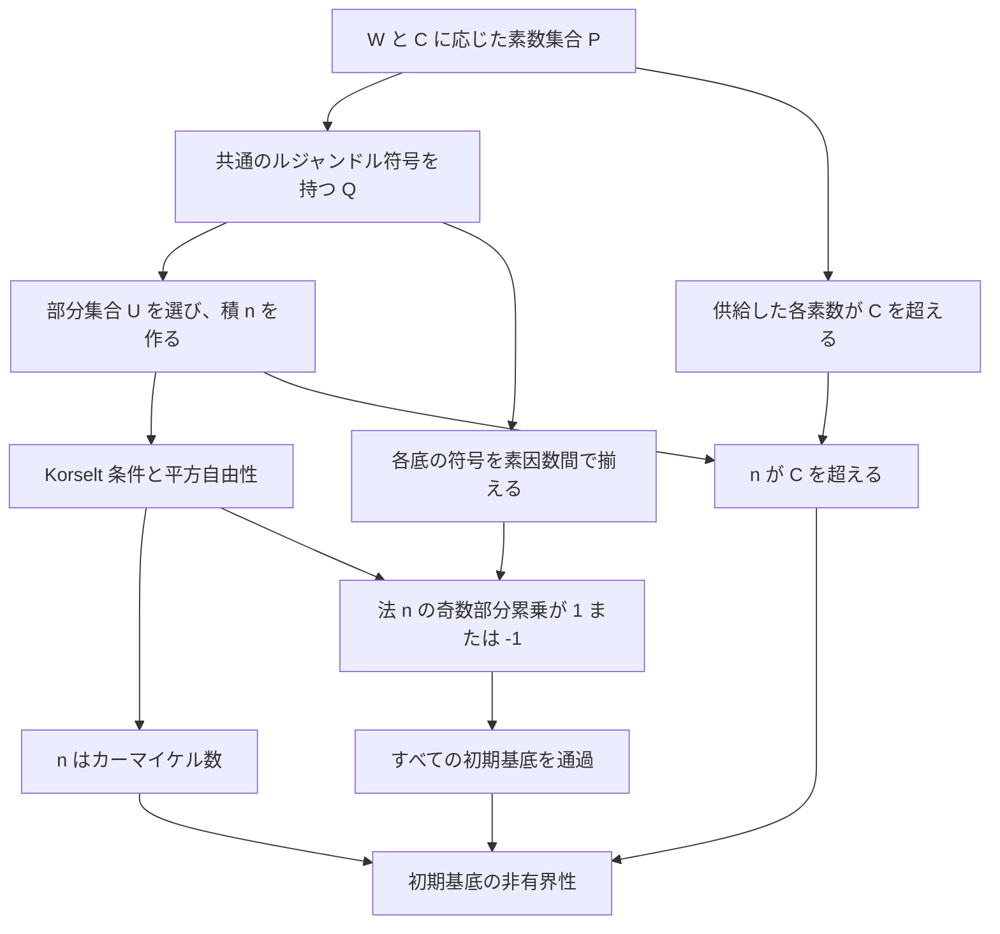

# `agp_initial_bases_unbounded` の証明詳解と、その系

> **対象宣言**：
> `PseudoPrime.PrimeTest.MillerRabin.AGP.agp_initial_bases_unbounded`
>
> **対象ファイル**：
> `PseudoPrime/PrimeTest/MillerRabin/AGP/InitialBasesUnbounded.lean`
>
> **系として説明する宣言**：
> `agp_finite_prime_bases`、`exists_a006945_candidate`、`exists_a006945_term`

## 1. 何を証明しているのか

`agp_initial_bases_unbounded` は、次の命題を証明する。

> **任意の自然数 $B,C$ に対して、$C$ より大きいカーマイケル数 $n$ で、
> すべての正の整数基底 $1\le b\le B$ の強い Miller–Rabin テストを通過するものが存在する。**

数学的には、

$$
\boxed{
\forall B,C\in\mathbb{N},\quad
\exists n\in\mathbb{N},\quad
C<n\ \land\ \operatorname{Carmichael}(n)\
\land\
\forall b\in\mathbb{N},\
0<b\le B\Rightarrow\operatorname{MRPass}(n,b).
}
$$

という主張である。対象版の公開定理には、GRH や解析的な素数供給命題を仮定として渡す必要はない。
無条件の計数データ存在定理を、初期基底の通過性と下限条件を構成する定理へ渡している。[F2]・[F4]・[A1]

ここで、二つのパラメータの役割を区別する。

- **$B$ は基底の値の上限**である。対象は整数 $1,2,\ldots,B$ であり、最初の $B$ 個の素数という意味ではない。
  $B\ge4$ なら合成数基底も含まれる。
- **$C$ は構成する数の下限**である。結論は $n>C$ という厳密不等式である。
- **$B$ と $C$ は独立に指定できる。** $B=C$ や $B\le C$ を仮定していない。
- **一つの $n$ が対象のすべての基底を同時に通過する。** 基底ごとに異なる $n$ を選ぶ命題ではない。

特に、$B$ を固定したまま $C$ を任意に大きくできる。
このため、固定した初期区間の全基底を通過するカーマイケル数は非有界であり、無限に存在する。
この非有界性は、今回の公開命題そのものに含まれている。
第9節では、その系として有限素数基底での通過数の存在、OEIS A006945 の候補の存在、
そして自然数の最小元としての各項の存在を順に導く。

### 1.1 Miller–Rabin の通過条件

奇数 $n>1$ に対し、

$$
n-1=2^s d,\qquad d\text{ は奇数}
$$

と分解する。ここで、

$$
s=v_2(n-1),\qquad d=\frac{n-1}{2^s}
$$

である。底 $b$ が強い Miller–Rabin テストを通過する条件は、

$$
\operatorname{MRPass}(n,b)
\iff
b^d\equiv1\pmod n
\quad\lor\quad
\exists j\in\mathbb{N},\ 
j<s\ \land\ b^{2^j d}\equiv-1\pmod n.
$$

後半は「最初に $b^d$ を計算し、その後の平方操作の途中で、$s$ 回分の候補のいずれかが
$-1$ になる」という条件である。$j=0$ も許されるので、最初の $b^d$ が $-1$ の場合も通過する。

Lean では、分解を `Nat.maxPowDvdDiv 2 (n - 1)` で表すか、

- `padicValNat 2 (n - 1)`：$s$。
- `Nat.divMaxPow (n - 1) 2`：$d$。

で表す。合同式は `ZMod n` 内の等式として記述される。

`StrongMillerRabinPass` がこの条件を名前付きの述語にしたものであり、
`strongMillerRabinWithBase_eq_true_iff_pass` が実行可能な単一底テストとの対応を与える。
したがって、ここでの通過条件はプロジェクトの実装と接続されている。[F5]

### 1.2 カーマイケル数と Korselt の判定法

カーマイケル数とは、合成数 $n$ で、$n$ と互いに素なすべての整数 $b$ に対して、

$$
b^{n-1}\equiv1\pmod n
$$

が成り立つものである。証明では、次の Korselt の判定条件を使う。

$$
\begin{aligned}
n\text{ はカーマイケル数}
\iff {}&
n>2,\quad n\text{ は合成数},\\
&n\text{ は平方自由},\\
&\forall p\mid n,\quad
p\text{ が素数なら }p-1\mid n-1.
\end{aligned}
$$

「平方自由」とは、どの素数の二乗でも割り切れないことである。実装は
`Nat.isCarmichael_iff_korselt` に上の条件を渡す。[F8]

カーマイケル性だけで、指定した底の強い Miller–Rabin テストを通過するとは限らない。
この証明は、さらに各素因数における二次剰余の符号を揃え、強い通過条件まで保証する。
その仕組みを第7節で説明する。

### 1.3 命題の Lean 定義

`AGPInitialBasesUnbounded` は `FiniteBases.lean` で次のように定義されている。[F2]

```lean
def AGPInitialBasesUnbounded : Prop :=
  ∀ B C : ℕ,
    ∃ a : ℕ,
      C < a ∧
        Nat.IsCarmichael a ∧
          ∀ b : ℕ,
            0 < b →
              b ≤ B →
                let (s, d) := Nat.maxPowDvdDiv 2 (a - 1)
                (b : ZMod a) ^ d = 1 ∨ ∃ j < s, (b : ZMod a) ^ (2 ^ j * d) = -1
```

ここで `a` が本文の $n$ に対応する。量化の順序は、

$$
\forall B\ \forall C\ \exists n\ \forall b
$$

である。$n$ は $B,C$ に応じて選べるが、一度選んだ $n$ は $1\le b\le B$ のすべてを通過する。
Miller–Rabin の負符号の枝で使う $j$ は、各基底 $b$ に応じて選んでよい。

$B=0$ の場合、$0<b\le B$ を満たす基底はないので、通過性の条件は空虚になる。
それでも $C$ を超えるカーマイケル数の存在は要求される。
基底 $0$ は定義から除外されている。奇数 $n>1$ に対するその剰余累乗は $0$ となり、
通過条件を満たさないためである。

### 1.4 記号の使い分け

解析部分と Miller–Rabin 部分では、ソース中の `d` や `q` が異なる役割で使われる。
本文では次のように区別する。

| 記号 | 意味 |
|---|---|
| $S$ | 第9節で系として扱う有限素数基底集合 |
| $W$ | 同時に扱う有限基底集合。主定理では $W=\{1,\ldots,B\}$ |
| $B$ | 初期基底 $1,\ldots,B$ の上限 |
| $C$ | 構成するカーマイケル数に要求する下限 |
| $L$ | 部分集合積を $1$ にするための補助法 |
| $\lambda(L)$ | カーマイケル関数。単元群 $(\mathbb{Z}/L\mathbb{Z})^\times$ の指数 |
| $k$ | 素数候補を $p=d_p k+1$ と表す共通の係数 |
| $d_p$ | $p-1=d_p k$ を満たす $L$ の約数 |
| $P$ | 解析的計数から供給される素数集合 |
| $Q$ | $P$ のうち、基底ごとのルジャンドル記号が一致する部分集合 |
| $U$ | $Q$ から選ぶ、積が $1\bmod L$ となる部分集合 |
| $n$ | 最終的な積 $\prod_{p\in U}p$ |
| $s,d$ | $n-1=2^s d$ における二進指数と奇数部分 |
| $q$ | 計数データで、小さい素数を除去するための閾値 |
| $x,y$ | 素数候補の上限と、$L$ の約数を数える上限 |

$\lambda(L)$ と「$n$ がカーマイケル数である」という性質は別の概念である。
前者は任意の正整数 $L$ に付随する算術関数で、後者は構成する合成数 $n$ の性質である。

## 2. 対象ファイルの証明を読む

### 2.1 公開定理の本体

新しい対象版の公開定理は、次の証明項で与えられている。[F4]

```lean
theorem agp_initial_bases_unbounded :
    AGPInitialBasesUnbounded :=
  agp_initial_bases_unbounded_of_progression_count_data
    AnalyticNumberTheory.AGP.agp_progression_count_data_exists_unconditional
```

型の観点では、次の二つを合成している。

$$
\begin{aligned}
&\texttt{agp\_progression\_count\_data\_exists\_unconditional}
:
\texttt{AGPProgressionCountDataExists},\\
&\texttt{agp\_initial\_bases\_unbounded\_of\_progression\_count\_data}
:
\texttt{AGPProgressionCountDataExists}
\to
\texttt{AGPInitialBasesUnbounded}.
\end{aligned}
$$

ここは `by` で始まる tactic 証明ではなく、定理を関数として直接適用する証明項である。
必要な解析的データの存在証明を、そのデータから目標の数を構成する定理に渡すと、
`AGPInitialBasesUnbounded` の証明が得られる。

### 2.2 計数データから初期基底の非有界性への橋渡し

同じファイルの中間定理は次のとおりである。[F4]

```lean
theorem agp_initial_bases_unbounded_of_progression_count_data
    (hdata : PseudoPrime.AnalyticNumberTheory.AGP.AGPProgressionCountDataExists) :
    AGPInitialBasesUnbounded :=
  agp_initial_bases_unbounded_of_prime_supply
    (PseudoPrime.AnalyticNumberTheory.AGP.agp_prime_supply_of_progression_count_data hdata)
```

これは、計数データを素数集合の供給命題へ変換し、次に有限構成を適用するという二段の合成である。

| 段階 | 実際に使う宣言 | 得られる内容 |
|---|---|---|
| 無条件の解析的存在 | `agp_progression_count_data_exists_unconditional` | 必要な計数データがすべての有限正基底集合 $W$ と下限 $C$ に対して存在 |
| 計数から素数集合 | `agp_prime_supply_of_progression_count_data` | 十分多数の、指定条件を持つ素数 $P$ |
| 有限構成 | `exists_carmichael_strongMillerRabin_pass_all_of_large_progression_primes` | $W$ の全基底を通過するカーマイケル数となる部分積 |
| 初期区間と下限の処理 | `agp_initial_bases_unbounded_of_prime_supply` | 任意の $C$ を超え、$1,\ldots,B$ をすべて通過する数 |
| 上二層の合成 | `agp_initial_bases_unbounded_of_progression_count_data` | 計数データから `AGPInitialBasesUnbounded` |
| 公開結論 | `agp_initial_bases_unbounded` | 解析的入力を外部仮定に残さない初期基底の非有界性 |

有限素数集合へ制限する `agp_finite_prime_bases` は、この公開定理から導く下流の系である。
その位置付けは第9節で述べる。[F1]

### 2.3 中心となる有限構成の接続を逐行で説明する

`agp_initial_bases_unbounded_of_prime_supply` が、
初期基底区間と任意の下限を、有限の素数集合からの構成へ接続する。
対象版の証明は次のとおりである。[F4]

```lean
theorem agp_initial_bases_unbounded_of_prime_supply
    (hsupply : PseudoPrime.AnalyticNumberTheory.AGP.AGPProgressionPrimeSupply) :
    AGPInitialBasesUnbounded := by
  apply agpInitialBasesUnbounded_iff.mpr
  intro B C
  let W : Finset ℕ := Finset.Icc 1 B
  have hWpos : ∀ b ∈ W, 0 < b := by
    intro b hb
    have hmem : b ∈ Finset.Icc 1 B := by simpa only [W] using hb
    exact lt_of_lt_of_le Nat.zero_lt_one (Finset.mem_Icc.mp hmem).1
  obtain ⟨L, k, P, hL, hlambda, hkL, hP, hsize⟩ := hsupply W C hWpos
  have hNeZeroL : NeZero L := ⟨Nat.ne_of_gt (Nat.lt_trans Nat.zero_lt_two hL)⟩
  have hNeZeroLambda : NeZero (ArithmeticFunction.carmichael L) :=
    ⟨Nat.ne_of_gt (lt_of_lt_of_le (by decide : 0 < 3) hlambda)⟩
  obtain ⟨U, hUP, hUcard, hUcar, hpass⟩ :=
    @exists_carmichael_strongMillerRabin_pass_all_of_large_progression_primes L hNeZeroL hL hlambda
      hNeZeroLambda W P k hkL (fun p hp => (hP p hp).1) (fun p hp => (hP p hp).2.1)
      (fun p hp => (hP p hp).2.2.1) (fun p hp => (hP p hp).2.2.2.1) hWpos
      (fun p hp b hb => (hP p hp).2.2.2.2.2 b hb) hsize
  refine ⟨∏ p ∈ U, p, ?_, hUcar, ?_⟩
  · have hUpos : 0 < U.card := lt_of_lt_of_le (by decide : 0 < 2) hUcard
    obtain ⟨p, hpU⟩ := Finset.card_pos.mp hUpos
    have hpC : C < p := (hP p (hUP hpU)).2.2.2.2.1
    have hprodPos : 0 < ∏ q ∈ U.erase p, q := by
      apply Finset.prod_pos
      intro q hq
      exact Nat.Prime.pos ((hP q (hUP (Finset.mem_erase.mp hq).2)).1)
    calc
      C < p := hpC
      _ ≤ p * ∏ q ∈ U.erase p, q := Nat.le_mul_of_pos_right p hprodPos
      _ = (∏ q ∈ U.erase p, q) * p := Nat.mul_comm _ _
      _ = ∏ q ∈ U, q := Finset.prod_erase_mul U id hpU
  · intro b hb hbB
    have hbW : b ∈ W := by
      change b ∈ Finset.Icc 1 B
      exact Finset.mem_Icc.mpr ⟨Nat.succ_le_iff.mpr hb, hbB⟩
    exact hpass b hbW
```

この証明の各段階を説明する。

#### ① 通過条件を名前付き述語へ揃える

```lean
apply agpInitialBasesUnbounded_iff.mpr
```

`agpInitialBasesUnbounded_iff` は、

```lean
AGPInitialBasesUnbounded ↔ AGPInitialBasesUnboundedWithDecomposition
```

という同値であり、証明は `by rfl` である。
明示的な `let (s, d)` の式と、`StrongMillerRabinPass` による式は定義上同じなので、
この一行で以後の証明に使う表記へ目標を揃える。[F3]

これは初期基底の命題と有限素数基底の命題との相互同値を使う操作ではない。

#### ② 任意の $B,C$ を固定し、対象基底の有限集合を作る

```lean
intro B C
let W : Finset ℕ := Finset.Icc 1 B
```

$B,C$ はここで任意の自然数として固定される。$W$ は閉区間の有限集合で、

$$
W=\{b\in\mathbb{N}:1\le b\le B\}
$$

である。

続く `hWpos` は、各 $b\in W$ が正であることを確認する。
`Finset.mem_Icc.mp hmem` は $1\le b$ と $b\le B$ の組を返すので、
その第一成分と $0<1$ をつなぐ。

$B=0$ なら $W=\varnothing$ であり、この正値性条件は空虚に成立する。
この場合のための特別な分岐は必要ない。

#### ③ 素数供給命題を適用する

```lean
obtain ⟨L, k, P, hL, hlambda, hkL, hP, hsize⟩ := hsupply W C hWpos
```

ここで `hsupply` に基底集合 $W$、下限 $C$、正値性を渡す。
返されるデータは次のとおりである。

| Lean の名前 | 数学的内容 |
|---|---|
| `L`、`k`、`P` | 補助法、共通係数、有限素数集合 |
| `hL` | $2<L$ |
| `hlambda` | $3\le\lambda(L)$ |
| `hkL` | $\gcd(k,L)=1$ |
| `hP` | 各 $p\in P$ の算術条件と下限条件 |
| `hsize` | $2^{\lvert W\rvert}\lfloor\lambda(L)\log L\rfloor<\lvert P\rvert$ |

`hP p hp` は、右に結合した六つの論理積である。
長い `.2.2...` は、そのうち必要な成分を取り出している。

| 式 | 取り出す条件 |
|---|---|
| `(hP p hp).1` | $p$ は素数 |
| `(hP p hp).2.1` | $\gcd(p,L)=1$ |
| `(hP p hp).2.2.1` | ある $d_p\mid L$ に対して $p=d_pk+1$ |
| `(hP p hp).2.2.2.1` | $p\bmod4=3$ |
| `(hP p hp).2.2.2.2.1` | $C<p$ |
| `(hP p hp).2.2.2.2.2` | すべての $b\in W$ に対して $p\nmid b$ |

これらの供給条件が、解析的計数からどのように得られるかは第4節と第10節で説明する。

#### ④ 非零性を、後続の定理が要求する型の形で用意する

```lean
have hNeZeroL : NeZero L := ...
have hNeZeroLambda : NeZero (ArithmeticFunction.carmichael L) := ...
```

$2<L$ より $L\ne0$、$3\le\lambda(L)$ より $\lambda(L)\ne0$ である。
この二行は、新しい仮定を追加するものではなく、すでに得た下界から
`NeZero` の証明を構成している。

後続の適用には先頭に `@` が付いている。
そのため、本来は暗黙に補われる非零性の型クラス引数も、
`hNeZeroL`、`hNeZeroLambda` として明示的に渡している。
この箇所は `letI` によって新しいインスタンスを登録するコードではない。

#### ⑤ 有限構成を適用する

`exists_carmichael_strongMillerRabin_pass_all_of_large_progression_primes` に、
上の算術条件、基底の正値性、個数下界を渡すと、次の結果が得られる。

| 名前 | 内容 |
|---|---|
| `U` | 選ばれた素数の有限集合 |
| `hUP` | $U\subseteq P$ |
| `hUcard` | $2\le\lvert U\rvert$ |
| `hUcar` | $\prod_{p\in U}p$ はカーマイケル数 |
| `hpass` | すべての $b\in W$ が、その積を法とする強いテストを通過 |

この内部で行われるのが、符号クラスの選択、単元群の部分集合積、
Korselt 条件、局所符号からの通過性である。第5〜7節で詳述する。[F6]

**$C<p$ は、この有限構成の定理には渡していない。**
カーマイケル性と通過性を作る部分には不要であり、
後で積の下界を示すために、外側の `hP` の中へ保持している。

#### ⑥ 積を存在量化の証人に選ぶ

```lean
refine ⟨∏ p ∈ U, p, ?_, hUcar, ?_⟩
```

ここで、

$$
n=\prod_{p\in U}p
$$

を存在証人として提示する。カーマイケル性は `hUcar` ですでに埋まる。
残る目標は、

1. $C<n$。
2. 任意の $0<b\le B$ に対する通過性。

の二つである。

#### ⑦ 積が任意の下限を超えることを示す

`hUcard` から $U$ は非空なので、一つの $p\in U$ を選ぶ。
`hUP hpU` により $p\in P$ となり、`hP` の第五成分から $C<p$ を得る。

次に、残りの因子の積、

$$
R_p=\prod_{q\in U\setminus\{p\}}q
$$

が正であることを証明する。
`Finset.mem_erase.mp hq` の第二成分で $q\in U$ を得て、
$U\subseteq P$、$P$ の各要素の素数性、`Nat.Prime.pos` を順に用いる。
`Finset.prod_pos` がこれらをまとめて $0<R_p$ を与える。

最後の `calc` は、

$$
\begin{aligned}
C
&<p\\
&\le pR_p\\
&=R_p\,p\\
&=\prod_{q\in U}q
\end{aligned}
$$

という不等式の連鎖である。

自然数の正の積は少なくとも $1$ なので、$p\le pR_p$ が成立する。
最後の `Finset.prod_erase_mul` は、取り除いた一因子を積へ戻す等式である。

下限の証明だけなら $U$ の非空性で十分である。
$|U|\ge2$ という強い条件は、上流で積が合成数となることを保証するためにも使われている。

#### ⑧ 初期区間の全基底に通過性を返す

```lean
intro b hb hbB
have hbW : b ∈ W := by
  change b ∈ Finset.Icc 1 B
  exact Finset.mem_Icc.mpr ⟨Nat.succ_le_iff.mpr hb, hbB⟩
exact hpass b hbW
```

`hb : 0 < b` と `hbB : b ≤ B` を受け取る。
自然数について $0<b$ は $1\le b$ と同値なので、
`Nat.succ_le_iff.mpr hb` を使い、二つの不等式を $b\in W$ にまとめる。

後は `hpass b hbW` を適用するだけである。
合成数基底も最初から $W$ に含まれているため、
素数基底の通過性から積の基底の通過性を推論する必要はない。

この最後の枝が終わると、任意に固定した $B,C$ に対して
$n>C$、カーマイケル性、初期区間の全通過性が揃う。
それが `AGPInitialBasesUnbounded` の証明である。

## 3. 証明全体の数学的な構成

固定した $B,C$ に対し、$W=\{1,\ldots,B\}$ とする。
構成の目標は、一つの数 $n$ について、次の三条件を揃えることである。

$$
n>C,\qquad n\text{ はカーマイケル数},\qquad
\forall b\in W,\quad b^d\equiv\sigma_b\pmod n,\quad \sigma_b\in\{1,-1\}.
$$

ここで $d$ は $n-1$ の奇数部分である。
最後の条件は、Miller–Rabin の通過性を保証する十分条件になる。



解析部分は、必要な算術条件を満たす素数を十分多数供給する。
有限構成はその素数からカーマイケル数と通過性を作り、
外側の積の下界の議論が $n>C$ を保証する。

## 4. 計数データから素数集合を取り出す

### 4.1 計数データに記録されるもの

`AGPProgressionCountData W C c₀ x₀` は、必要な整数と不等式をまとめた構造体である。
構造体の定義自体は存在証明ではない。そのインスタンスを実際に作る定理が第10節の解析部分にある。
[A3]

約数集合を、

$$
\mathcal{D}(L,y)=\{e\in\mathbb{N}:e\mid L,\ e\le y\}
$$

と書く。$L>2$ なので、この集合の要素は正である。

主要なデータは次のように整理できる。

| データ | 意味 |
|---|---|
| $L>2$、$L$ は平方自由 | 補助法の算術条件 |
| $\lambda(L)\ge3$ | 有限群の長さ評価を使うための条件 |
| $k>0$、$\gcd(k,L)=1$ | 候補 $ek+1$ の単射性と、後の合同条件の結合 |
| $q\ge\max(C,\sup W)$ | 小さい素数を除くための閾値 |
| $r\mid L$、$r$ 素数なら $r\le q$ | 残った素数を $L$ と互いに素にする条件 |
| $x\ge x_0$ | 解析的評価を適用できる範囲 |
| `hProp15Input` | 約数範囲や算術条件を含む Proposition 1.5 型の入力 |
| `hlower`、`hProp15` | 必要な個数より候補素数が多いという二段の評価 |

具体的に、

$$
H_W(L)=2^{|W|}\left\lfloor\lambda(L)\log L\right\rfloor
$$

と置く。`hlower` と `hProp15` は、

$$
H_W(L)+q
<
\frac{c_0}{\varphi(4)\log x}\,|\mathcal{D}(L,y)|
\le
\#\left\{
e\in\mathcal{D}(L,y):
\begin{array}{l}
ek+1\text{ は素数},\\
ek+1\le x,\\
ek+1\equiv3\pmod4
\end{array}
\right\}
$$

を与える。$\varphi(4)=2$ なので中央の係数は $c_0/(2\log x)$ である。
`reliableProp15Coefficient` がこの係数を定義している。[A3]・[A4]

`AGPProgressionCountDataExists` の量化順序は、

$$
\exists c_0>0,\ \exists x_0\ge2,\ 
\forall W,C,\ 
\bigl(\forall b\in W,\ b>0\bigr)
\Rightarrow
\exists X,\ \exists\text{計数データ}
$$

である。$c_0,x_0$ は $W,C$ に依存しない。さらに、

$$
X\ge2^{56},\qquad x=X^5,\qquad q\le X
$$

も含まれる。これらのスケール条件は、有限構成が直接必要とするものより強いが、
解析的構成を接続する際の仕様になっている。[A3]

### 4.2 小さい候補を高々 $q$ 個捨てる

`agp_prime_supply_of_progression_count_data` は、上の候補から、

$$
p=ek+1\le q
$$

となるものを除く。[A2]

$k>0$ なので $e\mapsto ek+1$ は単射である。$q$ 以下の正整数は $q$ 個しかないから、
取り除く候補は高々 $q$ 個である。従って、残った素数集合 $P$ は、

$$
|P|>H_W(L)
=
2^{|W|}\left\lfloor\lambda(L)\log L\right\rfloor
$$

を満たす。

ここで元の下界が $H_W(L)+q$ **より厳密に大きい**ことが、除去後の厳密不等式を保証する。

### 4.3 一つの閾値で三つの条件を保証する

残った素数 $p$ は $p>q$ なので、次の三つが同時に得られる。

1. **要求された下限を超える**：$q\ge C$ より $p>C$。
2. **補助法と互いに素**：$L$ の素因数は $q$ 以下なので $p\nmid L$。従って $\gcd(p,L)=1$。
3. **どの基底も割らない**：各 $b\in W$ は $0<b\le q<p$ なので $p\nmid b$。

最後の点には、基底が正であることが必要である。$b=0$ では、どの素数も $b$ を割ってしまう。

この結果をまとめたものが `AGPProgressionPrimeSupply` である。後続の有限構成で使う条件を
式で書くと、

$$
\begin{gathered}
L>2,\qquad \lambda(L)\ge3,\qquad \gcd(k,L)=1,\\
\forall p\in P:\quad
p\text{ は素数},\quad
\gcd(p,L)=1,\quad
p=d_p k+1\ (d_p\mid L),\\
p\equiv3\pmod4,\qquad p>C,\qquad
\forall b\in W,\ p\nmid b,\\
|P|>
2^{|W|}\left\lfloor\lambda(L)\log L\right\rfloor.
\end{gathered}
$$

解析の大部分は、この条件群を実現するために使われる。[A2]

## 5. ルジャンドル記号の符号を揃える

### 5.1 素数を符号ベクトルで分類する

各 $p\in P$ に対し、

$$
\operatorname{sig}_W(p)=
\left(\left(\frac bp\right)\right)_{b\in W}
$$

というベクトルを考える。$\left(\frac bp\right)$ はルジャンドル記号で、

- $p\nmid b$ で $b$ が法 $p$ の平方なら $1$。
- $p\nmid b$ で平方でなければ $-1$。

である。すでに $p\nmid b$ を確保したので、$0$ という値は現れない。

したがって、符号ベクトルは高々 $2^{|W|}$ 通りである。[F6]

### 5.2 鳩の巣原理を適用する

$$
N=\left\lfloor\lambda(L)\log L\right\rfloor
$$

と置く。$|P|>2^{|W|}N$ だから、鳩の巣原理より、同じ符号ベクトルを持つ集合
$Q\subseteq P$ があり、

$$
|Q|>N
$$

を満たす。

$|Q|$ が整数であることから、これは、

$$
|Q|>\lambda(L)\log L
$$

を意味する。一般に、非負実数 $x$ と整数 $m$ について、
$\lfloor x\rfloor<m$ と $x<m$ は同値だからである。

この操作は `exists_large_common_legendre_signature_class` で実装されている。
Lean では、

```lean
Base := {b // b ∈ W}
Color := Base → Bool
```

という型を使い、各座標で「ルジャンドル記号が $1$ か」を記録する。
その後、記号が $0$ ではないことを使って、同じ色から同じ符号を回復する。[F6]

### 5.3 揃う符号は基底ごとに異なってよい

得られる条件は、

$$
\forall b\in W,\ \exists\sigma_b\in\{1,-1\},\ 
\forall p\in Q,\quad
\left(\frac bp\right)=\sigma_b
$$

である。

例えば、底 $2$ の符号は全素因数で $1$、底 $3$ の符号は全素因数で $-1$、という状況でよい。
揃える対象は、**固定した一つの底に対する、異なる素因数での符号**である。

`common_legendre_sign_of_pairwise_signatures` は、$Q$ の素数を一つ基準に選び、
ペアごとの等式から、この一つの符号 $\sigma_b$ を取り出す。[F6]

## 6. 積が $1\bmod L$ になる部分集合を選ぶ

### 6.1 単元群に移す

$Q$ の各素数は $L$ と互いに素なので、

$$
G=(\mathbb{Z}/L\mathbb{Z})^\times
$$

の元を定める。この群の指数は $\lambda(L)$ である。つまり、すべての $g\in G$ に対して、

$$
g^{\lambda(L)}=1
$$

となる。

有限アーベル群における零和部分集合定理を、乗法表記で適用すると、十分長い列には積が $1$ となる
非空部分集合が存在する。実装は `Additive` を使って単元群を加法表記に直し、零和定理を適用してから、
積の等式へ戻している。[F7]・[C1]

### 6.2 同じ剰余類に来る異なる素数を区別する

異なる素数 $p,q$ が、法 $L$ で同じ剰余類になることはあり得る。その場合も、元の素数は異なる
因子として保持する必要がある。

実装は、$Q$ の要素をラベルとして保った列を使う。群に写した像を単純に集合化して重複を消す処理は
行わない。選び出されるのは元のラベルの部分集合なので、最終積には各素数を一回ずつ使える。
このことが後の平方自由性にもつながる。[F7]・[C1]

### 6.3 $\lambda(L)\log L$ という閾値の理由

$m=\lambda(L)$ とする。利用する有限群の評価では、

$$
r=
\left\lfloor m\log\frac Lm\right\rfloor+m
$$

個のラベルがあれば、非空の積 $1$ の部分集合を確保できる。

$m\ge3$ より $\log m\ge1$ であるため、

$$
m\log\frac Lm+m
=
m\log L-m\log m+m
\le m\log L.
$$

従って、

$$
r\le\lfloor m\log L\rfloor.
$$

一方、$|Q|>m\log L$ だから、

$$
|Q|-1\ge\lfloor m\log L\rfloor.
$$

つまり、**$Q$ から一つの要素を除いても**、有限群定理に必要な長さが残る。
これを使うのが、

`exists_nonempty_unit_product_eq_one_of_card_gt_carmichael_log_erase`

である。零和定理そのもののフーリエ的な証明は付録Aで説明する。[F7]・[C1]

### 6.4 なぜ $kL+1$ を除くのか

非空の部分集合が一つの素数だけだった場合、その積は合成数にならない。
この可能性を除くため、あらかじめ $kL+1$ を候補から取り除く。

実際、

$$
p=d_p k+1,\qquad d_p\mid L,\qquad p\equiv1\pmod L
$$

なら、

$$
L\mid d_p k.
$$

$\gcd(k,L)=1$ だから $L\mid d_p$。すでに $d_p\mid L$ なので $d_p=L$、従って、

$$
p=kL+1
$$

となる。これは、一要素の積が $1\bmod L$ になる唯一の候補である。

`eq_exception_of_unit_eq_one_of_progression` がこの事実を証明する。
その候補を除いて零和定理を適用すれば、

$$
U\subseteq Q\setminus\{kL+1\},\qquad
|U|\ge2,\qquad
\prod_{p\in U}p\equiv1\pmod L
$$

を得る。対応する補題は、

`exists_two_or_more_unit_product_eq_one_of_progression`

である。[F7]

### 6.5 Korselt 条件を満たす積を作る

$$
n=\prod_{p\in U}p
$$

と置く。

各 $p=d_p k+1$ は $1\bmod k$ なので、

$$
n\equiv1\pmod k.
$$

部分集合の選び方から $n\equiv1\pmod L$ でもある。$\gcd(k,L)=1$ より、

$$
kL\mid n-1.
$$

さらに各 $p\in U$ について、

$$
p-1=d_p k\mid kL.
$$

従って、

$$
p-1\mid kL\mid n-1.
$$

$U$ は異なる素数の集合で、$|U|\ge2$ だから、$n$ は平方自由な合成数である。
これで Korselt の全条件が揃い、$n$ はカーマイケル数となる。

この段階をまとめる主要な補題は、

- `isCarmichael_finset_prime_product`。
- `isCarmichael_finset_prime_product_of_progression_unit_product`。
- `exists_carmichael_subset_of_progression_primes`。

である。[F6]・[F8]

補助法 $L$ の平方自由性と、最終積 $n$ の平方自由性は、証明上の由来が異なる。
前者は解析的な約数計数に用いられ、後者は異なる素数を一度ずつ掛けたことから得られる。
有限構成の部分だけを見ると、$n$ の平方自由性を $L$ の平方自由性から移しているわけではない。

## 7. すべての対象基底で強いテストを通過する理由

ここが、単なるカーマイケル数の構成を、強擬素数の構成へ進める段階である。

### 7.1 素因数側の二進指数を $1$ に揃える

各 $p\in U$ は、

$$
p\equiv3\pmod4
$$

なので、

$$
p-1=2u_p,\qquad u_p=\frac{p-1}{2}\text{ は奇数}
$$

と書ける。

一方、$n$ は奇数で、

$$
n-1=2^s d,\qquad d\text{ は奇数},\qquad s\ge1.
$$

Korselt 条件 $p-1\mid n-1$ から、

$$
u_p\mid d.
$$

したがって、ある奇数 $t_p$ により、

$$
d=u_p t_p
$$

と書ける。$d$ と $u_p$ がともに奇数なので、商 $t_p$ も奇数である。

ソースでは一般的な奇数部分の整除補題 `odd_part_korselt` を使い、
$p\bmod4=3$ から `Nat.divMaxPow (p - 1) 2 = p / 2` を確認している。
奇素数 $p$ の自然数除算 $p/2$ は $(p-1)/2$ に等しい。[F9]・[F10]

### 7.2 Euler の規準で局所的な累乗を求める

固定した $b\in W$ を考える。$p\nmid b$ なので Euler の規準により、

$$
b^{u_p}
\equiv
\left(\frac bp\right)
\pmod p.
$$

よって、

$$
\begin{aligned}
b^d
&=b^{u_p t_p}\\
&=\left(b^{u_p}\right)^{t_p}\\
&\equiv
\left(\frac bp\right)^{t_p}\\
&=\left(\frac bp\right)\\
&=\sigma_b
\pmod p.
\end{aligned}
$$

$t_p$ が奇数であるため、$1$ も $-1$ も、そのまま保存される。

これが `residual_power_eq_legendre_at_prime` の内容である。
Euler の規準を奇数倍の指数へ拡張する部分では、
`pow_half_mul_odd_eq_legendre` を使う。[F9]・[F11]

### 7.3 同じ符号を法 $n$ へ持ち上げる

以上により、$n$ のどの素因数 $p$ に対しても、

$$
b^d\equiv\sigma_b\pmod p
$$

となる。$n$ は平方自由なので、

$$
b^d\equiv\sigma_b\pmod n
$$

が従う。

数学的には中国剰余定理に対応する議論だが、実装は環の同型を明示的に構成せず、整除性で処理する。

- $\sigma_b=1$ なら、各素因数 $p$ が $b^d-1$ を割る。
- $\sigma_b=-1$ なら、各素因数 $p$ が $b^d+1$ を割る。
- 平方自由な $n$ は、その相異なる素因数の積なので、$n$ 自身が同じ整数を割る。

`residual_power_eq_sign_of_squarefree` がこの処理を行い、
`dvd_of_squarefree_prime_dvd` によって素因数ごとの整除性をまとめる。[F9]

正符号の場合に `0 < b` を使う一つの理由は、自然数の差 $b^d-1$ を環に写すために
$1\le b^d$ を必要とすることである。

### 7.4 $j=0$ だけで負符号の枝を満たせる

結局、

$$
b^d\equiv1\pmod n
\quad\text{または}\quad
b^d\equiv-1\pmod n
$$

である。

- 正符号なら、Miller–Rabin の第一の通過条件。
- 負符号なら、第二の通過条件で $j=0$ を選ぶ。

$n>1$ は奇数なので $s\ge1$ であり、$0<s$ という範囲条件も満たす。

`strongMillerRabinPass_of_residual_power_eq_sign` の負符号の枝は、
実際に `⟨0, hs, ...⟩` という証人を返している。[F9]

ここで必要なのは **各素因数に対する $v_2(p-1)=1$** である。
$n$ 自身について $v_2(n-1)=1$ を仮定してはいない。
$n\equiv1\pmod4$ で $s$ が大きい場合でも、$j=0<s$ は使える。

### 7.5 有限構成をまとめる定理

`exists_carmichael_strongMillerRabin_pass_all_of_large_progression_primes` は、
第5節から第7節までを合成し、

$$
\exists U\subseteq P,\quad
|U|\ge2,\quad
\operatorname{Carmichael}\!\left(\prod_{p\in U}p\right),\quad
\forall b\in W,\ 
\operatorname{MRPass}\!\left(\prod_{p\in U}p,b\right)
$$

を返す。[F6]

内部の流れは、

1. 共通符号クラス $Q$ を選ぶ。
2. $|Q|>\lambda(L)\log L$ に変換する。
3. 部分集合積からカーマイケル数を作る。
4. $Q$ の共通符号を $U$ に制限する。
5. `strongMillerRabinPass_all_of_signature_class` を適用する。

となる。

## 8. 証明全体を数学の文章でまとめる

これまでの構成を使えば、`agp_initial_bases_unbounded` の数学的な証明は、
次のようにまとめられる。[F4]・[F6]・[A1]・[A2]

任意の自然数 $B,C$ を固定し、$W=\{1,\ldots,B\}$ と置く。
無条件の解析的存在定理と計数データから素数集合への変換により、
第4節の条件を満たす $L,k,P$ を取る。

各 $p\in P$ を $W$ に対するルジャンドル符号で分類する。
$P$ の個数下界と鳩の巣原理により、同じ符号ベクトルを持ち、
$|Q|>\lambda(L)\log L$ を満たす $Q\subseteq P$ が存在する。

単元群の部分集合積の定理を使い、$kL+1$ を避けた集合 $U\subseteq Q$ で、
$|U|\ge2$ かつ $\prod_{p\in U}p\equiv1\pmod L$ を満たすものを選ぶ。
$n=\prod_{p\in U}p$ と置くと、$p-1\mid kL\mid n-1$ と平方自由性・合成数性により、
$n$ はカーマイケル数である。

$n-1=2^s d$ と分解する。各素因数は $3\bmod4$ で、
各基底 $b\in W$ に対するルジャンドル符号は素因数間で共通だから、
$b^d\equiv\sigma_b\pmod n$、$\sigma_b\in\{1,-1\}$ となる。
従って $W$ のすべての基底が強いテストを通過する。

さらに $U$ は非空で、各 $p\in U$ が $C$ より大きい。
残りの素因数の積は正なので、$C<p\le n$ が成立する。
以上で $n>C$、カーマイケル性、全初期基底の通過性が得られた。

$B,C$ は任意だったから、`AGPInitialBasesUnbounded` が成り立つ。
この構成で必要な解析的存在定理の内容は第10節で説明する。

## 9. 主定理の系：有限素数基底と OEIS A006945

### 9.1 固定した初期区間について無限に存在する

$B$ を固定し、

$$
\mathcal{A}_B
=
\left\{
n\in\mathbb{N}:
\operatorname{Carmichael}(n)
\land
\forall b,\ 1\le b\le B\Rightarrow\operatorname{MRPass}(n,b)
\right\}
$$

と置く。定理は、

$$
\forall C\in\mathbb{N},\quad
\exists n\in\mathcal{A}_B,\quad C<n
$$

を直接述べている。

もし $\mathcal{A}_B$ が有限なら、そのすべての要素を上から抑える自然数 $C$ が取れる。
しかし定理は、その $C$ を超える $\mathcal{A}_B$ の要素を与えるので矛盾する。
従って $\mathcal{A}_B$ は無限集合である。

これは「$B$ を大きくするたびに別の反例がある」という主張だけではない。
**同じ $B$ に対して、反例を任意に大きく取れる**という主張である。

### 9.2 任意の有限正基底集合にも適用できる

正の整数からなる有限基底集合 $W_0$ と下限 $C$ を与え、
$B=\sup W_0$ と置く。

各 $b\in W_0$ は $0<b\le B$ だから、定理から得られる $n>C$ は
$W_0$ のすべての基底を通過する。
従って、任意の有限な正の整数基底集合についても、その全基底を通過する
カーマイケル数が任意に大きく存在する。

$W_0$ の要素に素数性は必要ない。
必要なのは、その要素が正で、有限集合であることである。

### 9.3 系1：任意の有限素数基底集合を通過するカーマイケル数

`agp_finite_prime_bases` は、主定理から次の命題を取り出す系である。

$$
\forall S\subseteq\mathbb{P},\quad
S\text{ が有限}
\Rightarrow
\exists a\in\mathbb{N},\quad
\operatorname{Carmichael}(a)
\land
\forall p\in S,\ \operatorname{MRPass}(a,p).
$$

つまり、どの有限素数集合を選んでも、そのすべてを底とする強い Miller–Rabin テストを
通過するカーマイケル数が一つ存在する。定義 `AGPFinitePrimeBases` は
`FiniteBases.lean` にあり、系の証明は `FiniteBasesTheorem.lean` にある。[F1]・[F2]

```lean
theorem agp_finite_prime_bases :
    AGPFinitePrimeBases :=
  agp_finite_prime_bases_of_initial agp_initial_bases_unbounded
```

#### 初期区間の主定理から有限集合への帰着

与えられた有限素数集合 $S$ に対して、

$$
B=\sup S
$$

とする。Lean では `S.sup id` を用いる。空集合でもこの値は $0$ と定義される。

主定理へ、基底上限として $B$、数に対する下限としても $B$ を渡すと、

$$
B<a,\qquad
\operatorname{Carmichael}(a),\qquad
\forall b,\ 0<b\le B\Rightarrow\operatorname{MRPass}(a,b)
$$

を満たす $a$ が得られる。

各 $p\in S$ は素数なので $p>0$ であり、上限の定義から $p\le B$ である。
したがって、この通過性を $b=p$ に適用すればよい。

実際の補題 `agp_finite_prime_bases_of_initial` の中心部分は、

```lean
  let B : ℕ := S.sup id
  obtain ⟨a, _, haCar, haPass⟩ := hDep B B
  refine ⟨a, haCar, ?_⟩
  intro p hp
  have hp_le : p ≤ B := by
    simpa [B] using (Finset.le_sup (s := S) (f := id) hp)
  exact haPass p (Nat.Prime.pos (hS p hp)) hp_le
```

となっている。`hDep` は、主定理の通過条件を `StrongMillerRabinPass` の表記へ直したもの、
`hS` は $S$ の各要素が素数であるという仮定である。[F1]・[F3]

`obtain ⟨a, _, haCar, haPass⟩` の `_` は、$B<a$ の証明を落としている。
この系の結論は、下限を伴わない存在形式であるためである。
固定した $S$ に対する非有界性も第9.2節から得られるが、
`agp_finite_prime_bases` の表示された結論には、その不等式は残さない。

### 9.4 OEIS A006945 の候補集合と添字

次の二つの系を述べるために、まず候補と最小項の意味を定める。

主定理で使った合成数 $n$ と、数列の添字を混同しないよう、
この節の数学的説明では、**通過を要求する素数基底の個数を $r$、候補の整数を $a$** と書く。
以下の Lean コードの引数 `n` は、この $r$ に対応する。

素数を、

$$
p_0=2,\quad p_1=3,\quad p_2=5,\quad p_3=7,\quad\ldots
$$

と $0$ 始まりで並べる。Lean の `Nat.nth Nat.Prime k` が $p_k$ に対応する。

候補集合を、

$$
\mathcal{C}_r
=
\left\{
a\in\mathbb{N}:
\begin{array}{l}
1<a,\quad a\text{ は奇数},\quad a\text{ は非素数},\\
\forall k<r,\quad \operatorname{MRPass}(a,p_k)
\end{array}
\right\}
$$

とする。$a>1$ と非素数性を合わせて、$a$ が合成数であることを表している。

`A006945Candidate r a` は、$a\in\mathcal{C}_r$ という条件を表す。
ソースの定義は次のとおりである。[F12]

```lean
noncomputable def A006945Candidate (n a : ℕ) : Prop :=
  let (s, d) := Nat.maxPowDvdDiv 2 (a - 1)
  1 < a ∧
    Odd a ∧
    ¬Nat.Prime a ∧
    ∀ k < n,
      (Nat.nth Nat.Prime k : ZMod a) ^ d = 1 ∨
        ∃ j < s, (Nat.nth Nat.Prime k : ZMod a) ^ (2 ^ j * d) = -1
```

条件は `k < n` なので、調べるのは最初の $r$ 個の素数である。
$r=0$ なら基底条件だけが空虚になり、$\mathcal{C}_0$ はすべての奇合成数の集合となる。
その最小元は $9$ である。

#### OEIS の公式添字との対応

OEIS A006945 は公式には添字 $1$ から始まり、最初の項は $9$ である。
このソースは $0$ 始まりで扱うので、コードの添字 $r$ は、公式 OEIS の添字 $r+1$ に対応する。
[OEIS]

次の二つの系で存在を保証する最小元を $\mu_r=\min\mathcal{C}_r$ と書くと、対応は次のようになる。
数値は OEIS に記載された値であり、この節の一般的な存在証明が各数値の最小性まで
計算して証明するという意味ではない。

| Lean の引数 $r$ | 通過を要求する素数基底 | $\mu_r$ | OEIS A006945 の公式添字 |
|---:|---|---:|---:|
| $0$ | なし | $9$ | $1$ |
| $1$ | $2$ | $2047$ | $2$ |
| $2$ | $2,3$ | $1373653$ | $3$ |
| $3$ | $2,3,5$ | $25326001$ | $4$ |
| $4$ | $2,3,5,7$ | $3215031751$ | $5$ |

このように、**素数列の添字 $k$、素数基底の個数 $r$、OEIS の公式添字 $r+1$** を区別する必要がある。

### 9.5 系2：`exists_a006945_candidate` — どの基底数でも候補が存在する

`exists_a006945_candidate` は、

$$
\boxed{
\forall r\in\mathbb{N},\quad
\exists a\in\mathbb{N},\quad a\in\mathcal{C}_r
}
$$

を述べる。すなわち、最初の何個の素数を調べる場合であっても、
それらをすべて通過する奇合成数が存在する。[F14]

公開定理は、有限素数基底の系を、そのまま条件付きの候補構成へ渡す形である。

```lean
theorem exists_a006945_candidate (n : ℕ) : ∃ a : ℕ, A006945Candidate n a :=
  exists_a006945_candidate_of_agp MillerRabin.AGP.agp_finite_prime_bases n
```

この定理と次節の `exists_a006945_term` の名前空間は、
`PseudoPrime.PrimeTest` である。ファイルは `MillerRabin/` 以下に置かれているが、
この二つの宣言の完全修飾名に `MillerRabin` は入らない。

#### 候補を構成する補題の証明

条件付きの `exists_a006945_candidate_of_agp` の証明は次のとおりである。[F14]

```lean
theorem exists_a006945_candidate_of_agp (hAGP : MillerRabin.AGP.AGPFinitePrimeBases) (n : ℕ) :
    ∃ a : ℕ, A006945Candidate n a := by
  let S : Finset ℕ := (Finset.range n).image (Nat.nth Nat.Prime)
  have hS : ∀ p ∈ S, Nat.Prime p := by
    intro p hp
    obtain ⟨k, _, rfl⟩ := Finset.mem_image.mp hp
    exact Nat.prime_nth_prime k
  have hAGPWithDecomposition := MillerRabin.AGP.agpFinitePrimeBases_iff.mp hAGP
  obtain ⟨a, haCarmichael, haPass⟩ := hAGPWithDecomposition S hS
  have ha1 : 1 < a := lt_trans (by decide : 1 < 2) haCarmichael.two_lt
  refine ⟨a, (a006945Candidate_iff n a).mpr ?_⟩
  refine ⟨ha1, haCarmichael.odd, haCarmichael.not_prime, ?_⟩
  intro k hk
  have hmem : Nat.nth Nat.Prime k ∈ S := by
    exact Finset.mem_image.mpr ⟨k, Finset.mem_range.mpr hk, rfl⟩
  exact haPass _ hmem
```

数学的な流れは四段階である。

**第一に、最初の $r$ 個の素数を有限集合へまとめる。**

$$
S_r=\{p_k:0\le k<r\}.
$$

これが、

```lean
(Finset.range n).image (Nat.nth Nat.Prime)
```

に対応する。`Finset.range n` は $0,\ldots,n-1$ の集合であり、その素数列への像を取っている。
$r=0$ の場合も自然に空集合となるため、最後の素数 $p_{r-1}$ を個別に扱う必要がない。

**第二に、この集合へ有限素数基底の系を適用する。**

$S_r$ の各要素が素数であることは `Nat.prime_nth_prime k` で証明できる。
通過条件を名前付き述語へ直した `hAGPWithDecomposition` に $S_r$ とその素数性を渡すと、

$$
\operatorname{Carmichael}(a),\qquad
\forall p\in S_r,\quad\operatorname{MRPass}(a,p)
$$

を得る。

この適用に必要なのは集合の有限性と各要素の素数性であり、
この箇所で $|S_r|=r$ を別途証明する必要はない。

**第三に、カーマイケル性から候補の基礎条件を取り出す。**

| 使用する証明 | 得られる条件 |
|---|---|
| `haCarmichael.two_lt` | $2<a$ |
| $1<2$ との推移律 | $1<a$ |
| `haCarmichael.odd` | $a$ は奇数 |
| `haCarmichael.not_prime` | $a$ は非素数 |

これで `A006945Candidate` の最初の三条件が揃う。

**第四に、添字ごとの通過性を取り出す。**

$k<r$ なら $k\in\operatorname{range}(r)$ なので、$p_k\in S_r$ である。
Lean では、

```lean
Finset.mem_image.mpr ⟨k, Finset.mem_range.mpr hk, rfl⟩
```

がこの所属を構成する。最後に `haPass _ hmem` を適用すれば、
$p_k$ を底とする通過性が得られる。

`a006945Candidate_iff` は、候補の定義を `StrongMillerRabinPass` の形で書き直す
定義的同値である。その証明は `by rfl` なので、ここで新たな数論的主張を使っているわけではない。
[F13]

以上により、$\mathcal{C}_r$ の非空性が、すべての $r$ について無条件に得られる。

### 9.6 系3：`exists_a006945_term` — 各添字で最小項が存在する

`IsA006945Term` は、候補集合の最小元であることを表す述語である。[F12]

```lean
noncomputable def IsA006945Term (n a : ℕ) : Prop :=
  IsLeast {b : ℕ | A006945Candidate n b} a
```

数学的には、

$$
\operatorname{IsA006945Term}(r,a)
\iff
a\in\mathcal{C}_r
\ \land\
\forall b\in\mathcal{C}_r,\quad a\le b.
$$

すなわち、$a$ 自身が候補であり、ほかのどの候補よりも大きくないことを要求する。
単に一つの候補を見つけただけでは、この最小性はまだ得られていない。

しかし、第9.5節により $\mathcal{C}_r$ は非空であり、自然数の非空部分集合には最小元が存在する。
従って、

$$
\boxed{
\forall r\in\mathbb{N},\quad
\exists a\in\mathbb{N},\quad
\operatorname{IsA006945Term}(r,a)
}
$$

が従う。これが `exists_a006945_term` である。[F14]

```lean
theorem exists_a006945_term (n : ℕ) : ∃ a : ℕ, IsA006945Term n a := by
  classical
  obtain ⟨a, ha⟩ := exists_a006945_candidate n
  let h : ∃ b : ℕ, A006945Candidate n b := ⟨a, ha⟩
  exact ⟨Nat.find h, Nat.isLeast_find h⟩
```

証明の各行は、次の役割を持つ。

1. `classical` により、後続の最小値選択に必要な古典的な判定可能性などを使えるようにする。
2. `exists_a006945_candidate n` から、ある候補 `a` とその証明 `ha` を得る。
3. `h : ∃ b, A006945Candidate n b` として、候補集合の非空性をまとめる。
4. `Nat.find h` を最小の候補として選び、`Nat.isLeast_find h` によって最小性を証明する。

`Nat.find` には、条件を満たす自然数が実際に存在するという証明 `h` を渡している。
候補が存在しない場合に既定値を置いているわけではない。

この段階では新しい素数分布の評価は必要ない。
数論的な存在証明で非空性を確保した後、自然数の整列性によって最小元を選んでいる。

#### 一意性も最小性から従う

公開定理の型は `∃ a` であり、`∃! a` ではない。
それでも、$a,a'$ がどちらも同じ候補集合の最小元なら、

$$
a\le a',\qquad a'\le a
$$

なので、反対称性から $a=a'$ が従う。したがって各添字の最小項は一意に定まる。

ここで述べた一意性は最小性からの数学的帰結であり、
このファイルに別の一意性定理が公開されているという意味ではない。

### 9.7 カーマイケルな存在証人と、全候補の最小元を区別する

第9.5節の構成で最初に得る $a$ はカーマイケル数である。
一方、`A006945Candidate` の定義はカーマイケル性を要求しない。
その条件は、奇合成数であることと、指定された素数基底を通過することだけである。

従って `Nat.find` が最小化する範囲は、

$$
\{\text{最初の }r\text{ 個の素数基底をすべて通過する奇合成数}\}
$$

全体である。カーマイケル数だけを取り出して、その中で最小化するものではない。

例えば $r=0$ の最小元は $9$ であるが、$9$ は平方自由ではないのでカーマイケル数ではない。
また $r=1$ の最小元は OEIS の表に対応する $2047=23\cdot89$ であり、

$$
89-1=88\nmid2046=2047-1
$$

なので、これもカーマイケル数ではない。[OEIS]

つまり、AGP によるカーマイケル数は候補集合の非空性を保証するための証人である。
そこから選ばれる最小元に、同じカーマイケル性が自動的に引き継がれるわけではない。

### 9.8 三つの系が保証する範囲

主定理からの各段階を並べると、次のように役割が分かれる。

| 定理 | 結論 | 導出で使うこと |
|---|---|---|
| `agp_initial_bases_unbounded` | 任意の $B,C$ について、$C$ を超え初期基底 $1,\ldots,B$ を全通過するカーマイケル数 | 解析的計数と有限構成 |
| `agp_finite_prime_bases` | 任意の有限素数基底集合を全通過するカーマイケル数 | 有限集合の上界を初期基底上限に選ぶ |
| `exists_a006945_candidate` | 任意の $r$ について、最初の $r$ 個の素数基底を全通過する奇合成数 | 最初の $r$ 個の素数を有限集合にする |
| `exists_a006945_term` | そのような奇合成数の最小元 | 非空な自然数集合の整列性 |

最後の二つの系にも GRH などの追加仮定はない。

また、`A006945Candidate r a` は、最初の $r$ 個の素数基底での通過だけを要求する。
次の基底 $p_r$ で棄却されることまでは要求しない。
そのため最小項が隣接する添字で同じ値になることも、定義に反しない。

実際、候補集合は、

$$
\mathcal{C}_{r+1}\subseteq\mathcal{C}_r
$$

という関係を持つので、最小値は $\mu_r\le\mu_{r+1}$ となる。
ただし、真の不等式 $\mu_r<\mu_{r+1}$ が必ず成り立つとは限らない。

`exists_a006945_term` は、全添字における最小項の存在を保証する定理である。
個々の項の具体的数値を確定するには、その値の通過性に加え、
それより小さい奇合成数が候補にならないことを別に示す必要がある。
第11節の剰余累乗の計算も、その数の候補性を確認するものであり、
その計算だけで候補集合の最小性まで証明するものではない。


## 10. 必要な計数データを無条件に構成する

有限構成の難しい入力は、第4節の大きな個数下界である。
この節では、それをどこから得るかを、現在のソースで使われている経路に沿って説明する。

対象版の経路は、一般的な Proposition 1.5 型の一様計数命題を外から仮定する形ではない。
必要な法 $m=1,4$ と選択したスケールに対する素数計数を用い、
最終的に必要な有限データを直接作っている。[A1]・[A5]

### 10.1 最初に確保する算術級数の素数下界

素数の対数重み付き計数関数を、

$$
\theta(x;M,a)
=
\sum_{\substack{p\le x\\p\ {\rm prime}\\p\equiv a\pmod M}}\log p
$$

とする。ソースの `thetaInProgressionReal` がこの関数に対応する。[A6]

`exists_unconditional_narrow_theta_supply` は、絶対定数

$$
J\ge2,\qquad D,\qquad X_\theta
$$

の存在を与える。任意の整数 $Z\ge X_\theta$ に対して例外集合 $E_Z$ を選べ、

$$
|E_Z|\le D,\qquad
e\in E_Z\Rightarrow e>1\text{ かつ }e\nmid4
$$

となる。

そして、

$$
\begin{gathered}
m\in\{1,4\},\qquad e_0>0,\qquad \gcd(e_0,m)=1,\\
M=e_0m>1,\qquad M^J\le Z,\qquad \gcd(a,M)=1,\\
\forall e\in E_Z,\quad e\nmid M
\end{gathered}
$$

を満たすとき、

$$
\boxed{
\theta(e_0Z^3;M,a)
\ge
\frac{e_0Z^3}{2\varphi(M)}.
}
\tag{10.1}
$$

ここでは Miller–Rabin の奇数部分 $d$ と区別するため、ソースで `d` と書かれた約数変数を
$e_0$ と記した。[A7]

この命題で重要なのは、量化の順序である。

$$
\exists J,D,X_\theta\quad
\forall Z\ge X_\theta\quad
\exists E_Z\quad
\forall M,a\ \cdots
$$

例外集合は、法や剰余類を選ぶ前に一つ選ばれる。
したがって同じスケールで多数の約数をまとめて扱える。
一方、異なるスケールでは、例外集合が異なってよい。

### 10.2 零点密度が、一様に有限な例外集合を与える

上の素数下界の解析的な基盤には、`exists_primitiveCharacterFamily_log_free_density` がある。
これは、ある絶対定数 $A_*,C_*>0$ により、

$$
N_{\mathrm{fam}}(R,\sigma)
\le
C_*R^{A_*(1-\sigma)}
\qquad
\left(R\ge2,\ \frac12\le\sigma\le1\right)
\tag{10.2}
$$

を与える。[A8]

ここで $N_{\mathrm{fam}}$ は、導手が $R$ 以下の原始非主ディリクレ指標について、
完成 $L$ 関数の

$$
\sigma\le\Re\rho\le1,\qquad |\Im\rho|\le R
$$

にある零点を、解析的重複度も含めて数えた総数である。

現在の依存経路は、おおむね次の内容を実装している。

| 段階 | 役割 |
|---|---|
| 零点検出 | 零点があると、対数微分の適切な高階導関数が大きくなることを使う |
| 有限和への変換 | 大きな素数に支えを持つ有限 Dirichlet 多項式の大きな値へ移す |
| 共通の高さ格子 | 指標・零点ごとにばらばらな評価を、一つの有限族の評価へまとめる |
| 重複度を保つ計数 | 零点の重複度添字を保持して、零点数から平均二乗の下界を得る |
| hybrid 大篩の上界 | 同じ平均二乗を上から評価する |
| 密度評価 | 上下の評価を比較し、$\exp(O((1-\sigma)\log R))$ 型の個数評価を得る |

対応する主要ファイルは `GeneralScaleDensity.lean`、
`GeneralScaleIncidence.lean`、`HighPrimeIncidence.lean` である。
$\sigma$ が $1$ に近い帯で得た評価を、その他の範囲での粗い $O(R^5)$ 評価と合わせ、
(10.2) の全範囲へ延長している。[A8]・[A9]

次に、$\log R\ge2$ を満たす十分大きい $R$ に対して、

$$
\sigma_R=1-\frac1{\log R}
$$

と置く。導手が $R$ 以下の原始非主指標について、$\Re\rho\ge\sigma_R$、
$|\Im\rho|\le R$ を満たす零点を持つ導手を例外に選ぶと、

$$
|E_R|
\le
N_{\mathrm{fam}}(R,\sigma_R)
\le
C_*R^{A_*/\log R}
=
C_*e^{A_*}.
$$

従って、

$$
D=\left\lceil C_*e^{A_*}\right\rceil
$$

のように、$R$ に依存しない個数上限を取れる。
`exceptionalFamilyConductors` は零点出現集合の「導手への有限像」であり、
`exists_uniform_exceptionalFamilyConductors_card_bound` がこの計算を実装する。[A10]

この方法は、すべての $L$ 関数に同じ強い零点排除を要求するのではなく、
必要な一様性を保ちながら、悪い導手を一定個数の例外にまとめている。

### 10.3 法 $4$ を使うための処理と、明示公式からの下界

最後には $p\equiv3\pmod4$ を満たす素数が必要である。
そのため、例外集合に導手 $4$ が残っていると、法 $4e_0$ がすべて排除されるおそれがある。

実装では `exceptionalFamilyConductorsAwayFromFour` により導手 $4$ を集合から外し、
その寄与を別の無条件評価で処理する。
これは「導手 $4$ の $L$ 関数には問題になる零点がない」と仮定する操作ではない。
固定導手 $4$ の寄与は
[FamilyFullHalfScaleBudget.lean](../PseudoPrime/AnalyticNumberTheory/DirichletLFunction/LogFreeDensity/FamilyFullHalfScaleBudget.lean)
などで別に評価する。例外集合の側では、導手 $4$ の除去と導手 $1,2$ の排除により、
残る例外について $e\nmid4$ を保証する。[A10]・[A11]

原始導手が $4$ でなく、例外を避けた指標については、有限の高さまで、

$$
\Re\rho<1-\frac1{\log R}
$$

という隔たりが得られる。これを重み付き零点密度と組み合わせて、
明示公式中の零点和を主項に比べて小さくする。

この過程では、平滑化した指標和

$$
F_\chi(x)
=
\sum_{n\le x}\Lambda(n)\log(x/n)\chi(n)
$$

の差 $F_\chi(x)-F_\chi(x/2)$ を使う。
非主指標の寄与の総和を小さくし、主指標の主項、素数冪の補正、切断誤差を合わせることで、

$$
\theta(x;M,a)\ge\frac{x}{2\varphi(M)}
$$

を得る。[A11]・[A12]

`exists_uniform_polynomial_theta_supply` は、ある整数 $b\ge1$ と一様な閾値により、

$$
M\le\sqrt R,\qquad x\ge R^{8b}
$$

などの条件下で、この下界を与える。

`exists_unconditional_narrow_theta_supply` は、これを (10.1) の整数スケールへ変換する。
具体的には、

$$
h=4b,\qquad J=2h=8b,\qquad
R=\left\lceil Z^{1/h}\right\rceil
$$

と選ぶ。

すると、

$$
M^J\le Z
\Rightarrow
M^2\le Z^{1/h}\le R
\Rightarrow
M\le\sqrt R.
$$

また、$Z$ を十分大きくして丸め誤差を吸収すれば、

$$
R^{8b}=R^{2h}
\le2^{2h}Z^2
\le Z^3
\le e_0Z^3.
$$

これで $x=e_0Z^3$ に対して多項式スケールの素数下界を適用できる。
`rounded_polynomial_height_bounds` が天井関数を含む評価を担う。[A7]・[A12]

### 10.4 最初の素数集合から補助法 $L$ を作る

以後、$W$ と下限 $C$ を固定する。例外個数の上限 $D$ から、

$$
c_0=\frac1{128\cdot2^D},
\qquad
x_0=\max(2,X_\theta)
$$

を選ぶ。これらは $W,C$ に依存しない。[A5]

十分大きい整数 $u$ を取り、

$$
z=2^u,\qquad
N_0=\prod_{p\le z}p,\qquad
X=N_0^J,\qquad
q=X^5
$$

とする。$N_0$ は $z$ 以下の全素数の積であり、平方自由なので約数を $2^{\pi(z)}$ 個持つ。

さらに、

$$
t=
\left\lfloor
\frac{c_0z^2}{20Ju\log2}
\right\rfloor+1
$$

とする。スケール選択の定理は、下限条件に加えて、

$$
t-1<
\frac{c_0}{\log q}\,2^{\pi(z)},
\qquad
2\pi(1024t)\le t
\tag{10.3}
$$

および、

$$
\boxed{
10J(t+3)\log q
\left(
2^{|W|}q^2t\log q+q
\right)
<
c_0\,2^{\lfloor t/2\rfloor}
}
\tag{10.4}
$$

を同時に満たすように $u$ を選ぶ。[A13]

尺度 $X$ の例外集合を避けるように $N_0$ から素因数を除き、
$1$ を除く残存約数 $e_0>1$ に対して $m=1$ の素数下界を適用する。約数 $e_0\mid N_0$ は、

$$
e_0^J\le N_0^J=X
$$

を満たすので、この下界の適用範囲に入る。

その後、$1\le k_1\le X^3$ について有限平均を取り、一つの共通の $k_1$ に対して、

$$
r=e_0k_1+1,\qquad e_0\mid N_0,\qquad r\le q
$$

という形の異なる素数を $t$ 個選ぶ。ここで $k_1$ は初期構成の係数で、
最後に $p=d_pk+1$ を作る係数 $k$ とは区別する。[A14]

得られた素数集合を $S_0$ として、

$$
L=\prod_{\substack{r\in S_0\\r>1024t}}r
$$

と置く。小さい素数の個数は (10.3) により高々 $t/2$ だから、

$$
\omega(L)\ge t/2.
$$

また、残した素因数はすべて $1024t$ より大きいので、

$$
\sum_{\substack{r\mid L\\r\ {\rm prime}}}\frac1r
\le\frac1{1024}.
\tag{10.5}
$$

各 $r-1$ は $k_1N_0$ を割る。$L$ が平方自由であることとカーマイケル関数の性質から、

$$
\lambda(L)\mid k_1N_0.
$$

ソースでは、後に十分となる粗い評価、

$$
\lambda(L)\le q^2,\qquad
L\le q^t
\tag{10.6}
$$

を保持する。この $L$ は平方自由な奇数で、$L>2$、$\lambda(L)\ge3$ も満たす。
[A14]・[A15]

### 10.5 全約数が範囲に入る二段目のスケールを使う

次に、

$$
Y=(4qL)^J,\qquad x=Y^5,\qquad
y=\left\lfloor x^{2/5}\right\rfloor=Y^2
$$

を選ぶ。このため、すべての $e_0\mid L$ に対して、

$$
(4e_0)^J\le Y,\qquad e_0\le Y^2
$$

となる。[A13]・[A15]

従って「$y$ 以下の約数」は、このスケールでは $L$ の全約数であり、

$$
|\mathcal{D}(L,y)|
=
2^{\omega(L)}
\ge
2^{\lfloor t/2\rfloor}.
\tag{10.7}
$$

さらに、$L\le q^t$ から、

$$
2\log x
=
2\log(Y^5)
\le
10J(t+3)\log q.
\tag{10.8}
$$

(10.4)、(10.6)、(10.7)、(10.8) を合わせると、

$$
\begin{aligned}
2^{|W|}
\left\lfloor\lambda(L)\log L\right\rfloor+q
&\le
2^{|W|}q^2t\log q+q\\
&<
\frac{c_0\,2^{\lfloor t/2\rfloor}}
     {10J(t+3)\log q}\\
&\le
\frac{c_0}{2\log x}\,|\mathcal{D}(L,y)|.
\end{aligned}
\tag{10.9}
$$

これが第4節で必要だった `hlower` の不等式である。

#### (10.4) を実現できる増大率

スケール選択を支えるのは、

$$
\log q\le10J\,2^u u\log2,
\qquad
t=
\left\lfloor
\frac{c_0\,4^u}{20Ju\log2}
\right\rfloor+1
$$

という比較である。$t$ は $2^u u$ より速く増大するため、
$\lfloor t/2\rfloor\log2$ が $\log q$ の固定倍と定数項を上回るようにできる。

実装では、より具体的に、

$$
\log\frac{40J(2^{|W|}+1)}{c_0}
+
6\log q
<
\lfloor t/2\rfloor\log2
$$

を確保し、指数を取って、

$$
40J(2^{|W|}+1)q^6
<
c_0\,2^{\lfloor t/2\rfloor}
$$

を得る。(10.4) の左辺はこの左辺以下に抑えられる。[A13]

この経路では、特定の小さい範囲に約数がどれだけ集中するかを精密に推定する必要はない。
二段目のスケールに全約数を含め、約数個数の指数的な増大を利用している。

### 10.6 法 $4$ の素数を数え、$\gcd(k,L)=1$ を確保する

ここまでで、候補を生み出すだけの約数の個数が揃った。
次は、ある共通 $k$ に対して、

$$
p=e_0k+1,\qquad p\equiv3\pmod4
$$

となる素数が十分あることを示す。

尺度 $Y$ で改めて例外集合 $E_Y$ を選び、
`exceptionalFreePartForModulus L E_Y 4` により、例外を避けた部分 $L'\mid L$ を作る。
$L$ の平方自由性と $e\nmid4$ を使い、各例外について必要なら素因数を一つ取り除くことで、
対象法 $4e_0$ を例外から外す。除去する素因数は高々 $D$ 個なので、約数数の損失は高々
$2^D$ 倍で済む。[A16]

$L'$ の大きい約数 $e_0>q$ に対し、中国剰余定理で、

$$
p\equiv1\pmod{e_0},
\qquad
p\equiv3\pmod4
$$

を表す法 $4e_0$ の剰余類を選ぶ。$L$ は奇数だから $\gcd(e_0,4)=1$ であり、
この剰余類は法 $4e_0$ と互いに素になる。

(10.1) を $Z=Y$ で適用し、対数重みを外して素数個数の下界を得る。
候補素数を $p=e_0k+1$ と書くと、$p\le e_0Y^3$ なので $k$ は $Y^3$ 以下の範囲に入る。
[A5]・[A6]

ただし、後の Korselt 構成には $\gcd(k,L)=1$ が必要である。
もし素因数 $r\mid L$ が $k$ を割るなら、その素数候補は、

$$
p\equiv1\pmod{e_0r},
\qquad
p\equiv3\pmod4
$$

という、より細かい算術級数に含まれる。

`agp_coarse_sieve_bound` は、この悪い候補の数について、

$$
\pi(e_0Y^3;4e_0r,a)
\le
\frac{640}{3}\frac1r
\frac{e_0Y^3}{\varphi(4e_0)\log(Y^5)}
\tag{10.10}
$$

という無条件の篩評価を与える。[A17]

素数個数への変換では、ソースは既存の汎用補題を再利用し、$\theta\le\psi$ を経由して
素数冪の寄与を上から抑える。このため主項の係数として $1/2-10^{-6}$ を確保する。
$10^{-6}$ はこの変換に用いる誤差の余裕であり、$\theta$ 自体に高次の素数冪が含まれるという
意味ではない。対応する補題は
`primeCountInProgression_ge_half_minus_epsilon_main_term_of_theta_lower` と
`progressionTheta_millionth_error_bound_of_modulus_square_bound` である。[A6]

ここで (10.5) の逆数和を使うと、残る素数個数の係数は、

$$
\begin{aligned}
\beta
&=
\left(\frac12-\frac1{10^6}\right)
-
\frac{640}{3}\cdot\frac1{1024}\\
&=
\frac7{24}-\frac1{10^6}\\
&>\frac14.
\end{aligned}
$$

一方、$c_0=1/(128\cdot2^D)$ だから、

$$
16\cdot2^D c_0=\frac18<\frac14<\beta.
\tag{10.11}
$$

この余裕により、例外因子、小さい約数、有限平均の端数に伴う損失を吸収できる。
係数の等式と不等式は、それぞれ、

- `agp_fifth_power_average_coefficient_640_1024_value`。
- `agp_fifth_power_average_coefficient_640_1024_gt_quarter`。

で確認されている。[A6]

最後に、残った $(e_0,k)$ の組を $k$ ごとに数える有限平均により、
正の共通 $k$ で $\gcd(k,L)=1$ を満たし、

$$
\frac{c_0}{2\log x}\,|\mathcal{D}(L,y)|
\le
\#\left\{
e_0\in\mathcal{D}(L,y):
\begin{array}{l}
e_0k+1\text{ は素数},\\
e_0k+1\le x,\\
e_0k+1\equiv3\pmod4
\end{array}
\right\}
$$

となるものを選ぶ。

`agpProgressionCountData_of_fifth_power_theta_and_brun_titchmarsh` が、
この計数と (10.9) を組み合わせて、計数データのインスタンスを返す。
名前に `brun_titchmarsh` を含むが、今回渡される具体的な上界は、上記の係数 $640/3$ の
粗い篩評価である。[A5]・[A6]・[A17]

### 10.7 解析的存在定理の最後の合成

`UnconditionalProgressionCountData.lean` の証明は次のとおりである。[A1]

```lean
theorem agp_progression_count_data_exists_unconditional : AGPProgressionCountDataExists := by
  obtain ⟨J, D, Xtheta, hJ, hSupply⟩ := exists_unconditional_narrow_theta_supply
  exact agp_progression_count_data_exists_of_primorial_p2_and_theta_supply J D Xtheta hJ hSupply
```

ここまでの議論を対応させると、

- `exists_unconditional_narrow_theta_supply`：第10.1〜10.3節。
- `agp_progression_count_data_exists_of_primorial_p2_and_theta_supply`：第10.4〜10.6節。

である。

初期素数集合の構成も同じ無条件の $\theta$ 供給から行うため、
「必要な計数データを作るために、その計数データの存在を仮定する」という循環はない。
その後は第4〜8節の有限構成に接続され、第2節の公開定理の証明が成立する。

## 11. 初期基底をすべて通過する具体例

今回の命題に合わせて、

$$
n=3215031751=151\cdot751\cdot28351
$$

を考える。この数は、合成数基底を含む $1,\ldots,10$ のすべてを通過する。
従って、例えば、

$$
B=10,\qquad C=10^9
$$

に対する具体的な証人になる。

この例は、定理の一つの有限インスタンスと、局所符号による通過機構を確認するものである。
解析的な素数供給の全仮定を、この三素数で満たすと主張するものではない。

### 11.1 因数と Korselt 条件

$$
n-1=3215031750=2\cdot1607515875
$$

なので、$s=1$、$d=1607515875$ である。

| 素因数 $p$ | $p\bmod4$ | $p-1$ | $(n-1)/(p-1)$ |
|---|---:|---:|---:|
| $151$ | $3$ | $150$ | $21433545$ |
| $751$ | $3$ | $750$ | $4286709$ |
| $28351$ | $3$ | $28350$ | $113405$ |

三つは相異なる素数で、すべて $p-1\mid n-1$ を満たす。
従って $n$ は平方自由な合成数であり、Korselt の判定法によりカーマイケル数である。
また $n>10^9$ が成立する。

### 11.2 基底 $1,\ldots,10$ の通過性

各基底のルジャンドル符号と奇数部分累乗は次のとおりである。

| 基底 $b$ | $\left(\frac b{151}\right)$ | $\left(\frac b{751}\right)$ | $\left(\frac b{28351}\right)$ | $b^d\bmod n$ |
|---|---:|---:|---:|---:|
| $1$ | $1$ | $1$ | $1$ | $1$ |
| $2$ | $1$ | $1$ | $1$ | $1$ |
| $3$ | $-1$ | $-1$ | $-1$ | $3215031750$ |
| $4$ | $1$ | $1$ | $1$ | $1$ |
| $5$ | $1$ | $1$ | $1$ | $1$ |
| $6$ | $-1$ | $-1$ | $-1$ | $3215031750$ |
| $7$ | $-1$ | $-1$ | $-1$ | $3215031750$ |
| $8$ | $1$ | $1$ | $1$ | $1$ |
| $9$ | $1$ | $1$ | $1$ | $1$ |
| $10$ | $1$ | $1$ | $1$ | $1$ |

どの行でも素因数間で符号が揃っている。
正符号の場合は $b^d\equiv1\pmod n$、負符号の場合は $b^d\equiv-1\pmod n$ なので、
すべての基底で強いテストを通過する。

特に $4,6,8,9,10$ は合成数基底であり、定理が正の整数の初期区間全体を対象とすることが
具体的に表れている。表の各基底について、剰余累乗を個別に確認した。

### 11.3 同じ数が、さらに大きい基底上限にも使えるとは限らない

基底 $11$ では符号が、

$$
\left(
\left(\frac{11}{151}\right),
\left(\frac{11}{751}\right),
\left(\frac{11}{28351}\right)
\right)
=
(1,-1,-1)
$$

となり、揃わない。実際に、

$$
11^{1607515875}\bmod3215031751=2129160099
$$

であり、$1$ でも $n-1$ でもない。$s=1$ なので他の負符号候補はなく、この基底では不通過となる。

これは定理と矛盾しない。定理の順序は $\forall B,C\,\exists n$ なので、
$B$ を増やしたときには、新たな $n$ を選んでよい。
同じ一つの合成数がすべての正の整数基底を通過する、と主張しているのではない。

## 12. この定理から分かることと、定理文に含まれないこと

### 12.1 固定した初期基底だけでは、すべての整数の素数性を判定できない

どんな基底上限 $B$ を固定しても、$1,\ldots,B$ をすべて通過するカーマイケル数が
任意に大きく存在する。

したがって、入力サイズにかかわらず固定した初期区間だけを調べ、
通過したら常に素数と結論する方法は、すべての自然数に対して正しくはならない。
任意の固定有限正基底集合についても、第9.2節により同じ結論が得られる。

### 12.2 入力に依存する証人上界とは両立する

今回の命題の量化は、

$$
\forall B,C,\quad
\exists n>C,\quad
\forall b,\ 1\le b\le B\Rightarrow\operatorname{MRPass}(n,b)
$$

である。これに対して、入力 $n$ に応じた上界定理は、

$$
\forall n\text{ 合成数},\quad
\exists\text{証人 }p\le f(n)
$$

という形を取る。

前者では固定した $B$ に対して $n$ を選ぶ。
後者では選ばれた $n$ に応じて探索範囲 $f(n)$ が変わる。
そのため両者は矛盾しない。
有限の入力範囲に対する固定基底セットの正しさも、この定理によって否定されない。

### 12.3 明示的な最小反例や、最小証人の増大率は結論に含まれない

`agp_initial_bases_unbounded` は、与えられた $B,C$ に対する存在命題である。
条件を満たす最小の $n$ を返す実行可能なアルゴリズムや、その小さい明示上界を述べてはいない。

第9.6節の系 `exists_a006945_term` は、最初の一定個数の素数基底を通過する奇合成数の
最小元の存在まで保証する。この存在・最小性の証明と、具体的な項の数値を計算して確定することは
区別される。

また、原論文に含まれる最小証人の定量的下界すべてを、この一つの定理文が表しているわけでもない。
今回の公開命題が直接述べるのは、固定した初期区間の全基底を通過するカーマイケル数の非有界性である。

### 12.4 条件付き補題と、無条件の最終結論を区別する

`agp_initial_bases_unbounded_of_prime_supply` と
`agp_initial_bases_unbounded_of_progression_count_data` は、
供給命題を引数として受け取る条件付き補題である。

一方、公開定理 `agp_initial_bases_unbounded` は、その入力を
`agp_progression_count_data_exists_unconditional` で埋めている。
途中の補題に解析的入力があることは、最終結論にその入力が仮定として残ることを意味しない。
[F4]・[A1]

添付版の一部の説明コメントには、構築途中の段階を反映した
「解析的入力はまだ証明する必要がある」といった文言が残っている。
本文では、現在の定理型と実際の適用関係を優先して説明した。

## 付録A. 有限アーベル群の零和定理は何をしているか

第6節では零和定理を一つの道具として使った。
この付録では、ソースの `FiniteAbelianZeroSum.lean` に沿って、その証明の機構を説明する。
[C1]

### A.1 目標と指標

$G$ を有限アーベル群とし、加法表記を使う。整数 $m,L$ は $3\le m\le L$、$|G|\le L$ を
満たし、すべての $g\in G$ に対して $mg=0$ とする。今回の適用では $m=\lambda(L)$ であり、
$\lambda(L)\mid\varphi(L)$ と $\varphi(L)\le L$ により $m\le L$ が保証される。
$G$ の複素指標は、群準同型、

$$
\chi:G\to\mathbb{C}^\times
$$

である。

$\chi(g)^m=1$ だから、固定した $g$ における指標値は高々 $m$ 種類の $m$ 乗根になる。
また複素指標の個数は $|G|$ であり、この適用では $|G|\le L$ である。

列 $g_1,\ldots,g_r$ に、非空の零和部分集合、

$$
\varnothing\ne I\subseteq\{1,\ldots,r\},\qquad
\sum_{i\in I}g_i=0
$$

があることを示したい。

### A.2 前半で指標を減らし、後半で残りを処理する

各座標 $g_i$ に対して、まだ処理していない指標を、値 $\chi(g_i)$ ごとに分類する。
高々 $m$ クラスなので、最大のクラスには少なくとも $1/m$ の割合の指標が入る。

その値を $a_i$ に選び、そのクラスの指標を処理済みにする。
すると残る指標数は各段で高々 $1-1/m$ 倍になる。

前半の長さを、

$$
\ell=\left\lfloor m\log\frac Lm\right\rfloor+1
$$

とすれば、

$$
\left(1-\frac1m\right)^\ell L
\le e^{-\ell/m}L
<m.
$$

残る指標は整数個なので高々 $m-1$ 個である。
後半に $m-1$ 座標を用意し、それぞれの指標を一つずつ処理する。

こうして、すべての指標 $\chi$ に対し、

$$
a_i=\chi(g_i)
$$

となる座標 $i$ が少なくとも一つ存在するように、非零複素数 $a_i$ を選べる。
全長は、

$$
\ell+(m-1)
=
\left\lfloor m\log\frac Lm\right\rfloor+m
$$

であり、第6節の長さと一致する。

### A.3 群環のフーリエ変換で矛盾を得る

群環で、群元 $g$ に対応する基底を $[g]$ と書き、

$$
F=\prod_{i=1}^r\bigl(a_i[0]-[g_i]\bigr)
$$

を考える。

どの指標 $\chi$ で評価しても、

$$
\widehat F(\chi)
=
\prod_{i=1}^r\bigl(a_i-\chi(g_i)\bigr)
=
0
$$

となる。必ず一つの因子が零になるからである。
フーリエ反転によって $F=0$ が従う。

一方、非空の零和部分集合がないと仮定する。
積を展開したとき $[0]$ の係数に寄与するのは、すべての因子で $a_i[0]$ を選ぶ項だけになる。
従ってその係数は、

$$
\prod_{i=1}^r a_i\ne0.
$$

これは $F=0$ に矛盾する。よって非空の零和部分集合が存在する。

対応する主要宣言は、

- `exists_nonempty_zero_sum_of_character_matches`。
- `exists_greedy_character_prefix_residual_lt`。
- `exists_nonempty_zero_sum_of_log_prefix_and_tail`。
- `log_length_with_tail_le_floor_log`。
- `exists_nonempty_zero_sum_label_subset_of_segmented_length`。

である。最後のラベル付きの形を使うことで、法 $L$ で同じ剰余類になる異なる素数も
区別したまま部分集合を取り出せる。

## 付録B. ソースを読み直すための対応表

以下のパスはリポジトリ内のもの。各行のリンク先で、列挙した宣言名を検索すると、
本文に対応する証明へ進める。

### B.1 主定理と有限構成

| 参照 | ファイル | 主要宣言・役割 |
|---|---|---|
| F1 | [FiniteBasesTheorem.lean][F1] | `agp_finite_prime_bases`、主定理から有限素数基底へ制限した系 |
| F2 | [FiniteBases.lean][F2] | `AGPFinitePrimeBases`、`AGPInitialBasesUnbounded` |
| F3 | [FiniteBasesIff.lean][F3] | 二つの表記上の `_iff` |
| F4 | [InitialBasesUnbounded.lean][F4] | 主定理 `agp_initial_bases_unbounded` と、供給命題からの二つの橋渡し |
| F5 | [Decomposition.lean][F5] | `StrongMillerRabinPass`、実行可能なテストとの同値 |
| F6 | [LegendreSignature.lean][F6] | 共通符号クラスと有限構成の合成 |
| F7 | [UnitSubsetProduct.lean][F7] | 部分集合積、例外 $kL+1$ の除去 |
| F8 | [CarmichaelConstruction.lean][F8] | 素数積と Korselt の判定法 |
| F9 | [LocalLegendreCriterion.lean][F9] | 局所の符号から強い通過条件 |
| F10 | [KorseltCanonicalSign.lean][F10] | `odd_part_korselt` |
| F11 | [LocalLegendrePowers.lean][F11] | Euler の規準と奇数倍の指数 |
| F12 | [OEISA006945.lean][F12] | `A006945Candidate`、`IsA006945Term` |
| F13 | [OEISA006945Iff.lean][F13] | `a006945Candidate_iff` |
| F14 | [OEISA006945Existence.lean][F14] | `exists_a006945_candidate`、`exists_a006945_term` と AGP からの橋渡し |
| C1 | [FiniteAbelianZeroSum.lean][C1] | 指標を使う零和部分集合定理 |

### B.2 解析的構成

| 参照 | ファイル | 主要宣言・役割 |
|---|---|---|
| A1 | [UnconditionalProgressionCountData.lean][A1] | 無条件の計数データ存在 |
| A2 | [PrimeSupply.lean][A2] | 計数データから大きい素数集合 |
| A3 | [ProgressionCountData.lean][A3] | 計数データの構造体と存在命題 |
| A4 | [ReliableProp15.lean][A4] | 係数 $c_0/(\varphi(m)\log x)$ と約数の上限 |
| A5 | [PrimorialProgressionCountData.lean][A5] | $\theta$ 供給から計数データへの全体の組立て |
| A6 | [ProgressionTheta.lean][A6] | $\theta$ 計数、有限平均、係数の余裕 |
| A7 | [UnconditionalNarrowThetaSupply.lean][A7] | $M^J\le Z$ に対する無条件の供給 |
| A8 | [FamilyDensity.lean][A8] | 指標族の無条件 log-free 零点密度 |
| A9 | [GeneralScaleDensity.lean][A9] | $1$ に近い帯での密度評価 |
| A10 | [FamilyExceptionalConductors.lean][A10] | 例外導手集合と一様な個数上限 |
| A11 | [FamilyExceptionalWeightedGap.lean][A11] | 例外を避けた重み付き零点和 |
| A12 | [UniformPolynomialThetaSupply.lean][A12] | 多項式スケールの $\theta$ 下界 |
| A13 | [P2SeedScale.lean][A13] | 増大率の比較、全約数スケールの下界 |
| A14 | [PrimorialSeedCount.lean][A14] | 初期素数集合とその大きい素数因子の積 |
| A15 | [PrimorialP2SeedBridge.lean][A15] | 二段目のスケールと補助データ |
| A16 | [ExceptionalModuli.lean][A16] | 例外を避ける補助法の部分 |
| A17 | [BrunTitchmarshSpecialization.lean][A17] | `agp_coarse_sieve_bound` |

さらに深い零点密度と明示公式の経路を読む場合は、以下が接続点になる。

- [GeneralScaleIncidence.lean](../PseudoPrime/AnalyticNumberTheory/DirichletLFunction/LogFreeDensity/GeneralScaleIncidence.lean)：
  `exists_uniform_general_scale_occurrence_meanSquare_bound`。
- [HighPrimeIncidence.lean](../PseudoPrime/AnalyticNumberTheory/DirichletLFunction/LogFreeDensity/HighPrimeIncidence.lean)：
  `highPrimeFamilyGridMeanSquareSum_hybrid_bound`。
- [FamilyUniformHalfScale.lean](../PseudoPrime/AnalyticNumberTheory/DirichletLFunction/LogFreeDensity/FamilyUniformHalfScale.lean)：
  `exists_uniform_character_family_half_scale_bound`。
- [FamilyFullHalfScaleBudget.lean](../PseudoPrime/AnalyticNumberTheory/DirichletLFunction/LogFreeDensity/FamilyFullHalfScaleBudget.lean)：
  導手 $4$ を含めた指標族の評価。
- [ScalarThetaBudget.lean](../PseudoPrime/AnalyticNumberTheory/AGP/ScalarThetaBudget.lean)：
  主項以外の実数誤差項を一様に吸収する評価。
- [RoundedPolynomialHeight.lean](../PseudoPrime/AnalyticNumberTheory/AGP/RoundedPolynomialHeight.lean)：
  天井関数による高さ選択の評価。

## 付録C. 原論文との関係と今回の確認範囲

### C.1 参考文献

W. R. Alford, Andrew Granville, Carl Pomerance,
*On the difficulty of finding reliable witnesses*,
Algorithmic Number Theory, ANTS-I, Lecture Notes in Computer Science 877 (1994), pp. 1–16.

- [Granville による書誌情報と内容紹介](https://dms.umontreal.ca/~andrew/1994.php)
- [Granville による公開 PDF](https://dms.umontreal.ca/~andrew/PDF/carmichael.pdf)
- [Pomerance による公開 PDF](https://math.dartmouth.edu/~carlp/PDF/reliable.pdf)
- [OEIS A006945：公式の定義・添字・既知の項][OEIS]

著者による紹介にも、任意の有限素数集合について、それらのすべてを底とする強擬素数でもある
カーマイケル数が無限に存在する、という主張が明記されている。

本解説の証明手順と定数の説明は、添付された Lean ソースを根拠にしている。
特に、第10節の primorial を使う二段階の構成、全約数を含めるスケール、係数 $640/3$ の篩評価は、
今回のソースが最終結論へ到達する経路として説明したものである。
原論文の全補題を同じ順序・同じ定数で翻訳した、と主張するものではない。

[F1]: ../PseudoPrime/PrimeTest/MillerRabin/AGP/FiniteBasesTheorem.lean
[F2]: ../PseudoPrime/PrimeTest/MillerRabin/AGP/FiniteBases.lean
[F3]: ../PseudoPrime/PrimeTest/MillerRabin/AGP/FiniteBasesIff.lean
[F4]: ../PseudoPrime/PrimeTest/MillerRabin/AGP/InitialBasesUnbounded.lean
[F5]: ../PseudoPrime/PrimeTest/MillerRabin/Decomposition.lean
[F6]: ../PseudoPrime/PrimeTest/MillerRabin/AGP/LegendreSignature.lean
[F7]: ../PseudoPrime/PrimeTest/MillerRabin/AGP/UnitSubsetProduct.lean
[F8]: ../PseudoPrime/PrimeTest/MillerRabin/AGP/CarmichaelConstruction.lean
[F9]: ../PseudoPrime/PrimeTest/MillerRabin/AGP/LocalLegendreCriterion.lean
[F10]: ../PseudoPrime/PrimeTest/MillerRabin/KorseltCanonicalSign.lean
[F11]: ../PseudoPrime/PrimeTest/MillerRabin/LocalLegendrePowers.lean
[F12]: ../PseudoPrime/PrimeTest/MillerRabin/OEISA006945.lean
[F13]: ../PseudoPrime/PrimeTest/MillerRabin/OEISA006945Iff.lean
[F14]: ../PseudoPrime/PrimeTest/MillerRabin/OEISA006945Existence.lean
[C1]: ../PseudoPrime/Combinatorics/Additive/FiniteAbelianZeroSum.lean
[A1]: ../PseudoPrime/AnalyticNumberTheory/AGP/UnconditionalProgressionCountData.lean
[A2]: ../PseudoPrime/AnalyticNumberTheory/AGP/PrimeSupply.lean
[A3]: ../PseudoPrime/AnalyticNumberTheory/AGP/ProgressionCountData.lean
[A4]: ../PseudoPrime/AnalyticNumberTheory/AGP/ReliableProp15.lean
[A5]: ../PseudoPrime/AnalyticNumberTheory/AGP/PrimorialProgressionCountData.lean
[A6]: ../PseudoPrime/AnalyticNumberTheory/AGP/ProgressionTheta.lean
[A7]: ../PseudoPrime/AnalyticNumberTheory/AGP/UnconditionalNarrowThetaSupply.lean
[A8]: ../PseudoPrime/AnalyticNumberTheory/DirichletLFunction/LogFreeDensity/FamilyDensity.lean
[A9]: ../PseudoPrime/AnalyticNumberTheory/DirichletLFunction/LogFreeDensity/GeneralScaleDensity.lean
[A10]: ../PseudoPrime/AnalyticNumberTheory/DirichletLFunction/LogFreeDensity/FamilyExceptionalConductors.lean
[A11]: ../PseudoPrime/AnalyticNumberTheory/DirichletLFunction/LogFreeDensity/FamilyExceptionalWeightedGap.lean
[A12]: ../PseudoPrime/AnalyticNumberTheory/AGP/UniformPolynomialThetaSupply.lean
[A13]: ../PseudoPrime/AnalyticNumberTheory/AGP/P2SeedScale.lean
[A14]: ../PseudoPrime/AnalyticNumberTheory/AGP/PrimorialSeedCount.lean
[A15]: ../PseudoPrime/AnalyticNumberTheory/AGP/PrimorialP2SeedBridge.lean
[A16]: ../PseudoPrime/AnalyticNumberTheory/AGP/ExceptionalModuli.lean
[A17]: ../PseudoPrime/AnalyticNumberTheory/AGP/BrunTitchmarshSpecialization.lean
[OEIS]: https://oeis.org/A006945
