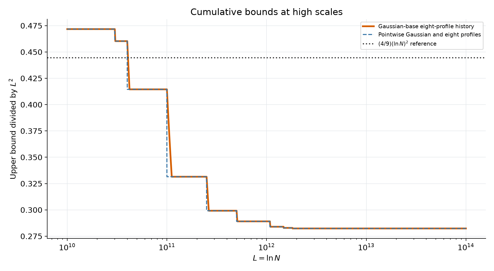

# PrimeTestBounds.MillerRabin　GRH下の素数判定同値と証人上界

対数平方上界の入口は [FromLLS.lean](../PseudoPrime/PrimeTestBounds/MillerRabin/FromLLS.lean)。名前空間は `PseudoPrime.PrimeTestBounds.MillerRabin` で、 `import PseudoPrime` からも利用できる。


固定79とGaussian surplusを含む公開包絡線は [NextTunedWitnessEnvelope.lean](../PseudoPrime/PrimeTestBounds/MillerRabin/NextTunedWitnessEnvelope.lean) の `nextTunedSelectedEnvelope` である。これを $U_{\mathrm{MR}}(n)$ と書く。GRHの下で、すべての奇合成数 $n > 1$ について、`exists_prime_nextTunedSelected` と `exists_least_nextTunedSelected` が実際の素数証人と最小素数証人の上界を与える。平方自由性や素因数の個数に追加条件はない。

素数へ丸めた値は `nextTunedPrimeEnvelope` で、`exists_prime_nextTunedPrimeEnvelope` と `exists_least_nextTunedPrimeEnvelope` が同じ条件で証人を与える。


MRの最小素数証人の累積最大値について、既知の更新点を [3種類の最小素数証人の数表](WitnessRecords.md) に参考情報として掲載した。

## 共通の記号

$$
\mathbb N=\lbrace0,1,2,\ldots\rbrace,\qquad
\mathbb P=\lbrace p\in\mathbb N\mid p\text{ は素数}\rbrace.
$$

$\ln$ は自然対数を表す。整数入力 $n$ と底 $p$ は自然数とする。
GRHはすべての原始複素Dirichlet指標のL関数について、非自明零点の実部が $1/2$ であるという仮定である。
Leanの定義は [Definition.lean](../PseudoPrime/AnalyticNumberTheory/GRH/Definition.lean) の
`PseudoPrime.AnalyticNumberTheory.GRH.GeneralizedRiemannHypothesis` に対応する。

## 証明した主張

前提と主張は次のとおりである。

$$
\mathrm{GRH},\qquad n\in\mathbb N,\qquad n > 1,\qquad n\equiv1\pmod2.
$$

$$
n \text{ が素数}
\iff
\text{すべての素数底 }p \le (\ln\mathrel{} n)^2\text{ が強 Miller–Rabin 条件を満たす}
$$

具体的には、一意な分解を

$$
n - 1 = 2^s d,\qquad s, d \in ℕ,\qquad d \text{ は奇数}
$$

と書く。底 $p$ に対する強 Miller–Rabin の合格条件は、次の冪合同条件である。

$$
p^d \equiv 1 \pmod n
\lor
\exists j \in ℕ,\quad j < s \land p^{2^j d} \equiv -1 \pmod n
$$

任意の自然数底 $a$ について、この条件を次のように略記する。

$$
\mathrm{StrongMRPass}(n,a)
\quad\Longleftrightarrow\quad
\left(a^d\equiv1\pmod n\right)
\lor\left(\exists j\in\mathbb N,\quad j < s\land a^{2^jd}\equiv-1\pmod n\right).
$$

以降、素数底証人とは $p\in\mathbb P$ かつ $\neg\mathrm{StrongMRPass}(n,p)$ を満たす底を指す。
この合格条件は、実行用判定 `strongMillerRabinWithBase n p` が `true` を返すことと同値である。対応する定理は [Decomposition.lean](../PseudoPrime/PrimeTest/MillerRabin/Decomposition.lean) の `strongMillerRabinWithBase_eq_true_iff_pass` である。

前提が $n > 1$ なので、合成数性についても次の同値が成り立つ。

$$
n \text{ が合成数}
\iff
\exists p \text{ 素数},\quad
p \le (\ln\mathrel{} n)^2
\land p^d \not\equiv 1 \pmod n
\land \forall j \in ℕ,\quad
j < s \Longrightarrow p^{2^j d} \not\equiv -1 \pmod n
$$

素数なら上界内のすべての素数底で合格することは、GRHなしに証明できる。逆に、これらの底での合格から素数性を導く向きに GRH を用いる。素数入力では、上界内の素数底は $p < n$ を満たし、 $n$ と互いに素になる。

Lean では $n - 1$ の 2 進付値 $s$ と奇数部分 $d$ をそれぞれ `padicValNat 2 (n - 1)` と `Nat.divMaxPow (n - 1) 2` として定義し、合同式を `ZMod n` の等式・不等式として表す。 GRHは前述の命題を仮定するものであり、GRH自体を証明したという主張ではない。

`prime_iff_millerRabin_for_all_primes_le_log_sq` の宣言部は次のとおりである。証明本体は省略している。

```lean
namespace PseudoPrime.PrimeTestBounds.MillerRabin

theorem prime_iff_millerRabin_for_all_primes_le_log_sq
    (hGRH : AnalyticNumberTheory.GRH.GeneralizedRiemannHypothesis)
    {n : ℕ} (hn : 1 < n) (hnOdd : Odd n) :
    let s := padicValNat 2 (n - 1)
    let d := Nat.divMaxPow (n - 1) 2
    (∀ p : ℕ, Nat.Prime p →
      (p : ℝ) ≤ (Real.log (n : ℝ)) ^ 2 →
      ((p : ZMod n) ^ d = 1 ∨
        ∃ j : ℕ, j < s ∧
          (p : ZMod n) ^ (2 ^ j * d) = -1)) ↔
      Nat.Prime n

end PseudoPrime.PrimeTestBounds.MillerRabin
```

## 公開定理

以下の名前は `PseudoPrime.PrimeTestBounds.MillerRabin` 名前空間に属する。

| 宣言 | 内容 | ソース |
|---|---|---|
| `exists_prime_nextTunedSelected`・`exists_least_nextTunedSelected` | 固定79・Gaussian surplusを含む現在の選択上界 | [NextTunedWitnessEnvelope.lean](../PseudoPrime/PrimeTestBounds/MillerRabin/NextTunedWitnessEnvelope.lean) |
| `exists_prime_nextTunedPrimeEnvelope`・`exists_least_nextTunedPrimeEnvelope` | 現在の選択値を素数へ丸めた上界 | [NextTunedWitnessEnvelope.lean](../PseudoPrime/PrimeTestBounds/MillerRabin/NextTunedWitnessEnvelope.lean) |
| `exists_prime_millerRabin_witness_le_log_sq` | 奇合成数に対する素数底の証人定理 | [FromLLS.lean](../PseudoPrime/PrimeTestBounds/MillerRabin/FromLLS.lean) |
| `prime_iff_millerRabin_for_all_primes_le_log_sq` | GRH の下で、上界内の全素数底の明示的な冪条件と素数性の同値 | [FromLLS.lean](../PseudoPrime/PrimeTestBounds/MillerRabin/FromLLS.lean) |
| `exists_rejectPowers_logSq_GRH` | `exists_prime_millerRabin_witness_le_log_sq` と同じ冪不等式を述べる別名。型は Boolean の `= false` を直接結論にはしない | [FromLLS.lean](../PseudoPrime/PrimeTestBounds/MillerRabin/FromLLS.lean) |
| `exists_primeWitness_lt_3000` | GRH を仮定しない $1 < n < 3000$ の定理 | [SmallLogBound.lean](../PseudoPrime/PrimeTestBounds/MillerRabin/SmallLogBound.lean) |

## 証明の流れ

### 1. 合格条件、単元性、素因数底

この節では $x\in\mathbb Z/n\mathbb Z$ を剰余環の元とする。Leanの `ZMod n` はこの剰余環を表す。
`PseudoPrime.PrimeTest.StrongMillerRabinPass n x` は、標準分解の奇数部分 $d$ と指数 $s$ を用いて $x^d = 1$ または、ある $j < s$ に対して $x^{2^j d} = -1$ という条件を定義する。合格すれば $x^{n - 1} = 1$ となり、 $n > 1$ のもとでは $x$ は単元となる。したがって素因数 $p \mid n$ を底にすると不合格になる。

[Decomposition.lean](../PseudoPrime/PrimeTest/MillerRabin/Decomposition.lean) の `strongMillerRabinPass_isUnit`、 `strongMillerRabinPass_not_of_prime_dvd` がこの性質を示す。同ファイルの `strongMillerRabinWithBase_eq_false_iff_not_pass` はこの合格条件の否定をBoolean 判定へ接続する。素数入力側では対数上界から底の互いに素性を示し、素数法の受理定理と指定分解の接続を組み合わせて不合格条件と矛盾させる。この節の宣言は `PseudoPrime.PrimeTest` 名前空間に属する。

### 2. 合格底を含む真部分群

自然な埋め込みを $\iota_n:(\mathbb Z/n\mathbb Z)^\times\hookrightarrow\mathbb Z/n\mathbb Z$ とする。
単元とは乗法逆元を持つ剰余環の元であり、その全体が単元群をなす。
$H$ の像とは $\iota_n(H)$ を指す。

奇合成数 $n > 1$ に対して、単元群 $(ℤ/nℤ)^\times$ の真部分群 $H$ が存在し、合格するすべての剰余が $H$ の像に入ることを無条件に証明する。合格集合そのものを部分群と仮定する必要はない。

- 素数 $q$ について $q^2 \mid n$ となる場合は、 単元 $u\in(\mathbb Z/n\mathbb Z)^\times$ で $u^{n - 1} = 1$ を満たすもの全体からなる部分群を使う。法 $q^2$ の $1 + q$ を利用して、この部分群に属さない単元を構成する。
- 異なる素因数 $q,r$ がある場合は、 $q - 1 = 2^t c$、 $t,c\in\mathbb N$、 $c$ は奇数と分解し、 $E = 2^{t - 1} d\in\mathbb N$ と置く。ここで $d$ は $n-1$ の奇数部分である。 $u^E \in \lbrace 1, -1 \rbrace$ を満たす単元 $u$ の部分群を使う。法 $q$ と法 $r$ で異なる符号をとる冪を中国剰余定理（CRT）で構成し、真部分群であることを示す。

各部分群の構成は [WitnessSubgroup.lean](../PseudoPrime/PrimeTest/MillerRabin/WitnessSubgroup.lean)、合成数の分岐と結合は [Composite.lean](../PseudoPrime/PrimeTest/MillerRabin/Composite.lean) にある。公開定理 `PseudoPrime.PrimeTest.exists_proper_subgroup_strongMR` がS2 へ渡す真部分群と合格剰余の包含をまとめる。

### 3. 大きい範囲に S2 を適用

$n \ge 3000$ に対し、 $p < (\ln\mathrel{} n)^2$ を満たす素因数があれば、第 1 節の性質によりその $p$ を証人にする。そのような素因数がなければ、[LLS の S2](LLS.md) を第 2 節で構成した真部分群へ適用する。 S2 は $p \le (\ln\mathrel{} n)^2$ で剰余が $H$ の像に入らない素数を与えるため、その底は合格できない。

S2 の適用には $p < (\ln\mathrel{} n)^2$ を満たす素数 $p$ が $n$ を割らないことを用い、結論の証人には $p \le (\ln\mathrel{} n)^2$ を要求する。等号端点で証人が単元になるという追加仮定は用いない。これが `exists_prime_millerRabin_witness_le_log_sq_of_s2` の証明である。最終段階で `PseudoPrime.LLS.llsTheorem11S2_of_grh` により GRH から S2 を供給する。

### 4. 小さい範囲の有限証明

[Computation/Small.lean](../PseudoPrime/PrimeTest/MillerRabin/Computation/Small.lean) は、 $1 < n < 3000$ の奇合成数について、底 2 または底 3 で不合格になることを示す。底 2 での不合格を示す有限分類では 2047 を例外候補とし、2047 の底 3 での不合格を別途証明する。公開定理は `PseudoPrime.PrimeTest.base_two_or_three_rejects_of_lt_3000`。

証明は自然数 $k$ による奇数の表示 $n = 2k + 1$、 $0 \le k < 1500$ を 256 要素の 5 ブロックと 220 要素の最終ブロックで被覆する。素数性と、明示分解・高速冪の不一致を Lean カーネルで検証し、検証器の健全性を通じて強 Miller–Rabin 判定へ移す。外部の整数探索結果を証明根拠には使わない。

奇合成数 $n > 1$ なら $n \ge 9$ なので $3 \le (\ln\mathrel{} n)^2$ が成立する。 [SmallLogBound.lean](../PseudoPrime/PrimeTestBounds/MillerRabin/SmallLogBound.lean) は対数評価を有限分類へ接続し、小範囲の素数証人定理を与える。有限分類だけを使う場合は `PseudoPrime.PrimeTest.MillerRabin.Computation.Small`、対数上界も使う場合は `PseudoPrime.PrimeTestBounds.MillerRabin.SmallLogBound` を import する。

## 証明依存

主定理、証人系、有限分類、小範囲の上界、真部分群の中心定理、利用した S2 定理の推移的公理依存は `propext`、 `Classical.choice`、 `Quot.sound` のみである。有限証明を含め、これらの定理に `sorry` や `native_decide` 由来の公理依存はない。確認例は次のとおり。

```lean
import PseudoPrime

namespace PseudoPrime.PrimeTestBounds.MillerRabin

#print axioms exists_prime_millerRabin_witness_le_log_sq
#print axioms PseudoPrime.PrimeTest.base_two_or_three_rejects_of_lt_3000

end PseudoPrime.PrimeTestBounds.MillerRabin
```

## 個別の上界と証明

対象を正の奇合成数とし、 $9 \le n$、 $L=\ln n$ とする。最小素数証人を

$$
q_{\mathrm{MR}}(n)=\min\lbrace p\in\mathbb P\mid\neg\mathrm{StrongMRPass}(n,p)\rbrace
$$

と書く。現在の実数上界を $U_{\mathrm{MR}}(n)=\mathrm{nextTunedSelectedEnvelope}(n)$ とする。GRHの下で $q_{\mathrm{MR}}(n) \le U_{\mathrm{MR}}(n)$ が成り立つ。

### 有限区間 $9 \le n < 3000$ の上界

$9 \le n < 2047$ では2、 $2047 \le n < 3000$ では3を返す。底2または底3での拒否を有限分類で証明し、素数証人と最小素数証人へ接続する。この範囲ではGRHは不要である。定義と証人定理は [SmallPointwiseBounds.lean](../PseudoPrime/PrimeTestBounds/MillerRabin/SmallPointwiseBounds.lean) にある。

公開数値関数の仕様としても、すべての自然数 $2047 \le n < 3000$ で `nextTunedSelectedEnvelope n` と `nextTunedPrimeEnvelope n` はともに3である。この等式には奇数性や合成数性を仮定しない。 $n < 2047$ では両関数が2を返す。対応する定理は [NextTunedIntervalSelection.lean](../PseudoPrime/PrimeTestBounds/MillerRabin/NextTunedIntervalSelection.lean) の `nextTunedSelected_small_two`、 `nextTunedSelected_small_three`、 `nextTunedPrime_small_two`、 `nextTunedPrime_small_three` である。

### 固定素数上界23〜79と有限principal和

固定半径 $y$ に対して、次の実際のvon Mangoldt和を使う。

$$
R(x)=\sum_{1 \le m \le x}\Lambda(m)\left(\frac1m-\frac1x\right),\qquad
S(x)=\sum_{1 \le m \le x}\Lambda(m)\ln\frac xm.
$$

$\ell(y)$ は次節の有理関数とする。各半径で、次の2本の下界を有限和から証明する。

$$
2\ln y-\ell(y)+\delta_R \le R(y^2),
$$

$$
y^2-\frac y{20}-\frac{1839}{500}\ln y-\frac{21}{20}+\delta_S \le S(y^2).
$$

各半径で既存の有理部分和が与える余裕を使い、補強量を分母 $10^6$ の有理数に固定する。73以下の21素数について対数の有理区間をTaylor級数8項で検証し、相異なる最大30個の素数冪の寄与を加える。残りの項は非負なので、これらの部分和は元の和の下界となる。

次節で定義する $D_e(y)$ と $F_{\mathrm{pt}}(y)$ を使うと、強化した比較gapは

$$
G_+(L,y)=D_e(y)(F_{\mathrm{pt}}(y)-L)
 +(y-1)^2\delta_S+2y^2(y+1+\ln y)\delta_R
$$

となる。実際の $R(y^2)$ と $S(y^2)$ に対する下界を指標の比較定理へ渡し、 $G_+(L,y) > 0$ から $y^2$ 以下のMR拒否素数を得る。表の各行で $y^2$ は次の素数より小さいため、素数間の有限検証により表の上界へ丸められる。

| 適用条件 | 固定半径 $y$ | $10^6\delta_R$ | $10^6\delta_S$ | 素数証人上界 |
|---|---|---:|---:|---:|
| $L \le 8.0901$ | $53851/10000$ | 7385 | 597822 | 23 |
| $L \le 8.3320$ | $55677/10000$ | 7794 | 630000 | 29 |
| $L \le 9.0031$ | $60827/10000$ | 9395 | 729227 | 31 |
| $L \le 9.3961$ | $64031/10000$ | 6554 | 651721 | 37 |
| $L \le 9.5875$ | $65574/10000$ | 6072 | 648651 | 41 |
| $L \le 9.9619$ | $68556/10000$ | 6816 | 712934 | 43 |
| $L \le 10.4895$ | $72801/10000$ | 8072 | 819332 | 47 |
| $L \le 10.9671$ | $76811/10000$ | 6484 | 769482 | 53 |
| $L \le 11.1199$ | $78102/10000$ | 6009 | 755180 | 59 |
| $L \le 11.5654$ | $1637/200$ | 5520 | 761820 | 61 |
| $L \le 11.8463$ | $337/40$ | 4829 | 739461 | 67 |
| $L \le 11.9879$ | $1068/125$ | 4972 | 762726 | 71 |
| $L \le 12.3975$ | $1111/125$ | 5757 | 856932 | 73 |
| $L \le 12.6409$ | $5694/625$ | 3135 | 667896 | 79 |

各行は記した上端以下の全域で使え、個別の証人定理には $n \ge 3000$ や前行の上端を仮定しない。23〜73の13行のデータは [EndpointFiniteCredits.lean](../PseudoPrime/Analysis/EndpointFiniteCredits.lean)、素数証人・最小素数証人は [EndpointFiniteTuned.lean](../PseudoPrime/PrimeTestBounds/MillerRabin/EndpointFiniteTuned.lean) にある。固定79には30項の素数冪の寄与と、半径 $5694/625$ の対数証明書を使う。素数79の寄与はこの部分和に含まれない。実際の和・gap・証人の接続は [Analysis/EndpointPrime79.lean](../PseudoPrime/Analysis/EndpointPrime79.lean)、[LLS/PaperStatements/EndpointPrime79.lean](../PseudoPrime/LLS/PaperStatements/EndpointPrime79.lean)、[MillerRabin/EndpointPrime79.lean](../PseudoPrime/PrimeTestBounds/MillerRabin/EndpointPrime79.lean) に分けてある。

### 固定79の適用範囲

入力が3000以上で $L\le12659/1000$ のとき、固定素数上界79を使える。証明書は有限principal和の32個の相異なる項を使う。2047未満の値2と、2047以上3000未満の値3を優先し、他の有効な上界との最小値をとる。

証人への接続は [Endpoint79TunedEnvelope.lean](../PseudoPrime/PrimeTestBounds/MillerRabin/Endpoint79TunedEnvelope.lean)、現在の包絡線への接続は [NextTunedWitnessEnvelope.lean](../PseudoPrime/PrimeTestBounds/MillerRabin/NextTunedWitnessEnvelope.lean) にある。

### pointwise補正の逆関数上界

$y\ge8$、 $z=\ln y$ として、次の関数を用いる。

$$
D_e(y)=(y-1)((y+1)^2+2y\ln y),\qquad
H(y)=\frac{N_H(y)}{18310000D_e(y)},
$$

$$
\begin{aligned}
N_H(y)={}&36620000y^3z-56749471y^3+109860000y^2z^2\\
&+73100099y^2z+10777809y^2-73240000yz^2\\
&-1528140yz+2824690y-36620000z^2-177204180z-94877470.
\end{aligned}
$$

$$
\ell(y)=\frac{78861}{50000}+\frac{231}{5000y}-\frac{16033}{9000y^2},\qquad
\delta(y)=\frac{2y^2(y+1+\ln y)(31551/20000-\ell(y))}{D_e(y)},
$$

$$
H_{\mathrm{pt}}(y)=H(y)+\delta(y),\qquad F_{\mathrm{pt}}(y)=y+H_{\mathrm{pt}}(y).
$$

$H_{\mathrm{pt}}$ と $F_{\mathrm{pt}}$ は $[8,\infty)$ で狭義単調である。 $L\le F_{\mathrm{pt}}(8)$ なら $R_{\mathrm{pt}}(L)=8$ とし、 $L > F_{\mathrm{pt}}(8)$ なら $F_{\mathrm{pt}}(y)=L$ を満たす $y\ge8$ の一意解を $R_{\mathrm{pt}}(L)$ とする。上界は

$$
U_{\mathrm{pt}}(L)=R_{\mathrm{pt}}(L)^2
$$

である。 $F_{\mathrm{pt}}(8)\approx11.2893992652$ で、下限の8はすべての実数 $L$ で保持する。

pointwise gapは正確に $D_e(y)(F_{\mathrm{pt}}(y)-L)$ となる。逆関数半径でgapが0になる場合も、最小素数証人とその平方根の中点を用いる離散的な議論により証人上界が成り立つ。定義・単調性・逆関数は [LLS/PaperStatements/EndpointPointwiseRoot.lean](../PseudoPrime/LLS/PaperStatements/EndpointPointwiseRoot.lean)、全奇合成数の素数証人・最小素数証人は [MillerRabin/EndpointPointwiseRoot.lean](../PseudoPrime/PrimeTestBounds/MillerRabin/EndpointPointwiseRoot.lean) にある。

### 低床Gaussianの4profile

Gaussian候補に共通の定数を次のように置く。

$$
J=10^9,\quad M=\frac{64167}{100000},\quad E=\frac{2129}{2000},\quad k=\frac25,
$$

$$
d=\frac{JM-E}{J-1},\qquad
\beta=\frac{J}{J-1}\left(kM+\frac1{10k}\right),\qquad
c=\frac{20115621}{50000000}.
$$

残差予算 $D$ に対する二次式の正根と上界を

$$
t_D(L)=\frac{\beta+\sqrt{\beta^2+4d(cL+D)}}{2d},\qquad
V_D(L)=\frac65t_D(L)^4
$$

とする。根の下限 $u$ を持つprofileは

$$
A_{u,D}(L)=\max\left\lbrace\frac65u^4,V_D(L)\right\rbrace
$$

である。 $L \ge 63$ で次の4profileがそれぞれ素数証人上界を与える。

| 根の下限 $u$ | 残差予算 $D$ | 使用するprefix下界 |
|---|---|---|
| $91/10=9.1$ | $929/100=9.29$ | $901/250=3.604$ |
| $93/10=9.3$ | $87/10=8.7$ | $901/250=3.604$ |
| $237/25=9.48$ | $1629/200=8.145$ | $722517/200000=3.612585$ |
| $979/100=9.79$ | $65/8=8.125$ | $722517/200000=3.612585$ |

実際の有限prefix和は表の値以上になる。大指数側の半径を $r=s^2$ とし、指数4側は $r_4=(7559/10000)r$、幅は両側とも $k/s$ とする。lowとbridgeはcoarse評価、middleとupperは符号を保った2項の評価を使う。指数4側の残差閾値は全profileで $204/5=40.8$ を保つ。大指数・指数4・局所部分群の分類を通じ、すべての奇合成数に対して実際の拒否素数を得る。

4profileの最小を $A_+(L)$ と書く。切替境界を

$$
\phi(u,D)=\frac{du^2-\beta u-D}{c},
$$

$$
\begin{aligned}
a_1&=\phi(9.1,9.29),& a_2&=\phi(9.3,9.29),& a_3&=\phi(9.3,8.7),\\
a_4&=\phi(9.48,8.7),& a_5&=\phi(9.48,8.145),& a_6&=\phi(9.79,8.145),\\
a_7&=\phi(9.79,8.125)
\end{aligned}
$$

とする。境界は正確な有理数であり、数値的な根探索をguardに使わない。

| 適用条件 | $A_+(L)$ |
|---|---|
| $63 \le L \le a_1$ | $(6/5)(9.1)^4$ |
| $a_1 < L \le a_2$ | $V_{9.29}(L)$ |
| $a_2 < L \le a_3$ | $(6/5)(9.3)^4$ |
| $a_3 < L \le a_4$ | $V_{8.7}(L)$ |
| $a_4 < L \le a_5$ | $(6/5)(9.48)^4$ |
| $a_5 < L \le a_6$ | $V_{8.145}(L)$ |
| $a_6 < L \le a_7$ | $(6/5)(9.79)^4$ |
| $a_7 < L$ | $V_{8.125}(L)$ |

数値証明書は [GaussianTunedProfiles.lean](../PseudoPrime/PrimeTestBounds/MillerRabin/GaussianTunedProfiles.lean)、素数証人・最小素数証人は [GaussianTunedBounds.lean](../PseudoPrime/PrimeTestBounds/MillerRabin/GaussianTunedBounds.lean) にある。

### Gaussian surplusを使う3候補

同じ $V_D(L)$ を用いると、既存の2候補は

$$
G_{35}(L)=\max\lbrace35000,V_{837/200}(L)\rbrace,\qquad
G_{50}(L)=\max\lbrace50000,V_{1967/500}(L)\rbrace
$$

である。両候補は $L\ge63$ で使う。固定した床値と残差予算により、範囲条件だけで適用できる。

[NextTunedWitnessEnvelope.lean](../PseudoPrime/PrimeTestBounds/MillerRabin/NextTunedWitnessEnvelope.lean) は、既存tuned包絡線・固定79候補・Gaussian surplusの3候補を、それぞれの有効域で最小化する。選択値は `nextTunedSelectedEnvelope`、素数丸め後の値は `nextTunedPrimeEnvelope` で公開している。1より大きい奇合成数について、GRHから実際の拒否素数と最小拒否素数を与える。追加のprefix下界や部分群の分類を利用側の仮定には残していない。

surplusはGaussian重みからGamma重みの17/20倍を引いた差である。この差の非負性と既存35行の厳密な有限評価から、100以上のprefixに73/100の加算を得る。35000と50000の既存Gamma prefixへ接続すると、実際のGaussian prefixの下界はそれぞれ5.54117と5.645295となる。MR側の残差は4.185と3.934となり、prefixのfloorは35000と50000を保持する。固定データとprefix評価はLLS、MR固有のfloor・残差予算はMillerRabin側へ配置している。

1000までの既存Gamma prefixにも同じsurplusを接続し、第三の候補

$$
G_{1000}(L)=\max\lbrace(6/5)(91/10)^4,V_{38/5}(L)\rbrace
$$

を加えた。この候補も $L \ge 63$ で使う。Gaussian prefixの下界は
$868517/200000=4.342585$ であり、新たな大規模有限探索は行わない。
[GaussianPrefix1000Surplus.lean](../PseudoPrime/LLS/GaussianPrefix1000Surplus.lean) が
実際のprefix評価を供給し、
[GaussianSurplusBounds.lean](../PseudoPrime/PrimeTestBounds/MillerRabin/GaussianSurplusBounds.lean) の
`exists_prime_gaussianSurplus` と `exists_least_gaussianSurplus` が、
大指数・指数4・局所因子の各場合を通じて実際の証人へ接続する。
この残差7.6の候補は比較用の $G_0$ として保持する。

同じ床9.1とprefixを使い、残差を7.2へ縮めた候補を

$$
G_A(L)=\max\lbrace(6/5)(91/10)^4,V_{36/5}(L)\rbrace
$$

とする。
[GaussianTightNumerics.lean](../PseudoPrime/PrimeTestBounds/MillerRabin/GaussianTightNumerics.lean)
は、指数4側の誤差と主項の両方に共通の閾値 $3663/100=36.63$ を認証する。
[GaussianTightBounds.lean](../PseudoPrime/PrimeTestBounds/MillerRabin/GaussianTightBounds.lean)
の `exists_prime_gaussianTight` と `exists_least_gaussianTight` は、
大指数・指数4・局所の各枝から、GRHの下で実際の拒否素数と最小拒否素数を与える。
入力は奇合成数で $L \ge 63$ とし、prefixやscalar gapの追加仮定は要求しない。
公開式では既存の3000と対数63のguardを保って $G_0$ を $G_A$ へ置き換える。
有限prefixのデータと35000・50000の候補は増やさない。

[GaussianTightComparison.lean](../PseudoPrime/PrimeTestBounds/MillerRabin/GaussianTightComparison.lean)
は、置換前の全公開最小値を `priorSurplusEnvelope` として保持する。
`nextTuned_le_priorSurplus`、 `nextSelected_le_priorSurplus`、
`nextPrime_le_priorSurplus` は、全自然数で実数の証人上界・選択値・素数丸め後の値が
それぞれ従来以下であることを証明する。
$105 \le \ln n \le 105.5$ では、新上界が8609未満、旧候補全体の最小値が8609より大きい。
認証済み素数8609を挟むため、`nextTuned_strict_tighter` により丸め後にも厳密改善を得る。
旧全最小値は $100 \le \ln n \le 235.73$ で $G_0(\ln n)$ に等しいことも証明している。

[GaussianSurplusComparison.lean](../PseudoPrime/PrimeTestBounds/MillerRabin/GaussianSurplusComparison.lean)
の `nextTuned_le_previous` は、全ての入力で変更前の公開最小値以下となることを証明する。
`nextTuned_strict_surplus` は $100 \le \ln n \le 101$ で、実数の公開上界と
素数丸め後の公開上界の両方が真に小さくなることを証明する。
丸め後の比較では、認証済み素数8419が新上界より大きく、旧上界以下となることを使う。
単独のGaussian候補だけとの比較ではない。

合成後も2047未満の公開値2と、2047以上3000未満の公開値3を保持する。後者では選択値・丸め後の値の両方の局所単調性を証明している。全域の単調性は仮定しない。累積上界は実際の最小拒否素数を対象とする `HistoryCumulativeBounds.lean` の全域定理で評価できる。

### 高域のtriangular上界

triangular kernelの明示公式から、各行の適用条件で $C_iL^2$ 以下の素数証人を得る。主指標の下界、指標平均、conductor比較、signed零点質量の評価を、共通のprofile定理へ渡す。

| $i$ | 適用条件 $T_i \le L$ | 係数 $C_i$ |
|---:|---|---|
| 1 | $3\cdot10^{10} \le L$ | $4603/10000=0.4603$ |
| 2 | $4\cdot10^{10} \le L$ | $829/2000=0.4145$ |
| 3 | $10^{11} \le L$ | $663/2000=0.3315$ |
| 4 | $2.5\cdot10^{11} \le L$ | $374/1250=0.2992$ |
| 5 | $5\cdot10^{11} \le L$ | $2891/10000=0.2891$ |
| 6 | $1.08\cdot10^{12} \le L$ | $28399/100000=0.28399$ |
| 7 | $1.48\cdot10^{12} \le L$ | $28289/100000=0.28289$ |
| 8 | $1.82\cdot10^{12} \le L$ | $1411811/5000000=0.2823622$ |

各profileは自分の入口 $T_i$ 以上でのみ有効になる。定数の証明書は [TriangularTunedProfiles.lean](../PseudoPrime/PrimeTestBounds/MillerRabin/TriangularTunedProfiles.lean)、素数証人・最小素数証人は [TriangularTunedBounds.lean](../PseudoPrime/PrimeTestBounds/MillerRabin/TriangularTunedBounds.lean) にある。

第8行の定数と証人定理は [TriangularProfiles.lean](../PseudoPrime/PrimeTestBounds/MillerRabin/TriangularProfiles.lean) と [TriangularProfileBounds.lean](../PseudoPrime/PrimeTestBounds/MillerRabin/TriangularProfileBounds.lean) にある。

### 素数への丸め

実数上界 $R \ge 2$ に対して、 $R$ 以下の最大素数を $\mathrm{primeRound}(R)$ とする。 $R < 2$ では値を変えない。すべての実数で $\mathrm{primeRound}(R) \le R$ が成り立ち、 $p \le R$ を満たす素数 $p$ は丸め後も範囲内にある。また、 `primeRound_mono` はこの丸めの単調性を示す。定義と定理は [PrimeCutoff.lean](../PseudoPrime/PrimeTestBounds/MillerRabin/PrimeCutoff.lean) にある。

`nextTunedPrimeEnvelope n` は `nextTunedWitnessEnvelope n` を丸める。2・3・固定23〜79は丸めても同じ値である。素数への丸めは調べる素数基数の集合を変えずに、実数上界をその集合の最大要素へ置き換える。

### 全域の累積上界

$Q_{\mathrm{MR}}(N)$ は、 $1 < n \le N$ の奇合成数に対する真の最小拒否素数の最大値である。対象外の入力の値は0とし、上端 $N=0,1,2$ も含める。

[HistoryCumulativeBounds.lean](../PseudoPrime/PrimeTestBounds/MillerRabin/HistoryCumulativeBounds.lean) は、従来の改善済み7候補を保ち、第8候補も含めた履歴を使う。入口が増加する順の係数と尺度を $C_i,T_i$ とし、

$$
B_1=T_1^2,\qquad
B_i=\min\lbrace T_i^2,\ \min_{j < i}\max(B_j,C_jT_i^2)\rbrace
$$

と置く。公開関数 `historyCumulativeEnvelope` は

$$
\min\lbrace(\ln N)^2,\ \min_{1\le i\le8}\max(B_i,C_i(\ln N)^2)\rbrace
$$

である。各入口より前の入力を、既証明の前段候補で覆う。高入口の係数を小入力へ外挿せず、点ごとの包絡線の全域単調性も仮定しない。

`cumulativeLeastPrime_le_history` はGRH下の全自然数上端でこの上界を証明する。`historyCumulative_le_high` は従来の7候補の公開値以下を、`historyCumulative_lt_high_large` は $\ln N \ge 2\times10^{12}$ での厳密改善を示す。最小証人の意味と、 $2047 \le n < 3000$ の点ごとの公開値3は変えない。

履歴の認証値は $B_7=622051696000000000000000$、 $B_8=937044836000000000000000$ であり、回復条件を有理数のまま比較している。従来の `highCumulativeEnvelope` とその定理は比較用にも保持した。

さらに、床9.1・残差7.6の既存Gaussianを $G_0(L)$ とし、基底を

$$
B_0(L)=\min\lbrace L^2,G_0(\max\lbrace63,L\rbrace)\rbrace
$$

へ置き換えた。
[GaussianCumulativeBounds.lean](../PseudoPrime/PrimeTestBounds/MillerRabin/GaussianCumulativeBounds.lean)
の `leastPrime_le_gaussianBase` は、 $\ln n \le L$ の全ての奇合成数を同じ基底で覆う。
対数63未満の入力は既存の $63^2=3969$ とGaussianの床で吸収し、新たな入力列挙は行わない。
非負の $L \le 63$ では基底は従来の $L^2$ と一致する。

[BaseHistoryBounds.lean](../PseudoPrime/PrimeTestBounds/MillerRabin/BaseHistoryBounds.lean)
の再帰は開始値と係数を写像として受け取り、固定した数値証明書に依存しない。
MRのprofileと実際の最小拒否素数への移送はGaussianの利用側に置く。
`cumulativeLeastPrime_le_gaussian` はGRHの下で全自然数上端を覆い、
`gaussianCumulative_le_history` は従来の8候補累積以下であることを示す。

[GaussianHistoryCaps.lean](../PseudoPrime/PrimeTestBounds/MillerRabin/GaussianHistoryCaps.lean)
では、 $100 \le \ln N \le 101$ の旧累積が $(\ln N)^2 \ge 10000$ である一方、
新累積は8419未満となることから、全候補を合わせた累積上界の厳密改善を証明した。
点ごとのGaussian証人は既に存在したため、新しい改善はその累積への接続である。

$G_0$ 基底の第1適用開始点の履歴は $(59/125)T_1^2$ 未満、
第2は正確に $(4603/10000)T_2^2$ となる。
`gaussian_first_recovery_scale` と `gaussian_second_recovery_scale` により、
係数 $.4603$ と $.4145$ への回復尺度は、それぞれ30378881000、42152002600以下である。
これは有理数の平方比較による認証値であり、平方根の表示近似を仮定に使っていない。
第3以降も従来の保証を維持し、第7・第8候補も引き続き有効である。

最終的には、同じ履歴再帰へ改善候補 $G_A$ の基底

$$
B_A(L)=\min\lbrace L^2,G_A(\max\lbrace63,L\rbrace)\rbrace
$$

を渡す。
[GaussianTightCumulativeBounds.lean](../PseudoPrime/PrimeTestBounds/MillerRabin/GaussianTightCumulativeBounds.lean)
の `cumulativeLeastPrime_le_gaussianTight` は全自然数の累積最大を覆う。
`gaussianTightCumulative_le_gaussian` と `gaussianTightCumulative_le_history` により、
この累積は $G_0$ 基底の累積と従来の平方基底の累積の両方以下となる。
区間100から101の厳密改善も維持する。
第1capは引き続き狭義上界、第2capは $(4603/10000)T_2^2$ 以下として継承し、
上の二つの回復尺度も同じ認証値を再利用する。



図は高域だけを対象とし、現行の8候補の履歴とGaussianを含む点ごとの候補を、
対数二乗で割って示す。
黒点線は規準 $(4/9)(\ln N)^2$ に対応し、この縦軸では高さ $4/9$ となる。
実数軸の描画をLeanの全自然数上端の証明と区別する。

### 包絡線の構成

補助包絡線 `sharpSelectedEnvelope` と14個の固定素数候補の最小値を $F(n)$ と書く。
$H(n)$ は $F(n)$ と、有効な7個の高域候補の最小値である。
$G_+(L)=\min\lbrace G_{35}(L),G_{50}(L)\rbrace$ とし、
$C_{79}(n)$ は $L \le 12659/1000$ なら79、それ以外なら $F(n)$ とする。
現在の選択式には次の正規形を使える。

| 入力の範囲 | 正規形の値 |
|---|---|
| $n < 3000$ | 既存の `smallIntervalBound n` |
| $n \ge 3000$、 $L < 63$ | $\min\lbrace F(n),C_{79}(n)\rbrace$ |
| $L \ge 63$ | $\min\lbrace H(n),G_+(L),G_A(L)\rbrace$ |

[NextTunedNormalForm.lean](../PseudoPrime/PrimeTestBounds/MillerRabin/NextTunedNormalForm.lean)
の `nextTuned_eq_normal`、 `nextTunedSelected_eq_normal`、 `nextTunedPrime_eq_normal` は、
全自然数で実証人用・選択用・素数丸め後の式が元の公開APIと等しいことを証明する。
共通guardの対数63以上では、surplusが支配する旧4個のtuned Gaussianと
旧2個のseeded tunedを直接の枝から除いた。
これは式の同値整理であり、追加の上界改善として数えない。旧APIは保持する。

高域の入口 $T_i$ はtriangular上界の表の値である。第1〜7候補は入口が増加し係数が減少するため、有効なもののうち最後の候補だけを残せる。 $T_8$ 以降の第8候補は $U_{\mathrm{sharp}}$ に含まれる。

数値関数と実証人の接続は [TunedWitnessEnvelope.lean](../PseudoPrime/PrimeTestBounds/MillerRabin/TunedWitnessEnvelope.lean)、小入力の等式は [TunedIntervalSelection.lean](../PseudoPrime/PrimeTestBounds/MillerRabin/TunedIntervalSelection.lean) にある。有限区間の選択は [EndpointTunedEnvelope.lean](../PseudoPrime/PrimeTestBounds/MillerRabin/EndpointTunedEnvelope.lean) が与える。

### 上界式と証明済みの適用条件

以下の解析候補と固定23〜79にはGRHを仮定する。有限区間の2と3は無条件である。

| 適用条件 | 上界式 |
|---|---|
| $9 \le n < 2047$ | $2$ |
| $2047 \le n < 3000$ | $3$ |
| 固定素数表にある $L \le L_0$ | 表の各素数23〜79 |
| $n\ge3000$、 $L\le12659/1000$ | 固定上界79 |
| すべての実数 $L$ | $U_{\mathrm{pt}}(L)$ |
| $63 \le L$ | $G_A(L)$ |
| $63 \le L$ | $G_{35}(L)$、 $G_{50}(L)$ |
| 各 $T_i \le L$ | $C_iL^2$、 $i=1,\ldots,8$ |

## 上界式の適用区間

| 適用条件 | $U_{\mathrm{MR}}(n)$ |
|---|---|
| $9 \le n < 2047$ | $2$ |
| $2047 \le n < 3000$ | $3$ |
| $\ln3000 \le L \le 8.0901$ | $23$ |
| $8.0901 < L \le 8.3320$ | $29$ |
| $8.3320 < L \le 9.0031$ | $31$ |
| $9.0031 < L \le 9.3961$ | $37$ |
| $9.3961 < L \le 9.5875$ | $41$ |
| $9.5875 < L \le 9.9619$ | $43$ |
| $9.9619 < L \le 10.4895$ | $47$ |
| $10.4895 < L \le 10.9671$ | $53$ |
| $10.9671 < L \le 11.1199$ | $59$ |
| $11.1199 < L \le 11.5654$ | $61$ |
| $11.5654 < L \le 11.8463$ | $67$ |
| $11.8463 < L \le 11.9879$ | $71$ |
| $11.9879 < L \le 12.3975$ | $73$ |
| $12.3975 < L \le 12.6409$ | $79$ |
| $12.6409 < L \le 12659/1000$ | $\min\lbrace U_{\mathrm{pt}}(L),79\rbrace$ |
| $12659/1000 < L < 63$ | $U_{\mathrm{pt}}(L)$ |
| $63 \le L < T_1$ | $\min\lbrace U_{\mathrm{sharp}}(n),G_A(L),G_+(L)\rbrace$ |
| $T_i \le L < T_{i+1}$、 $1 \le i \le 6$ | $\min\lbrace U_{\mathrm{sharp}}(n),G_A(L),G_+(L),C_iL^2\rbrace$ |
| $T_7 \le L$ | $\min\lbrace U_{\mathrm{sharp}}(n),G_A(L),G_+(L),C_7L^2\rbrace$ |

### 比較グラフ


横軸は $\ln(\ln n)$ に線形なスケールとし、目盛りには $n$ を10の累乗で示す。縦軸は対数軸である。 $2^{64}$、 $2^{80}$、 $2^{128}$ の縦グリッドを重ねた。橙の実線は表の $U_{\mathrm{MR}}(n)$、黒の点線は $(4/9)(\ln n)^2$、青緑の点と階段線は最小素数証人の記録を表す。

基数を素数 $p_1=2,p_2=3,p_3=5,\ldots$ の順に選んでMiller–Rabinテストを行う。青緑の点の横座標は [OEIS A006945](https://oeis.org/A006945) の第 $k$ 項、すなわち最初の $k-1$ 個の素数基数 $p_1,\ldots,p_{k-1}$ によるテストをすべて通過する最小の奇合成数である。縦座標はその入力を棄却する最小素数基数 $q_{\mathrm{MR}}(n)$ であり、記録更新点では $Q_{\mathrm{MR}}(n)$ と一致する。例えば、 $n=2047$ は基数2で通過し、基数3で棄却されるため、点の縦座標は3となる。青緑の階段線は掲載した記録を結んだもので、未探索範囲への外挿ではない。

描画範囲は $9 \le n \le 10^{1024}$ である。点ごとの上界を描いており、累積上界としての単調性は仮定していない。挿入図は $n \ge 3000$ での比 $U_{\mathrm{MR}}(n)/(\ln n)^2$ を示す。この比の下降は分子である上界 $U_{\mathrm{MR}}(n)$ の下降を意味しない。triangular候補が有効になる高域の入口は描画範囲外であり、そこで入力ごとの上界に下降が生じても、累積最大値の下降を表すものではない。

図の数値計算はLeanの証明を代替しない。 [PNG版](figures/mr_upper_bound_comparison.png)

[構成全体へ](README.md) · [PrimeTest](PrimeTest.md) · [LLS](LLS.md)
