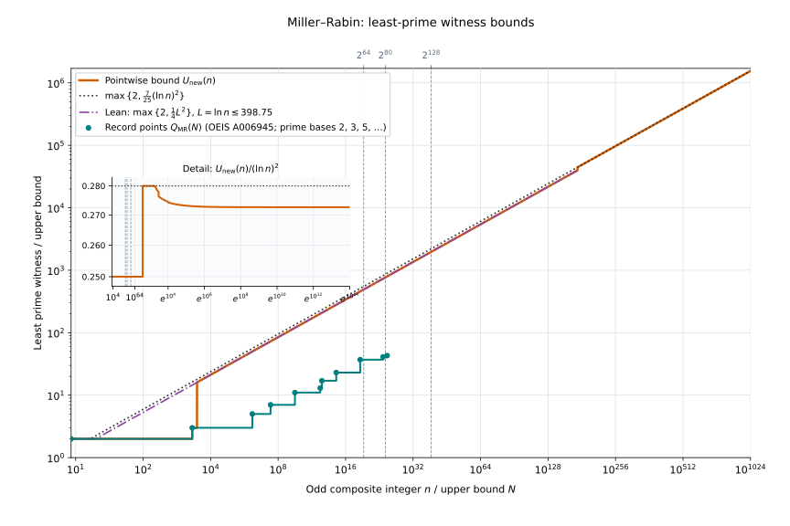
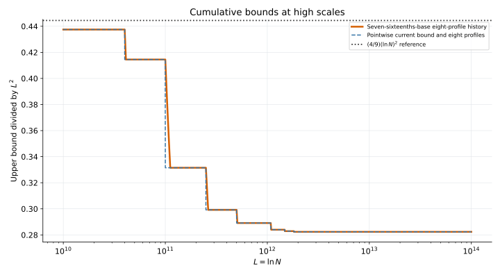

# PrimeTestBounds.MillerRabin　GRH下の素数判定同値と証人上界

GRHの下で、奇合成数 $n \ge 9$ には $(4/9)(\ln n)^2$ 以下のMiller–Rabin拒否素数が存在する。証人と最小証人の定理は [FourNinthsBounds.lean](../PseudoPrime/PrimeTestBounds/MillerRabin/FourNinthsBounds.lean)、素数判定条件の同値は [FourNinthsCriterion.lean](../PseudoPrime/PrimeTestBounds/MillerRabin/FourNinthsCriterion.lean) にある。名前空間は `PseudoPrime.PrimeTestBounds.MillerRabin` で、 `import PseudoPrime` から利用できる。

公開選択上界 $U_{\mathrm{MR}}(n)$ は [ReducedContourEnvelope.lean](../PseudoPrime/PrimeTestBounds/MillerRabin/ReducedContourEnvelope.lean) の `reducedSelected` である。既存の候補と、固定輪郭の評価を強めた係数系列を組み合わせる。 `exists_least_reducedSelected` は最小拒否素数が選択値以下であることを示す。 `reducedPrime` は選択値を素数へ丸め、同じ最小証人を保持する。

MRの最小素数証人の累積最大値について、既知の更新点を [3種類の最小素数証人の数表](WitnessRecords.md) に参考情報として掲載した。

## 共通の記号

$$
\mathbb N=\lbrace0,1,2,\ldots\rbrace,\qquad
\mathbb P=\lbrace p\in\mathbb N\mid p\text{ は素数}\rbrace.
$$

$\ln$ は自然対数を表す。整数入力 $n$ と底 $p$ は自然数とする。
GRHはすべての原始複素Dirichlet指標のL関数について、非自明零点の実部が $1/2$ であるという仮定である。
Leanの定義は [Definition.lean](../PseudoPrime/AnalyticNumberTheory/GRH/Definition.lean) の
`PseudoPrime.AnalyticNumberTheory.GRH.GeneralizedRiemannHypothesis` に対応する。

## 証明した主張

前提と主張は次のとおりである。

$$
\mathrm{GRH},\qquad n\in\mathbb N,\qquad n > 1,\qquad n\equiv1\pmod2.
$$

$$
n \text{ が素数}
\iff
\text{すべての素数底 }p \le \frac{4}{9}(\ln\mathrel{} n)^2\text{ が強 Miller–Rabin 条件を満たす}
$$

具体的には、一意な分解を

$$
n - 1 = 2^s d,\qquad s, d \in ℕ,\qquad d \text{ は奇数}
$$

と書く。底 $p$ に対する強 Miller–Rabin の合格条件は、次の冪合同条件である。

$$
p^d \equiv 1 \pmod n
\lor
\exists j \in ℕ,\quad j < s \land p^{2^j d} \equiv -1 \pmod n
$$

任意の自然数底 $a$ について、この条件を次のように略記する。

$$
\mathrm{StrongMRPass}(n,a)
\quad\Longleftrightarrow\quad
\left(a^d\equiv1\pmod n\right)
\lor\left(\exists j\in\mathbb N,\quad j < s\land a^{2^jd}\equiv-1\pmod n\right).
$$

以降、素数底証人とは $p\in\mathbb P$ かつ $\neg\mathrm{StrongMRPass}(n,p)$ を満たす底を指す。
この合格条件は、実行用判定 `strongMillerRabinWithBase n p` が `true` を返すことと同値である。対応する定理は [Decomposition.lean](../PseudoPrime/PrimeTest/MillerRabin/Decomposition.lean) の `strongMillerRabinWithBase_eq_true_iff_pass` である。

この前提の下で合成数なら $n \ge 9$ であり、合成数性について次の同値が成り立つ。

$$
n \text{ が合成数}
\iff
\exists p \text{ 素数},\quad
p \le \frac{4}{9}(\ln\mathrel{} n)^2
\land p^d \not\equiv 1 \pmod n
\land \forall j \in ℕ,\quad
j < s \Longrightarrow p^{2^j d} \not\equiv -1 \pmod n
$$

素数なら上界内のすべての素数底で合格することは、GRHなしに証明できる。逆に、これらの底での合格から素数性を導く向きに GRH を用いる。素数入力では、上界内の素数底は $p < n$ を満たし、 $n$ と互いに素になる。

Lean では $n - 1$ の 2 進付値 $s$ と奇数部分 $d$ をそれぞれ `padicValNat 2 (n - 1)` と `Nat.divMaxPow (n - 1) 2` として定義し、合同式を `ZMod n` の等式・不等式として表す。 GRHは前述の命題を仮定するものであり、GRH自体を証明したという主張ではない。

`prime_iff_mr_le_four_ninths_log_sq` の宣言部を示す。証明本体は省略している。

```lean
namespace PseudoPrime.PrimeTestBounds.MillerRabin

theorem prime_iff_mr_le_four_ninths_log_sq
    (hGRH : AnalyticNumberTheory.GRH.GeneralizedRiemannHypothesis) {n : ℕ} (hn : 1 < n)
    (ho : Odd n) :
    let (s, d) := Nat.maxPowDvdDiv 2 (n - 1)
    (∀ p : ℕ,
        Nat.Prime p →
          (p : ℝ) ≤ (4 / 9 : ℝ) * (Real.log n) ^ 2 →
          ((p : ZMod n) ^ d = 1 ∨ ∃ j : ℕ, j < s ∧ (p : ZMod n) ^ (2 ^ j * d) = -1)) ↔
      Nat.Prime n

end PseudoPrime.PrimeTestBounds.MillerRabin
```

## 公開定理

以下の名前は `PseudoPrime.PrimeTestBounds.MillerRabin` 名前空間に属する。

| 宣言 | 内容 | ソース |
|---|---|---|
| `exists_prime_witness_four_ninths`・`exists_least_witness_four_ninths` | GRH下の奇合成数 $n \ge 9$ に対する $4/9$ の証人と最小証人 | [FourNinthsBounds.lean](../PseudoPrime/PrimeTestBounds/MillerRabin/FourNinthsBounds.lean) |
| `prime_iff_mr_le_four_ninths_log_sq` | $4/9$ の上界による素数判定条件 | [FourNinthsCriterion.lean](../PseudoPrime/PrimeTestBounds/MillerRabin/FourNinthsCriterion.lean) |
| `cumulativeLeastPrime_le_four_ninths_log_sq` | 全自然数の上端に対する累積最大値の $4/9$ 上界 | [FourNinthsCumulative.lean](../PseudoPrime/PrimeTestBounds/MillerRabin/FourNinthsCumulative.lean) |
| `paired_prime_witness`・`factorial_prime_witness` | 可変係数による全奇合成数の証人上界 | [HighVariableBounds.lean](../PseudoPrime/PrimeTestBounds/MillerRabin/HighVariableBounds.lean)、[HighFactorialBounds.lean](../PseudoPrime/PrimeTestBounds/MillerRabin/HighFactorialBounds.lean) |
| `cumulativeLeastPrime_le_fixedImproved` | 固定係数候補と入口以前の履歴を含む累積上界 | [ImprovedFixedCumulative.lean](../PseudoPrime/PrimeTestBounds/MillerRabin/ImprovedFixedCumulative.lean) |
| `reducedSeries_witness`・`reducedSeries_antitone` | 新しい係数系列による証人上界と係数の単調非増加性 | [ReducedContourSeries.lean](../PseudoPrime/PrimeTestBounds/MillerRabin/ReducedContourSeries.lean) |
| `exists_least_reducedSelected`・`exists_least_reducedPrime` | 新しい選択値と素数丸め値による最小証人の上界 | [ReducedContourEnvelope.lean](../PseudoPrime/PrimeTestBounds/MillerRabin/ReducedContourEnvelope.lean) |
| `reducedSelected_lt_mean_window`・`reducedSelected_lt_fixed_window`・`reducedSelected_lt_earlyGaussian` | 中域、固定係数系列、可変Gaussian系列による従来の公開上界からの厳密な改善 | [ReducedContourComparison.lean](../PseudoPrime/PrimeTestBounds/MillerRabin/ReducedContourComparison.lean) |
| `cumulativeLeastPrime_le_reduced` | 各入口以前の履歴を保持した累積上界 | [ReducedContourEnvelope.lean](../PseudoPrime/PrimeTestBounds/MillerRabin/ReducedContourEnvelope.lean) |
| `exists_primeWitness_lt_3000` | GRHを仮定しない奇合成数 $9 \le n < 3000$ の定理 | [SmallLogBound.lean](../PseudoPrime/PrimeTestBounds/MillerRabin/SmallLogBound.lean) |

## 証明の流れ

係数 $4/9$ の定理では重複込みの素因数個数により奇合成数を分類する。素因数が3個以上なら既存の因数個数による上界を使う。2個の場合は平方と異なる2素数の積に分け、局所核の大きさと素数積の個数を比較する。低域では重複を許す素数積と有限個の有理数証明書を使い、中域では素数個数の解析的下界と61行の証明書を使う。 $\ln n \ge 1024$ は一様な評価で扱う。小さい入力と固定素数23・29の既存定理を接続し、全域を覆う。実装は [FourNinthsFiniteWitness.lean](../PseudoPrime/PrimeTestBounds/MillerRabin/FourNinthsFiniteWitness.lean) と [FourNinthsHighWitness.lean](../PseudoPrime/PrimeTestBounds/MillerRabin/FourNinthsHighWitness.lean) を経て全域定理に至る。

可変係数の定理でも同じ因数構造を扱う。RHから正方半径での素数供給を $99/100$ に強め、局所核と素数積の個数を比較する。階乗型では対数階乗の上界から二項係数を評価し、床・天井と $\ln(k+1)$ の損失を残す。平方自由3素因子の特殊な場合は、それぞれの半径でGaussian比較の余裕を確認する。

係数 $1057/2500$ の定理では素数積の平均対数で選別した積を局所核へ注入する。第一Chebyshev関数の評価とAbel公式の積分項から素数供給を得て、有限誤差付きStirling評価で個数を下から抑える。重複因子と平方自由3素因子も扱い、 $\ln n \ge 2\cdot10^8$ は固定輪郭を改良した上界で覆う。

合格底の構造と小さい入力の有限分類は [Composite.lean](../PseudoPrime/PrimeTest/MillerRabin/Composite.lean) と [Computation/Small.lean](../PseudoPrime/PrimeTest/MillerRabin/Computation/Small.lean) にある。有限分類は $9 \le n < 3000$ の奇合成数に対して底2または3の不合格を示す。素数入力の合格方向にはGRHを使わない。

## 証明依存

主定理、証人系、有限分類、小範囲の上界、真部分群の中心定理、利用した S2 定理の推移的公理依存は `propext`、 `Classical.choice`、 `Quot.sound` のみである。有限証明を含め、これらの定理に `sorry` や `native_decide` 由来の公理依存はない。確認例は次のとおり。

```lean
import PseudoPrime

namespace PseudoPrime.PrimeTestBounds.MillerRabin

#print axioms prime_iff_mr_le_four_ninths_log_sq
#print axioms exists_prime_witness_four_ninths
#print axioms cumulativeLeastPrime_le_four_ninths_log_sq
#print axioms exists_least_reducedPrime
#print axioms cumulativeLeastPrime_le_reduced
#print axioms PseudoPrime.PrimeTest.base_two_or_three_rejects_of_lt_3000

end PseudoPrime.PrimeTestBounds.MillerRabin
```

## 個別の上界と証明

対象を正の奇合成数とし、 $9 \le n$、 $L=\ln n$ とする。最小素数証人を

$$
q_{\mathrm{MR}}(n)=\min\lbrace p\in\mathbb P\mid\neg\mathrm{StrongMRPass}(n,p)\rbrace
$$

と書く。現在の実数上界を $U_{\mathrm{MR}}(n)=\mathrm{reducedSelected}(n)$ とする。GRHの下で $q_{\mathrm{MR}}(n) \le U_{\mathrm{MR}}(n)$ が成り立つ。

### 有限区間 $9 \le n < 3000$ の上界

$9 \le n < 2047$ では2、 $2047 \le n < 3000$ では3を返す。底2または底3での拒否を有限分類で証明し、素数証人と最小素数証人へ接続する。この範囲ではGRHは不要である。定義と証人定理は [SmallPointwiseBounds.lean](../PseudoPrime/PrimeTestBounds/MillerRabin/SmallPointwiseBounds.lean) にある。

公開数値関数の仕様としても、すべての自然数 $2047 \le n < 3000$ で `reducedSelected n` と `reducedPrime n` はともに3である。この等式には奇数性や合成数性を仮定しない。 $n < 2047$ では両関数が2を返す。

### 可変係数による高域上界

$L=\ln n$ とし、次の係数を定める。

$$
C_{\mathrm{pair}}(L)=\left(\frac{2\ln L+1/100}{3\ln L+339/500}\right)^2,
\qquad
C_{\mathrm{fac}}(L)=\left(\frac{2\ln L+3/200}{3\ln L+49/50}\right)^2.
$$

GRHの下で、すべての奇合成数について $L \ge 70000$ なら $q_{\mathrm{MR}}(n) \le C_{\mathrm{pair}}(L)L^2$、 $L \ge 80000$ なら $q_{\mathrm{MR}}(n) \le C_{\mathrm{fac}}(L)L^2$ が成り立つ。 $70000 \le L \le 100000$ では対による候補が以前の包絡線を、 $80000 \le L \le 100000$ では階乗型が対による候補を、それぞれ厳密に下回る。

### 固定素数上界23〜53と有限principal和

固定半径 $y$ に対して、次の実際のvon Mangoldt和を使う。

$$
R(x)=\sum_{1 \le m \le x}\Lambda(m)\left(\frac1m-\frac1x\right),\qquad
S(x)=\sum_{1 \le m \le x}\Lambda(m)\ln\frac xm.
$$

各半径で、次の2本の下界を有限和から証明する。

$$
\ell(y)=\frac{78861}{50000}+\frac{231}{5000y}-\frac{16033}{9000y^2}.
$$

$$
2\ln y-\ell(y)+\delta_R \le R(y^2),
$$

$$
y^2-\frac y{20}-\frac{1839}{500}\ln y-\frac{21}{20}+\delta_S \le S(y^2).
$$

各半径で既存の有理部分和が与える余裕を使い、補強量を分母 $10^6$ の有理数に固定する。必要な素数の対数について有理区間をTaylor級数8項で検証し、相異なる素数冪の寄与を加える。残りの項は非負なので、これらの部分和は元の和の下界となる。

実際の $R(y^2)$ と $S(y^2)$ に対する下界を指標の比較定理へ渡し、強化した比較gapが正であることから $y^2$ 以下のMR拒否素数を得る。表の各行で $y^2$ は次の素数より小さいため、素数間の有限検証により表の上界へ丸められる。

| 適用条件 | 固定半径 $y$ | $10^6\delta_R$ | $10^6\delta_S$ | 素数証人上界 |
|---|---|---:|---:|---:|
| $L \le 8.0901$ | $53851/10000$ | 7385 | 597822 | 23 |
| $L \le 8.3320$ | $55677/10000$ | 7794 | 630000 | 29 |
| $L \le 9.0031$ | $60827/10000$ | 9395 | 729227 | 31 |
| $L \le 9.3961$ | $64031/10000$ | 6554 | 651721 | 37 |
| $L \le 9.9619$ | $68556/10000$ | 6816 | 712934 | 43 |
| $L \le 10.4895$ | $72801/10000$ | 8072 | 819332 | 47 |
| $L \le 10.9671$ | $76811/10000$ | 6484 | 769482 | 53 |

各行は記した上端以下の全域で使え、個別の証人定理には $n \ge 3000$ や前行の上端を仮定しない。小域の値2・3と $(4/9)L^2$ も含めた公開包絡線では、表の7候補がそれぞれ選択される区間を持つ。証明書は [EndpointFiniteCredits.lean](../PseudoPrime/Analysis/EndpointFiniteCredits.lean)、素数証人・最小素数証人は [EndpointFiniteTuned.lean](../PseudoPrime/PrimeTestBounds/MillerRabin/EndpointFiniteTuned.lean) にある。

固定上界41、59、61、67、71、73、79は、それぞれの適用上端 $L_0$ で $(4/9)L_0^2$ が固定上界より小さい。したがって $n \ge 3000$ の適用範囲全体でも $(4/9)L^2$ の方が小さい。 $n < 3000$ では値2または3を使うため、これらの固定上界は公開包絡線を更新しない。

### 改良した係数系列

固定輪郭上の核評価を強めると、GRHの下で奇合成数の拒否素数は、次の各入口以上で $CL^2$ 以下に存在する。

| 入口 $L$ | 係数 $C$ |
|---:|---:|
| $80000$ | $1057/2500$ |
| $2\cdot 10^8$ | $39/100$ |
| $5\cdot 10^8$ | $161/500$ |
| $10^9$ | $3/10$ |
| $5\cdot 10^9$ | $71/250$ |

$L \ge 3\cdot 10^{10}$ では次の可変Gaussian係数を使う。これらを入口ごとにつないだ正規化係数は単調非増加である。 $10^7 \le L \le 2\cdot 10^7$、 $2\cdot 10^8 \le L < 3\cdot 10^{10}$、 $3\cdot 10^{10} \le L < 3.8\cdot 10^{10}$ の各範囲で、改良後の公開選択上界は改良前を厳密に下回る。

### 可変Gaussian係数

$L \ge 3\cdot 10^{10}$ では、次の係数を選択上界に加える。

$$
a_G(L)=\frac{2(20115621/50000000)
+(61/100)(28794111/12500000)/\sqrt L+39/L}{10971611/5000000},
\qquad C_G(L)=\frac{21}{10}a_G(L)^2.
$$

GRHの下で、すべての奇合成数について $q_{\mathrm{MR}}(n) \le C_G(L)L^2$ が成り立つ。この係数は対象範囲全体で $28237/100000$ を厳密に下回る。三素因子にはGaussian比較を使い、それ以外の分類には同じ半径で改良したtriangular比較の条件を満たすことを示す。

### 素数への丸め

実数上界 $R \ge 2$ に対して、 $R$ 以下の最大素数を $\mathrm{primeRound}(R)$ とする。 $R < 2$ では値を変えない。すべての実数で $\mathrm{primeRound}(R) \le R$ が成り立ち、 $p \le R$ を満たす素数 $p$ は丸め後も範囲内にある。また、 `primeRound_mono` はこの丸めの単調性を示す。定義と定理は [PrimeCutoff.lean](../PseudoPrime/PrimeTestBounds/MillerRabin/PrimeCutoff.lean) にある。

`reducedPrime n` は `reducedSelected n` を丸める。2・3と表の固定素数は丸めても同じ値である。素数への丸めは調べる素数基数の集合を変えずに、実数上界をその集合の最大要素へ置き換える。

### 全域の累積上界

$Q_{\mathrm{MR}}(N)$ を $9 \le n \le N$ の奇合成数 $n$ に対する最小拒否素数の最大値とし、対象がないときは0とする。以下では $N \ge 9$、 $L=\ln N$ とする。 $N < 9$ では $Q_{\mathrm{MR}}(N)=0$ である。共通尺度の基底を

$$
R_0(L)=\max\left\lbrace\frac49 70000^2,C_{\mathrm{pair}}(L)L^2\right\rbrace
$$

と定める。また、既存の累積上界を $W_F(N)=\mathrm{fixedImprovedCumulative}(N)$ と書く。この関数と全自然数上端に対する証明は [ImprovedFixedCumulative.lean](../PseudoPrime/PrimeTestBounds/MillerRabin/ImprovedFixedCumulative.lean) にある。

改良した係数系列でも入口以前の履歴を保持する。上の表の5組を $(T_i,C_i)$ とする。順に

$$
R_i(L)=\min\left\lbrace R_{i-1}(L),
\max\left\lbrace R_{i-1}(T_i),C_iL^2\right\rbrace\right\rbrace
$$

と定める。 $T_G=3\cdot 10^{10}$ とすると、現行の累積上界は

$$
\min\left\lbrace W_F(N),R_5(L),
\max\left\lbrace R_5(T_G),C_G(L)L^2\right\rbrace\right\rbrace
$$

である。各入口以前は前段の上界で覆い、入口以後はその候補の尺度に関する単調性を使う。証明は [ReducedContourCumulative.lean](../PseudoPrime/PrimeTestBounds/MillerRabin/ReducedContourCumulative.lean) と [ReducedContourEnvelope.lean](../PseudoPrime/PrimeTestBounds/MillerRabin/ReducedContourEnvelope.lean) にある。

各候補が入口の履歴を吸収する尺度として、順に $100000$、 $2.1\cdot 10^8$、 $5.51\cdot 10^8$、 $1.037\cdot 10^9$、 $5.14\cdot 10^9$、Gaussianでは $3.01\cdot 10^{10}$ を証明している。詳細は [ReducedContourAbsorption.lean](../PseudoPrime/PrimeTestBounds/MillerRabin/ReducedContourAbsorption.lean) にある。

### 包絡線の構成

$n \ge 3000$ では固定素数候補、適用条件を満たすtriangular上界、および $(4/9)L^2$ の最小値をとる。さらに $L \ge 70000$ では $C_{\mathrm{pair}}(L)L^2$、 $L \ge 80000$ では $C_{\mathrm{fac}}(L)L^2$ と改良した係数系列を加える。 $n < 3000$ では小域の値2または3を使う。

### 上界式と証明済みの適用条件

以下の解析候補と表の固定素数上界にはGRHを仮定する。有限区間の2と3は無条件である。

| 適用条件 | 上界式 |
|---|---|
| $9 \le n < 2047$ | $2$ |
| $2047 \le n < 3000$ | $3$ |
| 固定素数表にある $L \le L_0$ | 表の各素数23〜53 |
| 奇合成数 $n \ge 9$ | $(4/9)L^2$ |
| 奇合成数 $n \ge 9$、 $70000 \le L$ | $C_{\mathrm{pair}}(L)L^2$ |
| 奇合成数 $n \ge 9$、 $80000 \le L$ | $C_{\mathrm{fac}}(L)L^2$ |
| 奇合成数 $n \ge 9$、 $80000 \le L$ | 改良した係数系列の $CL^2$ |

## 上界式の適用区間

次の表は小域の値と固定素数候補を示す。 $n \ge 3000$ では適用可能な候補と $(4/9)L^2$ の最小値をとる。 $L \ge 70000$ では $C_{\mathrm{pair}}(L)L^2$、 $L \ge 80000$ では $C_{\mathrm{fac}}(L)L^2$ と改良した係数系列も加える。小域の2行は記載した値をそのまま使う。

| 適用条件 | 現行の上界を構成する候補 |
|---|---|
| $9 \le n < 2047$ | $2$ |
| $2047 \le n < 3000$ | $3$ |
| $\ln3000 \le L \le 8.0901$ | $23$ |
| $8.0901 < L \le 8.3320$ | $29$ |
| $8.3320 < L \le 9.0031$ | $31$ |
| $9.0031 < L \le 9.3961$ | $37$ |
| $9.3961 < L \le 9.9619$ | $43$ |
| $9.9619 < L \le 10.4895$ | $47$ |
| $10.4895 < L \le 10.9671$ | $53$ |
| $10.9671 < L$ | $(4/9)L^2$ |

### 比較グラフ



横軸は $\ln(\ln n)$ に線形なスケールとし、目盛りには $n$ を10の累乗で示す。縦軸は対数軸である。 $2^{64}$、 $2^{80}$、 $2^{128}$ の縦グリッドを重ねた。橙の実線は表の候補と $4/9$ の上界から定めた $U_{\mathrm{MR}}(n)$、黒の点線は $(4/9)(\ln n)^2$、青緑の点と階段線は最小素数証人の記録を表す。

基数を素数 $p_1=2,p_2=3,p_3=5,\ldots$ の順に選んでMiller–Rabinテストを行う。青緑の点の横座標は [OEIS A006945](https://oeis.org/A006945) の第 $k$ 項、すなわち最初の $k-1$ 個の素数基数 $p_1,\ldots,p_{k-1}$ によるテストをすべて通過する最小の奇合成数である。縦座標はその入力を棄却する最小素数基数 $q_{\mathrm{MR}}(n)$ であり、記録更新点では $Q_{\mathrm{MR}}(n)$ と一致する。例えば、 $n=2047$ は基数2で通過し、基数3で棄却されるため、点の縦座標は3となる。青緑の階段線は掲載した記録を結んだもので、未探索範囲への外挿ではない。

主図の描画範囲は $9 \le n \le 10^{64}$、縦軸は $10^0$ から $10^4$ である。点ごとの上界を描いており、累積上界としての単調性は仮定していない。挿入図は $3000 \le n \le e^{10^{14}}$ での比 $U_{\mathrm{MR}}(n)/(\ln n)^2$ を示す。この比の下降は分子である上界 $U_{\mathrm{MR}}(n)$ の下降を意味しない。可変係数とtriangular候補が有効になる高域の入口は主図の範囲外にある。そこで入力ごとの上界に下降が生じても、累積最大値の下降を表すものではない。

図の数値計算はLeanの証明を代替しない。 [PNG版](figures/mr_upper_bound_comparison.png)

### 累積上界と点ごとの上界の比較



橙線は上記の入口履歴を含む累積上界を $L^2$ で割った値、青い破線は点ごとの上界 $U_{\mathrm{MR}}(n)/(\ln n)^2$ を示す。黒点線の高さは $4/9$ である。実数軸の描画と、Leanによる自然数上端の証明は区別する。[PNG版](figures/mr_cumulative_high_comparison.png)

[構成全体へ](README.md) · [PrimeTest](PrimeTest.md) · [LLS](LLS.md)
