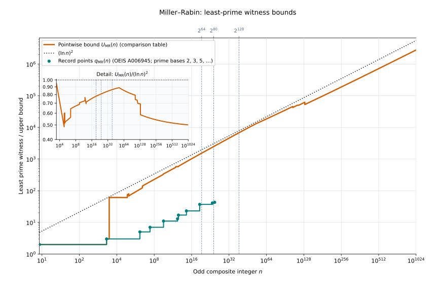

# PrimeTestBounds.MillerRabin　GRH下の素数判定同値と証人上界

公開入口は [FromLLS.lean](../PseudoPrime/PrimeTestBounds/MillerRabin/FromLLS.lean)。名前空間は `PseudoPrime.PrimeTestBounds.MillerRabin` で、 `import PseudoPrime` からも利用できる。

MRの最小素数証人の累積最大値について、既知の更新点を [3種類の最小素数証人の数表](WitnessRecords.md) に参考情報として掲載した。

## 共通の記号

$$
\mathbb N=\lbrace0,1,2,\ldots\rbrace,\qquad
\mathbb P=\lbrace p\in\mathbb N\mid p\text{ は素数}\rbrace.
$$

$\ln$ は自然対数を表す。整数入力 $n$ と底 $p$ は自然数とする。
GRHは、すべての原始複素Dirichlet指標のL関数について、非自明零点の実部が $1/2$ であるという仮定である。
Leanの定義は [Definition.lean](../PseudoPrime/AnalyticNumberTheory/GRH/Definition.lean) の
`PseudoPrime.AnalyticNumberTheory.GRH.GeneralizedRiemannHypothesis` に対応する。

## 証明した主張

前提と主張は次のとおりである。

$$
\mathrm{GRH},\qquad n\in\mathbb N,\qquad n > 1,\qquad n\equiv1\pmod2.
$$

$$
n \text{ が素数}
\iff
\text{すべての素数底 }p \le (\ln\mathrel{} n)^2\text{ が強 Miller–Rabin 条件を満たす}
$$

具体的には、一意な分解を

$$
n - 1 = 2^s d,\qquad s, d \in ℕ,\qquad d \text{ は奇数}
$$

と書く。底 $p$ に対する強 Miller–Rabin の合格条件は、次の冪合同条件である。

$$
p^d \equiv 1 \pmod n
\lor
\exists j \in ℕ,\quad j < s \land p^{2^j d} \equiv -1 \pmod n
$$

任意の自然数底 $a$ について、この条件を次のように略記する。

$$
\mathrm{StrongMRPass}(n,a)
\quad\Longleftrightarrow\quad
\left(a^d\equiv1\pmod n\right)
\lor\left(\exists j\in\mathbb N,\quad j < s\land a^{2^jd}\equiv-1\pmod n\right).
$$

以降、素数底証人とは、 $p\in\mathbb P$ かつ $\neg\mathrm{StrongMRPass}(n,p)$ を満たす底を指す。
この合格条件は、実行用判定 `strongMillerRabinWithBase n p` が `true` を返すことと同値である。対応する定理は [Decomposition.lean](../PseudoPrime/PrimeTest/MillerRabin/Decomposition.lean) の `strongMillerRabinWithBase_eq_true_iff_pass` である。

前提が $n > 1$ なので、合成数性についても次の同値が成り立つ。

$$
n \text{ が合成数}
\iff
\exists p \text{ 素数},\quad
p \le (\ln\mathrel{} n)^2
\land p^d \not\equiv 1 \pmod n
\land \forall j \in ℕ,\quad
j < s \Longrightarrow p^{2^j d} \not\equiv -1 \pmod n
$$

素数なら上界内のすべての素数底で合格することは、GRHなしに証明できる。逆に、これらの底での合格から素数性を導く向きに GRH を用いる。素数入力では、上界内の素数底は $p < n$ を満たし、 $n$ と互いに素になる。

Lean では、 $n - 1$ の 2 進付値 $s$ と奇数部分 $d$ をそれぞれ `padicValNat 2 (n - 1)` と `Nat.divMaxPow (n - 1) 2` として定義し、合同式を `ZMod n` の等式・不等式として表す。 GRHは前述の命題を仮定するものであり、GRH自体を証明したという主張ではない。

`prime_iff_millerRabin_for_all_primes_le_log_sq` の宣言部は次のとおりである。証明本体は省略している。

```lean
namespace PseudoPrime.PrimeTestBounds.MillerRabin

theorem prime_iff_millerRabin_for_all_primes_le_log_sq
    (hGRH : AnalyticNumberTheory.GRH.GeneralizedRiemannHypothesis)
    {n : ℕ} (hn : 1 < n) (hnOdd : Odd n) :
    let s := padicValNat 2 (n - 1)
    let d := Nat.divMaxPow (n - 1) 2
    (∀ p : ℕ, Nat.Prime p →
      (p : ℝ) ≤ (Real.log (n : ℝ)) ^ 2 →
      ((p : ZMod n) ^ d = 1 ∨
        ∃ j : ℕ, j < s ∧
          (p : ZMod n) ^ (2 ^ j * d) = -1)) ↔
      Nat.Prime n

end PseudoPrime.PrimeTestBounds.MillerRabin
```

## 公開定理

以下の名前は `PseudoPrime.PrimeTestBounds.MillerRabin` 名前空間に属する。

| 宣言 | 内容 | ソース |
|---|---|---|
| `exists_prime_millerRabin_witness_le_log_sq` | 奇合成数に対する素数底の証人定理 | [FromLLS.lean](../PseudoPrime/PrimeTestBounds/MillerRabin/FromLLS.lean) |
| `prime_iff_millerRabin_for_all_primes_le_log_sq` | GRH の下で、上界内の全素数底の明示的な冪条件と素数性の同値 | [FromLLS.lean](../PseudoPrime/PrimeTestBounds/MillerRabin/FromLLS.lean) |
| `exists_prime_strongMillerRabinWithBase_eq_false_le_log_sq` | `exists_prime_millerRabin_witness_le_log_sq` と同じ冪不等式を述べる別名。定理名に `eq_false` を含むが、型は Boolean の `= false` を直接結論にはしない | [FromLLS.lean](../PseudoPrime/PrimeTestBounds/MillerRabin/FromLLS.lean) |
| `exists_prime_millerRabin_witness_le_log_sq_of_lt_3000` | GRH を仮定しない $1 < n < 3000$ の定理 | [SmallLogBound.lean](../PseudoPrime/PrimeTestBounds/MillerRabin/SmallLogBound.lean) |

## 証明の流れ

### 1. 合格条件、単元性、素因数底

この節では $x\in\mathbb Z/n\mathbb Z$ を剰余環の元とする。Leanの `ZMod n` はこの剰余環を表す。
`PseudoPrime.PrimeTest.StrongMillerRabinPass n x` は、標準分解の奇数部分 $d$ と指数 $s$ を用いて $x^d = 1$ または、ある $j < s$ に対して $x^{2^j d} = -1$ という条件を定義する。合格すれば $x^{n - 1} = 1$ となり、 $n > 1$ のもとでは $x$ は単元となる。したがって素因数 $p \mid n$ を底にすると不合格になる。

[Decomposition.lean](../PseudoPrime/PrimeTest/MillerRabin/Decomposition.lean) の `strongMillerRabinPass_isUnit`、 `strongMillerRabinPass_not_of_prime_dvd` がこの性質を示す。同ファイルの `strongMillerRabinWithBase_eq_false_iff_not_pass` は、この合格条件の否定をBoolean 判定へ接続する。素数入力側では、対数上界から底の互いに素性を示し、素数法の受理定理と指定分解の接続を組み合わせて不合格条件と矛盾させる。この節の宣言は `PseudoPrime.PrimeTest` 名前空間に属する。

### 2. 合格底を含む真部分群

自然な埋め込みを $\iota_n:(\mathbb Z/n\mathbb Z)^\times\hookrightarrow\mathbb Z/n\mathbb Z$ とする。
単元とは乗法逆元を持つ剰余環の元であり、その全体が単元群をなす。
$H$ の像とは $\iota_n(H)$ を指す。

奇合成数 $n > 1$ に対して、単元群 $(ℤ/nℤ)^\times$ の真部分群 $H$ が存在し、合格するすべての剰余が $H$ の像に入ることを無条件に証明する。合格集合そのものを部分群と仮定する必要はない。

- 素数 $q$ について $q^2 \mid n$ となる場合は、 単元 $u\in(\mathbb Z/n\mathbb Z)^\times$ で $u^{n - 1} = 1$ を満たすもの全体からなる部分群を使う。法 $q^2$ の $1 + q$ を利用して、この部分群に属さない単元を構成する。
- 異なる素因数 $q,r$ がある場合は、 $q - 1 = 2^t c$、 $t,c\in\mathbb N$、 $c$ は奇数と分解し、 $E = 2^{t - 1} d\in\mathbb N$ と置く。ここで $d$ は $n-1$ の奇数部分である。 $u^E \in \lbrace 1, -1 \rbrace$ を満たす単元 $u$ の部分群を使う。法 $q$ と法 $r$ で異なる符号をとる冪を中国剰余定理（CRT）で構成し、真部分群であることを示す。

各部分群の構成は [WitnessSubgroup.lean](../PseudoPrime/PrimeTest/MillerRabin/WitnessSubgroup.lean)、合成数の分岐と結合は [Composite.lean](../PseudoPrime/PrimeTest/MillerRabin/Composite.lean) にある。公開定理 `PseudoPrime.PrimeTest.exists_proper_subgroup_containing_strongMillerRabinPass` が、S2 へ渡す真部分群と合格剰余の包含をまとめる。

### 3. 大きい範囲に S2 を適用

$n \ge 3000$ に対し、 $p < (\ln\mathrel{} n)^2$ を満たす素因数があれば、第 1 節の性質によりその $p$ を証人にする。そのような素因数がなければ、[LLS の S2](LLS.md) を第 2 節で構成した真部分群へ適用する。 S2 は $p \le (\ln\mathrel{} n)^2$ で剰余が $H$ の像に入らない素数を与えるため、その底は合格できない。

S2 の適用には $p < (\ln\mathrel{} n)^2$ を満たす素数 $p$ が $n$ を割らないことを用い、結論の証人には $p \le (\ln\mathrel{} n)^2$ を要求する。等号端点で証人が単元になるという追加仮定は用いない。これが `exists_prime_millerRabin_witness_le_log_sq_of_s2` の証明である。最終段階で `PseudoPrime.LLS.llsTheorem11S2_of_grh` により GRH から S2 を供給する。

### 4. 小さい範囲の有限証明

[Computation/Small.lean](../PseudoPrime/PrimeTest/MillerRabin/Computation/Small.lean) は、 $1 < n < 3000$ の奇合成数について、底 2 または底 3 で不合格になることを示す。底 2 での不合格を示す有限分類では 2047 を例外候補とし、2047 の底 3 での不合格を別途証明する。公開定理は `PseudoPrime.PrimeTest.base_two_or_three_rejects_of_lt_3000`。

証明は自然数 $k$ による奇数の表示 $n = 2k + 1$、 $0 \le k < 1500$ を 256 要素の 5 ブロックと 220 要素の最終ブロックで被覆する。素数性と、明示分解・高速冪の不一致を Lean カーネルで検証し、検証器の健全性を通じて強 Miller–Rabin 判定へ移す。外部の整数探索結果を証明根拠には使わない。

奇合成数 $n > 1$ なら $n \ge 9$ なので $3 \le (\ln\mathrel{} n)^2$ が成立する。 [SmallLogBound.lean](../PseudoPrime/PrimeTestBounds/MillerRabin/SmallLogBound.lean) は対数評価を有限分類へ接続し、小範囲の素数証人定理を与える。有限分類だけを使う場合は `PseudoPrime.PrimeTest.MillerRabin.Computation.Small`、対数上界も使う場合は `PseudoPrime.PrimeTestBounds.MillerRabin.SmallLogBound` を import する。

## 証明依存

主定理、証人系、有限分類、小範囲の上界、真部分群の中心定理、利用した S2 定理の推移的公理依存は `propext`、 `Classical.choice`、 `Quot.sound` のみである。有限証明を含め、これらの定理に `sorry` や `native_decide` 由来の公理依存はない。確認例は次のとおり。

```lean
import PseudoPrime

namespace PseudoPrime.PrimeTestBounds.MillerRabin

#print axioms exists_prime_millerRabin_witness_le_log_sq
#print axioms PseudoPrime.PrimeTest.base_two_or_three_rejects_of_lt_3000

end PseudoPrime.PrimeTestBounds.MillerRabin
```

## 個別の上界と証明

### 有限区間 $9\le n<2047$ の上界 $2$

有限上界 $2$ は底 $2$ で不合格になることから得られる。

[`PseudoPrime.PrimeTest.base_two_decides_prime_of_lt_2047`](../PseudoPrime/PrimeTest/MillerRabin/Computation/Small.lean)

### 有限区間 $2047\le n<3000$ の上界 $3$

この区間の奇合成数は、底 $2$ または底 $3$ のいずれかで不合格になる。$n<2047$ では底 $2$ の上界 $2$ が小さいため、ここでは $2047\le n<3000$ の範囲を示す。

[`PseudoPrime.PrimeTest.base_two_or_three_rejects_of_lt_3000`](../PseudoPrime/PrimeTest/MillerRabin/Computation/Small.lean)

### GRH下で $L\le56/5$ における素数底61以下の解析的上界

$L=\ln n$ とする。

$$
\mathrm{GRH},\quad n\in\mathbb N,\quad n > 1,\quad
n\equiv1\pmod2,\quad n\notin\mathbb P,\quad L\le\frac{56}{5}
$$

$$
\Longrightarrow\quad\exists p\in\mathbb P,\quad
p\le61,\quad\neg\mathrm{StrongMRPass}(n,p).
$$

[EndpointExactEvenPolynomial.lean](../PseudoPrime/PrimeTestBounds/MillerRabin/EndpointExactEvenPolynomial.lean) の
`exists_prime_reject_le_sixty_one_exact_even` と
`exists_least_prime_reject_le_sixty_one_exact_even` が、実際の棄却と最小素数底の上界を与える。
偶指標に対する厳密な逆数誤差包絡と対数和比較を半径8で適用し、素数底を64以下に限定する。
64以下の素数は61以下であることだけを固定の有限検査で確認し、入力整数は列挙しない。半径8での直接 gap 評価は $L\le56/5$ で有効である。

### 偶指標の厳密評価による endpoint 上界

偶な原始非主指標では、逆数評価の定数を $179/200$ とする端点零点質量上界を使える。Miller–Rabin の合格剰余上で自明な指標は $-1$ も合格剰余であることから偶となる。

偶指標の逆数誤差について、$y\ge8$ で

$$
E_{\mathrm{even}}(y^2)\le-\frac{1961}{2000}+\frac{2\ln y+103/80}{y^2}
$$

を満たす。この評価を厳密な対数和上界および主和下界と比較し、endpoint多項式の正値から証人を抽出する。素数底61、係数 $64/81$・$81/100$、固定半径576、区分線形半径について、証人定理と最小素数証人定理が成り立つ。固定上界576の適用域は $L\le144/5$ であり、半径24での直接 gap 評価を使う。区分線形半径には引数 $L-7/4$ を用いる。各上界の適用条件は後掲の表に示す。定理は [EndpointExactEvenPolynomial.lean](../PseudoPrime/PrimeTestBounds/MillerRabin/EndpointExactEvenPolynomial.lean) にある。

区分線形半径関数を

$$
R_{\mathrm{aff}}(t)=
\begin{cases}
\dfrac{800}{837}(t-167/100) & t\le703/20,\\
\dfrac{3200}{3337}(t-89/50) & 703/20 < t\le10367/200,\\
\dfrac{3200}{3281}(t-131/50) & 10367/200 < t\le1706/25,\\
\dfrac{3200}{3259}(t-153/50) & 1706/25 < t\le6671/50,\\
\dfrac{12800}{12927}(t-83/20) & 6671/50 < t
\end{cases}
$$

と定める。Lean定義は [MidscaleEndpointRadius.lean](../PseudoPrime/LLS/MidscaleEndpointRadius.lean) の `PseudoPrime.LLS.PaperStatements.midscaleEndpointRadius` である。最小包絡には $144/5 < L < 120$ で $R_{\mathrm{aff}}(L-7/4)^2$ を使う。 $120\le L < 122$ ではこの式とclipped-log Gamma上界の小さい方を使い、 $L\ge122$ ではGamma上界が $R_{\mathrm{aff}}(L-7/4)^2$ 以下となる。

### 偶 endpoint gap の二段階補正

直接 gap を正規化した補正関数を

$$
H(y)=\frac{N_H(y)}{18310000(y-1)((y+1)^2+2y\ln y)},
$$

$$
N_H(y)=36620000y^3\ln y-56749471y^3+109860000y^2(\ln y)^2
+73100099y^2\ln y+10777809y^2-73240000y(\ln y)^2
-1528140y\ln y+2824690y-36620000(\ln y)^2-177204180\ln y-94877470
$$

とする。$A(L)=\max\lbrace8,L-H(L)\rbrace$、$B(L)=L-H(A(L))$ と置き、二段階 cutoff を $C_2(L)=B(L)^2$ と定める。単調性と正の直接 gap により、GRH の下で $L\ge23/2$ の全奇合成数に実際の素数証人が存在し、その最小素数証人は $C_2(L)$ 以下となる。$23/2\le L\le74/5$ では$(64/81)(L-73/50)^2$ 以下でもあるため、両方の適用上界の最小値に対応する公開定理 `exists_least_prime_reject_le_evenTwoStepEndpointEnvelope` は [EndpointEvenPolynomial.lean](../PseudoPrime/PrimeTestBounds/MillerRabin/EndpointEvenPolynomial.lean) にある。この区間では最小値は $C_2(L)$ となる。

### 全奇合成数に対する係数 $282924/1000000$ の上界

GRH の下で、すべての奇合成数 $n\ge10^{9\,565\,217\,391\,305}$ に対し、最小素数 MR 証人 $q_{\mathrm{MR}}(n)$ は係数 $282924/1000000$ の上界を満たす。素数証人の存在定理 `exists_prime_witness_le_0282924` と最小証人版 `exists_least_prime_witness_le_0282924` は [TriangularWitnessBounds.lean](../PseudoPrime/PrimeTestBounds/MillerRabin/TriangularWitnessBounds.lean) にある。証明では有限指数の分類と三素数 Korselt 枝を結合し、平方自由性や Fermat 部分群指数の制限なしに全入力を同じ係数で覆う。

三素数枝では Gaussian cutoff 質量
$$
I=\int_0^{21/10}\frac{\mathcal G(u)}{\sqrt{u}}\,du
$$
を、tilt の上界 $2129/2000$ と曲率多項式の上界 $71$ を使った二階微分評価 $97$ の下で、16,000点のmidpoint証明書に適用する。このとき積分値は $81470555/100000000$ より大きい。ここで $\mathcal G$ は Gaussian プロファイルである。端点項 $k$ は $k\le2129/2000$ を満たすので、三つの導手から得る分母は
$$
4I-k\ge\frac{10971611}{5000000}>\frac{21943}{10000}.
$$
係数 $282924/1000000$ に必要な主項余裕は
$$
\left(\frac{161}{200}+\frac{1}{2500}\right)^2
<\left(\frac{21943}{10000}\right)^2
\frac{282924/1000000}{21/10}.
$$
この有理不等式は差 $503185673/17500000000000$ が正であることに帰着する。大 Fermat 指数枝では $L\ge22\cdot10^{12}$ とし、$x=(282924/1000000)L^2$ と置く。この範囲では $x^{1/16}\ge43$ かつ $\sqrt{x}\ge(531/1000)L$ なので、signed cost は $175400000000$ 以下であり、$L/125$ 以下でもある。これを指数 $h\ge10^9$ の signed gap に代入して、同じ係数の上界を得る。有限指数分類の他の枝も同じ係数を満たすため、三素数枝の開始値 $10^{434782608696}$ と合わせ、全奇合成数に対する適用条件 $n\ge10^{9565217391305}$ が得られる。

### 最小包絡に採用する clipped-log Gamma 上界

$L\ge120$ に対して、1000と50000の二つのcutoffに対応するprefix から得る上界の小さい方を

$$
U_{\Gamma}(L)=\min\left\{\frac{99}{40}r_{1000}(L)^2,
\frac{99}{40}r_{50000}(L)^2\right\}
$$

とする。$b_1=1000$、$C_1=203/50$、$b_2=50000$、$C_2=28493/5000$ と置き、各 $i\in\{1,2\}$ について

$$
r_i(L)=\max\left\{\sqrt{\frac{40b_i}{99}},\rho_{C_i}(L)\right\},
$$

$$
\rho_C(L)=
\frac{\mu L+D_C+\sqrt{(\mu L+D_C)^2+4K(7L/6+190/3)}}{2K},
\quad
K=\frac{87069}{98800},\quad
\mu=\frac{11783423}{25000000},\quad
D_C=\frac{143420077}{11856000}-2C.
$$

clipped-log 補正を含む prefix 評価から、GRH の下で $L\ge120$ のすべての奇合成数に実際の素数証人が存在し、その最小素数証人も $U_{\Gamma}(L)$ 以下となる。公開定理 `exists_least_prime_witness_le_gammaClippedUpper` は [GammaClippedComparison.lean](../PseudoPrime/PrimeTestBounds/MillerRabin/GammaClippedComparison.lean) にある。

### Gaussian上界


定数6のGaussian上界 $B_6$ に用いる定数を

$$
J=10^9,\qquad E=\frac{2129}{2000},\qquad \gamma=\frac{J}{J-1},
$$

$$
M=\frac{16}{25},\qquad c=\frac{161}{400},\qquad
d=\frac{JM-E}{J-1},\qquad
\beta=\gamma\left(\frac M3+\frac3{10}\right)
$$

とし、

$$
s_6(L)=\frac{\beta+\sqrt{\beta^2+4d(cL+6)}}{2d},\qquad
B_6(L)=\frac65s_6(L)^4
$$

と定める。証明では35000をcutoffとする10節点の有理区間証明書からGaussian部分和下界 $47/10$ を導き、主指標誤差を13とするsigned比較を使う。

GRHの下で、 $L\ge240$ のすべての奇合成数について、最小素数証人は $B_6(L)$ 以下となる。全入力の存在定理`exists_prime_witness_gaussianMR6_log240`と最小証人版`exists_least_witness_gaussianMR6_log240`は [PseudoPrime/PrimeTestBounds/MillerRabin/GaussianMR240WitnessBounds.lean](../PseudoPrime/PrimeTestBounds/MillerRabin/GaussianMR240WitnessBounds.lean) にある。平方自由性やFermat部分群指数は公開定理の追加仮定に含めない。

上界 $B_*(L)$ は $L\ge300$ に適用する。定数を

$$
M_*=\frac{64167}{100000},\quad c_*=\frac{20115621}{50000000},\quad k_*=\frac25,
$$

$$
d_*=\frac{JM_*-E}{J-1},\qquad
\beta_*=\gamma\left(M_*k_*+\frac1{10k_*}\right)
$$

とし、

$$
s_*(L)=\frac{\beta_*+\sqrt{\beta_*^2+4d_*(c_*L+28/5)}}{2d_*},\qquad
B_*(L)=\frac65s_*(L)^4
$$

と定める。ここで $J,E,\gamma$ は $B_6$ と共通である。証明には128点証明書による質量下界 $M_*$ と、cutoff 50000でのGaussian部分和下界を用いる。導手係数は $c_*$、相対幅は $h=k_*/s_*(L)$ である。Lean定義`gaussianMRRefinedBound`と数値比較は [PseudoPrime/Analysis/GaussianMRRefinedNumerics.lean](../PseudoPrime/Analysis/GaussianMRRefinedNumerics.lean) にある。

全入力の存在定理`exists_prime_witness_gaussianMRRefined`と最小証人版`exists_least_witness_gaussianMRRefined`は [PseudoPrime/PrimeTestBounds/MillerRabin/GaussianMRRefinedWitnessBounds.lean](../PseudoPrime/PrimeTestBounds/MillerRabin/GaussianMRRefinedWitnessBounds.lean) にある。いずれもGRH、奇数性、合成数性、 $L\ge300$ のみを仮定する。この適用域全体で $B_*(L) < B_6(L)$ が成立する。

$240\le L < 300$ の全区間で、使用する上界は $B_6(L)$ である。Lean定理`gaussianMRWitnessEnvelope_eq240`が、この区間で公開包絡線`gaussianMRWitnessEnvelope`と $B_6$ が一致することを示す。包絡線の定義、各区間の等式定理、最小証人定理`exists_least_witness_gaussianMR_envelope`は [GaussianMRWitnessEnvelopes.lean](../PseudoPrime/PrimeTestBounds/MillerRabin/GaussianMRWitnessEnvelopes.lean) にある。

係数枝の開始尺度を $T=9565217391305\ln10$ とする。条件 $T\le L$ は $n\ge10^{9565217391305}$ と同値である。 $L\ge300$ では $B_*(L) > 0.3L^2$ が成立し、係数 $282924/1000000$ は $0.3$ より小さい。したがって $T\le L$ では、係数上界 $(282924/1000000)L^2$ が $B_*(L)$ より小さく、最小素数証人の上界として適用できる。定理`gaussianMRLargeEnvelope_eq`と`exists_least_witness_gaussianMRLarge`が、比較と適用条件をそれぞれ示す。

## 上界式の適用区間と比較

対象は正の奇合成数 $n$ に対する最小素数底証人 $q_{\mathrm{MR}}(n)$ とし、$L=\ln n$ とする。各式は記載区間の全奇合成数に適用でき、追加の素因数条件や平方自由性やFermat部分群指数などの GRH 以外の仮定を要しない。

### 上界式と証明済みの適用条件

次表には、各上界式について対応するLean定理が証明している適用条件を載せる。区間ごとにどの式が最小となるかは、次の「区間ごとの包絡線」で示す。各行で $n$ は正の奇合成数とし、有限上界3の行を除いてGRHを仮定する。定理名は有限上界の行を除いて `PseudoPrime.PrimeTestBounds.MillerRabin` 名前空間に属する。

| 上界式 | 適用条件 | 対応するLean定理 |
|---|---|---|
| $2$ | $n < 2047$。GRH不要 | [`PseudoPrime.PrimeTest.base_two_decides_prime_of_lt_2047`](../PseudoPrime/PrimeTest/MillerRabin/Computation/Small.lean) |
| $3$ | $2047\le n<3000$。GRH不要 | [`PseudoPrime.PrimeTest.base_two_or_three_rejects_of_lt_3000`](../PseudoPrime/PrimeTest/MillerRabin/Computation/Small.lean) |
| $61$ | $n\ge3000$、$L\le56/5$ | [`exists_least_prime_reject_le_sixty_one_exact_even`](../PseudoPrime/PrimeTestBounds/MillerRabin/EndpointExactEvenPolynomial.lean) |
| $(64/81)(L-73/50)^2$ | $523/50\le L\le2171/100$ | [`exists_least_prime_reject_le_sixtyFourEightyFirst_shifted_log_sq`](../PseudoPrime/PrimeTestBounds/MillerRabin/EndpointExactEvenPolynomial.lean) |
| $C_2(L)$ | $23/2\le L\le74/5$ | [`exists_least_prime_reject_le_evenTwoStepEndpointEnvelope`](../PseudoPrime/PrimeTestBounds/MillerRabin/EndpointEvenPolynomial.lean) |
| $(81/100)(L-73/50)^2$ | $523/50\le L\le1373/50$ | [`exists_least_prime_reject_le_eightyOne_shifted_log_sq`](../PseudoPrime/PrimeTestBounds/MillerRabin/EndpointExactEvenPolynomial.lean) |
| $576$ | $L\le144/5$ | [`exists_least_prime_reject_le_576_exact_even`](../PseudoPrime/PrimeTestBounds/MillerRabin/EndpointExactEvenPolynomial.lean) |
| $R_{\mathrm{aff}}(L-7/4)^2$ | $144/5\le L\le13517/100$ | [`exists_least_prime_reject_le_7over4_shifted_midscale_radius_sq`](../PseudoPrime/PrimeTestBounds/MillerRabin/EndpointExactEvenPolynomial.lean) |
| $U_{\Gamma}(L)$ | $L\ge120$ | [`exists_least_prime_witness_le_gammaClippedUpper`](../PseudoPrime/PrimeTestBounds/MillerRabin/GammaClippedComparison.lean) |
| $B_6(L)$ | $L\ge240$ | [`exists_least_witness_gaussianMR6_log240`](../PseudoPrime/PrimeTestBounds/MillerRabin/GaussianMR240WitnessBounds.lean) |
| $B_*(L)$ | $L\ge300$ | [`exists_least_witness_gaussianMRRefined`](../PseudoPrime/PrimeTestBounds/MillerRabin/GaussianMRRefinedWitnessBounds.lean) |
| $(282924/1000000)L^2$ | $n\ge10^{9565217391305}$ | [`exists_least_prime_witness_le_0282924`](../PseudoPrime/PrimeTestBounds/MillerRabin/TriangularWitnessBounds.lean) |


### 区間ごとの包絡線

$n$ は正の奇合成数、$L=\ln n$ とする。有限上界3の行を除きGRHを仮定する。区間境界では両隣の式が一致する場合に、適用条件を満たす行へ含める。

| 条件 | $U_{\mathrm{MR}}(n)$ | 上界を与えるLean定理 |
|---|---|---|
| $9\le n < 2047$ | $2$ | [`PseudoPrime.PrimeTest.base_two_decides_prime_of_lt_2047`](../PseudoPrime/PrimeTest/MillerRabin/Computation/Small.lean) |
| $2047\le n < 3000$ | $3$ | [`PseudoPrime.PrimeTest.base_two_or_three_rejects_of_lt_3000`](../PseudoPrime/PrimeTest/MillerRabin/Computation/Small.lean) |
| $n\ge3000$、 $L\le56/5$ | $61$ | [`exists_least_prime_reject_le_sixty_one_exact_even`](../PseudoPrime/PrimeTestBounds/MillerRabin/EndpointExactEvenPolynomial.lean) |
| $56/5 < L < 23/2$ | $(64/81)(L-73/50)^2$ | [`exists_least_prime_reject_le_sixtyFourEightyFirst_shifted_log_sq`](../PseudoPrime/PrimeTestBounds/MillerRabin/EndpointExactEvenPolynomial.lean) |
| $23/2\le L\le74/5$ | $C_2(L)$ | [`exists_least_prime_reject_le_evenTwoStepEndpointEnvelope`](../PseudoPrime/PrimeTestBounds/MillerRabin/EndpointEvenPolynomial.lean) |
| $74/5 < L\le2171/100$ | $(64/81)(L-73/50)^2$ | [`exists_least_prime_reject_le_sixtyFourEightyFirst_shifted_log_sq`](../PseudoPrime/PrimeTestBounds/MillerRabin/EndpointExactEvenPolynomial.lean) |
| $2171/100 < L\le1373/50$ | $(81/100)(L-73/50)^2$ | [`exists_least_prime_reject_le_eightyOne_shifted_log_sq`](../PseudoPrime/PrimeTestBounds/MillerRabin/EndpointExactEvenPolynomial.lean) |
| $1373/50 < L\le144/5$ | $576$ | [`exists_least_prime_reject_le_576_exact_even`](../PseudoPrime/PrimeTestBounds/MillerRabin/EndpointExactEvenPolynomial.lean) |
| $144/5 < L < 120$ | $R_{\mathrm{aff}}(L-7/4)^2$ | [`exists_least_prime_reject_le_7over4_shifted_midscale_radius_sq`](../PseudoPrime/PrimeTestBounds/MillerRabin/EndpointExactEvenPolynomial.lean) |
| $120\le L < 122$ | $\min\{R_{\mathrm{aff}}(L-7/4)^2,U_{\Gamma}(L)\}$ | [`exists_least_prime_witness_le_endpointGammaEnvelope`](../PseudoPrime/PrimeTestBounds/MillerRabin/EndpointGammaEnvelope.lean) |
| $122\le L < 240$ | $U_{\Gamma}(L)$ | [`exists_least_prime_witness_le_gammaClippedUpper`](../PseudoPrime/PrimeTestBounds/MillerRabin/GammaClippedComparison.lean) |
| $240\le L < 300$ | $B_6(L)$ | [`exists_least_witness_gaussianMR6_log240`](../PseudoPrime/PrimeTestBounds/MillerRabin/GaussianMR240WitnessBounds.lean) |
| $300\le L < T$ | $B_*(L)$ | [`exists_least_witness_gaussianMRRefined`](../PseudoPrime/PrimeTestBounds/MillerRabin/GaussianMRRefinedWitnessBounds.lean)、[`gaussianMRRefinedEnvelope_eq`](../PseudoPrime/PrimeTestBounds/MillerRabin/GaussianMRWitnessEnvelopes.lean) |
| $T\le L$ | $(282924/1000000)L^2$ | 入力条件は $n\ge10^{9565217391305}$。[`exists_least_witness_gaussianMRLarge`](../PseudoPrime/PrimeTestBounds/MillerRabin/GaussianMRWitnessEnvelopes.lean)、[`gaussianMRLargeEnvelope_eq`](../PseudoPrime/PrimeTestBounds/MillerRabin/GaussianMRWitnessEnvelopes.lean) |

### 比較グラフ



横軸は $\ln(\ln n)$ に線形なスケールとし、目盛りには $n$ を10の累乗で示す。縦軸は対数軸である。$2^{64}$、$2^{80}$、$2^{128}$ の縦グリッドを重ねた。橙の実線は区間表の $U_{\mathrm{MR}}(n)$、黒の点線は $(\ln n)^2$、青緑の点と階段線は最小素数証人の記録を表す。青緑の点の横座標は [OEIS A006945](https://oeis.org/A006945) の第 $k$ 項に対応する。ここでは、基数を素数 $2,3,5,7,\ldots$ の順に選んでMiller–Rabinテストを行う。第 $k$ 項は、最初の $k-1$ 個の素数を基数とするテストをすべて通過する最小の奇合成数である。この合成数を棄却するには、少なくとも第 $k$ 番目の素数 $p_k$ を基数とするテストまで進む必要がある。青緑の点の縦座標は、その奇合成数 $n$ をMiller–Rabinテストで棄却する最小の素数基数 $q_{\mathrm{MR}}(n)$ である。例えば、 $n=2047$ は基数2では通過し、基数3で棄却されるため、対応する点の縦座標は3となる。描画範囲は $9\le n\le10^{1024}$ である。

橙線は各入力 $n$ に対する証明済み上界であり、そこまでの入力全体に対する累積最大値ではない。例えば $L=240$ や $L=300$ では、適用できる上界式が切り替わるため、線が下がる。この下降は、その地点から小さい上界を使えることを表し、実際の最小素数証人やその累積最大値が減少することを意味しない。また、切替後の上界が切替前の入力にも成り立つとは限らない。ある $N$ 以下の全入力を一律に覆う上界が必要な場合は、 $U_{\mathrm{MR}}(N)$ だけでなく、対象となる各区間内での上界の最大値も含めて評価する。

挿入図は $n\ge3000$ における比 $U_{\mathrm{MR}}(n)/(\ln n)^2$ を示す。$10^{1024}$ より大きい範囲で有効になる枝は、指定した描画範囲を超えるため図には現れない。

[構成全体へ](README.md) · [PrimeTest](PrimeTest.md) · [LLS](LLS.md)
