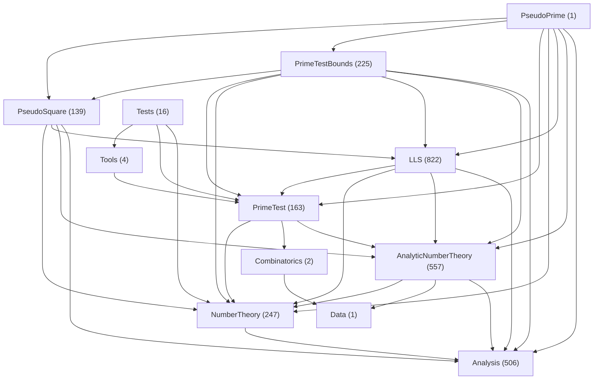

# 名前空間とソース配置

Leanソースの基底名前空間は `PseudoPrime/` を含む親ディレクトリのパスに対応させる。例えば、 `PseudoPrime/Analysis/` の宣言は `PseudoPrime.Analysis` に、 `PseudoPrime/PrimeTestBounds/MillerRabin/` の宣言は `PseudoPrime.PrimeTestBounds.MillerRabin` に配置する。型固有の下位名前空間は、その型を扱うファイル内で使える。

異なる分野の宣言を一つのファイルに混在させない。解析の補助定理とMiller–Rabinへの適用定理が同居する場合は、docstringと証明を含む宣言を分割し、それぞれの名前空間に対応するディレクトリへ移す。配置のみを変更する場合は完全修飾名を保持し、利用側のimportで依存関係を接続する。所属する名前空間も変更する場合は、後述の分離方針に従う。旧import経路を維持するファイルには、転送用の `public import` を置く。

## 一般的な定義・補題の分離

LLSに依存しない一般的な定義・補題は、共通の定義や広い用途を持つものから優先して `PseudoPrime.LLS` から分離し、内容に応じて `PseudoPrime.Analysis`、 `PseudoPrime.NumberTheory`、 `PseudoPrime.AnalyticNumberTheory` などへ配置する。この方針はLLSに限らない。特定の名前空間に固有の概念を必要としないことに加え、実際の共有可能性や分離の必要性も確認して配置を決める。

配置はimportの依存関係だけで判断しない。各宣言の引数、暗黙の引数、型クラス、前提、結論、返り値の型を読み、その名前空間に固有の定義や仮定が必要かを確かめる。 `def` の定義本体や、型の別名・補助定義の展開先も確認する。LLSのファイルからしか使われていないことや、LLSの定理を証明で使っていることだけでは、LLS固有とは判断しない。

各宣言について、前提と主張が数学的に何に依存するかを確認する。前提に現れる対象・条件と、主張に現れる対象・性質が、どの分野の定義や仮定を必要とするかを、補助定義の展開先までたどる。前提・主張の依存と、証明で使う補題への依存を区別し、その宣言が一般の解析・算術だけで述べられるのか、LLSなどの適用先に固有の概念を必要とするのかを確かめて配置を決める。

実数や算術量だけで記述できることは、汎用性の十分条件ではない。核・尺度・係数・誤差予算・開始条件が、どのパラメータの選択に基づくかも確認する。LLSで選んだ核や尺度、定数に特化した評価・数値認証・比較条件は、一般の解析や算術の式だけで書ける場合もLLS側に置く。一部の係数が引数に残っていても、他の尺度や定数がLLSの選択に固定されていれば、それだけで汎用評価とは判断しない。

一般化できることと、共通APIとして切り出す必要性を区別する。仮定する条件や評価の目的によって、使える状況・使われ方が限定される宣言ほど、一般化・分離の必要性は低いと判断する。特に、特定の条件の組合せで使う不等式評価は、引数を増やして一般形にできるだけでは共通APIへ切り出す理由にならない。一般的な定義や広く使える基本的な恒等式を優先し、限定的な評価は共通化する必要が確認できた場合に切り出す。仮定や不等式の有無だけで一律に分類せず、実際の適用範囲と再利用の必要性を確認する。

一般の尺度・係数を引数とし、適用先の選択から独立して成り立つ共通評価と、具体的なパラメータを選んだ後の評価を区別する。前者は共通化の必要性を確認して内容に応じた一般の分野へ置き、後者は適用側へ残す。例えば、LLSの尺度 $T = \log q - \log\log q$ と所定の誤差係数を組み合わせた評価はLLS側に置く。引数にパラメータがあることだけで特殊な評価と判断したり、固定した数値を含むことだけで適用先固有と判断したりせず、前提・主張に現れる選択と適用先の関係を確認する。

例えば、広く共有できる有限群・指標・積分に関する主張は、LLSへの用途があっても一般の分野へ置く。一方、LLS固有の証人や評価条件を前提とする適用定理はLLS側へ残す。一般的な主張の証明がLLS固有の補題に依存している場合は、必要な補題も分離するか、一般的な証明へ組み替える。移動先からLLSをimportして済ませてはならない。

分離時はdocstring・定義本体・証明を一体で移し、名前空間と配置先を対応させ、参照名とimportを更新する。一般の名前空間へ所属を変更する場合は完全修飾名も変更する。既存APIとの互換性が必要な場合は、旧名前空間側に互換用の宣言を置き、新しい一般の宣言を参照させる。

配置変更は、逆依存を生まない依存先から着手する。変更前に前提・主張・定義本体・証明の依存関係を確認し、移動先が必要とする共通の定義・一般補題を先に分離して検証する。移動先が適用側を参照せずに成立することを確認してから、依存する宣言と利用側を順に変更する。対象の依存経路に既存の逆依存がある場合も、先にその依存を解消する。後で修正することを前提に、一般側から適用側へのimportを残したり追加したりしない。

必要な依存を外せず逆依存が残る場合は、依存する宣言の配置が適切でないと判断し、配置を見直す。前提・主張に適用先固有の概念が必要なら適用側へ配置し、一般部分と適用部分が混在しているなら宣言を分割する。配置先を先に固定して逆依存を例外扱いせず、前提・主張と証明の依存に合う配置へ改める。

## 名前空間の依存図

図は配置方針に沿う向きのimportを表示し、図に表示しない依存も下表に列挙する。名前空間単位の集計であり、ファイル単位の循環検査や、各宣言の前提・主張・証明の意味上の監査を代替しない。図と表の両方を確認し、一般側から適用側へ戻る依存は、宣言の配置と数学的な依存に照らして個別に見直す。

<!-- namespace-dependencies:start -->
対象はチェックアウト内のLeanソース 2683 ファイル。隠しディレクトリ・ `archive` ・シンボリックリンク以下は走査しない。未追跡ファイルも含む。Mathlibなどの外部依存と同一グループ内の辺は図から除く。



ノードの括弧内はファイル数。名前は `PseudoPrime.` を省略している。異なるグループ間の直接依存 45 方向のうち、配置方針に沿う 33 方向を表示する。図に表示しない 12 方向は下表にすべて示す。表示する辺はすべて実際のimportに基づく。図から除いた依存がソース上で解消されたことを意味しない。

| 依存元 | 依存先 | import数 |
|---|---|---|
| `Analysis` | `AnalyticNumberTheory` | 25 |
| `Analysis` | `LLS` | 70 |
| `Analysis` | `NumberTheory` | 3 |
| `Analysis` | `PrimeTestBounds` | 4 |
| `Analysis` | `PseudoSquare` | 4 |
| `AnalyticNumberTheory` | `LLS` | 40 |
| `AnalyticNumberTheory` | `PrimeTestBounds` | 1 |
| `LLS` | `PrimeTestBounds` | 5 |
| `LLS` | `PseudoSquare` | 2 |
| `NumberTheory` | `AnalyticNumberTheory` | 1 |
| `PrimeTest` | `PseudoSquare` | 1 |
| `PrimeTest` | `Tests` | 1 |
<!-- namespace-dependencies:end -->

[namespace_dependencies.py](../scripts/namespace_dependencies.py) は、現在のソースから図・件数・省略した依存の表を再生成する。表示方向はスクリプトの `LAYERS` で定める。 `--check` は文書と集計結果の一致だけを検査し、逆依存の解消や配置の妥当性を保証しない。

```powershell
python -X utf8 scripts/namespace_dependencies.py --write
python -X utf8 scripts/namespace_dependencies.py --check
```

## 既存APIを共有する補助ディレクトリ

次のディレクトリ群は共通APIの実装を分野や処理段階で分割している。ディレクトリ名を名前空間へ追加すると既存の型・述語・証人APIを変更するため、以下の基底名前空間を共有する。

| ソースの区分 | 共有する基底名前空間 |
|---|---|
| `PseudoSquare/Bounds`、 `PseudoSquare/Computation` | `PseudoPrime.PseudoSquare` |
| `PrimeTest` 以下のBPSW・EulerJacobi・Lucas・LucasV・MillerRabin・Selfridge・StrongLucasの実装 | `PseudoPrime.PrimeTest` |
| `NumberTheory` 以下のJacobi・JacobiWitness・Kroneckerの実装 | `PseudoPrime.NumberTheory` |
| `AnalyticNumberTheory/NumberField` のDedekind L関数API | `PseudoPrime.AnalyticNumberTheory` |

例外の対象ディレクトリと許可する名前空間は [namespace_layout_policy.json](../scripts/namespace_layout_policy.json) に列挙している。許可は列挙した名前空間に限り、同じ接頭辞を持つ別分野へは広げない。 `PseudoSquare.SmallN` の内部計算も対象ディレクトリと名前空間を個別に指定している。

## 配置の検査

[check_namespace_layout.py](../scripts/check_namespace_layout.py) はコメントと文字列を除き、入れ子の名前空間を解決して宣言の所属を検査する。隠しディレクトリと `archive` 以下は対象外とする。実行用の `main` はモジュール直下に置ける。

```powershell
python -X utf8 scripts/check_namespace_layout.py
python -X utf8 scripts/check_namespace_layout.py --json
```

スクリプトは作業ディレクトリに依存せず、配置違反があれば非ゼロで終了する。検査範囲は宣言の配置であり、定理の型や証明はLeanのビルドとLSP診断で別途確認する。
