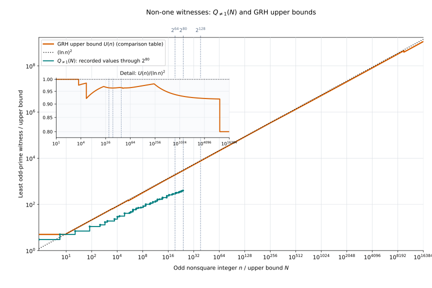
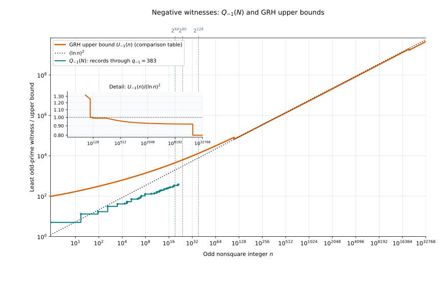

# PseudoSquareのJacobi証人の最大値とGRHに基づく解析的上界

対象: [`PseudoPrime/PseudoSquare`](../PseudoPrime/PseudoSquare)。公開入口は [`PseudoPrime/PseudoSquare.lean`](../PseudoPrime/PseudoSquare.lean)、名前空間は `PseudoPrime.PseudoSquare`。

この領域では、奇数かつ非平方数に対する最小 Jacobi 証人の最大値を定義する。有限計算と Dirichlet 指標・L 関数の解析を組み合わせて、その上界を証明する。実行用の BPSW 本体は [PrimeTest](PrimeTest.md)、Selfridge 固有の上界への接続は [SelfridgeBoundGrh](SelfridgeBoundGrh.md) で扱う。

## 構成

| ディレクトリ | 内容 |
|---|---|
| [Bounds](../PseudoPrime/PseudoSquare/Bounds) | 証人の有限最大、点ごとの上界、対数・初等半径の評価 |
| [Computation](../PseudoPrime/PseudoSquare/Computation) | 小区間の証明書、閾値、剰余類を用いた有限部分の検証 |
| [CharacterBound.lean](../PseudoPrime/PseudoSquare/CharacterBound.lean) | 一般 S1 の結論を Jacobi 値が $-1$ の証人へ変換 |
| [QNeOneConcrete.lean](../PseudoPrime/PseudoSquare/QNeOneConcrete.lean)・[QNeOneFinal.lean](../PseudoPrime/PseudoSquare/QNeOneFinal.lean) | `QNeOne` の上界に向けた解析的三分岐と有限範囲を統合 |

二次指標の構成・原始化・導手算術は [NumberTheory](NumberTheory.md)、一般解析は [Analysis.lean](../PseudoPrime/Analysis.lean)、GRH・L 関数・Riemann の $\zeta$ 関数・ $\xi$ 関数・輪郭と平滑化明示公式は [AnalyticNumberTheory.lean](../PseudoPrime/AnalyticNumberTheory.lean) に分離されている。これらの一般層は PseudoSquare を import しない。LLS には専用の誤差配分・数値分離と結論への接続を置く。 LLS の公開入口と主張は [LLS](LLS.md) を参照する。

## Legendre記号・Jacobi記号とEulerの規準

奇素数全体を次で表す。

$$
\mathbb P_{\mathrm{odd}}
=\left\lbrace p\in\mathbb N:
p\text{ は素数},\ p\ge3\right\rbrace.
$$

$n\in\mathbb Z$ と $p\in\mathbb P_{\mathrm{odd}}$ に対するLegendre記号を次で定義する。

$$
\left(\frac np\right)=
\begin{cases}
0 & p\mid n,\\
1 & p\nmid n\quad\text{かつ}\quad\exists x\in\mathbb Z,\quad x^2\equiv n\pmod p,\\
-1 & p\nmid n\quad\text{かつ}\quad\nexists x\in\mathbb Z,\quad x^2\equiv n\pmod p.
\end{cases}
$$

値 $1$ は非零の平方剰余、値 $-1$ は平方非剰余、値 $0$ は $p\mid n$ を表す。

Legendre記号は次の3値を取り、Eulerの規準（Euler’s criterion）を満たす。

$$
\left(\frac np\right)\in\lbrace-1,0,1\rbrace,
$$

$$
p\in\mathbb P_{\mathrm{odd}},\qquad n\in\mathbb Z
\quad\Longrightarrow\quad
n^{(p-1)/2}\equiv\left(\frac np\right)\pmod p.
$$

特に $p\nmid n$ なら、右辺は $1$ または $-1$ であり、べき乗の剰余から平方剰余か平方非剰余かを判定できる。 $p\mid n$ なら両辺は法 $p$ で $0$ となる。この式は奇素数を分母とする主張であり、合成数 $b$ に置き換えた同じ式が一般に成り立つわけではない。

正の奇数 $b$ の素因数分解を $b=\prod_{j=1}^r p_j^{e_j}$ とする。ただし $p_j$ は相異なる奇素数、 $e_j\ge1$ である。Jacobi記号を次で定義する。

$$
n\in\mathbb Z,\qquad b\in\mathbb N,\qquad b\ge1,\qquad b\equiv1\pmod2,
$$

$$
\left(\frac nb\right)
=\prod_{j=1}^r\left(\frac n{p_j}\right)^{e_j},
\qquad
\left(\frac n1\right)=1.
$$

分母が奇素数ならLegendre記号と一致し、Leanでは `jacobiSym n b` と表す。Jacobi記号は $0,1,-1$ のいずれかであり、

$$
\left(\frac nb\right)=0
\quad\Longleftrightarrow\quad
\gcd(n,b)>1.
$$

合成数 $b$ では、Jacobi記号が $1$ でも $n$ が法 $b$ の平方剰余とは限らない。例えば $\left(\frac2{15}\right)=1$ だが、 $x^2\equiv2\pmod{15}$ を満たす整数 $x$ は存在しない。

## $Q_{\ne1}$ と $Q_{-1}$ の定義

正の奇数かつ非平方数の集合と、その有限範囲を次で定義する。

$$
\mathcal A
=\left\lbrace n\in\mathbb N:
n\ge1,\quad n\equiv1\pmod2,\quad
\forall m\in\mathbb N,\ n\ne m^2\right\rbrace,
\qquad
\mathcal A(B)=\left\lbrace n\in\mathcal A:n\le B\right\rbrace
\quad(B\in\mathbb N).
$$

$n\in\mathcal A$ に対する最小奇素数証人を $q_{\ne1}(n)$、 $q_{-1}(n)$ と表し、次で定義する。

$$
q_{\ne1}(n)
=\min\left\lbrace q\in\mathbb P_{\mathrm{odd}}:
\left(\frac nq\right)\ne1\right\rbrace,
\qquad
q_{-1}(n)
=\min\left\lbrace q\in\mathbb P_{\mathrm{odd}}:
\left(\frac nq\right)=-1\right\rbrace.
$$

両方の証人集合が非空であることは、GRHを仮定せずに証明されている。非1証人は記号の値 $0$ も許すため、 $q\mid n$ による因子検出を含む。負値証人では値 $-1$ を要求するので、必ず $q\nmid n$ となる。

最小証人の有限最大値を次で定義する。

$$
Q_{\ne1}(B)
=\max\left(
\left\lbrace0\right\rbrace
\cup\left\lbrace q_{\ne1}(n):n\in\mathcal A(B)\right\rbrace
\right),
$$

$$
Q_{-1}(B)
=\max\left(
\left\lbrace0\right\rbrace
\cup\left\lbrace q_{-1}(n):n\in\mathcal A(B)\right\rbrace
\right).
$$

$\mathcal A(B)$ が空なら両者は $0$ である。Leanの定義との対応は次のとおりである。

| 数学的記号 | Leanの定義 |
|---|---|
| $q_{\ne1}(n)$ | `NumberTheory.primeNeOneWitness n h` |
| $q_{-1}(n)$ | `NumberTheory.primeNegOneWitness n h` |
| $Q_{\ne1}(B)$ | `QNeOne B` |
| $Q_{-1}(B)$ | `QNegOne B` |

ここで `h` は該当する証人集合の非空性の証明である。最小証人は [JacobiWitness/Basic.lean](../PseudoPrime/NumberTheory/JacobiWitness/Basic.lean)、非空性は [JacobiWitness/Existence.lean](../PseudoPrime/NumberTheory/JacobiWitness/Existence.lean)、有限最大値は [Bounds/WitnessMaximum.lean](../PseudoPrime/PseudoSquare/Bounds/WitnessMaximum.lean) にある。いずれも数学的な定義は `noncomputable` である。

負値証人は非1証人でもあるため、次が成り立つ。

$$
n\in\mathcal A
\quad\Longrightarrow\quad q_{\ne1}(n)\le q_{-1}(n),
\qquad
B\in\mathbb N
\quad\Longrightarrow\quad Q_{\ne1}(B)\le Q_{-1}(B).
$$

後半に対応するLeanの定理は `QNeOne_le_QNegOne` である。許容入力はすべての正の奇数かつ非平方数であり、古典的なpseudosquareの条件 $n\equiv1\pmod8$ に限定していない。

## GRH の下での Legendre 記号の証人


[GRH/Definition.lean](../PseudoPrime/AnalyticNumberTheory/GRH/Definition.lean) の `PseudoPrime.AnalyticNumberTheory.GRH.GeneralizedRiemannHypothesis` が解析的前提である。 `GeneralizedRiemannHypothesis.riemann` により RH を取り出せるが、GRH 自体を証明するものではない。

分母の証人 $q$ は奇素数なので、以下のJacobi記号はLegendre記号と一致する。 $\ln$ は自然対数を表す。

### Legendre 記号が $1$ でない素数証人とその上界の拡張・改良

#### 全入力に対する上界

$$
\mathrm{GRH},\qquad n\in\mathcal A
\quad\Longrightarrow\quad
\exists q\in\mathbb P_{\mathrm{odd}},\quad
\left(\frac nq\right)\ne1,\quad
q\le\max\left\lbrace5,(\ln n)^2\right\rbrace.
$$

$$
\mathrm{GRH},\qquad B\in\mathbb N,\qquad B\ge10
\quad\Longrightarrow\quad Q_{\ne1}(B)\le(\ln B)^2.
$$

存在定理は [Bounds/PointwiseWitness.lean](../PseudoPrime/PseudoSquare/Bounds/PointwiseWitness.lean) の
`exists_prime_ne_one_witness_of_grh`、有限最大値の定理は `QNeOne_le_log_sq_of_grh` である。
`QNeOne_le_greatestOddPrimeLE_of_grh` は同じ前提で、その半径以下の最大奇素数による上界を与える。
`primeNeOneWitness_cast_le_log_sq_of_11_le` は $n\in\mathcal A$、 $n\ge11$ の最小証人を直接 $(\ln n)^2$ 以下に評価する。
非1証人は値 $0$ も許すため、法を割る素数も証人となる。

#### 平方自由部分への正確な還元と指数改善の拡張

この項では $P^-(n)$ を $n$ の最小素因数とする。

$$
\begin{gathered}
n > 0,\quad n\text{ は奇数かつ非平方},\quad
n=ds^2,\quad d > 1,\quad d\text{ は平方自由}
\\
\Longrightarrow\quad
q_{\ne1}(n)=\min\bigl(P^-(n),q_{\ne1}(d)\bigr).
\end{gathered}
$$

[SquarefreeReduction.lean](../PseudoPrime/NumberTheory/JacobiWitness/SquarefreeReduction.lean) の
`primeNeOneWitness_eq_min_minFac_squarefree` が対応する。
$p\mid n$ なら値0の非1証人となり、$p\nmid n$ なら平方因子が記号の値に影響しない。
これは証人集合から導いた無条件の等式であり、複数の評価式を最小値で結合したものではない。

$$
\begin{gathered}
\mathrm{GRH},\quad n > 0,\quad n\text{ は奇数かつ非平方},\quad
n=ds^2,\quad d\text{ は平方自由}
\\
\Longrightarrow\quad q_{\ne1}(n)\le\max\bigl(5,(\ln d)^2\bigr).
\end{gathered}
$$

[SquarefreeNeOneWitnessBounds.lean](../PseudoPrime/PseudoSquare/Bounds/SquarefreeNeOneWitnessBounds.lean) の
`primeNeOneWitness_le_squarefree_log_square` が最小証人版、
`exists_odd_prime_ne_one_le_squarefree_log_square` が素数証人の存在版である。
$d=3,5,7$ の既存証人と $d\ge11$ の対数二乗定理を再利用する。
平方因子側の素因数を割る候補も値0の証人として使えるため、負値証人のような除外費用は生じない。

$$
\begin{gathered}
\mathrm{GRH},\quad n > 0,\quad n\text{ は奇数かつ非平方},\quad
n=ds^2,\quad d\text{ は平方自由},\quad L=\ln n,
\\
0 < \varepsilon < 2,\quad5\le L^{2-\varepsilon},\quad
\ln d\le L^{1-\varepsilon/2}
\\
\Longrightarrow\quad q_{\ne1}(n)\le L^{2-\varepsilon}.
\end{gathered}
$$

`primeNeOneWitness_le_log_power_of_squarefree_log` がこの帰結を証明する。
平方自由部分に条件を課した指数改善であり、全入力一様の主張ではない。
この上界は $d$ にも依存するため、$n$ だけで比較する後節の区間表には含めていない。

#### 根から1/1000を引く非1証人上界

$$
F(t)=\left(\ln t-\frac1{1000}\right)^2.
$$

点ごとの評価の前提と結論は次のとおりである。

$$
\mathrm{GRH},\qquad n\in\mathbb N,\qquad n\ge2984,\qquad
n\equiv1\pmod2,\qquad\neg\mathrm{IsSquare}(n)
$$

$$
\Longrightarrow\quad
\exists q\in\mathbb P_{\mathrm{odd}},\quad
\left(\frac nq\right)\ne1,\quad q\le F(n) < (\ln n)^2.
$$

有限最大値については、上の記号で次を証明した。

$$
\mathrm{GRH},\qquad B\in\mathbb N,\qquad B\ge2984
\quad\Longrightarrow\quad Q_{\ne1}(B)\le F(B).
$$

[QNeOneRetainedReciprocalAnalytic.lean](../PseudoPrime/PseudoSquare/QNeOneRetainedReciprocalAnalytic.lean) の
`exists_prime_ne_one_witness_le_retained_reciprocal_shift_and_lt_log_sq_of_ge_2984` と
`QNeOne_le_retained_reciprocal_shift_of_ge_2984` が対応する。
最小証人も同じ端点で評価している。

新しい解析は平方自由部分 $d\ge2984$ に対して
$q\le(\ln d-1/1000)^2$ を証明する。素数2の値 $0,1,-1$ を分岐して補正を保つ。
小さい平方自由部分には既存のGRH点ごとの定理と証人の整数性を再利用し、
新しい有限証明書は生成していない。全入力の有限最大値もこの共通端点へ接続した。

#### 根から1/10を引く非1証人上界

正の実数 $t$ に対して、

$$
F_{1/10}(t)=\left(\ln t-\frac1{10}\right)^2
$$

と定める。

$$
\begin{gathered}
\mathrm{GRH},\qquad n\in\mathbb N,\qquad n\ge3295,\\
n\equiv1\pmod2,\qquad\neg\mathrm{IsSquare}(n)
\end{gathered}
\quad\Longrightarrow\quad
\exists q\in\mathbb P_{\mathrm{odd}},\quad
\left(\frac nq\right)\ne1,\quad q\le F_{1/10}(n)<(\ln n)^2.
$$

$$
\mathrm{GRH},\qquad B\in\mathbb N,\qquad B\ge3295
\quad\Longrightarrow\quad Q_{\ne1}(B)\le F_{1/10}(B).
$$

[QNeOneDeciShiftBounds.lean](../PseudoPrime/PseudoSquare/QNeOneDeciShiftBounds.lean) の
`exists_prime_ne_one_witness_le_deci_shift_and_lt_log_sq_of_ge_3295` と
`QNeOne_le_deci_shift_of_ge_3295` が対応する。最小証人も同じ端点で評価する。

$t\ge3295$ では $F_{1/10}(t)<F(t)$ であり、補正 $1/1000$ の上界をさらに小さくする。
解析的な三分岐比較で根と導手上界の差を $1/10$ まで許すことで得た。
小さい平方自由部分の処理は既存のGRH定理を再利用し、入力別の有限証明書は追加していない。
補正 $1/1000$ の定理は $2984\le n<3295$ の範囲も扱うため、そのまま残している。
負値証人の上界からも、 $q_{\ne1}(n)\le q_{-1}(n)$ と $Q_{\ne1}(B)\le Q_{-1}(B)$ により非1証人の上界が得られる。係数 $99/100$ と $9999/10000$ の結果は、次の負値証人の節にまとめる。

#### 根から1/2を引く非1証人上界

$$
\mathrm{GRH},\quad n\in\mathcal A,\quad\ln n\ge\frac{25}{2}
\quad\Longrightarrow\quad
\exists q\in\mathbb P_{\mathrm{odd}},\quad
\left(\frac nq\right)\ne1,\quad
q\le\left(\ln n-\frac12\right)^2 < (\ln n)^2.
$$

$$
\mathrm{GRH},\quad B\in\mathbb N,\quad\ln B\ge\frac{25}{2}
\quad\Longrightarrow\quad
Q_{\ne1}(B)\le\left(\ln B-\frac12\right)^2.
$$

[QNeOneHalfShiftBounds.lean](../PseudoPrime/PseudoSquare/QNeOneHalfShiftBounds.lean) の
`exists_prime_ne_one_witness_le_half_shift_and_lt_log_sq` と `QNeOne_le_half_shift` が対応する。
同じ範囲では補正 $1/10$ の式より小さい。値 $0$ を許す非1証人の定理であり、負値証人の定理ではない。

根 $y\ge12$ と導手の対数上界 $L\le y+1/2$ に対し、分離式の正値性を半直線全体で証明した。
証明では有理対数下界の分母を払った5次多項式の全係数が正となる。
平方自由部分の対数を別に保持し、共通端点 $y=\ln B-1/2$ を使うため、小さい入力も同じ解析的比較で扱える。
入力の有限列挙や、小さい平方自由部分を扱うための有限証明書は追加していない。

#### 負の対数補正を持つ非1証人上界

$$
\mathrm{GRH},\quad n\in\mathcal A,\quad\ln n\ge16
\quad\Longrightarrow\quad
q_{\ne1}(n)\le\left(\ln n-\ln\ln n+3\right)^2.
$$

$$
\mathrm{GRH},\quad B\in\mathbb N,\quad\ln B\ge16
\quad\Longrightarrow\quad
Q_{\ne1}(B)\le\left(\ln B-\ln\ln B+3\right)^2.
$$

[QNeOneLogShiftBounds.lean](../PseudoPrime/PseudoSquare/QNeOneLogShiftBounds.lean) の
`primeNeOneWitness_cast_le_log_shift_endpoint` と `QNeOne_le_log_shift` が対応する。
さらに $\ln n\ge32$ では、この上界が $(\ln n)^2$ より小さいことと、その範囲に奇素数の非1証人が存在することを
`exists_prime_ne_one_witness_le_log_shift_and_lt_log_sq` で証明している。

解析では $y\ge12$、 $L\le y+\ln y-2$ の分離条件を半直線全体で認証した。
$L\ge16$ に対し $y=L-\ln L+3$ がその条件を満たすことを、対数の接線不等式から導く。
小さい入力を含む共通端点への接続を使い、入力別の有限証明書は追加していない。
この式も値 $0$ を許す非1証人の上界であり、負値証人の上界ではない。

#### 定数11/4への改良と開始尺度96

$$
\mathrm{GRH},\quad n\in\mathcal A,\quad L=\ln n\ge96
\quad\Longrightarrow\quad
q_{\ne1}(n)\le\left(L-\ln L+\frac{11}{4}\right)^2.
$$

$$
\mathrm{GRH},\quad B\in\mathbb N,\quad\ln B\ge96
\quad\Longrightarrow\quad
Q_{\ne1}(B)\le\left(\ln B-\ln\ln B+\frac{11}{4}\right)^2.
$$

[ElevenFourthsFromNinetySix.lean](../PseudoPrime/PseudoSquare/Bounds/ElevenFourthsFromNinetySix.lean) の
`primeNeOneWitness_cast_le_elevenFourths_log_shift_from_96` と
`QNeOne_cast_le_elevenFourths_log_shift_from_96` が対応する。

$$
L\ge96\quad\Longrightarrow\quad
\left(L-\ln L+\frac{11}{4}\right)^2 < (L-\ln L+3)^2,\qquad
\left(L-\ln L+\frac{11}{4}\right)^2 < L^2.
$$

これらの比較も同ファイルで証明している。
さらに $128\le L\le384$ では、係数99/100の式より小さいことを
[ElevenFourthsLogShift.lean](../PseudoPrime/PseudoSquare/Bounds/ElevenFourthsLogShift.lean) の
`elevenFourths_log_shift_sq_lt_nearSquare` が示す。

導手と素数2での指標値を連動させ、逆数側と主項側の費用を別々に保持する。
半径 $y=L-\ln L+11/4$ について、 $94\le y\le120$ は対数の連動下界を、
$y\ge120$ は既存の半直線比較を使う。整数入力の有限列挙は追加していない。
この結果は値0を許す非1証人の上界である。

#### 補正定数37/5と開始尺度50による係数2の負の対数補正

実数 $L > 0$ に対して

$$
T(L)=L-2\ln L+\frac{37}{5}
$$

と定める。

$$
\mathrm{GRH},\quad n\in\mathcal A,\quad\ln n\ge50
\quad\Longrightarrow\quad
q_{\ne1}(n)\le T(\ln n)^2 < (\ln n)^2.
$$

$$
\mathrm{GRH},\quad B\in\mathbb N,\quad\ln B\ge50
\quad\Longrightarrow\quad
Q_{\ne1}(B)\le T(\ln B)^2 < (\ln B)^2.
$$

[FiniteScaleShiftedDoubleLogBounds.lean](../PseudoPrime/PseudoSquare/Bounds/FiniteScaleShiftedDoubleLogBounds.lean) の
`primeNeOneWitness_cast_le_shiftedDoubleLog_from_fifty`、 `QNeOne_le_shiftedDoubleLog_from_fifty` が対応する。
`exists_prime_ne_one_le_shiftedDoubleLog_from_fifty_of_le` は、対象入力 $n\le B$ に共通尺度 $B$ の証人を与える。狭義対数二乗との比較は `shiftedDoubleLogRoot_sq_lt_log_sq_from_fifty` で証明した。

素数2での指標値と導手の大きさを連動させ、逆数重み付き和と対数重み付き和の二つの費用を残す。
端点極限の多項式の係数は $y\ge49$ で非負となる。残りは $y\ge1$ における

$$
\frac{79}{2000}y+14+\frac{15}{2}\ln y-2(\ln y)^2 > 0
$$

という汎用評価へ帰着した。入力整数は列挙しない。 $\ln y\le5$ では因数分解し、 $\ln y\ge5$ では指数関数のTaylor下界を使う。
分離条件と導手の費用は [FiniteScaleShiftedDoubleLogRoot.lean](../PseudoPrime/LLS/FiniteScaleShiftedDoubleLogRoot.lean) で証明した。

$$
L\ge96,\quad\ln L > \frac{93}{20}
\quad\Longrightarrow\quad
T(L)^2 < \left(L-\ln L+\frac{11}{4}\right)^2.
$$

開始尺度96での比較は [ShiftedOddEndpointDoubleLogBounds.lean](../PseudoPrime/PseudoSquare/Bounds/ShiftedOddEndpointDoubleLogBounds.lean) の `shiftedDoubleLogRoot_sq_lt_elevenFourths` が証明する。
同じ適用範囲で旧補正定数149/20の式より狭義に小さいことも、 `shiftedDoubleLogRoot_sq_lt_sharp` で証明した。素数2での原始指標値が0の枝では $(\ln X-\ln2/2)^2/2$、非零の枝では $(\ln X)^2/2$ の費用を用いた。半対数シフトを保持した改善である。

$$
L\ge50,\quad\ln L > \frac{22}{5}
\quad\Longrightarrow\quad
T(L)^2 < (L-\ln L+3)^2.
$$

`shiftedDoubleLogRoot_sq_lt_log_shift_from_fifty` が対応する。これにより、 $\exp(22/5) < L < 96$ でも従来の最良式を改善する。
値0を許す非1の奇素数証人の結果であり、負値証人の式ではない。

#### 中間尺度で改良した非1証人の一次半径

実数 $L$ に対して

$$
R_{\mathrm{odd}}(L)=\frac{3200}{3241}\left(L-\frac{18}{25}\right)
$$

と定める。前提と主張は次のとおりである。

$$
\begin{gathered}
\mathrm{GRH},\quad n\in\mathcal A,\quad
\frac{3259}{25}\le\ln n\le\frac{16277}{100}
\\
\Longrightarrow\quad q_{\ne1}(n)\le R_{\mathrm{odd}}(\ln n)^2.
\end{gathered}
$$

$$
\begin{gathered}
\mathrm{GRH},\quad B\in\mathbb N,\quad
\frac{3259}{25}\le\ln B\le\frac{16277}{100}
\\
\Longrightarrow\quad Q_{\ne1}(B)\le R_{\mathrm{odd}}(\ln B)^2.
\end{gathered}
$$

[OddMidscaleEndpointBounds.lean](../PseudoPrime/PseudoSquare/Bounds/OddMidscaleEndpointBounds.lean)
の `primeNeOneWitness_cast_le_oddMidscale` と `QNeOne_le_oddMidscale` が対応する。
値0を許す奇素数の非1証人の上界であり、負値証人の上界ではない。

同じ区間全体で、従来の半径 $T(L)=L-2\ln L+149/20$ に対して

$$
\frac{3259}{25}\le L\le\frac{16277}{100}
\quad\Longrightarrow\quad R_{\mathrm{odd}}(L)^2 < T(L)^2
$$

が成立する。
[OddMidscaleEndpointRadius.lean](../PseudoPrime/LLS/OddMidscaleEndpointRadius.lean)
の `oddMidscaleEndpointRadius_sq_lt_sharpDoubleLog_sq` がこの比較を証明する。
適用区間は $130.36\le L\le162.77$、半径の範囲は $128\le R_{\mathrm{odd}}(L)\le160$ である。

主項には自然対数の下側の弦を使い、二進補正の二つの費用には上側の接線を使う。
四次式を5個の有理Bernstein係数で認証し、導手と素数2での指標値を連動させた。
整数入力の有限列挙は使っていない。

#### 共通誤差を保持した非1証人上界

$$
V_{\ne1}(L)=\frac{99}{40}
\left(\frac{500}{821}\left(L+\frac75\right)+\frac{213}{20}\right)^2.
$$

$$
\mathrm{GRH},\quad n\in\mathcal A,\quad\ln n\ge500
\quad\Longrightarrow\quad
q_{\ne1}(n)\le V_{\ne1}(\ln n) < (\ln n)^2.
$$

$$
\mathrm{GRH},\quad B\in\mathbb N,\quad\ln B\ge500
\quad\Longrightarrow\quad
Q_{\ne1}(B)\le V_{\ne1}(\ln B) < (\ln B)^2.
$$

[TwoPolePrefixBounds.lean](../PseudoPrime/PseudoSquare/Bounds/TwoPolePrefixBounds.lean) の
`primeNeOneWitness_cast_le_eulerPrefixTwoPole` と `QNeOne_le_eulerPrefixTwoPole` が対応する。
実際の奇素数証人の存在も `exists_prime_ne_one_witness_le_eulerPrefixTwoPole` で証明している。

実軸Euler和を非負な和として保持し、二極Poisson核でGamma零点和を評価する。
実部の符号を保持して非正の積分項を除き、導手を含まない左積分の費用を用いる。
非1奇素数証人が存在しないと仮定すると、法の奇素因数は切断点を超えるが、素数2の局所費用は残る。
偶指標のGamma固定費用を $112/25$ に抑え、素数2の費用は切断点の対数式として保持する。
証人不存在の反証仮定の下で、奇数支持の素数3・5から少なくとも $7/8$ のEuler寄与を差し引く。
尺度依存の誤差分子を保持し、鋭い主指標上界の対数部分の節約で素数2の費用を賄う。
定数部分の節約も保持し、根の加法定数 $213/20$ で分離を得る。
ランプと主指標に共通の誤差を合成した比較は
[JointRampPrincipalWitnessBounds.lean](../PseudoPrime/LLS/JointRampPrincipalWitnessBounds.lean)、
数値分離は [TwoPolePrincipalPrefixBounds.lean](../PseudoPrime/LLS/TwoPolePrincipalPrefixBounds.lean) にある。
これにより、対数尺度500以上の半直線上で数値分離を証明した。

有限最大値では、すべての $n\in\mathcal A$、 $n\le B$ に共通の補助法 $4B$ を使う。
小さい入力も同じ解析評価に含めるため、入力整数の有限証明書は追加していない。
この上界は値0を許す非1証人に対するもので、負値証人には適用しない。

#### 係数4/5と開始尺度22221

$$
\mathrm{GRH},\quad n\in\mathcal A,\quad\ln n\ge22221
\quad\Longrightarrow\quad q_{\ne1}(n)\le\frac45(\ln n)^2.
$$

$$
\mathrm{GRH},\quad B\in\mathbb N,\quad\ln B\ge22221
\quad\Longrightarrow\quad Q_{\ne1}(B)\le\frac45(\ln B)^2.
$$

[GammaPrincipalEulerNonOneBounds.lean](../PseudoPrime/PseudoSquare/Bounds/GammaPrincipalEulerNonOneBounds.lean) の
`exists_prime_ne_one_witness_le_gamma_log_22221` と `QNeOne_le_gamma_log_22221` が対応する。
符号付き左積分で導手項を保持し、共通端点で小さい平方自由部分も扱う。
正の入力から作る二次指標は偶指標であり、原始指標への移行でも偶性を保つ。
実軸Euler和の非負性と偶指標の符号付きGamma項を使い、固定費用を $541/50$ に抑える。
誤差評価には $L\ge15000$ と $\ln L\le L/2000$ を使う。
具体的には、 $L\ge22221$ でこの対数条件と

$$
\frac{541}{50}+\frac{1647}{100}+\frac{11783423}{25000000}\cdot\frac75
\le\frac{L}{795}
$$

が成立する。新しい初期区間証明書や入力整数の有限証明書は追加していない。
この開始尺度では係数99/100の式より小さく、定数11/4の半径も $(9/10)\ln n$ より大きいため、
掲載式の中では係数4/5の式が最小となる。

### Legendre 記号が $-1$ となる素数証人とその上界の拡張・改良

#### 全入力に対する上界

正の実数 $t\ge3$ に対して、

$$
R(t)=\left(\ln(4t)+\frac{24}{5}\ln\ln(4t)+3\right)^2
$$

と置く。

$$
\mathrm{GRH},\qquad n\in\mathcal A
\quad\Longrightarrow\quad
\exists q\in\mathbb P_{\mathrm{odd}},\quad
\left(\frac nq\right)=-1,\quad q\le R(n).
$$

$$
\mathrm{GRH},\qquad B\in\mathbb N,\qquad B\ge3
\quad\Longrightarrow\quad
Q_{-1}(B)\le R(B).
$$

存在定理は [Bounds/PointwiseWitness.lean](../PseudoPrime/PseudoSquare/Bounds/PointwiseWitness.lean) の
`exists_prime_neg_one_witness_of_grh`、有限最大値の定理は `elementary_formula_explicit` である。
値 $-1$ を要求するため、証人 $q$ は必ず $n$ を割らない。

#### 固定尺度による4093の有界区間上界

$$
\mathrm{GRH},\quad n\in\mathcal A,\quad
10\le\ln n\le\frac{1609}{25}
\quad\Longrightarrow\quad q_{-1}(n)\le4093.
$$

[Phase64RetainedExcessJacobiCell.lean](../PseudoPrime/LLS/Phase64RetainedExcessJacobiCell.lean) の
`exists_odd_prime_negative_phase64_retained_fixed_cap` が、4093以下の奇素数負値証人を与える。
最小証人への上界は最小性から従う。
固定尺度64の解析比較で局所超過費用を精密に保持し、入力整数の有限列挙を使わずに証明している。

この式は $R(n) > 4093$ となる区間で従来の明示式より小さい。
さらに $63977/1000\le\ln n\le1609/25$ では $q_{-1}(n) < (\ln n)^2$ となる。
有界区間の結果であり、その先の半直線上界は主張しない。
以下の表では点ごとの最小証人にだけこの式を使い、
有限最大値の行は専用の公開定理に対応する上界を示す。

#### 係数99/100の大尺度上界

前提と点ごとの主張は次のとおりである。ここで $L=\ln n$ は自然対数の尺度であり、開始条件は $\ln n\ge290$ である。

$$
\mathrm{GRH},\quad n\in\mathbb N,\quad n\ge1,\quad
n\equiv1\pmod2,\quad \forall m\in\mathbb N,\ n\ne m^2,\quad \ln n\ge290
$$

$$
\Longrightarrow\quad
q_{-1}(n)\le\frac{99}{100}(\ln n)^2 < (\ln n)^2.
$$

有限最大値については、同じ共通端点で次を得る。

$$
\mathrm{GRH},\quad B\in\mathbb N,\quad \ln B\ge290
\quad\Longrightarrow\quad
Q_{-1}(B)\le\frac{99}{100}(\ln B)^2.
$$

[GammaMixedLog290Bounds.lean](../PseudoPrime/PseudoSquare/Bounds/GammaMixedLog290Bounds.lean) の
`primeNegOneWitness_bound_mixed_log_290`、`primeNeOneWitness_bound_mixed_log_290` と
`QNegOne_bound_mixed_log_290`、`QNeOne_bound_mixed_log_290` が
開始対数尺度290の上界を与える。以下は尺度550以上で再利用する定理である。

[GammaPrincipalPairedBounds.lean](../PseudoPrime/PseudoSquare/Bounds/GammaPrincipalPairedBounds.lean) の
`exists_prime_neg_one_witness_le_nearSquare_gamma_log_550` と
`QNegOne_le_nearSquare_gamma_log_550` が負値証人を扱う。
[GammaPrincipalPairedNonOneBounds.lean](../PseudoPrime/PseudoSquare/Bounds/GammaPrincipalPairedNonOneBounds.lean) は
非1証人の最小値と有限最大値へ接続する。

係数99/100の評価では、ランプ端点の結合に加え、RH下の $\xi'/\xi$ の非負な零点和を用いる。符号付き係数を保った共通の素数冪和を $25/2$ 未満に抑え、開始対数尺度を550へ下げた。新しい有限入力の証明書は生成していない。非1証人に対する2984からの負の補正とは、それぞれの前提で成立する別の上界である。

##### 係数99/100の証明に用いる混合Euler評価

$$
\mathrm{GRH},\quad n\text{ は非平方正奇数},\quad300\le\ln n\le310
$$

ならば

$$
q_{-1}(n)\le\frac{99}{100}(\ln n)^2 < (\ln n)^2.
$$

また、正整数 $B$ について

$$
\mathrm{GRH},\quad300\le\ln B\le310
\Longrightarrow
Q_{-1}(B)\le\frac{99}{100}(\ln B)^2 < (\ln B)^2.
$$

`GammaMixedProfileBounds.lean` で、最小証人と全対象の有限最大値へ接続した。小素数のノード区間と20以上の素数の共通Euler上界を組み合わせ、分離式の正値性までLeanで認証している。この有界区間を含む $300\le L\le550$ の解析評価を接続し、`GammaMixedHalflineBounds.lean` では $L\ge300$ 全域へ延長した。

基準点50000からの非負の部分和の下界を用い、 $[290,295]$ と $[295,300]$ の局所行・誤差を認証して、上記の半直線上界を290以上へ延長した。幾何と双対費用の移送は、開始尺度300に依存しない汎用補題を使う。

#### 係数9999/10000の上界と開始尺度255

$$
\mathrm{GRH},\quad n\in\mathcal A,\quad\ln n\ge255
\quad\Longrightarrow\quad
q_{-1}(n)\le\frac{9999}{10000}(\ln n)^2 < (\ln n)^2.
$$

$$
\mathrm{GRH},\quad B\in\mathbb N,\quad\ln B\ge255
\quad\Longrightarrow\quad
Q_{-1}(B)\le\frac{9999}{10000}(\ln B)^2 < (\ln B)^2.
$$

[GammaJointEntranceBounds.lean](../PseudoPrime/PseudoSquare/Bounds/GammaJointEntranceBounds.lean) の
`primeNegOneWitness_cast_le_joint_entrance_endpoint`、`primeNeOneWitness_bound_joint_entrance_log_255` と
`QNegOne_bound_joint_entrance_log_255`、`QNeOne_bound_joint_entrance_log_255` が対応する。
尺度を $x=(101/250)L^2$ とし、主指標和とramp和に共通する算術誤差を結合して評価する。
素数別の既存データを小さい尺度へ移す汎用補題と、区間全体での改善量 $1/3$ を使い、 $255\le L\le260$ の分離条件を証明した。
新しい素数別の数値表は生成せず、350以下の奇素数について既存行から計算する有理費用和を $769/200$ 以下と検証している。
260以上の既存結果へ接続し、 $L\ge255$ 全域で同じ係数9999/10000の式を証明している。入力 $n$ の有限列挙は用いない。
上記の係数99/100の定理は開始尺度290から使える別の評価である。

#### 切断対数と素因数除外費用を保持した二極上界

実数 $T > 0$、 $L > 0$ に対して次を定める。

$$
H_{-1}(T)=\frac{500}{821}T+\frac{11}{10}\ln T+6,\qquad
V_{-1}(L)=\frac{99}{40}H_{-1}\left(L+\frac75\right)^2.
$$

$$
\mathrm{GRH},\quad n\in\mathcal A,\quad\ln n\ge500
\quad\Longrightarrow\quad q_{-1}(n)\le V_{-1}(\ln n).
$$

$$
\mathrm{GRH},\quad B\in\mathbb N,\quad\ln B\ge500
\quad\Longrightarrow\quad Q_{-1}(B)\le V_{-1}(\ln B).
$$

$$
L\ge550\quad\Longrightarrow\quad V_{-1}(L) < L^2.
$$

$$
L\ge600\quad\Longrightarrow\quad
V_{-1}(L) < \frac{99}{100}L^2 < L^2.
$$

[QuarterLogClippedNegOneBounds.lean](../PseudoPrime/PseudoSquare/Bounds/QuarterLogClippedNegOneBounds.lean) の
`primeNegOneWitness_cast_le_quarterClippedTwoPole_logarithmic` と
`QNegOne_le_quarterClippedTwoPole_logarithmic` が対応する。
共通の補助法 $4B$ により小さい対象入力も覆い、入力整数の有限証明書は使わない。

偶指標のGamma固定費用 $112/25$ と、認証済みアンカー128から得たEuler和の下界を使う。
探索上限を $b=(99/40)x$ とすると、Euler和による節約から素数2の費用を引いた量は

$$
\frac{3643}{1000}-5b^{-1/4}-\frac{\ln2}{5}
$$

以上である。原始指標の導手を $f$、元の法を $q$ とすると、
残る素数冪の除外費用は主指標の部分和と $(3/10)\ln(q/f)+(1/5)\ln2$ で抑えられる。
導手の対数に含まれる節約を、除外費用に $3/10$、局所補正に $1/5$ と配分して相殺する。

主指標の共通誤差全体で連続な切断対数 $\ln(\max(1,t))$ を保持し、尺度依存の対数誤差を除いた。主項係数 $133/160$、分離した反射Euler誤差、下記の素因数個数評価を組み合わせる。
解析的分離は [QuarterLogClippedNegativeBounds.lean](../PseudoPrime/LLS/QuarterLogClippedNegativeBounds.lean) で証明した。
同じ適用域 $L\ge500$ で、従来の対数係数 $33/20$・加法定数 $6$ の式より厳密に小さい。
適用開始尺度は500であり、尺度550から $L^2$ 未満が続く。尺度600以上では $(99/100)L^2$ 未満となる。

導手節約の配分は [ParameterizedConductorPrefixBounds.lean](../PseudoPrime/LLS/ParameterizedConductorPrefixBounds.lean) で一般化した。
非負実数 $a,d$ を用い、素数ごとの費用を $a\ln p$ と素数2での追加費用 $d$ で抑えれば、
局所補正に配分する係数は $1/2-a$ となり、 $(1/2-a)\sqrt{x}\ge1$ が吸収条件となる。
今回の明示式は $a=3/10$、 $d=(1/5)\ln2$ の特殊化である。

正整数 $d,A$ に対し、 $\omega(d)$ を異なる素因数の個数とすると、

$$
0 < d\le A\quad\Longrightarrow\quad
\omega(d)\le\frac{13}{2}+\frac14\ln A.
$$

[QuarterLogPrimeFactorBounds.lean](../PseudoPrime/AnalyticNumberTheory/Arithmetic/QuarterLogPrimeFactorBounds.lean) では、64未満の18素数の対数欠損を有理数で抑える。 $\ln A > 32$ では従来の $5/2+(3/8)\ln A$ より小さく、負値証人の素因数除外費用を減らせる。固定の18素数に関する検査を使うが、入力整数の有限列挙は使わない。

任意の主指標下界とアンカーの節約を受け取る汎用定理を経由して、実際の負値素数を抽出する。この節の閉じた上界には、別途検証する数値分離条件を残していない。

#### 係数4/5と開始値 $10^{19978}$

$$
\mathrm{GRH},\quad n\in\mathcal A,\quad n\ge10^{19978}
\quad\Longrightarrow\quad q_{-1}(n)\le\frac45(\ln n)^2.
$$

$$
\mathrm{GRH},\quad B\in\mathbb N,\quad B\ge10^{19978}
\quad\Longrightarrow\quad Q_{-1}(B)\le\frac45(\ln B)^2.
$$

[GammaWitnessBounds.lean](../PseudoPrime/PseudoSquare/Bounds/GammaWitnessBounds.lean) の
`primeNegOneWitness_cast_le_gamma_19978` と
[GammaMaximumBounds.lean](../PseudoPrime/PseudoSquare/Bounds/GammaMaximumBounds.lean) の
`gamma_formula_explicit_19978` が対応する。
後者は小さい対象入力も共通端点で覆う。
符号付きGamma項と局所費用を保持した解析比較を用い、
$\ln n\ge46000$ の評価へ十進開始値から接続する。
係数99/100より小さいため、この開始値以降は掲載式の中で最小となる。

#### 平方自由部分と平方因子の素因数費用による上界の拡張

この項では $E(s)$ を平方因子側の異なる素因数の対数和とする。

$$
E(s)=\sum_{\substack{\ell\mid s\\\ell\text{ は素数}}}\ln\ell
=\ln\mathrm{rad}(s).
$$

$$
\begin{gathered}
\mathrm{GRH},\quad n\in\mathcal A,\quad d,s\in\mathbb N,
\\
n=ds^2,\quad d > 1,\quad d\text{ は平方自由},\quad L=\ln n
\\
\Longrightarrow\quad
q_{-1}(n)\le4\left(\frac{2429}{720}\ln(4d)+\frac{18339}{400}\right)^2+\frac{28}{5}E(s).
\end{gathered}
$$

[DirectHadamardJacobiBounds.lean](../PseudoPrime/PseudoSquare/Bounds/DirectHadamardJacobiBounds.lean) の
`exists_prime_neg_one_le_direct_hadamard_squarefree_budget` が実際の負値奇素数証人を構成し、
`primeNegOneWitness_le_direct_hadamard_squarefree_budget` が最小証人の上界を証明する。
正の入力から作る二次指標とその原始指標の偶性を保持し、偶指標用のHadamard定数の直接評価を使う。
原始導手を $4d$ 以下に抑え、除外素数の費用を平方因子側の $E(s)$ と分けて残す。
非1最小証人にも同じ上界を移す定理があるが、この項の構成対象は負値証人である。
さらに、 $G,E\ge0$ の全域で

$$
4\left(\frac{2429}{720}G+\frac{18339}{400}\right)^2+\frac{28}{5}E
\le4\left(\frac{287}{80}G+\frac{4407}{80}\right)^2+\frac{28}{5}E
$$

をLeanで証明した。導手対数の係数を $287/80$ から $2429/720$ へ、加法定数を $4407/80$ から $18339/400$ へ下げた。
解析的比較の適用下限を尺度200へ下げたため、定数枝との最大値は不要となった。新しい有限証明書は使っていない。

$$
\begin{gathered}
0 < \varepsilon < 2,\quad
\frac{2429}{720}\ln(4d)+\frac{18339}{400}\le\frac14L^{1-\varepsilon/2},\quad
E(s)\le\frac18L^{2-\varepsilon}
\\
\Longrightarrow\quad q_{-1}(n)\le L^{2-\varepsilon}.
\end{gathered}
$$

上のGRH・入力分解の前提の下で、
`exists_prime_neg_one_le_log_power_of_direct_hadamard_squarefree_budget` がこの帰結を証明する。
全入力一様の指数改善ではない。

また、同じGRH・入力分解の前提から

$$
E(s)\le\ln s\le\frac12\ln n
\quad\Longrightarrow\quad
q_{-1}(n)\le4\left(\frac{2429}{720}\ln(4d)+\frac{18339}{400}\right)^2+\frac{14}{5}\ln n
$$

を得る。`primeNegOneWitness_le_direct_hadamard_squarefree_log_budget` が対応する。
平方自由部分 $d$ を固定した入力族では、 $\ln n$ に一次の明示上界となる。
この上界は $d,s$ にも依存するため、 $n$ だけで比較する次節の区間表には含めていない。

#### 逆数公式の可変切断点による上界の拡張

$f(n)$ を正の奇数 $n$ の二次指標の原始導手とし、
$W_{\eta,c}(f,m,x)$ は [LLSの可変切断点上界](LLS.md#逆数公式の切断点を保持した拡張) で定義した関数とする。
$m$ は除外整数、$x$ は逆数公式の切断点であり、証人探索上限とは異なる。

$$
\begin{gathered}
\mathrm{GRH},\quad n\in\mathcal A,\quad x\ge64
\\
\Longrightarrow\quad
q_{\ne1}(n)\le q_{-1}(n)\le W_{179/200,21/10}(f(n),2n,x).
\end{gathered}
$$

[VariableReciprocalJacobiBounds.lean](../PseudoPrime/PseudoSquare/Bounds/VariableReciprocalJacobiBounds.lean)
で、実際の負値奇素数と二つの最小証人へ接続した。
偶性を原始指標まで保持し、素数2と入力の素因数を除外する。
この上界は同じ導手・除外費用の固定尺度の根上界以下である。
導手と因数分解に依存するため、全入力一様の最良区間表とは分けて扱う。

#### 導手対数の係数を下げた上界の拡張

$A_{\mathrm{ad}}$ は [LLSの導手依存の明示上界](LLS.md#導手依存の切断点による明示上界) で定義した関数とする。
$n=ds^2$ は、平方自由な正整数 $d$ と正整数 $s$ による標準分解である。

$$
\begin{gathered}
\mathrm{GRH},\quad n\in\mathcal A,\quad n=ds^2,\quad G=\ln(4d)
\\
\Longrightarrow\quad
q_{\ne1}(n)\le q_{-1}(n)\le
4\left(A_{\mathrm{ad}}(G)+1\right)^2+\frac{28}{5}E(s).
\end{gathered}
$$

ここで $E(s)$ は平方因子の相異なる素因数の対数和である。
[AdaptiveReciprocalJacobiBounds.lean](../PseudoPrime/PseudoSquare/Bounds/AdaptiveReciprocalJacobiBounds.lean)
で、実際の負値奇素数と二つの最小証人へ接続した。
$E(s)\le\frac12\ln n$ を使う固定 $d$ の対数一次上界も証明した。

$G\ge100$ では、この式が同じ平方因子費用を持つ従来の
$4((2429/720)G+18339/400)^2+(28/5)E(s)$ 以下となることをLeanで証明した。
二重対数項を残すことで導手対数の係数を下げた結果であり、全入力一様な固定指数改善ではない。
平方自由部分に依存するため、全入力一様の最良区間表には含めない。

#### 推奨切断点による平方自由部分別上界の改良

$A_{\mathrm{cut}}$ は [LLSの推奨切断点の上界](LLS.md#推奨切断点による明示上界の改良) で定義した関数とする。
$n=ds^2$ を平方自由な正整数 $d$ と正整数 $s$ による標準分解とし、
$E(s)$ は平方因子の相異なる素因数の対数和とする。

$$
\begin{gathered}
\mathrm{GRH},\quad n\in\mathcal A,\quad n=ds^2,\quad G=\ln(4d),\quad G\ge16
\\
\Longrightarrow\quad
q_{\ne1}(n)\le q_{-1}(n)\le
4\left(A_{\mathrm{cut}}(G)+1\right)^2+\frac{28}{5}E(s).
\end{gathered}
$$

[SelectedReciprocalJacobiBounds.lean](../PseudoPrime/PseudoSquare/Bounds/SelectedReciprocalJacobiBounds.lean)
で、実際の負値奇素数と二つの最小証人へ接続した。
実導手の対数が16未満でも、 $G\ge16$ なら使える。
固定 $d$ での対数一次包絡も証明した。

$G\ge16$ では前段の $A_{\mathrm{ad}}$ を使う多項式上界以下となり、
$G\ge57$ では $4((2429/720)G+18339/400)^2+(28/5)E(s)$ 以下ともなる。
二つの比較をLeanで証明した。いずれも同じ平方因子費用を使う比較である。

すべての入力では、推奨切断点を既存の可変定理へ渡して固定偶指標上界との最小値を保持する版も使える。
導手や因数分解に依存するため、全入力一様の最良区間表には含めない。

#### 三次核による導手別上界の拡張

$\theta_n$ を $n$ の原始二次指標とし、その導手を $f(n)$ とする。
正整数 $m$ に対して

$$
E_{\theta_n}(m)=\sum_{p\mid m,\ p\text{ は素数}}(1-\Re\theta_n(p))\ln p
$$

と定め、

$$
\begin{aligned}
A_3(G)&=\frac{10}{13}G+\frac{63}{2},\\
\rho_3(G,E)&=A_3(G)+\sqrt{A_3(G)^2+\frac85G+28+\frac43E}
\end{aligned}
$$

と置く。前提と主張は次のとおりである。

$$
\begin{gathered}
\mathrm{GRH},\quad n\in\mathcal A,\quad
G\ge\ln f(n),\quad E\ge E_{\theta_n}(2n)
\\
\Longrightarrow\quad q_{-1}(n)\le\rho_3(G,E)^2.
\end{gathered}
$$

[TightCubicNegativeSupportBounds.lean](../PseudoPrime/PseudoSquare/Bounds/TightCubicNegativeSupportBounds.lean)
の `exists_prime_neg_one_le_tight_cubic_sensitive_radius` から最小証人の定義により従う。
実際に得る素数は奇数で $n$ と互いに素であり、Jacobi記号が $-1$ となる。
除外素数で $\theta_n(p)=1$ なら、その素数の費用は0になる。

一律の除外費用による上界を [LLSの三次核上界](LLS.md#三次核による導手別上界の改良) の
$R_3(G,m)$ とすると、

$$
G\ge0\quad\Longrightarrow\quad
\rho_3(G,E_{\theta_n}(2n))^2\le R_3(G,2n).
$$

この比較は `tightCubicExclusionRadius_sq_le_uniform` でLean証明した。導手と指標値に依存するため、全入力一様の最良区間表には含めない。
平方因子側の負値素数だけの費用へ置き換えた式は、この定理には含めていない。

#### 三次核による平方自由部分別上界の拡張

$n=ds^2$ を平方自由な正整数 $d > 1$ と正整数 $s$ による標準分解とし、

$$
G=\ln(4d),\qquad E(s)=\sum_{p\mid s,\ p\text{ は素数}}\ln p,
\qquad B_d=\frac{10}{13}G+35
$$

と置く。

$$
\begin{gathered}
\mathrm{GRH},\quad n\in\mathcal A,\quad n=ds^2
\\
\Longrightarrow\quad q_{\ne1}(n)\le q_{-1}(n)\le
\left(B_d+\sqrt{B_d^2+\frac83E(s)}\right)^2.
\end{gathered}
$$

[CubicSquareFactorJacobiBounds.lean](../PseudoPrime/PseudoSquare/Bounds/CubicSquareFactorJacobiBounds.lean)
の `primeNegOneWitness_le_cubic_square_factor` と
`primeNeOneWitness_le_cubic_square_factor` が対応する。
平方自由部分の素因数では原始指標が0となるため、その除外費用を $\ln(4d)$ に含められる。
残る平方因子の費用を根の中に保持した上界である。

同じ $d,s$ に対し、従来の推奨切断点の式と次の関係が成立する。

$$
G\ge16\quad\Longrightarrow\quad
\left(B_d+\sqrt{B_d^2+\frac83E(s)}\right)^2
\le4\left(A_{\mathrm{cut}}(G)+1\right)^2+\frac{28}{5}E(s).
$$

この比較は [CubicSquareFactorBounds.lean](../PseudoPrime/LLS/CubicSquareFactorBounds.lean) で
Lean証明した。新しい存在定理自体には $G\ge16$ の条件はない。
導手と平方因子に依存するため、全入力一様の最良区間表には含めない。

任意の正の目標上界 $X$ について、次の汎用的な十分条件も証明した。

$$
\begin{gathered}
\mathrm{GRH},\quad n\in\mathcal A,\quad n=ds^2,\quad X > 0,
\quad2B_d\sqrt X+\frac83E(s)\le X
\\
\Longrightarrow\quad q_{-1}(n)\le X.
\end{gathered}
$$

`primeNegOneWitness_le_of_cubic_square_factor_target` が対応する。
導手と平方因子の費用を一つの二次不等式で扱う。

#### 負値素数だけを数える平方自由部分別上界の拡張

同じ標準分解 $n=ds^2$ と $B_d=(10/13)\ln(4d)+35$ を用い、

$$
E_-(s)=\sum_{\substack{p\mid s\\p\text{ は素数}\\(d/p)=-1}}\ln p
$$

と定める。 $s$ は奇数なので、分母の素数も全て奇数である。

$$
\begin{gathered}
\mathrm{GRH},\quad n\in\mathcal A,\quad n=ds^2
\\
\Longrightarrow\quad q_{\ne1}(n)\le q_{-1}(n)\le
\left(B_d+\sqrt{B_d^2+\frac83E_-(s)}\right)^2.
\end{gathered}
$$

[CubicNegativeSupportBounds.lean](../PseudoPrime/PseudoSquare/Bounds/CubicNegativeSupportBounds.lean)
の `primeNegOneWitness_le_cubic_negative_support` と
`primeNeOneWitness_le_cubic_negative_support` が対応する。
原始二次指標の値を任意の整数で平方自由部分へ移し、
$p\nmid d$ となる奇素数では、その値がJacobi記号 $(d/p)$ と一致することを用いる。
平方因子の素数でも $(d/p)=1$ なら費用を課さない。 $p\mid d$ の費用は平方自由部分側で数える。

$$
0\le E_-(s)\le E(s)
\quad\Longrightarrow\quad
\left(B_d+\sqrt{B_d^2+\frac83E_-(s)}\right)^2
\le\left(B_d+\sqrt{B_d^2+\frac83E(s)}\right)^2.
$$

この比較は `cubicNegativeSupportRadius_sq_le_full` でLean証明した。
同じ $d,s$ に対し、前項の三次核上界以下となる。
指標値と因数分解に依存するため、全入力一様の最良区間表には含めない。

任意の $X > 0$ に対し、負値素数の費用だけを用いる十分条件も得る。

$$
\begin{gathered}
\mathrm{GRH},\quad n\in\mathcal A,\quad n=ds^2,\quad X > 0,
\quad2B_d\sqrt X+\frac83E_-(s)\le X
\\
\Longrightarrow\quad q_{-1}(n)\le X.
\end{gathered}
$$

`primeNegOneWitness_le_of_cubic_negative_support_target` が対応する。
$L=\ln n$ とすると、対数の実数冪への接続は次のとおりである。

$$
\begin{gathered}
\mathrm{GRH},\quad n\in\mathcal A,\quad n=ds^2,\quad0 < \varepsilon < 2,
\quad2B_dL^{1-\varepsilon/2}+\frac83E_-(s)\le L^{2-\varepsilon}
\\
\Longrightarrow\quad q_{-1}(n)\le L^{2-\varepsilon}.
\end{gathered}
$$

`primeNegOneWitness_le_log_rpow_of_cubic_negative_support` が対応する。
この不等式を満たす入力についての結果であり、全入力に一様な固定指数の改善は主張しない。

#### 定数2434/75による負値素数費用の上界の改良

上の標準分解 $n=ds^2$ と負値素数費用 $E_-(s)$ を用い、

$$
\widetilde B_d=\frac{10}{13}\ln(4d)+\frac{2434}{75}
$$

と置く。

$$
\begin{gathered}
\mathrm{GRH},\quad n\in\mathcal A,\quad n=ds^2
\\
\Longrightarrow\quad q_{\ne1}(n)\le q_{-1}(n)\le
\left(\widetilde B_d+
\sqrt{\widetilde B_d^2+\frac83E_-(s)}\right)^2.
\end{gathered}
$$

[RationalCubicNegativeSupportBounds.lean](../PseudoPrime/PseudoSquare/Bounds/RationalCubicNegativeSupportBounds.lean) の
`primeNegOneWitness_le_cubic2434_negative_support` と
`primeNeOneWitness_le_cubic2434_negative_support` が対応する。
三次核の定数を $63/2$ と $28$ に改善し、原始指標の除外費用を
$\ln(4d)+2E_-(s)$ 以下に抑えて導手項を半径へ吸収した。
定数を引数に取る汎用的な吸収定理を用い、 $63/2$ からの差 $143/150$ で導手費用を吸収した。定数 $65/2$ の半径より全ての非負予算で狭義に小さくなる比較は `cubicSquareFactorRadius2434_lt_tight` で証明した。
導手と因数分解に依存するため、全入力一様の最良区間表には含めない。

古典的Selfridge Method AとWheel30方式の負値停止値も、同じ上界を満たす。
対応する定理は `classicalSelfridgeD_cubic2434_negative_support_bound` である。

#### 切断点以下の素因数費用による負値証人上界の改良

$n\in\mathcal A$ に対応する原始二次指標を $\theta_n$ とする。
$G$ をその導手対数の上界とし、

$$
\begin{aligned}
E_n(X)&=\sum_{\substack{p\mid2n,\ p\le X\\p\text{ は素数}}}
(1-\Re\theta_n(p))\ln p,\\
A_3(G)&=\frac{10}{13}G+\frac{63}{2},\\
U_n(G;X)&=\left(A_3(G)+\sqrt{A_3(G)^2+
\frac85G+28+\frac43E_n(X)}\right)^2
\end{aligned}
$$

と定義する。

$$
\begin{gathered}
\mathrm{GRH},\quad n\in\mathcal A,\quad
\ln\mathrm{cond}(\theta_n)\le G,\quad U_n(G;X)\le X
\\
\Longrightarrow\quad q_{\ne1}(n)\le q_{-1}(n)\le X.
\end{gathered}
$$

[TruncatedCubicJacobiBounds.lean](../PseudoPrime/PseudoSquare/Bounds/TruncatedCubicJacobiBounds.lean)
の `primeNegOneWitness_le_of_truncated_cubic_radius` と
`primeNeOneWitness_le_of_truncated_cubic_radius` が対応する。
抽出される素数は $2n$ を割らず、奇素数かつ指標値 $-1$ の証人となる。
$X$ より大きい素因数を費用から除く点で、全支持を数える三次核上界を改善する。

全支持費用による三次核上界を $X_0$ とし、 $X_{j+1}=U_n(G;X_j)$ と反復すると、
各 $X_j$ は有効な上界であり、増加しない。
`primeNegOneWitness_le_truncatedCubicIterate` が最小負値証人への接続を与える。
反復の有限段での安定性は [LLSの切断費用](LLS.md#切断点以下の除外費用による三次上界の改良)
を参照する。入力の素因数に依存するため、全入力一様の最良区間表には含めない。

#### 大きい平方因子を持つ入力族への一定上界の拡張

$$
\begin{aligned}
G_d&=\ln(4d),\\
X_d&=\left(A_3(G_d)+\sqrt{A_3(G_d)^2+\frac{44}{15}G_d+28}\right)^2.
\end{aligned}
$$

ここで $A_3(G)=10G/13+63/2$ は前項の関数である。

$$
\begin{gathered}
\mathrm{GRH},\quad n\in\mathcal A,\quad n=ds^2,\quad
 d,s\in\mathbb N,\quad d > 1,\quad d\text{ は平方自由},\\
\forall\ell\in\mathbb P_{\mathrm{odd}},\quad
\bigl(\ell\mid s\land\left(\frac d\ell\right)=-1
\Longrightarrow X_d < \ell\bigr)
\\
\Longrightarrow\quad q_{-1}(n)\le X_d.
\end{gathered}
$$

$n\in\mathcal A$ とこの分解から、 $d,s$ も正の奇数である。
$(d/\ell)=-1$ を満たす平方因子 $s$ の素因数 $\ell$ がすべて $X_d$ より大きければ、
切断費用は $E_n(X_d)\le G_d$ となる。したがって上界 $X_d$ は $s$ の大きさに依存しない。

[FixedSquarefreeCubicWitnesses.lean](../PseudoPrime/PseudoSquare/Bounds/FixedSquarefreeCubicWitnesses.lean)
の `primeNegOneWitness_le_fixed_squarefree_family` が対応する。
費用の算術評価は `primitiveQuadratic_truncated_cost_le_log_squarefree`、
上界の定義は `fixedSquarefreeCubicBound` にある。

##### 非1証人への帰結

同じ前提の下で、別の最小証人について

$$
q_{\ne1}(n)\le X_d
$$

も成立する。対応する定理は `primeNeOneWitness_le_fixed_squarefree_family` である。
この入力族の上界は素因数の指標値と大きさに依存するため、全入力一様の最良区間表には含めない。

#### 固定した平方自由部分に対する対数一次上界の拡張

標準分解 $n=ds^2$ に対し、 $L=\ln n$、 $G=\ln(4d)$ と置き、

$$
B_d=\frac{10}{13}G+35,\qquad
F_d(L)=\frac43L+4B_d^2+2B_d\sqrt{\frac43L}
$$

と定める。

$$
\begin{gathered}
\mathrm{GRH},\quad n\in\mathcal A,\quad n=ds^2
\\
\Longrightarrow\quad q_{\ne1}(n)\le q_{-1}(n)\le F_d(\ln n).
\end{gathered}
$$

[CubicLinearJacobiBounds.lean](../PseudoPrime/PseudoSquare/Bounds/CubicLinearJacobiBounds.lean)
の `primeNegOneWitness_le_cubic_linear_envelope` と
`primeNeOneWitness_le_cubic_linear_envelope` が対応する。
前項の根上界に $E_-(s)\le E(s)\le L/2$ を代入し、
平方根を含む交差項を残して評価した。
固定した $d$ では、主項は $(4/3)L$、残りは定数項と $\sqrt L$ の項である。

開始条件も次の不等式で明示できる。

$$
\begin{gathered}
\mathrm{GRH},\quad n\in\mathcal A,\quad n=ds^2,\quad \delta > 0,
\\
8B_d^2\le\delta L,\quad64B_d^2\le\delta^2L
\\
\Longrightarrow\quad q_{\ne1}(n)\le q_{-1}(n)\le
\left(\frac43+\delta\right)L.
\end{gathered}
$$

`primeNegOneWitness_le_cubic_linear_coefficient` が対応する。
従来の推奨切断点による対数一次上界との比較は、同じ $G,L$ に対して

$$
G\ge16,\quad L\ge0
\quad\Longrightarrow\quad
F_d(L)\le4\bigl(A_{\mathrm{cut}}(G)+1\bigr)^2+\frac{14}{5}L
$$

である。この比較は `cubicSquareFactorLinearEnvelope_le_selected` でLean証明した。
ここで $A_{\mathrm{cut}}$ は前述の推奨切断点による半径である。
旧式の適用域全体でこの包絡以下となるが、 $d$ に依存するため、
全入力一様の最良区間表には含めない。

## 証人別の上界式の適用区間と比較

参考となる実測値は [3種類の最小素数証人の数表](WitnessRecords.md) にまとめた。負値証人は $n < 2^{64}$、非1証人は $n < 2^{80}$ の累積最大値の更新点を掲載している。

以下はGRHを仮定し、この文書に掲載した実数の上界式に $t=n$ または $t=B$ を直接代入して、各式の適用範囲内で比較したものである。別の端点で得た上界の流用、素数への丸め、個別の有限検証は比較に含めない。点ごとの最小証人と、全対象の有限最大値を別の行に示す。

### 非1証人の比較：Legendre記号が $0$ または $-1$

対象は $q_{\ne1}(n)$ と $Q_{\ne1}(B)$ である。 $q_{-1}(n)$ や $Q_{-1}(B)$ の上界を、この表の補正付き上界から得ることはできない。

以下の比較で $S(L)=L-\ln L+11/4$、 $T(L)=L-2\ln L+37/5$、 $\kappa=1-\sqrt{99/100}$ と置く。

| 対象 | 条件 | 適用可能な掲載式のうち最も小さい上界 | 対応するLean定理 |
|---|---|---|---|
| $q_{\ne1}(n)$ | $n\in\mathcal A$、 $n < 11$ | $5$ | [`exists_prime_ne_one_witness_of_grh`](../PseudoPrime/PseudoSquare/Bounds/PointwiseWitness.lean) |
| $q_{\ne1}(n)$ | $n\in\mathcal A$、 $11\le n < 2984$ | $(\ln n)^2$ | [`primeNeOneWitness_cast_le_log_sq_of_11_le`](../PseudoPrime/PseudoSquare/Bounds/PointwiseWitness.lean) |
| $Q_{\ne1}(B)$ | $B\in\mathbb N$、 $10\le B < 2984$ | $(\ln B)^2$ | [`QNeOne_le_log_sq_of_grh`](../PseudoPrime/PseudoSquare/Bounds/QNeOneLogSq.lean) |
| $q_{\ne1}(n)$ | $n\in\mathcal A$、 $2984\le n < 3295$ | $(\ln n-1/1000)^2$ | [`primeNeOneWitness_cast_le_retained_reciprocal_endpoint`](../PseudoPrime/PseudoSquare/QNeOneRetainedReciprocalAnalytic.lean) |
| $Q_{\ne1}(B)$ | $B\in\mathbb N$、 $2984\le B < 3295$ | $(\ln B-1/1000)^2$ | [`QNeOne_le_retained_reciprocal_shift_of_ge_2984`](../PseudoPrime/PseudoSquare/QNeOneRetainedReciprocalAnalytic.lean) |
| $q_{\ne1}(n)$ | $n\in\mathcal A$、 $n\ge3295$、 $\ln n < 25/2$ | $(\ln n-1/10)^2$ | [`primeNeOneWitness_cast_le_deci_endpoint`](../PseudoPrime/PseudoSquare/QNeOneDeciShiftBounds.lean) |
| $Q_{\ne1}(B)$ | $B\in\mathbb N$、 $B\ge3295$、 $\ln B < 25/2$ | $(\ln B-1/10)^2$ | [`QNeOne_le_deci_shift_of_ge_3295`](../PseudoPrime/PseudoSquare/QNeOneDeciShiftBounds.lean) |
| $q_{\ne1}(n)$ | $n\in\mathcal A$、 $25/2\le\ln n$、 $\ln\ln n\le7/2$ | $(\ln n-1/2)^2$ | [`exists_prime_ne_one_witness_le_half_shift_and_lt_log_sq`](../PseudoPrime/PseudoSquare/QNeOneHalfShiftBounds.lean) |
| $Q_{\ne1}(B)$ | $B\in\mathbb N$、 $25/2\le\ln B$、 $\ln\ln B\le7/2$ | $(\ln B-1/2)^2$ | [`QNeOne_le_half_shift`](../PseudoPrime/PseudoSquare/QNeOneHalfShiftBounds.lean) |
| $q_{\ne1}(n)$ | $n\in\mathcal A$、 $\ln\ln n > 7/2$、 $\ln\ln n\le22/5$ | $(\ln n-\ln\ln n+3)^2$ | [`primeNeOneWitness_cast_le_log_shift_endpoint`](../PseudoPrime/PseudoSquare/QNeOneLogShiftBounds.lean) |
| $Q_{\ne1}(B)$ | $B\in\mathbb N$、 $\ln\ln B > 7/2$、 $\ln\ln B\le22/5$ | $(\ln B-\ln\ln B+3)^2$ | [`QNeOne_le_log_shift`](../PseudoPrime/PseudoSquare/QNeOneLogShiftBounds.lean) |
| $q_{\ne1}(n)$ | $n\in\mathcal A$、 $50\le\ln n < 96$、 $\ln\ln n > 22/5$ | $T(\ln n)^2$ | [`primeNeOneWitness_cast_le_shiftedDoubleLog_from_fifty`](../PseudoPrime/PseudoSquare/Bounds/FiniteScaleShiftedDoubleLogBounds.lean) |
| $Q_{\ne1}(B)$ | $B\in\mathbb N$、 $50\le\ln B < 96$、 $\ln\ln B > 22/5$ | $T(\ln B)^2$ | [`QNeOne_le_shiftedDoubleLog_from_fifty`](../PseudoPrime/PseudoSquare/Bounds/FiniteScaleShiftedDoubleLogBounds.lean) |
| $q_{\ne1}(n)$ | $n\in\mathcal A$、 $96\le\ln n$、 $\ln\ln n\le93/20$ | $S(\ln n)^2$ | [`primeNeOneWitness_cast_le_elevenFourths_log_shift_from_96`](../PseudoPrime/PseudoSquare/Bounds/ElevenFourthsFromNinetySix.lean) |
| $Q_{\ne1}(B)$ | $B\in\mathbb N$、 $96\le\ln B$、 $\ln\ln B\le93/20$ | $S(\ln B)^2$ | [`QNeOne_cast_le_elevenFourths_log_shift_from_96`](../PseudoPrime/PseudoSquare/Bounds/ElevenFourthsFromNinetySix.lean) |
| $q_{\ne1}(n)$ | $n\in\mathcal A$、 $\ln n < 500$、 $\ln\ln n > 93/20$、 $\left(\ln n\notin[3259/25,16277/100]\lor T(\ln n)^2 < R_{\mathrm{odd}}(\ln n)^2\right)$ | $T(\ln n)^2$ | [`primeNeOneWitness_cast_le_shiftedDoubleLog`](../PseudoPrime/PseudoSquare/Bounds/ShiftedOddEndpointDoubleLogBounds.lean) |
| $Q_{\ne1}(B)$ | $B\in\mathbb N$、 $\ln B < 500$、 $\ln\ln B > 93/20$、 $\left(\ln B\notin[3259/25,16277/100]\lor T(\ln B)^2 < R_{\mathrm{odd}}(\ln B)^2\right)$ | $T(\ln B)^2$ | [`QNeOne_le_shiftedDoubleLog`](../PseudoPrime/PseudoSquare/Bounds/ShiftedOddEndpointDoubleLogBounds.lean) |
| $q_{\ne1}(n)$ | $n\in\mathcal A$、 $3259/25\le\ln n\le16277/100$、 $R_{\mathrm{odd}}(\ln n)^2\le T(\ln n)^2$ | $R_{\mathrm{odd}}(\ln n)^2$ | [`primeNeOneWitness_cast_le_oddMidscale`](../PseudoPrime/PseudoSquare/Bounds/OddMidscaleEndpointBounds.lean) |
| $Q_{\ne1}(B)$ | $B\in\mathbb N$、 $3259/25\le\ln B\le16277/100$、 $R_{\mathrm{odd}}(\ln B)^2\le T(\ln B)^2$ | $R_{\mathrm{odd}}(\ln B)^2$ | [`QNeOne_le_oddMidscale`](../PseudoPrime/PseudoSquare/Bounds/OddMidscaleEndpointBounds.lean) |
| $q_{\ne1}(n)$ | $n\in\mathcal A$、 $500\le\ln n < 22221$、 $T(\ln n)^2\le V_{\ne1}(\ln n)$ | $T(\ln n)^2$ | [`primeNeOneWitness_cast_le_shiftedDoubleLog`](../PseudoPrime/PseudoSquare/Bounds/ShiftedOddEndpointDoubleLogBounds.lean) |
| $q_{\ne1}(n)$ | $n\in\mathcal A$、 $500\le\ln n < 22221$、 $V_{\ne1}(\ln n) < T(\ln n)^2$ | $V_{\ne1}(\ln n)$ | [`primeNeOneWitness_cast_le_eulerPrefixTwoPole`](../PseudoPrime/PseudoSquare/Bounds/TwoPolePrefixBounds.lean) |
| $Q_{\ne1}(B)$ | $B\in\mathbb N$、 $500\le\ln B < 22221$、 $T(\ln B)^2\le V_{\ne1}(\ln B)$ | $T(\ln B)^2$ | [`QNeOne_le_shiftedDoubleLog`](../PseudoPrime/PseudoSquare/Bounds/ShiftedOddEndpointDoubleLogBounds.lean) |
| $Q_{\ne1}(B)$ | $B\in\mathbb N$、 $500\le\ln B < 22221$、 $V_{\ne1}(\ln B) < T(\ln B)^2$ | $V_{\ne1}(\ln B)$ | [`QNeOne_le_eulerPrefixTwoPole`](../PseudoPrime/PseudoSquare/Bounds/TwoPolePrefixBounds.lean) |
| $q_{\ne1}(n)$ | $n\in\mathcal A$、 $\ln n\ge22221$ | $(4/5)(\ln n)^2$ | [`exists_prime_ne_one_witness_le_gamma_log_22221`](../PseudoPrime/PseudoSquare/Bounds/GammaPrincipalEulerNonOneBounds.lean) |
| $Q_{\ne1}(B)$ | $B\in\mathbb N$、 $\ln B\ge22221$ | $(4/5)(\ln B)^2$ | [`QNeOne_le_gamma_log_22221`](../PseudoPrime/PseudoSquare/Bounds/GammaPrincipalEulerNonOneBounds.lean) |


$n\in\mathcal A$、 $n < 11$ では $n=3,5,7$ なので、掲載式 $\max\lbrace5,(\ln n)^2\rbrace$ は5になる。有限最大値の表は対数二乗上界が成立する $B\ge10$ を対象とする。 $3\le B < 10$ では同じ存在定理から $Q_{\ne1}(B)\le5$ が従い、 $B < 3$ では対象集合が空なので $Q_{\ne1}(B)=Q_{-1}(B)=0$ である。

係数 $99/100$ の式は負値証人の上界から、 $q_{\ne1}(n)\le q_{-1}(n)$ および $Q_{\ne1}(B)\le Q_{-1}(B)$ により得られる。

対数尺度を $L$ とすると、補正 $1/2$ の式と負の対数補正の式は $\ln L=7/2$ で一致する。
$\ln L > 7/2$ では後者が小さい。
$L\ge96$ では定数11/4の式が定数3の式より小さい。 $\ln L > 93/20$ では、さらに $T(L)^2 < S(L)^2$ となる。係数99/100の式も適用できる $L\ge290$ では

$$
(L-\ln L+11/4)^2\le\frac{99}{100}L^2
\quad\Longleftrightarrow\quad
\ln L-11/4\ge\kappa L.
$$

この比較で係数99/100の式との大小を判定できる。交点の近似値を定理の適用条件として使っていない。
係数 $9999/10000$ と $99/100$ の式は、非1証人については最小にならない。
$255\le L < 290$ では補正 $1/2$ の式より大きく、負の対数補正の式はその補正 $1/2$ の式よりさらに小さい。
$L\ge290$ では係数 $99/100$ の式の方が小さい。

$L\ge800$ では、二極上界の根が $(6291/10000)L$ 以下なので、

$$
\frac{V_{\ne1}(L)}{L^2}
\le\frac{99}{40}\left(\frac{6291}{10000}\right)^2<\frac{99}{100}.
$$

また、800での対数の接線評価と $\ln800 < 67/10$ から $T(L)/L > 99/100$ が従い、

$$
\frac{V_{\ne1}(L)}{L^2}
<\left(1-\frac8{800}\right)^2
<\frac{T(L)^2}{L^2}.
$$

$290\le L\le500$ では $\ln L > 11/2$ と $\kappa L < 51/20$ から $S(L)^2 < (99/100)L^2$ となる。
$500\le L\le600$ では $\ln L > 6$ と $\kappa < 51/10000$ から同じ比較が成り立つ。
$L\ge600$ では二極上界の根が $(631/1000)L$ 以下なので、 $V_{\ne1}(L) < (99/100)L^2$ となる。
この範囲では $T(L) < S(L)$ でもあるため、尺度500以上では $T(L)^2$ と二極式の比較だけで係数99/100の式も除外できる。
$500\le L < 800$ では表の大小条件で比較し、切り替わる尺度の近似値は $L\approx557.1916$ である。

したがって $800\le L < 22221$ では $V_{\ne1}(L)$ が掲載式のうち最小になる。
$L\ge22221$ では、 $V_{\ne1}(L)/L^2>(99/40)(500/821)^2>4/5$ であり、既存の係数4/5の式の方が小さい。 また $T(L) > (9/10)L$ なので、 $T(L)^2 > (81/100)L^2 > (4/5)L^2$ である。



横軸は $\ln(\ln B)$ に線形なスケールとし、目盛りには $B$ を10の累乗で表示した。縦軸は対数軸である。橙の実線は表の区間ごとの上界 $U(B)$、黒の点線は $(\ln B)^2$、青緑の階段線は $2^{80}$ までの記録に基づく $Q_{\ne1}(B)$ を示す。実測値の線は探索上限で止めている。

上界同士の差は主図では小さいため、挿入図に比 $U(B)/(\ln B)^2$ を対数軸で示した。描画範囲は $3\le B\le10^{16384}$ とし、負の対数補正と二極上界が切り替わる $\log_{10}B\approx 241.9852$ と二極上界の適用開始尺度500と、係数4/5の開始尺度22221も含めた。この近似値は描画用であり、表の厳密な適用条件を置き換えない。$130.36\le\ln B\le162.77$ では奇素数専用の一次半径の二乗を使い、両端で従来式との切り替えによる小さな段差が生じる。 $\exp(22/5) < \ln B < 96$ では定数37/5の式が従来の対数補正式を改善する。開始尺度96では定数11/4の式へ切り替わり、 $\ln\ln B=93/20$ で係数2の負の対数補正式へ切り替わる。上界はGRHを仮定し、整数間の曲線は表示のために補間している。

### 負値証人の比較：Legendre記号が $-1$

対象は $q_{-1}(n)$ と $Q_{-1}(B)$ である。非1証人の補正 $1/1000$、 $1/10$、 $1/2$ と負の対数補正の定理は、値 $0$ の証人を許すため、この表には適用できない。

| 対象 | 条件 | 適用可能な掲載式のうち最も小さい上界 | 対応するLean定理 |
|---|---|---|---|
| $q_{-1}(n)$ | $n\in\mathcal A$、 $\ln n < 10$ | $R(n)$ | [`exists_prime_neg_one_witness_of_grh`](../PseudoPrime/PseudoSquare/Bounds/PointwiseWitness.lean) |
| $q_{-1}(n)$ | $n\in\mathcal A$、 $10\le\ln n\le1609/25$、 $R(n)\le4093$ | $R(n)$ | [`exists_prime_neg_one_witness_of_grh`](../PseudoPrime/PseudoSquare/Bounds/PointwiseWitness.lean) |
| $q_{-1}(n)$ | $n\in\mathcal A$、 $10\le\ln n\le1609/25$、 $R(n) > 4093$ | $4093$ | [`exists_odd_prime_negative_phase64_retained_fixed_cap`](../PseudoPrime/LLS/Phase64RetainedExcessJacobiCell.lean) |
| $q_{-1}(n)$ | $n\in\mathcal A$、 $1609/25 < \ln n < 255$ | $R(n)$ | [`exists_prime_neg_one_witness_of_grh`](../PseudoPrime/PseudoSquare/Bounds/PointwiseWitness.lean) |
| $Q_{-1}(B)$ | $B\in\mathbb N$、 $B\ge3$、 $\ln B < 255$ | $R(B)$ | [`elementary_formula_explicit`](../PseudoPrime/PseudoSquare/Bounds/ElementaryOmegaFinal.lean) |
| $q_{-1}(n)$ | $n\in\mathcal A$、 $255\le\ln n < 290$ | $(9999/10000)(\ln n)^2$ | [`primeNegOneWitness_cast_le_joint_entrance_endpoint`](../PseudoPrime/PseudoSquare/Bounds/GammaJointEntranceBounds.lean) |
| $Q_{-1}(B)$ | $B\in\mathbb N$、 $255\le\ln B < 290$ | $(9999/10000)(\ln B)^2$ | [`QNegOne_bound_joint_entrance_log_255`](../PseudoPrime/PseudoSquare/Bounds/GammaJointEntranceBounds.lean) |
| $q_{-1}(n)$ | $n\in\mathcal A$、 $290\le\ln n < 500$ | $(99/100)(\ln n)^2$ | [`primeNegOneWitness_bound_mixed_log_290`](../PseudoPrime/PseudoSquare/Bounds/GammaMixedLog290Bounds.lean) |
| $q_{-1}(n)$ | $n\in\mathcal A$、 $500\le\ln n < 600$、 $(99/100)(\ln n)^2\le V_{-1}(\ln n)$ | $(99/100)(\ln n)^2$ | [`primeNegOneWitness_bound_mixed_log_290`](../PseudoPrime/PseudoSquare/Bounds/GammaMixedLog290Bounds.lean) |
| $Q_{-1}(B)$ | $B\in\mathbb N$、 $290\le\ln B < 500$ | $(99/100)(\ln B)^2$ | [`QNegOne_bound_mixed_log_290`](../PseudoPrime/PseudoSquare/Bounds/GammaMixedLog290Bounds.lean) |
| $Q_{-1}(B)$ | $B\in\mathbb N$、 $500\le\ln B < 600$、 $(99/100)(\ln B)^2\le V_{-1}(\ln B)$ | $(99/100)(\ln B)^2$ | [`QNegOne_bound_mixed_log_290`](../PseudoPrime/PseudoSquare/Bounds/GammaMixedLog290Bounds.lean) |
| $q_{-1}(n)$ | $n\in\mathcal A$、 $\ln n\ge500$、 $n < 10^{19978}$、 $V_{-1}(\ln n) < (99/100)(\ln n)^2$ | $V_{-1}(\ln n)$ | [`primeNegOneWitness_cast_le_quarterClippedTwoPole_logarithmic`](../PseudoPrime/PseudoSquare/Bounds/QuarterLogClippedNegOneBounds.lean) |
| $Q_{-1}(B)$ | $B\in\mathbb N$、 $\ln B\ge500$、 $B < 10^{19978}$、 $V_{-1}(\ln B) < (99/100)(\ln B)^2$ | $V_{-1}(\ln B)$ | [`QNegOne_le_quarterClippedTwoPole_logarithmic`](../PseudoPrime/PseudoSquare/Bounds/QuarterLogClippedNegOneBounds.lean) |
| $q_{-1}(n)$ | $n\in\mathcal A$、 $n\ge10^{19978}$ | $(4/5)(\ln n)^2$ | [`primeNegOneWitness_cast_le_gamma_19978`](../PseudoPrime/PseudoSquare/Bounds/GammaWitnessBounds.lean) |
| $Q_{-1}(B)$ | $B\in\mathbb N$、 $B\ge10^{19978}$ | $(4/5)(\ln B)^2$ | [`gamma_formula_explicit_19978`](../PseudoPrime/PseudoSquare/Bounds/GammaMaximumBounds.lean) |


$t\ge3$ では $R(t)>(\ln t)^2$ なので、係数1未満の式が適用できる範囲では、その式が $R(t)$ より小さい。
係数 $9999/10000$ の式は開始尺度を下げ、係数 $99/100$ の式は尺度290以上でより小さい上界を与える。
$500\le L < 600$ では表の式同士の大小で比較する。切替尺度の近似値は $L\approx591.9690$ であり、表の境界には使わない。
尺度600以上では $V_{-1}(L) < (99/100)L^2$ となり、
$V_{-1}(L) > (99/40)(500/821)^2L^2 > (4/5)L^2$ なので、
$\ln(10^{19978})$ で既存の係数4/5の式へ切り替わる。




非1証人の図と同じく、横軸は $\ln(\ln B)$ に線形なスケール、目盛りは10の累乗表示、縦軸は対数軸である。 $2^{64}$、 $2^{80}$、 $2^{128}$ の縦グリッドも示した。橙の実線は表の区間ごとの上界 $U_{-1}(B)$、黒の点線は比較用の $(\ln B)^2$、青緑の階段線は $2^{64}$ 未満の完了記録に、更新点349と新たに確認された383を加えた $Q_{-1}(B)$ を示す。入力 $1736820352691539357719$ で383が最小負値証人となることを剰余計算で確認した。素数別初出表では、353、359、367、373、379の初出はいずれも $1900000000000000000000$ より大きい。点線は全域で負値証人の上界になるわけではない。

挿入図には $\ln B\ge200$ での比 $U_{-1}(B)/(\ln B)^2$ を対数軸で示し、 $\ln B=255$ と $\ln B=290$、 $\ln B\approx591.9690$ で二極式へ連続的に切り替わる様子を描いた。二極式自体は $\ln B\ge500$ で適用できる。主図の描画範囲は $3\le B\le10^{32768}$ とし、記録値の線は $1736820352691539357719$ まで示す。開始値 $B=10^{19978}$ では係数4/5の式へ切り替わる。上界はGRHを仮定し、整数間の曲線は表示のために補間している。

## LLS の役割

[LLS/Statement.lean](../PseudoPrime/LLS/Statement.lean) の `llsTheorem11S1Character` は、法 $q \ge 3000$ の非主 Dirichlet 指標について、法を割らず指標値が $1$ でない素数を明示的な上界以下に求める仕様である。部分群についての主張を指標の核に特殊化した形を採用する。

[LLS/Theorem11S1GRH.lean](../PseudoPrime/LLS/Theorem11S1GRH.lean) は一般指標の解析結果を組み立てる。Jacobi 値が $-1$ の評価は、この一般 S1 を法 $4n$ の指標に適用して得る。[JacobiCharacterArithmetic.lean](../PseudoPrime/NumberTheory/JacobiCharacterArithmetic.lean) の算術と中間の重み付き評価を用いて `QNeOne` の上界を導く経路と、有限区間の数値証明はそれぞれ異なる役割を持つ。 `QNeOne` と `QNegOne` の二分だけを、そのまま原論文の part (1) と part (2) の対応と読むことはできない。

Jacobi 記号が $-1$ となる証人について、大きい入力 $n \ge 750$ での存在は一般 S1 から、小さい入力での存在は有限証明書から得る。明示的半径への変換には無条件の素因数個数評価を使い、Robin 評価は仮定しない。 Jacobi 記号が $1$ でない証人については、原始指標の $2$ での値が $0$・ $1$・ $-1$ となる三分岐を扱い、有限範囲と接続する。両存在定理は公開 API であり、Selfridge 側はその手前の最小証人・最大値評価も直接利用する。

## 局所費用を保持する汎用多項式条件

[GammaPolynomialBounds.lean](../PseudoPrime/PseudoSquare/Bounds/GammaPolynomialBounds.lean) は、実効prefix下界と局所双対費用の上界を受け取る。`GammaPairedPolynomialCondition` が成立すれば、同じ尺度で両証人の存在・最小値・有限最大値を評価できる。
条件の定義と代数的な移送は [GammaQuadraticPolynomialSeparation.lean](../PseudoPrime/LLS/GammaQuadraticPolynomialSeparation.lean) にある。実効prefixと局所費用を引数に取り、具体的な開始尺度から独立して利用できる。
区間上の局所双対費用には [GammaWindowDualBudget.lean](../PseudoPrime/LLS/GammaWindowDualBudget.lean) を利用できる。既存の行検査で認証したEuler費用と符号付きランプprefixを、連続区間全体の費用上界へ移す。
既存セルの左端を下げる際の解析的補正は [GammaLowerWindowBounds.lean](../PseudoPrime/LLS/GammaLowerWindowBounds.lean) にある。

## 利用方法

```lean
import PseudoPrime.PseudoSquare

#check PseudoPrime.PseudoSquare.QNeOne_le_QNegOne
#check PseudoPrime.PseudoSquare.exists_prime_ne_one_witness_of_grh
#check PseudoPrime.PseudoSquare.exists_prime_neg_one_witness_of_grh
```

個別の結果だけが必要なら、対応する Bounds 等のモジュールを直接 import できる。Selfridge の候補順序・停止値を含む結果については、専用の統合モジュールを参照する。

[構成全体へ](README.md)
