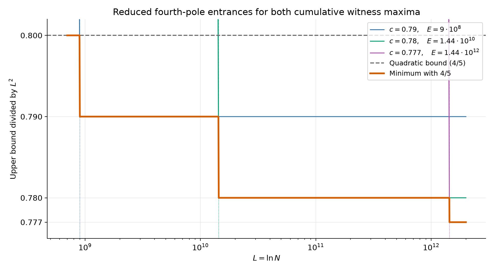
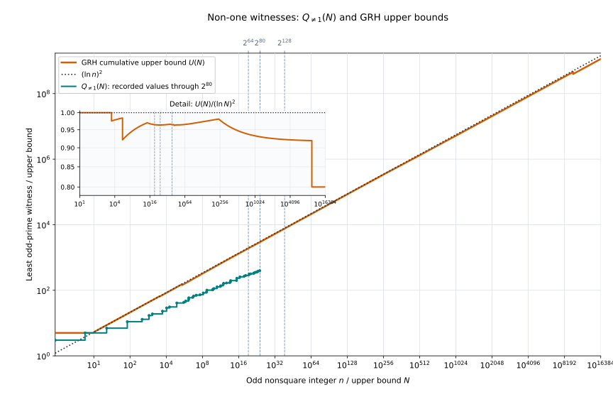
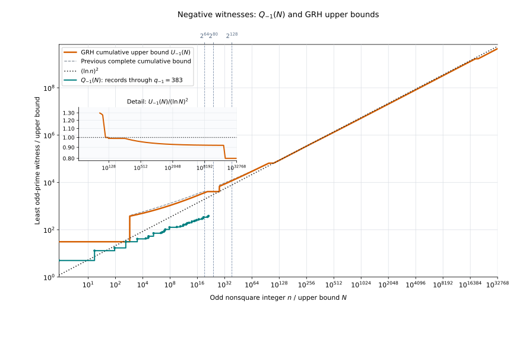

# PseudoSquareのJacobi証人の最大値とGRHに基づく解析的上界

対象: [`PseudoPrime/PseudoSquare`](../PseudoPrime/PseudoSquare)。公開入口は [`PseudoPrime/PseudoSquare.lean`](../PseudoPrime/PseudoSquare.lean)、名前空間は `PseudoPrime.PseudoSquare`。

この領域では、奇数かつ非平方数に対する最小 Jacobi 証人の最大値を定義する。有限計算と Dirichlet 指標・L 関数の解析を組み合わせて、その上界を証明する。実行用の BPSW 本体は [PrimeTest](PrimeTest.md)、Selfridge 固有の上界への接続は [SelfridgeBoundGrh](SelfridgeBoundGrh.md) で扱う。

## 構成

| ディレクトリ | 内容 |
|---|---|
| [Bounds](../PseudoPrime/PseudoSquare/Bounds) | 証人の有限最大、点ごとの上界、対数・初等半径の評価 |
| [Computation](../PseudoPrime/PseudoSquare/Computation) | 小区間の証明書、閾値、剰余類を用いた有限部分の検証 |
| [CharacterBound.lean](../PseudoPrime/PseudoSquare/CharacterBound.lean) | 一般 S1 の結論を Jacobi 値が $-1$ の証人へ変換 |
| [QNeOneConcrete.lean](../PseudoPrime/PseudoSquare/QNeOneConcrete.lean)・[QNeOneFinal.lean](../PseudoPrime/PseudoSquare/QNeOneFinal.lean) | `QNeOne` の上界に向けた解析的三分岐と有限範囲を統合 |

二次指標の構成・原始化・導手算術は [NumberTheory](NumberTheory.md)、一般解析は [Analysis.lean](../PseudoPrime/Analysis.lean)、GRH・L 関数・Riemann の $\zeta$ 関数・ $\xi$ 関数・輪郭と平滑化明示公式は [AnalyticNumberTheory.lean](../PseudoPrime/AnalyticNumberTheory.lean) に分離されている。これらの一般層は PseudoSquare を import しない。LLS には専用の誤差配分・数値分離と結論への接続を置く。 LLS の公開入口と主張は [LLS](LLS.md) を参照する。

## Legendre記号・Jacobi記号とEulerの規準

奇素数全体を次で表す。

$$
\mathbb P_{\mathrm{odd}}
=\left\lbrace p\in\mathbb N:
p\text{ は素数},\ p\ge3\right\rbrace.
$$

$n\in\mathbb Z$ と $p\in\mathbb P_{\mathrm{odd}}$ に対するLegendre記号を次で定義する。

$$
\left(\frac np\right)=
\begin{cases}
0 & p\mid n,\\
1 & p\nmid n\quad\text{かつ}\quad\exists x\in\mathbb Z,\quad x^2\equiv n\pmod p,\\
-1 & p\nmid n\quad\text{かつ}\quad\nexists x\in\mathbb Z,\quad x^2\equiv n\pmod p.
\end{cases}
$$

値 $1$ は非零の平方剰余、値 $-1$ は平方非剰余、値 $0$ は $p\mid n$ を表す。

Legendre記号は次の3値を取り、Eulerの規準（Euler’s criterion）を満たす。

$$
\left(\frac np\right)\in\lbrace-1,0,1\rbrace,
$$

$$
p\in\mathbb P_{\mathrm{odd}},\qquad n\in\mathbb Z
\quad\Longrightarrow\quad
n^{(p-1)/2}\equiv\left(\frac np\right)\pmod p.
$$

特に $p\nmid n$ なら、右辺は $1$ または $-1$ であり、べき乗の剰余から平方剰余か平方非剰余かを判定できる。 $p\mid n$ なら両辺は法 $p$ で $0$ となる。この式は奇素数を分母とする主張であり、合成数 $b$ に置き換えた同じ式が一般に成り立つわけではない。

正の奇数 $b$ の素因数分解を $b=\prod_{j=1}^r p_j^{e_j}$ とする。ただし $p_j$ は相異なる奇素数、 $e_j\ge1$ である。Jacobi記号を次で定義する。

$$
n\in\mathbb Z,\qquad b\in\mathbb N,\qquad b\ge1,\qquad b\equiv1\pmod2,
$$

$$
\left(\frac nb\right)
=\prod_{j=1}^r\left(\frac n{p_j}\right)^{e_j},
\qquad
\left(\frac n1\right)=1.
$$

分母が奇素数ならLegendre記号と一致し、Leanでは `jacobiSym n b` と表す。Jacobi記号は $0,1,-1$ のいずれかであり、

$$
\left(\frac nb\right)=0
\quad\Longleftrightarrow\quad
\gcd(n,b) > 1.
$$

合成数 $b$ では、Jacobi記号が $1$ でも $n$ が法 $b$ の平方剰余とは限らない。例えば $\left(\frac2{15}\right)=1$ だが、 $x^2\equiv2\pmod{15}$ を満たす整数 $x$ は存在しない。

## $Q_{\ne1}$ と $Q_{-1}$ の定義

正の奇数かつ非平方数の集合と、その有限範囲を次で定義する。

$$
\mathcal A
=\left\lbrace n\in\mathbb N:
n\ge1,\quad n\equiv1\pmod2,\quad
\forall m\in\mathbb N,\ n\ne m^2\right\rbrace,
\qquad
\mathcal A(B)=\left\lbrace n\in\mathcal A:n\le B\right\rbrace
\quad(B\in\mathbb N).
$$

$n\in\mathcal A$ に対する最小奇素数証人を $q_{\ne1}(n)$、 $q_{-1}(n)$ と表し、次で定義する。

$$
q_{\ne1}(n)
=\min\left\lbrace q\in\mathbb P_{\mathrm{odd}}:
\left(\frac nq\right)\ne1\right\rbrace,
\qquad
q_{-1}(n)
=\min\left\lbrace q\in\mathbb P_{\mathrm{odd}}:
\left(\frac nq\right)=-1\right\rbrace.
$$

両方の証人集合が非空であることは、GRHを仮定せずに証明されている。非1証人は記号の値 $0$ も許すため、 $q\mid n$ による因子検出を含む。負値証人では値 $-1$ を要求するので、必ず $q\nmid n$ となる。

最小証人の有限最大値を次で定義する。

$$
Q_{\ne1}(B)
=\max\left(
\left\lbrace0\right\rbrace
\cup\left\lbrace q_{\ne1}(n):n\in\mathcal A(B)\right\rbrace
\right),
$$

$$
Q_{-1}(B)
=\max\left(
\left\lbrace0\right\rbrace
\cup\left\lbrace q_{-1}(n):n\in\mathcal A(B)\right\rbrace
\right).
$$

$\mathcal A(B)$ が空なら両者は $0$ である。Leanの定義との対応は次のとおりである。

| 数学的記号 | Leanの定義 |
|---|---|
| $q_{\ne1}(n)$ | `NumberTheory.primeNeOneWitness n h` |
| $q_{-1}(n)$ | `NumberTheory.primeNegOneWitness n h` |
| $Q_{\ne1}(B)$ | `QNeOne B` |
| $Q_{-1}(B)$ | `QNegOne B` |

ここで `h` は該当する証人集合の非空性の証明である。最小証人は [JacobiWitness/Basic.lean](../PseudoPrime/NumberTheory/JacobiWitness/Basic.lean)、非空性は [JacobiWitness/Existence.lean](../PseudoPrime/NumberTheory/JacobiWitness/Existence.lean)、有限最大値は [Bounds/WitnessMaximum.lean](../PseudoPrime/PseudoSquare/Bounds/WitnessMaximum.lean) にある。いずれも数学的な定義は `noncomputable` である。

負値証人は非1証人でもあるため、次が成り立つ。

$$
n\in\mathcal A
\quad\Longrightarrow\quad q_{\ne1}(n)\le q_{-1}(n),
\qquad
B\in\mathbb N
\quad\Longrightarrow\quad Q_{\ne1}(B)\le Q_{-1}(B).
$$

後半に対応するLeanの定理は `QNeOne_le_QNegOne` である。許容入力はすべての正の奇数かつ非平方数であり、古典的なpseudosquareの条件 $n\equiv1\pmod8$ に限定していない。

## GRH の下での Legendre 記号の証人


[GRH/Definition.lean](../PseudoPrime/AnalyticNumberTheory/GRH/Definition.lean) の `PseudoPrime.AnalyticNumberTheory.GRH.GeneralizedRiemannHypothesis` が解析的前提である。 `GeneralizedRiemannHypothesis.riemann` により RH を取り出せるが、GRH 自体を証明するものではない。

分母の証人 $q$ は奇素数なので、以下のJacobi記号はLegendre記号と一致する。 $\ln$ は自然対数を表す。

### Legendre 記号が $1$ でない素数証人とその上界の拡張・改良

#### 全入力に対する上界

$$
\mathrm{GRH},\qquad n\in\mathcal A
\quad\Longrightarrow\quad
\exists q\in\mathbb P_{\mathrm{odd}},\quad
\left(\frac nq\right)\ne1,\quad
q\le\max\left\lbrace5,(\ln n)^2\right\rbrace.
$$

$$
\mathrm{GRH},\qquad B\in\mathbb N,\qquad B\ge10
\quad\Longrightarrow\quad Q_{\ne1}(B)\le(\ln B)^2.
$$

存在定理は [Bounds/PointwiseWitness.lean](../PseudoPrime/PseudoSquare/Bounds/PointwiseWitness.lean) の
`exists_prime_ne_one_witness_of_grh`、有限最大値の定理は `QNeOne_le_log_sq_of_grh` である。
`QNeOne_le_greatestOddPrimeLE_of_grh` は同じ前提で、その半径以下の最大奇素数による上界を与える。
`primeNeOneWitness_cast_le_log_sq_of_11_le` は $n\in\mathcal A$、 $n\ge11$ の最小証人を直接 $(\ln n)^2$ 以下に評価する。
非1証人は値 $0$ も許すため、法を割る素数も証人となる。

#### 根から1/1000を引く非1証人上界

$$
F(t)=\left(\ln t-\frac1{1000}\right)^2.
$$

点ごとの評価の前提と結論は次のとおりである。

$$
\mathrm{GRH},\qquad n\in\mathbb N,\qquad n\ge2984,\qquad
n\equiv1\pmod2,\qquad\neg\mathrm{IsSquare}(n)
$$

$$
\Longrightarrow\quad
\exists q\in\mathbb P_{\mathrm{odd}},\quad
\left(\frac nq\right)\ne1,\quad q\le F(n) < (\ln n)^2.
$$

有限最大値については、上の記号で次を証明した。

$$
\mathrm{GRH},\qquad B\in\mathbb N,\qquad B\ge2984
\quad\Longrightarrow\quad Q_{\ne1}(B)\le F(B).
$$

[QNeOneRetainedReciprocalAnalytic.lean](../PseudoPrime/PseudoSquare/QNeOneRetainedReciprocalAnalytic.lean) の
`exists_prime_neOne_logShift_2984_GRH` と
`QNeOne_le_retained_reciprocal_shift_of_ge_2984` が対応する。
最小証人も同じ端点で評価している。

新しい解析は平方自由部分 $d\ge2984$ に対して
$q\le(\ln d-1/1000)^2$ を証明する。素数2の値 $0,1,-1$ を分岐して補正を保つ。
小さい平方自由部分には既存のGRH点ごとの定理と証人の整数性を再利用し、
新しい有限証明書は生成していない。全入力の有限最大値もこの共通端点へ接続した。

#### 根から1/10を引く非1証人上界

正の実数 $t$ に対して、

$$
F_{1/10}(t)=\left(\ln t-\frac1{10}\right)^2
$$

と定める。

$$
\begin{gathered}
\mathrm{GRH},\qquad n\in\mathbb N,\qquad n\ge3295,\\
n\equiv1\pmod2,\qquad\neg\mathrm{IsSquare}(n)
\end{gathered}
\quad\Longrightarrow\quad
\exists q\in\mathbb P_{\mathrm{odd}},\quad
\left(\frac nq\right)\ne1,\quad q\le F_{1/10}(n) < (\ln n)^2.
$$

$$
\mathrm{GRH},\qquad B\in\mathbb N,\qquad B\ge3295
\quad\Longrightarrow\quad Q_{\ne1}(B)\le F_{1/10}(B).
$$

[QNeOneDeciShiftBounds.lean](../PseudoPrime/PseudoSquare/QNeOneDeciShiftBounds.lean) の
`exists_prime_neOne_deciShift_3295_GRH` と
`QNeOne_le_deci_shift_of_ge_3295` が対応する。最小証人も同じ端点で評価する。

$t\ge3295$ では $F_{1/10}(t) < F(t)$ であり、補正 $1/1000$ の上界をさらに小さくする。
解析的な三分岐比較で根と導手上界の差を $1/10$ まで許すことで得た。
小さい平方自由部分の処理は既存のGRH定理を再利用し、入力別の有限証明書は追加していない。
補正 $1/1000$ の定理は $2984\le n < 3295$ の範囲も扱うため、そのまま残している。
負値証人の上界からも、 $q_{\ne1}(n)\le q_{-1}(n)$ と $Q_{\ne1}(B)\le Q_{-1}(B)$ により非1証人の上界が得られる。係数 $99/100$ と $9999/10000$ の結果は、次の負値証人の節にまとめる。

#### 根から1/2を引く非1証人上界

$$
\mathrm{GRH},\quad n\in\mathcal A,\quad\ln n\ge\frac{25}{2}
\quad\Longrightarrow\quad
\exists q\in\mathbb P_{\mathrm{odd}},\quad
\left(\frac nq\right)\ne1,\quad
q\le\left(\ln n-\frac12\right)^2 < (\ln n)^2.
$$

$$
\mathrm{GRH},\quad B\in\mathbb N,\quad\ln B\ge\frac{25}{2}
\quad\Longrightarrow\quad
Q_{\ne1}(B)\le\left(\ln B-\frac12\right)^2.
$$

[QNeOneHalfShiftBounds.lean](../PseudoPrime/PseudoSquare/QNeOneHalfShiftBounds.lean) の
`exists_neOneWitness_le_half_shift_and_lt_log_sq` と `QNeOne_le_half_shift` が対応する。
同じ範囲では補正 $1/10$ の式より小さい。値 $0$ を許す非1証人の定理であり、負値証人の定理ではない。

根 $y\ge12$ と導手の対数上界 $L\le y+1/2$ に対し、分離式の正値性を半直線全体で証明した。
証明では有理対数下界の分母を払った5次多項式の全係数が正となる。
平方自由部分の対数を別に保持し、共通端点 $y=\ln B-1/2$ を使うため、小さい入力も同じ解析的比較で扱える。
入力の有限列挙や、小さい平方自由部分を扱うための有限証明書は追加していない。

#### 負の対数補正を持つ非1証人上界

$$
\mathrm{GRH},\quad n\in\mathcal A,\quad\ln n\ge16
\quad\Longrightarrow\quad
q_{\ne1}(n)\le\left(\ln n-\ln\ln n+3\right)^2.
$$

$$
\mathrm{GRH},\quad B\in\mathbb N,\quad\ln B\ge16
\quad\Longrightarrow\quad
Q_{\ne1}(B)\le\left(\ln B-\ln\ln B+3\right)^2.
$$

[QNeOneLogShiftBounds.lean](../PseudoPrime/PseudoSquare/QNeOneLogShiftBounds.lean) の
`primeNeOneWitness_cast_le_log_shift_endpoint` と `QNeOne_le_log_shift` が対応する。
さらに $\ln n\ge32$ では、この上界が $(\ln n)^2$ より小さいことと、その範囲に奇素数の非1証人が存在することを
`exists_neOneWitness_le_log_shift_and_lt_log_sq` で証明している。

解析では $y\ge12$、 $L\le y+\ln y-2$ の分離条件を半直線全体で認証した。
$L\ge16$ に対し $y=L-\ln L+3$ がその条件を満たすことを、対数の接線不等式から導く。
小さい入力を含む共通端点への接続を使い、入力別の有限証明書は追加していない。
この式も値 $0$ を許す非1証人の上界であり、負値証人の上界ではない。

#### 定数11/4への改良と開始尺度96

$$
\mathrm{GRH},\quad n\in\mathcal A,\quad L=\ln n\ge96
\quad\Longrightarrow\quad
q_{\ne1}(n)\le\left(L-\ln L+\frac{11}{4}\right)^2.
$$

$$
\mathrm{GRH},\quad B\in\mathbb N,\quad\ln B\ge96
\quad\Longrightarrow\quad
Q_{\ne1}(B)\le\left(\ln B-\ln\ln B+\frac{11}{4}\right)^2.
$$

[ElevenFourthsFromNinetySix.lean](../PseudoPrime/PseudoSquare/Bounds/ElevenFourthsFromNinetySix.lean) の
`neOneWitness_le_elevenFourths_log_shift_from_96` と
`QNeOne_cast_le_elevenFourths_log_shift_from_96` が対応する。

$$
L\ge96\quad\Longrightarrow\quad
\left(L-\ln L+\frac{11}{4}\right)^2 < (L-\ln L+3)^2,\qquad
\left(L-\ln L+\frac{11}{4}\right)^2 < L^2.
$$

これらの比較も同ファイルで証明している。
さらに $128\le L\le384$ では、係数99/100の式より小さいことを
[ElevenFourthsLogShift.lean](../PseudoPrime/PseudoSquare/Bounds/ElevenFourthsLogShift.lean) の
`elevenFourths_log_shift_sq_lt_nearSquare` が示す。

導手と素数2での指標値を連動させ、逆数側と主項側の費用を別々に保持する。
半径 $y=L-\ln L+11/4$ について、 $94\le y\le120$ は対数の連動下界を、
$y\ge120$ は既存の半直線比較を使う。整数入力の有限列挙は追加していない。
この結果は値0を許す非1証人の上界である。

#### 補正定数37/5と開始尺度50による係数2の負の対数補正

実数 $L > 0$ に対して

$$
T(L)=L-2\ln L+\frac{37}{5}
$$

と定める。

$$
\mathrm{GRH},\quad n\in\mathcal A,\quad\ln n\ge50
\quad\Longrightarrow\quad
q_{\ne1}(n)\le T(\ln n)^2 < (\ln n)^2.
$$

$$
\mathrm{GRH},\quad B\in\mathbb N,\quad\ln B\ge50
\quad\Longrightarrow\quad
Q_{\ne1}(B)\le T(\ln B)^2 < (\ln B)^2.
$$

[FiniteScaleShiftedDoubleLogBounds.lean](../PseudoPrime/PseudoSquare/Bounds/FiniteScaleShiftedDoubleLogBounds.lean) の
`neOneWitness_cast_le_shiftedDoubleLog_from_fifty`、 `QNeOne_le_shiftedDoubleLog_from_fifty` が対応する。
`exists_prime_neOne_shiftedDoubleLog50_GRH` は、対象入力 $n\le B$ に共通尺度 $B$ の証人を与える。狭義対数二乗との比較は `shiftedDoubleLogRoot_sq_lt_log_sq_from_fifty` で証明した。

素数2での指標値と導手の大きさを連動させ、逆数重み付き和と対数重み付き和の二つの費用を残す。
端点極限の多項式の係数は $y\ge49$ で非負となる。残りは $y\ge1$ における

$$
\frac{79}{2000}y+14+\frac{15}{2}\ln y-2(\ln y)^2 > 0
$$

という汎用評価へ帰着した。入力整数は列挙しない。 $\ln y\le5$ では因数分解し、 $\ln y\ge5$ では指数関数のTaylor下界を使う。
分離条件と導手の費用は [FiniteScaleShiftedDoubleLogRoot.lean](../PseudoPrime/LLS/FiniteScaleShiftedDoubleLogRoot.lean) で証明した。

$$
L\ge96,\quad\ln L > \frac{93}{20}
\quad\Longrightarrow\quad
T(L)^2 < \left(L-\ln L+\frac{11}{4}\right)^2.
$$

開始尺度96での比較は [ShiftedOddEndpointDoubleLogBounds.lean](../PseudoPrime/PseudoSquare/Bounds/ShiftedOddEndpointDoubleLogBounds.lean) の `shiftedDoubleLogRoot_sq_lt_elevenFourths` が証明する。
素数2での原始指標値が0の枝では $(\ln X-\ln2/2)^2/2$、非零の枝では $(\ln X)^2/2$ の費用を用いた。半対数シフトを保持した改善である。

$$
L\ge50,\quad\ln L > \frac{22}{5}
\quad\Longrightarrow\quad
T(L)^2 < (L-\ln L+3)^2.
$$

`shiftedDoubleLogRoot_sq_lt_log_shift_from_fifty` が対応する。これにより、 $\exp(22/5) < L < 96$ でも従来の最良式を改善する。
値0を許す非1の奇素数証人の結果であり、負値証人の式ではない。

#### 中間尺度で改良した非1証人の一次半径

実数 $L$ に対して

$$
R_{\mathrm{odd}}(L)=\frac{3200}{3241}\left(L-\frac{18}{25}\right)
$$

と定める。前提と主張は次のとおりである。

$$
\begin{gathered}
\mathrm{GRH},\quad n\in\mathcal A,\quad
\frac{3259}{25}\le\ln n\le\frac{16277}{100}
\\
\Longrightarrow\quad q_{\ne1}(n)\le R_{\mathrm{odd}}(\ln n)^2.
\end{gathered}
$$

$$
\begin{gathered}
\mathrm{GRH},\quad B\in\mathbb N,\quad
\frac{3259}{25}\le\ln B\le\frac{16277}{100}
\\
\Longrightarrow\quad Q_{\ne1}(B)\le R_{\mathrm{odd}}(\ln B)^2.
\end{gathered}
$$

[OddMidscaleEndpointBounds.lean](../PseudoPrime/PseudoSquare/Bounds/OddMidscaleEndpointBounds.lean)
の `primeNeOneWitness_cast_le_oddMidscale` と `QNeOne_le_oddMidscale` が対応する。
値0を許す奇素数の非1証人の上界であり、負値証人の上界ではない。

同じ区間全体で、従来の半径 $T(L)=L-2\ln L+149/20$ に対して

$$
\frac{3259}{25}\le L\le\frac{16277}{100}
\quad\Longrightarrow\quad R_{\mathrm{odd}}(L)^2 < T(L)^2
$$

が成立する。
[OddMidscaleEndpointRadius.lean](../PseudoPrime/LLS/OddMidscaleEndpointRadius.lean)
の `oddMidscale_sq_lt_sharpDoubleLog_sq` がこの比較を証明する。
適用区間は $130.36\le L\le162.77$、半径の範囲は $128\le R_{\mathrm{odd}}(L)\le160$ である。

主項には自然対数の下側の弦を使い、二進補正の二つの費用には上側の接線を使う。
四次式を5個の有理Bernstein係数で認証し、導手と素数2での指標値を連動させた。
整数入力の有限列挙は使っていない。

#### 共通誤差を保持した非1証人上界

$$
V_{\ne1}(L)=\frac{99}{40}
\left(\frac{500}{821}\left(L+\frac75\right)+\frac{213}{20}\right)^2.
$$

$$
\mathrm{GRH},\quad n\in\mathcal A,\quad\ln n\ge500
\quad\Longrightarrow\quad
q_{\ne1}(n)\le V_{\ne1}(\ln n) < (\ln n)^2.
$$

$$
\mathrm{GRH},\quad B\in\mathbb N,\quad\ln B\ge500
\quad\Longrightarrow\quad
Q_{\ne1}(B)\le V_{\ne1}(\ln B) < (\ln B)^2.
$$

[TwoPolePrefixBounds.lean](../PseudoPrime/PseudoSquare/Bounds/TwoPolePrefixBounds.lean) の
`primeNeOneWitness_cast_le_eulerPrefixTwoPole` と `QNeOne_le_eulerPrefixTwoPole` が対応する。
実際の奇素数証人の存在も `exists_neOneWitness_le_eulerPrefixTwoPole` で証明している。

実軸Euler和を非負な和として保持し、二極Poisson核でGamma零点和を評価する。
実部の符号を保持して非正の積分項を除き、導手を含まない左積分の費用を用いる。
非1奇素数証人が存在しないと仮定すると、法の奇素因数は切断点を超えるが、素数2の局所費用は残る。
偶指標のGamma固定費用を $112/25$ に抑え、素数2の費用は切断点の対数式として保持する。
証人不存在の反証仮定の下で、奇数支持の素数3・5から少なくとも $7/8$ のEuler寄与を差し引く。
尺度依存の誤差分子を保持し、鋭い主指標上界の対数部分の節約で素数2の費用を賄う。
定数部分の節約も保持し、根の加法定数 $213/20$ で分離を得る。
ランプと主指標に共通の誤差を合成した比較は
[JointRampPrincipalWitnessBounds.lean](../PseudoPrime/LLS/JointRampPrincipalWitnessBounds.lean)、
数値分離は [TwoPolePrincipalPrefixBounds.lean](../PseudoPrime/LLS/TwoPolePrincipalPrefixBounds.lean) にある。
これにより、対数尺度500以上の半直線上で数値分離を証明した。

有限最大値では、すべての $n\in\mathcal A$、 $n\le B$ に共通の補助法 $4B$ を使う。
小さい入力も同じ解析評価に含めるため、入力整数の有限証明書は追加していない。
この上界は値0を許す非1証人に対するもので、負値証人には適用しない。

#### 係数4/5と開始尺度22221

$$
\mathrm{GRH},\quad n\in\mathcal A,\quad\ln n\ge22221
\quad\Longrightarrow\quad q_{\ne1}(n)\le\frac45(\ln n)^2.
$$

$$
\mathrm{GRH},\quad B\in\mathbb N,\quad\ln B\ge22221
\quad\Longrightarrow\quad Q_{\ne1}(B)\le\frac45(\ln B)^2.
$$

[GammaPrincipalEulerNonOneBounds.lean](../PseudoPrime/PseudoSquare/Bounds/GammaPrincipalEulerNonOneBounds.lean) の
`exists_prime_ne_one_witness_le_gamma_log_22221` と `QNeOne_le_gamma_log_22221` が対応する。
符号付き左積分で導手項を保持し、共通端点で小さい平方自由部分も扱う。
正の入力から作る二次指標は偶指標であり、原始指標への移行でも偶性を保つ。
実軸Euler和の非負性と偶指標の符号付きGamma項を使い、固定費用を $541/50$ に抑える。
誤差評価には $L\ge15000$ と $\ln L\le L/2000$ を使う。
具体的には、 $L\ge22221$ でこの対数条件と

$$
\frac{541}{50}+\frac{1647}{100}+\frac{11783423}{25000000}\cdot\frac75
\le\frac{L}{795}
$$

が成立する。新しい初期区間証明書や入力整数の有限証明書は追加していない。
この開始尺度では係数99/100の式より小さく、定数11/4の半径も $(9/10)\ln n$ より大きいため、
掲載式の中では係数4/5の式が最小となる。

### Legendre 記号が $-1$ となる素数証人とその上界の拡張・改良

#### 全入力に対する上界

正の実数 $t\ge3$ に対して、

$$
R(t)=\left(\ln(4t)+\frac{24}{5}\ln\ln(4t)+3\right)^2
$$

と置く。

$$
\mathrm{GRH},\qquad n\in\mathcal A
\quad\Longrightarrow\quad
\exists q\in\mathbb P_{\mathrm{odd}},\quad
\left(\frac nq\right)=-1,\quad q\le R(n).
$$

$$
\mathrm{GRH},\qquad B\in\mathbb N,\qquad B\ge3
\quad\Longrightarrow\quad
Q_{-1}(B)\le R(B).
$$

存在定理は [Bounds/PointwiseWitness.lean](../PseudoPrime/PseudoSquare/Bounds/PointwiseWitness.lean) の
`exists_prime_neg_one_witness_of_grh`、有限最大値の定理は `elementary_formula_explicit` である。
値 $-1$ を要求するため、証人 $q$ は必ず $n$ を割らない。

#### 固定尺度による4093の有界区間上界

$$
\mathrm{GRH},\quad n\in\mathcal A,\quad
10\le\ln n\le\frac{1609}{25}
\quad\Longrightarrow\quad q_{-1}(n)\le4093.
$$

[Phase64RetainedExcessJacobiCell.lean](../PseudoPrime/LLS/Phase64RetainedExcessJacobiCell.lean) の
`exists_oddPrime_negJacobi_4093_retained_GRH` が、4093以下の奇素数負値証人を与える。
最小証人への上界は最小性から従う。
固定尺度64の解析比較で局所超過費用を精密に保持し、入力整数の有限列挙を使わずに証明している。

この式は $R(n) > 4093$ となる区間で従来の明示式より小さい。
さらに $63977/1000\le\ln n\le1609/25$ では $q_{-1}(n) < (\ln n)^2$ となる。
有界区間の結果であり、その先の半直線上界は主張しない。
以下の表では点ごとの最小証人にだけこの式を使い、
有限最大値の行は専用の公開定理に対応する上界を示す。

#### 係数99/100の大尺度上界

前提と点ごとの主張は次のとおりである。ここで $L=\ln n$ は自然対数の尺度であり、開始条件は $\ln n\ge290$ である。

$$
\mathrm{GRH},\quad n\in\mathbb N,\quad n\ge1,\quad
n\equiv1\pmod2,\quad \forall m\in\mathbb N,\ n\ne m^2,\quad \ln n\ge290
$$

$$
\Longrightarrow\quad
q_{-1}(n)\le\frac{99}{100}(\ln n)^2 < (\ln n)^2.
$$

有限最大値については、同じ共通端点で次を得る。

$$
\mathrm{GRH},\quad B\in\mathbb N,\quad \ln B\ge290
\quad\Longrightarrow\quad
Q_{-1}(B)\le\frac{99}{100}(\ln B)^2.
$$

[GammaMixedLog290Bounds.lean](../PseudoPrime/PseudoSquare/Bounds/GammaMixedLog290Bounds.lean) の
`primeNegOneWitness_bound_mixed_log_290`、`primeNeOneWitness_bound_mixed_log_290` と
`QNegOne_bound_mixed_log_290`、`QNeOne_bound_mixed_log_290` が
開始対数尺度290の上界を与える。以下は尺度550以上で再利用する定理である。

[GammaPrincipalPairedBounds.lean](../PseudoPrime/PseudoSquare/Bounds/GammaPrincipalPairedBounds.lean) の
`exists_negOneWitness_le_nearSquare_gamma_log_550` と
`QNegOne_le_nearSquare_gamma_log_550` が負値証人を扱う。
[GammaPrincipalPairedNonOneBounds.lean](../PseudoPrime/PseudoSquare/Bounds/GammaPrincipalPairedNonOneBounds.lean) は
非1証人の最小値と有限最大値へ接続する。

係数99/100の評価では、ランプ端点の結合に加え、RH下の $\xi'/\xi$ の非負な零点和を用いる。符号付き係数を保った共通の素数冪和を $25/2$ 未満に抑え、開始対数尺度を550へ下げた。新しい有限入力の証明書は生成していない。非1証人に対する2984からの負の補正とは、それぞれの前提で成立する別の上界である。

##### 係数99/100の証明に用いる混合Euler評価

$$
\mathrm{GRH},\quad n\text{ は非平方正奇数},\quad300\le\ln n\le310
$$

ならば

$$
q_{-1}(n)\le\frac{99}{100}(\ln n)^2 < (\ln n)^2.
$$

また、正整数 $B$ について

$$
\mathrm{GRH},\quad300\le\ln B\le310
\Longrightarrow
Q_{-1}(B)\le\frac{99}{100}(\ln B)^2 < (\ln B)^2.
$$

`GammaMixedProfileBounds.lean` で、最小証人と全対象の有限最大値へ接続した。小素数のノード区間と20以上の素数の共通Euler上界を組み合わせ、分離式の正値性までLeanで認証している。この有界区間を含む $300\le L\le550$ の解析評価を接続し、`GammaMixedHalflineBounds.lean` では $L\ge300$ 全域へ延長した。

基準点50000からの非負の部分和の下界を用い、 $[290,295]$ と $[295,300]$ の局所行・誤差を認証して、上記の半直線上界を290以上へ延長した。幾何と双対費用の移送は、開始尺度300に依存しない汎用補題を使う。

#### 係数9999/10000の上界と開始尺度255

$$
\mathrm{GRH},\quad n\in\mathcal A,\quad\ln n\ge255
\quad\Longrightarrow\quad
q_{-1}(n)\le\frac{9999}{10000}(\ln n)^2 < (\ln n)^2.
$$

$$
\mathrm{GRH},\quad B\in\mathbb N,\quad\ln B\ge255
\quad\Longrightarrow\quad
Q_{-1}(B)\le\frac{9999}{10000}(\ln B)^2 < (\ln B)^2.
$$

[GammaJointEntranceBounds.lean](../PseudoPrime/PseudoSquare/Bounds/GammaJointEntranceBounds.lean) の
`negOneWitness_cast_le_joint_entrance_endpoint`、`primeNeOneWitness_bound_joint_entrance_log_255` と
`QNegOne_bound_joint_entrance_log_255`、`QNeOne_bound_joint_entrance_log_255` が対応する。
尺度を $x=(101/250)L^2$ とし、主指標和とramp和に共通する算術誤差を結合して評価する。
素数別の既存データを小さい尺度へ移す汎用補題と、区間全体での改善量 $1/3$ を使い、 $255\le L\le260$ の分離条件を証明した。
新しい素数別の数値表は生成せず、350以下の奇素数について既存行から計算する有理費用和を $769/200$ 以下と検証している。
260以上の既存結果へ接続し、 $L\ge255$ 全域で同じ係数9999/10000の式を証明している。入力 $n$ の有限列挙は用いない。
上記の係数99/100の定理は開始尺度290から使える別の評価である。

#### 切断対数と素因数除外費用を保持した二極上界

実数 $T > 0$、 $L > 0$ に対して次を定める。

$$
H_{-1}(T)=\frac{500}{821}T+\frac{11}{10}\ln T+6,\qquad
V_{-1}(L)=\frac{99}{40}H_{-1}\left(L+\frac75\right)^2.
$$

$$
\mathrm{GRH},\quad n\in\mathcal A,\quad\ln n\ge500
\quad\Longrightarrow\quad q_{-1}(n)\le V_{-1}(\ln n).
$$

$$
\mathrm{GRH},\quad B\in\mathbb N,\quad\ln B\ge500
\quad\Longrightarrow\quad Q_{-1}(B)\le V_{-1}(\ln B).
$$

$$
L\ge550\quad\Longrightarrow\quad V_{-1}(L) < L^2.
$$

$$
L\ge600\quad\Longrightarrow\quad
V_{-1}(L) < \frac{99}{100}L^2 < L^2.
$$

[QuarterLogClippedNegOneBounds.lean](../PseudoPrime/PseudoSquare/Bounds/QuarterLogClippedNegOneBounds.lean) の
`negOneWitness_le_quarterLog_GRH` と
`QNegOne_le_quarterClippedTwoPole_logarithmic` が対応する。
共通の補助法 $4B$ により小さい対象入力も覆い、入力整数の有限証明書は使わない。

偶指標のGamma固定費用 $112/25$ と、認証済みアンカー128から得たEuler和の下界を使う。
探索上限を $b=(99/40)x$ とすると、Euler和による節約から素数2の費用を引いた量は

$$
\frac{3643}{1000}-5b^{-1/4}-\frac{\ln2}{5}
$$

以上である。原始指標の導手を $f$、元の法を $q$ とすると、
残る素数冪の除外費用は主指標の部分和と $(3/10)\ln(q/f)+(1/5)\ln2$ で抑えられる。
導手の対数に含まれる節約を、除外費用に $3/10$、局所補正に $1/5$ と配分して相殺する。

主指標の共通誤差全体で連続な切断対数 $\ln(\max(1,t))$ を保持し、尺度依存の対数誤差を除いた。主項係数 $133/160$、分離した反射Euler誤差、下記の素因数個数評価を組み合わせる。
解析的分離は [QuarterLogClippedNegativeBounds.lean](../PseudoPrime/LLS/QuarterLogClippedNegativeBounds.lean) で証明した。
同じ適用域 $L\ge500$ で、従来の対数係数 $33/20$・加法定数 $6$ の式より厳密に小さい。
適用開始尺度は500であり、尺度550から $L^2$ 未満が続く。尺度600以上では $(99/100)L^2$ 未満となる。

#### 係数4/5と開始値 $10^{19978}$

$$
\mathrm{GRH},\quad n\in\mathcal A,\quad n\ge10^{19978}
\quad\Longrightarrow\quad q_{-1}(n)\le\frac45(\ln n)^2.
$$

$$
\mathrm{GRH},\quad B\in\mathbb N,\quad B\ge10^{19978}
\quad\Longrightarrow\quad Q_{-1}(B)\le\frac45(\ln B)^2.
$$

[GammaWitnessBounds.lean](../PseudoPrime/PseudoSquare/Bounds/GammaWitnessBounds.lean) の
`primeNegOneWitness_cast_le_gamma_19978` と
[GammaMaximumBounds.lean](../PseudoPrime/PseudoSquare/Bounds/GammaMaximumBounds.lean) の
`gamma_formula_explicit_19978` が対応する。
後者は小さい対象入力も共通端点で覆う。
符号付きGamma項と局所費用を保持した解析比較を用い、
$\ln n\ge46000$ の評価へ十進開始値から接続する。
係数99/100より小さいため、この開始値以降は掲載式の中で最小となる。

#### 係数777/1000の有限入口と全域累積候補

[RationalPoleSharpEntrance.lean](../PseudoPrime/LLS/RationalPoleSharpEntrance.lean) は、GRH下で、奇数・非平方の全入力 $n$ に対し、 $\ln n\ge10^{18}$ なら実際の負値Jacobi奇素数証人とその最小値が $(777/1000)(\ln n)^2$ 以下となることを証明する。平方自由性や、利用者が与える算術的な橋は前提にしていない。

累積最大値には入口未満の入力も含まれる。[FourPoleFiniteBounds.lean](../PseudoPrime/PseudoSquare/Bounds/FourPoleFiniteBounds.lean) は、この履歴を残す候補

$$
U_4(B)=\max\left(\frac{9999}{10000}(10^{18})^2,\frac{777}{1000}(\ln B)^2\right)
$$

を `fourPoleCumulativeBound` と定義し、負値・非1値の両証人の累積最大値を全ての自然数上端 $B$ で抑える。空の対象範囲も含む。



図は $L=\ln B$ とし、累積候補と係数 $4/5$ の上界との最小値を $L^2$ で割って示す。 $L=10^{18}$ で点ごとの入口を満たしても、累積候補には小入力の定数項が残るため、直ちに係数777/1000へ切り替わるわけではない。中低域の図では、共通端点255の候補と、適用域内の4093の定数候補を含める。いずれも列挙した証明済み候補内での比較である。

## Selfridgeと共有する前提と累積最大値

上端 $B$ は任意の自然数とし、最大値の対象は $0 < n\le B$ の奇数・非平方入力にそろえる。上端 $B$ 自身に奇数・非平方条件は課さない。上端0を含む全域関数では、Leanの $\mathrm{Real.log}(0)=0$ と空の最大値0の規約を使う。点ごとの最小素数証人 $q_{\ne1}(n),q_{-1}(n)$ と、その累積最大値 $Q_{\ne1}(B),Q_{-1}(B)$ を区別する。

Selfridgeの対応する停止値絶対値の累積最大を $M_{\ne1}(B),M_{-1}(B)$、Wheel30版を $M^{(30)}_{\ne1}(B),M^{(30)}_{-1}(B)$ とする。[MaximumBridge.lean](../PseudoPrime/PrimeTestBounds/Selfridge/MaximumBridge.lean) は次をGRHなしで証明する。

| 条件 | 対応する累積最大値の関係 |
|---|---|
| 全ての $B\in\mathbb N$ | $M^{(30)}_{\ne1}=M_{\ne1}$、 $Q_{\ne1}\le M_{\ne1}\le\max\lbrace15,Q_{\ne1}\rbrace$ |
| 全ての $B\in\mathbb N$ | $M^{(30)}_{-1}=M_{-1}$、 $Q_{-1}\le M_{-1}\le\max\lbrace27,Q_{-1}\rbrace$ |
| $B\ge751$ | $M^{(30)}_{\ne1}(B)=M_{\ne1}(B)=Q_{\ne1}(B)$ |
| $B\ge399$ | $M^{(30)}_{-1}(B)=M_{-1}(B)=Q_{-1}(B)$ |
| $B < 3$ | 対象が空なので全て0 |

表の最初の2行では引数 $B$ を省略した。一致は対応する同じ系列どうしの関係であり、非1値系列と負値系列を同一視するものではない。点ごとの最小証人と停止値の一致も、この累積最大値の一致からは仮定しない。

以下の解析的上界にはGRHを加える。一致範囲では、PseudoSquareの累積上界と図を、そのまま古典Selfridge・Wheel30の停止最大値にも使える。[Selfridgeのまとめ](SelfridgeBoundGrh.md#累積上界の適用区間と図) に停止値・試行回数への対応を示す。

## LLS の役割

[LLS/Statement.lean](../PseudoPrime/LLS/Statement.lean) の `llsTheorem11S1Character` は、法 $q \ge 3000$ の非主 Dirichlet 指標について、法を割らず指標値が $1$ でない素数を明示的な上界以下に求める仕様である。部分群についての主張を指標の核に特殊化した形を採用する。

[LLS/Theorem11S1GRH.lean](../PseudoPrime/LLS/Theorem11S1GRH.lean) は一般指標の解析結果を組み立てる。Jacobi 値が $-1$ の評価は、この一般 S1 を法 $4n$ の指標に適用して得る。[JacobiCharacterArithmetic.lean](../PseudoPrime/NumberTheory/JacobiCharacterArithmetic.lean) の算術と中間の重み付き評価を用いて `QNeOne` の上界を導く経路と、有限区間の数値証明はそれぞれ異なる役割を持つ。 `QNeOne` と `QNegOne` の二分だけを、そのまま原論文の part (1) と part (2) の対応と読むことはできない。

Jacobi 記号が $-1$ となる証人について、大きい入力 $n \ge 750$ での存在は一般 S1 から、小さい入力での存在は有限証明書から得る。明示的半径への変換には無条件の素因数個数評価を使い、Robin 評価は仮定しない。 Jacobi 記号が $1$ でない証人については、原始指標の $2$ での値が $0$・ $1$・ $-1$ となる三分岐を扱い、有限範囲と接続する。両存在定理は公開 API であり、Selfridge 側はその手前の最小証人・最大値評価も直接利用する。

### 累積上界の構成

$L=\ln B$ とし、共通端点候補を

$$
J(B)=\frac{9999}{10000}\max\lbrace255,L\rbrace^2
$$

と書く。第四極核の累積候補 $U_4(B)$ は前節の `fourPoleCumulativeBound` である。

| 上界式 | 適用条件 | 累積上界への適用 |
|---|---|---|
| $J(B)$ | 全ての自然数上端 | 小入力を尺度255で覆う。他の有効な式との最小値をとる |
| $4093$ | $L\le1609/25$ | 両系列に有効な定数候補。適用域の外へは延長しない |
| $U_4(B)$ | 全ての自然数上端 | 入口未満の定数項を保持して最小化 |
| $\frac{777}{1000}L^2$ | 下表の $L_{\mathrm{recover}}$ 以上で $U_4(B)$ から回復 | 高域の二次上界 |

[Jと4093の接続](../PseudoPrime/PseudoSquare/Bounds/CommonEndpointBounds.lean) と [U4の接続](../PseudoPrime/PseudoSquare/Bounds/FourPoleFiniteBounds.lean) は、どちらも非1値・負値の両累積最大を扱う。点ごとの係数777/1000は $\ln n\ge10^{18}$ から有効だが、累積候補にはそれ以前の入力の履歴が残る。入口直後から累積値も同じ係数になるとはしない。

各図の $U_{\ne1}(B),U_{-1}(B)$ は、詳細表とこの表の有効な式の最小値である。以下の中低域の図に加え、[高域の比較図](figures/q_four_pole_high_comparison.svg) が入口未満の入力を含む累積上界を示す。[図と生成スクリプトの対応](figures/README.md) も参照する。


## 証人別の上界式の適用区間と比較

累積上界は、各行の式と $J(B)$、 $U_4(B)$ の最小値とする。 $\ln B\le1609/25$ では4093も最小値に含める。点ごとの上界には累積用の定数項を代入しない。

参考となる実測値は [3種類の最小素数証人の数表](WitnessRecords.md) にまとめた。負値証人は $n < 2^{64}$、非1証人は $n < 2^{80}$ の累積最大値の更新点を掲載している。

以下はGRHを仮定する。上界は、以下の範囲条件で有効になる式の最小値をとる。共通端点255・有効域内の4093・第四極核の累積上界も含める。点ごとの最小証人と累積最大値は別の行に示し、点ごとの入口をそのまま累積全域へ外挿しない。

### 高域の累積上界

高域では $E=10^{18}$、 $L=\ln B$ とし、

$$
L_{\mathrm{cross}}=E\sqrt{\frac{9999}{8000}},\qquad
L_{\mathrm{recover}}=E\sqrt{\frac{9999}{7770}}
$$

と置く。係数4/5の候補と $U_4$ の最小値は次のとおりである。両証人の累積最大に使え、Selfridgeとの一致開始点も十分に超えている。

| 対数上端の区間 | $\min\lbrace(4/5)L^2,U_4(B)\rbrace$ |
|---|---|
| $E\le L\le L_{\mathrm{cross}}$ | $(4/5)L^2$ |
| $L_{\mathrm{cross}} < L < L_{\mathrm{recover}}$ | $(9999/10000)E^2$ |
| $L_{\mathrm{recover}}\le L$ | $(777/1000)L^2$ |

切替は $U_4(B)=\max\lbrace(9999/10000)E^2,(777/1000)L^2\rbrace$ と係数4/5の代数比較から得たもので、浮動小数の交点を定理の条件にしていない。証人・累積最大のLean上界へ代入する式の比較であり、新たな証人定理や適用条件を追加したものではない。

### 非1証人の比較：Legendre記号が $0$ または $-1$

対象は $q_{\ne1}(n)$ と $Q_{\ne1}(B)$ である。 $q_{-1}(n)$ や $Q_{-1}(B)$ の上界を、この表の補正付き上界から得ることはできない。

以下の比較で $S(L)=L-\ln L+11/4$、 $T(L)=L-2\ln L+37/5$、 $\kappa=1-\sqrt{99/100}$ と置く。

| 対象 | 条件 | 範囲別の上界式 | 対応するLean定理 |
|---|---|---|---|
| $q_{\ne1}(n)$ | $n\in\mathcal A$、 $n < 11$ | $5$ | [`exists_prime_ne_one_witness_of_grh`](../PseudoPrime/PseudoSquare/Bounds/PointwiseWitness.lean) |
| $q_{\ne1}(n)$ | $n\in\mathcal A$、 $11\le n < 2984$ | $(\ln n)^2$ | [`primeNeOneWitness_cast_le_log_sq_of_11_le`](../PseudoPrime/PseudoSquare/Bounds/PointwiseWitness.lean) |
| $Q_{\ne1}(B)$ | $B\in\mathbb N$、 $10\le B < 2984$ | $(\ln B)^2$ | [`QNeOne_le_log_sq_of_grh`](../PseudoPrime/PseudoSquare/Bounds/QNeOneLogSq.lean) |
| $q_{\ne1}(n)$ | $n\in\mathcal A$、 $2984\le n < 3295$ | $(\ln n-1/1000)^2$ | [`neOneWitness_le_retained_reciprocal_endpoint`](../PseudoPrime/PseudoSquare/QNeOneRetainedReciprocalAnalytic.lean) |
| $Q_{\ne1}(B)$ | $B\in\mathbb N$、 $2984\le B < 3295$ | $(\ln B-1/1000)^2$ | [`QNeOne_le_retained_reciprocal_shift_of_ge_2984`](../PseudoPrime/PseudoSquare/QNeOneRetainedReciprocalAnalytic.lean) |
| $q_{\ne1}(n)$ | $n\in\mathcal A$、 $n\ge3295$、 $\ln n < 25/2$ | $(\ln n-1/10)^2$ | [`primeNeOneWitness_cast_le_deci_endpoint`](../PseudoPrime/PseudoSquare/QNeOneDeciShiftBounds.lean) |
| $Q_{\ne1}(B)$ | $B\in\mathbb N$、 $B\ge3295$、 $\ln B < 25/2$ | $(\ln B-1/10)^2$ | [`QNeOne_le_deci_shift_of_ge_3295`](../PseudoPrime/PseudoSquare/QNeOneDeciShiftBounds.lean) |
| $q_{\ne1}(n)$ | $n\in\mathcal A$、 $25/2\le\ln n$、 $\ln\ln n\le7/2$ | $(\ln n-1/2)^2$ | [`exists_neOneWitness_le_half_shift_and_lt_log_sq`](../PseudoPrime/PseudoSquare/QNeOneHalfShiftBounds.lean) |
| $Q_{\ne1}(B)$ | $B\in\mathbb N$、 $25/2\le\ln B$、 $\ln\ln B\le7/2$ | $(\ln B-1/2)^2$ | [`QNeOne_le_half_shift`](../PseudoPrime/PseudoSquare/QNeOneHalfShiftBounds.lean) |
| $q_{\ne1}(n)$ | $n\in\mathcal A$、 $\ln\ln n > 7/2$、 $\ln\ln n\le22/5$ | $(\ln n-\ln\ln n+3)^2$ | [`primeNeOneWitness_cast_le_log_shift_endpoint`](../PseudoPrime/PseudoSquare/QNeOneLogShiftBounds.lean) |
| $Q_{\ne1}(B)$ | $B\in\mathbb N$、 $\ln\ln B > 7/2$、 $\ln\ln B\le22/5$ | $(\ln B-\ln\ln B+3)^2$ | [`QNeOne_le_log_shift`](../PseudoPrime/PseudoSquare/QNeOneLogShiftBounds.lean) |
| $q_{\ne1}(n)$ | $n\in\mathcal A$、 $50\le\ln n < 96$、 $\ln\ln n > 22/5$ | $T(\ln n)^2$ | [`neOneWitness_cast_le_shiftedDoubleLog_from_fifty`](../PseudoPrime/PseudoSquare/Bounds/FiniteScaleShiftedDoubleLogBounds.lean) |
| $Q_{\ne1}(B)$ | $B\in\mathbb N$、 $50\le\ln B < 96$、 $\ln\ln B > 22/5$ | $T(\ln B)^2$ | [`QNeOne_le_shiftedDoubleLog_from_fifty`](../PseudoPrime/PseudoSquare/Bounds/FiniteScaleShiftedDoubleLogBounds.lean) |
| $q_{\ne1}(n)$ | $n\in\mathcal A$、 $96\le\ln n$、 $\ln\ln n\le93/20$ | $S(\ln n)^2$ | [`neOneWitness_le_elevenFourths_log_shift_from_96`](../PseudoPrime/PseudoSquare/Bounds/ElevenFourthsFromNinetySix.lean) |
| $Q_{\ne1}(B)$ | $B\in\mathbb N$、 $96\le\ln B$、 $\ln\ln B\le93/20$ | $S(\ln B)^2$ | [`QNeOne_cast_le_elevenFourths_log_shift_from_96`](../PseudoPrime/PseudoSquare/Bounds/ElevenFourthsFromNinetySix.lean) |
| $q_{\ne1}(n)$ | $n\in\mathcal A$、 $\ln n < 500$、 $\ln\ln n > 93/20$、 $\left(\ln n\notin[3259/25,16277/100]\lor T(\ln n)^2 < R_{\mathrm{odd}}(\ln n)^2\right)$ | $T(\ln n)^2$ | [`primeNeOneWitness_cast_le_shiftedDoubleLog`](../PseudoPrime/PseudoSquare/Bounds/ShiftedOddEndpointDoubleLogBounds.lean) |
| $Q_{\ne1}(B)$ | $B\in\mathbb N$、 $\ln B < 500$、 $\ln\ln B > 93/20$、 $\left(\ln B\notin[3259/25,16277/100]\lor T(\ln B)^2 < R_{\mathrm{odd}}(\ln B)^2\right)$ | $T(\ln B)^2$ | [`QNeOne_le_shiftedDoubleLog`](../PseudoPrime/PseudoSquare/Bounds/ShiftedOddEndpointDoubleLogBounds.lean) |
| $q_{\ne1}(n)$ | $n\in\mathcal A$、 $3259/25\le\ln n\le16277/100$、 $R_{\mathrm{odd}}(\ln n)^2\le T(\ln n)^2$ | $R_{\mathrm{odd}}(\ln n)^2$ | [`primeNeOneWitness_cast_le_oddMidscale`](../PseudoPrime/PseudoSquare/Bounds/OddMidscaleEndpointBounds.lean) |
| $Q_{\ne1}(B)$ | $B\in\mathbb N$、 $3259/25\le\ln B\le16277/100$、 $R_{\mathrm{odd}}(\ln B)^2\le T(\ln B)^2$ | $R_{\mathrm{odd}}(\ln B)^2$ | [`QNeOne_le_oddMidscale`](../PseudoPrime/PseudoSquare/Bounds/OddMidscaleEndpointBounds.lean) |
| $q_{\ne1}(n)$ | $n\in\mathcal A$、 $500\le\ln n < 22221$、 $T(\ln n)^2\le V_{\ne1}(\ln n)$ | $T(\ln n)^2$ | [`primeNeOneWitness_cast_le_shiftedDoubleLog`](../PseudoPrime/PseudoSquare/Bounds/ShiftedOddEndpointDoubleLogBounds.lean) |
| $q_{\ne1}(n)$ | $n\in\mathcal A$、 $500\le\ln n < 22221$、 $V_{\ne1}(\ln n) < T(\ln n)^2$ | $V_{\ne1}(\ln n)$ | [`primeNeOneWitness_cast_le_eulerPrefixTwoPole`](../PseudoPrime/PseudoSquare/Bounds/TwoPolePrefixBounds.lean) |
| $Q_{\ne1}(B)$ | $B\in\mathbb N$、 $500\le\ln B < 22221$、 $T(\ln B)^2\le V_{\ne1}(\ln B)$ | $T(\ln B)^2$ | [`QNeOne_le_shiftedDoubleLog`](../PseudoPrime/PseudoSquare/Bounds/ShiftedOddEndpointDoubleLogBounds.lean) |
| $Q_{\ne1}(B)$ | $B\in\mathbb N$、 $500\le\ln B < 22221$、 $V_{\ne1}(\ln B) < T(\ln B)^2$ | $V_{\ne1}(\ln B)$ | [`QNeOne_le_eulerPrefixTwoPole`](../PseudoPrime/PseudoSquare/Bounds/TwoPolePrefixBounds.lean) |
| $q_{\ne1}(n)$ | $n\in\mathcal A$、 $22221\le\ln n < 10^{18}$ | $(4/5)(\ln n)^2$ | [`exists_prime_ne_one_witness_le_gamma_log_22221`](../PseudoPrime/PseudoSquare/Bounds/GammaPrincipalEulerNonOneBounds.lean) |
| $q_{\ne1}(n)$ | $n\in\mathcal A$、 $\ln n\ge10^{18}$ | $(777/1000)(\ln n)^2$ | [負値証人の有限入口](../PseudoPrime/LLS/RationalPoleSharpEntrance.lean) と $q_{\ne1}\le q_{-1}$ |
| $Q_{\ne1}(B)$ | $B\in\mathbb N$、 $\ln B\ge22221$ | $\min\lbrace(4/5)(\ln B)^2,U_4(B)\rbrace$ | [`QNeOne_le_gamma_log_22221`](../PseudoPrime/PseudoSquare/Bounds/GammaPrincipalEulerNonOneBounds.lean)・[第四極核の累積候補](../PseudoPrime/PseudoSquare/Bounds/FourPoleFiniteBounds.lean) |


$n\in\mathcal A$、 $n < 11$ では $n=3,5,7$ なので、掲載式 $\max\lbrace5,(\ln n)^2\rbrace$ は5になる。有限最大値の表は対数二乗上界が成立する $B\ge10$ を対象とする。 $3\le B < 10$ では同じ存在定理から $Q_{\ne1}(B)\le5$ が従い、 $B < 3$ では対象集合が空なので $Q_{\ne1}(B)=Q_{-1}(B)=0$ である。

係数 $99/100$ の式は負値証人の上界から、 $q_{\ne1}(n)\le q_{-1}(n)$ および $Q_{\ne1}(B)\le Q_{-1}(B)$ により得られる。

対数尺度を $L$ とすると、補正 $1/2$ の式と負の対数補正の式は $\ln L=7/2$ で一致する。
$\ln L > 7/2$ では後者が小さい。
$L\ge96$ では定数11/4の式が定数3の式より小さい。 $\ln L > 93/20$ では、さらに $T(L)^2 < S(L)^2$ となる。係数99/100の式も適用できる $L\ge290$ では

$$
(L-\ln L+11/4)^2\le\frac{99}{100}L^2
\quad\Longleftrightarrow\quad
\ln L-11/4\ge\kappa L.
$$

この比較で係数99/100の式との大小を判定できる。交点の近似値を定理の適用条件として使っていない。
係数 $9999/10000$ と $99/100$ の式は、非1証人については最小にならない。
$255\le L < 290$ では補正 $1/2$ の式より大きく、負の対数補正の式はその補正 $1/2$ の式よりさらに小さい。
$L\ge290$ では係数 $99/100$ の式の方が小さい。

$L\ge800$ では、二極上界の根が $(6291/10000)L$ 以下なので、

$$
\frac{V_{\ne1}(L)}{L^2}
\le\frac{99}{40}\left(\frac{6291}{10000}\right)^2 < \frac{99}{100}.
$$

また、800での対数の接線評価と $\ln800 < 67/10$ から $T(L)/L > 99/100$ が従い、

$$
\frac{V_{\ne1}(L)}{L^2}
 < \left(1-\frac8{800}\right)^2
 < \frac{T(L)^2}{L^2}.
$$

$290\le L\le500$ では $\ln L > 11/2$ と $\kappa L < 51/20$ から $S(L)^2 < (99/100)L^2$ となる。
$500\le L\le600$ では $\ln L > 6$ と $\kappa < 51/10000$ から同じ比較が成り立つ。
$L\ge600$ では二極上界の根が $(631/1000)L$ 以下なので、 $V_{\ne1}(L) < (99/100)L^2$ となる。
この範囲では $T(L) < S(L)$ でもあるため、尺度500以上では $T(L)^2$ と二極式の比較だけで係数99/100の式も除外できる。
$500\le L < 800$ では表の大小条件で比較し、切り替わる尺度の近似値は $L\approx557.1916$ である。

したがって $800\le L < 22221$ では $V_{\ne1}(L)$ が掲載式のうち最小になる。
$L\ge22221$ では、 $V_{\ne1}(L)/L^2 > (99/40)(500/821)^2 > 4/5$ であり、既存の係数4/5の式の方が小さい。 また $T(L) > (9/10)L$ なので、 $T(L)^2 > (81/100)L^2 > (4/5)L^2$ である。



横軸は $\ln(\ln B)$ に線形なスケールとし、目盛りには $B$ を10の累乗で表示した。縦軸は対数軸である。橙の実線は表の候補と共通端点・定数候補の最小値 $U(B)$、黒の点線は $(\ln B)^2$、青緑の階段線は $2^{80}$ までの記録に基づく $Q_{\ne1}(B)$ を示す。実測値の線は探索上限で止めている。

上界同士の差は主図では小さいため、挿入図に比 $U(B)/(\ln B)^2$ を対数軸で示した。描画範囲は $3\le B\le10^{16384}$ とし、負の対数補正と二極上界が切り替わる $\log_{10}B\approx 241.9852$ と二極上界の適用開始尺度500と、係数4/5の開始尺度22221も含めた。この近似値は描画用であり、表の厳密な適用条件を置き換えない。 $130.36\le\ln B\le162.77$ では奇素数専用の一次半径の二乗を使い、両端で従来式との切り替えによる小さな段差が生じる。 $\exp(22/5) < \ln B < 96$ では定数37/5の式が従来の対数補正式を改善する。開始尺度96では定数11/4の式へ切り替わり、 $\ln\ln B=93/20$ で係数2の負の対数補正式へ切り替わる。上界はGRHを仮定し、整数間の曲線は表示のために補間している。

### 負値証人の比較：Legendre記号が $-1$

対象は $q_{-1}(n)$ と $Q_{-1}(B)$ である。非1証人の補正 $1/1000$、 $1/10$、 $1/2$ と負の対数補正の定理は、値 $0$ の証人を許すため、この表には適用できない。

| 対象 | 条件 | 範囲別の上界式 | 対応するLean定理 |
|---|---|---|---|
| $q_{-1}(n)$ | $n\in\mathcal A$、 $\ln n < 10$ | $R(n)$ | [`exists_prime_neg_one_witness_of_grh`](../PseudoPrime/PseudoSquare/Bounds/PointwiseWitness.lean) |
| $q_{-1}(n)$ | $n\in\mathcal A$、 $10\le\ln n\le1609/25$、 $R(n)\le4093$ | $R(n)$ | [`exists_prime_neg_one_witness_of_grh`](../PseudoPrime/PseudoSquare/Bounds/PointwiseWitness.lean) |
| $q_{-1}(n)$ | $n\in\mathcal A$、 $10\le\ln n\le1609/25$、 $R(n) > 4093$ | $4093$ | [`exists_oddPrime_negJacobi_4093_retained_GRH`](../PseudoPrime/LLS/Phase64RetainedExcessJacobiCell.lean) |
| $q_{-1}(n)$ | $n\in\mathcal A$、 $1609/25 < \ln n < 255$ | $R(n)$ | [`exists_prime_neg_one_witness_of_grh`](../PseudoPrime/PseudoSquare/Bounds/PointwiseWitness.lean) |
| $Q_{-1}(B)$ | $B\in\mathbb N$、 $B\ge3$、 $\ln B < 255$ | $R(B)$ | [`elementary_formula_explicit`](../PseudoPrime/PseudoSquare/Bounds/ElementaryOmegaFinal.lean) |
| $q_{-1}(n)$ | $n\in\mathcal A$、 $255\le\ln n < 290$ | $(9999/10000)(\ln n)^2$ | [`negOneWitness_cast_le_joint_entrance_endpoint`](../PseudoPrime/PseudoSquare/Bounds/GammaJointEntranceBounds.lean) |
| $Q_{-1}(B)$ | $B\in\mathbb N$、 $255\le\ln B < 290$ | $(9999/10000)(\ln B)^2$ | [`QNegOne_bound_joint_entrance_log_255`](../PseudoPrime/PseudoSquare/Bounds/GammaJointEntranceBounds.lean) |
| $q_{-1}(n)$ | $n\in\mathcal A$、 $290\le\ln n < 500$ | $(99/100)(\ln n)^2$ | [`primeNegOneWitness_bound_mixed_log_290`](../PseudoPrime/PseudoSquare/Bounds/GammaMixedLog290Bounds.lean) |
| $q_{-1}(n)$ | $n\in\mathcal A$、 $500\le\ln n < 600$、 $(99/100)(\ln n)^2\le V_{-1}(\ln n)$ | $(99/100)(\ln n)^2$ | [`primeNegOneWitness_bound_mixed_log_290`](../PseudoPrime/PseudoSquare/Bounds/GammaMixedLog290Bounds.lean) |
| $Q_{-1}(B)$ | $B\in\mathbb N$、 $290\le\ln B < 500$ | $(99/100)(\ln B)^2$ | [`QNegOne_bound_mixed_log_290`](../PseudoPrime/PseudoSquare/Bounds/GammaMixedLog290Bounds.lean) |
| $Q_{-1}(B)$ | $B\in\mathbb N$、 $500\le\ln B < 600$、 $(99/100)(\ln B)^2\le V_{-1}(\ln B)$ | $(99/100)(\ln B)^2$ | [`QNegOne_bound_mixed_log_290`](../PseudoPrime/PseudoSquare/Bounds/GammaMixedLog290Bounds.lean) |
| $q_{-1}(n)$ | $n\in\mathcal A$、 $\ln n\ge500$、 $n < 10^{19978}$、 $V_{-1}(\ln n) < (99/100)(\ln n)^2$ | $V_{-1}(\ln n)$ | [`negOneWitness_le_quarterLog_GRH`](../PseudoPrime/PseudoSquare/Bounds/QuarterLogClippedNegOneBounds.lean) |
| $Q_{-1}(B)$ | $B\in\mathbb N$、 $\ln B\ge500$、 $B < 10^{19978}$、 $V_{-1}(\ln B) < (99/100)(\ln B)^2$ | $V_{-1}(\ln B)$ | [`QNegOne_le_quarterClippedTwoPole_logarithmic`](../PseudoPrime/PseudoSquare/Bounds/QuarterLogClippedNegOneBounds.lean) |
| $q_{-1}(n)$ | $n\in\mathcal A$、 $n\ge10^{19978}$、 $\ln n < 10^{18}$ | $(4/5)(\ln n)^2$ | [`primeNegOneWitness_cast_le_gamma_19978`](../PseudoPrime/PseudoSquare/Bounds/GammaWitnessBounds.lean) |
| $q_{-1}(n)$ | $n\in\mathcal A$、 $\ln n\ge10^{18}$ | $(777/1000)(\ln n)^2$ | `fourPole_sharp_jacobi_finite_least`：[RationalPoleSharpEntrance.lean](../PseudoPrime/LLS/RationalPoleSharpEntrance.lean) |
| $Q_{-1}(B)$ | $B\in\mathbb N$、 $B\ge10^{19978}$ | $\min\lbrace(4/5)(\ln B)^2,U_4(B)\rbrace$ | [`gamma_formula_explicit_19978`](../PseudoPrime/PseudoSquare/Bounds/GammaMaximumBounds.lean)・[第四極核の累積候補](../PseudoPrime/PseudoSquare/Bounds/FourPoleFiniteBounds.lean) |


上の高域の点ごとの行は係数777/1000を採用し、累積の行は小入力の履歴を残す $U_4$ と係数4/5の最小値を採用する。

$t\ge3$ では $R(t) > (\ln t)^2$ なので、係数1未満の式が適用できる範囲では、その式が $R(t)$ より小さい。
係数 $9999/10000$ の式は開始尺度を下げ、係数 $99/100$ の式は尺度290以上でより小さい上界を与える。
$500\le L < 600$ では表の式同士の大小で比較する。切替尺度の近似値は $L\approx591.9690$ であり、表の境界には使わない。
尺度600以上では $V_{-1}(L) < (99/100)L^2$ となり、
$V_{-1}(L) > (99/40)(500/821)^2L^2 > (4/5)L^2$ なので、
$\ln(10^{19978})$ で既存の係数4/5の式へ切り替わる。




非1証人の図と同じく、横軸は $\ln(\ln B)$ に線形なスケール、目盛りは10の累乗表示、縦軸は対数軸である。 $2^{64}$、 $2^{80}$、 $2^{128}$ の縦グリッドも示した。橙の実線は表の候補と共通端点・定数候補の最小値 $U_{-1}(B)$、黒の点線は比較用の $(\ln B)^2$、青緑の階段線は $2^{64}$ 未満の完了記録に、更新点349と新たに確認された383を加えた $Q_{-1}(B)$ を示す。入力 $1736820352691539357719$ で383が最小負値証人となることを剰余計算で確認した。素数別初出表では、353、359、367、373、379の初出はいずれも $1900000000000000000000$ より大きい。点線は全域で負値証人の上界になるわけではない。

挿入図には $\ln B\ge200$ での比 $U_{-1}(B)/(\ln B)^2$ を対数軸で示し、 $\ln B=255$ と $\ln B=290$、 $\ln B\approx591.9690$ で二極式へ連続的に切り替わる様子を描いた。二極式自体は $\ln B\ge500$ で適用できる。主図の描画範囲は $3\le B\le10^{32768}$ とし、記録値の線は $1736820352691539357719$ まで示す。開始値 $B=10^{19978}$ では係数4/5の式へ切り替わる。上界はGRHを仮定し、整数間の曲線は表示のために補間している。

## 利用方法

```lean
import PseudoPrime.PseudoSquare

#check PseudoPrime.PseudoSquare.QNeOne_le_QNegOne
#check PseudoPrime.PseudoSquare.exists_prime_ne_one_witness_of_grh
#check PseudoPrime.PseudoSquare.exists_prime_neg_one_witness_of_grh
```

個別の結果だけが必要なら、対応する Bounds 等のモジュールを直接 import できる。Selfridge の候補順序・停止値を含む結果については、専用の統合モジュールを参照する。

[構成全体へ](README.md)
