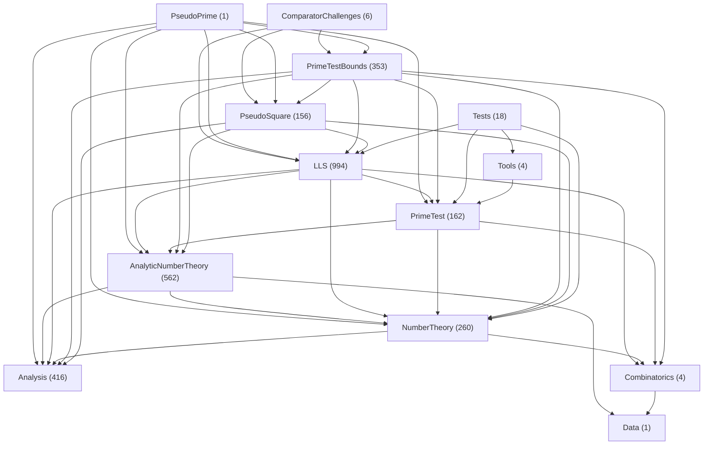

# 名前空間の依存図

図は配置方針に沿う向きのimportを表示し、図に表示しない依存も下表に列挙する。名前空間単位の集計であり、ファイル単位の循環検査や、各宣言の前提・主張・証明の意味上の監査を代替しない。図と表の両方を確認し、一般側から適用側へ戻る依存は、宣言の配置と数学的な依存に照らして個別に見直す。

<!-- namespace-dependencies:start -->
対象はチェックアウト内のLeanソース 2937 ファイル。隠しディレクトリ・ `archive` ・シンボリックリンク以下は走査しない。未追跡ファイルも含む。Mathlibなどの外部依存と同一グループ内の辺は図から除く。



ノードの括弧内はファイル数。名前は `PseudoPrime.` を省略している。異なるグループ間の直接依存 46 方向のうち、配置方針に沿う 40 方向を表示する。図に表示しない 6 方向は下表にすべて示す。表示する辺はすべて実際のimportに基づく。図から除いた依存がソース上で解消されたことを意味しない。

| 依存元 | 依存先 | import数 |
|---|---|---|
| `Analysis` | `AnalyticNumberTheory` | 27 |
| `Analysis` | `NumberTheory` | 3 |
| `LLS` | `PrimeTestBounds` | 5 |
| `LLS` | `PseudoSquare` | 2 |
| `NumberTheory` | `AnalyticNumberTheory` | 1 |
| `PrimeTest` | `Tests` | 1 |
<!-- namespace-dependencies:end -->

[namespace_dependencies.py](../../../scripts/namespace_dependencies.py) は、現在のソースから図・件数・省略した依存の表を再生成する。表示方向はスクリプトの `LAYERS` で定める。 `--check` は文書と集計結果の一致だけを検査し、逆依存の解消や配置の妥当性を保証しない。

```powershell
python -X utf8 scripts/namespace_dependencies.py --write
python -X utf8 scripts/namespace_dependencies.py --check
```
