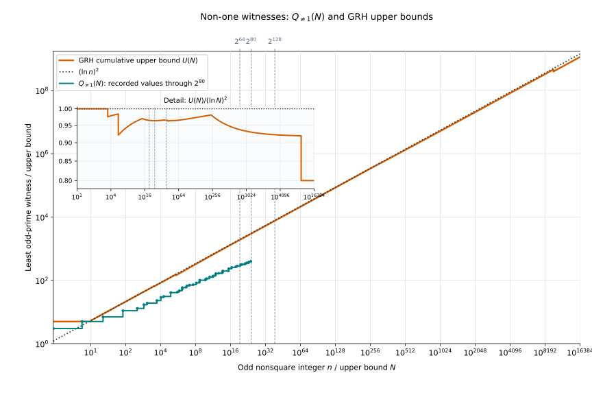
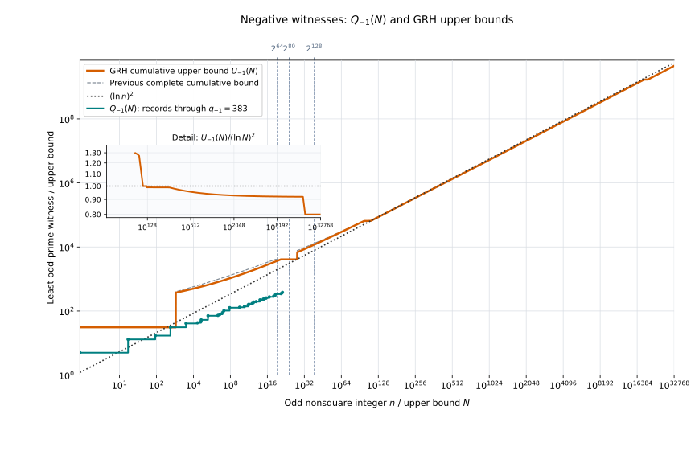
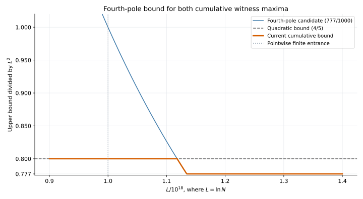

# Selfridge停止値へのGRH上界の接続（PrimeTestBounds.Selfridge）

対象: [`PseudoPrime/PrimeTestBounds/Selfridge`](../PseudoPrime/PrimeTestBounds/Selfridge)。公開入口は [`PseudoPrime/PrimeTestBounds.lean`](../PseudoPrime/PrimeTestBounds.lean)、上界の名前空間は `PseudoPrime.PrimeTestBounds.Selfridge`。離散的な候補列・試行回数・証人比較は `PseudoPrime.PrimeTest` に属する。

この領域では[PrimeTest](PrimeTest.md) の数学的な Selfridge 停止値を [PseudoSquare](PseudoSquare.md) の Jacobi 証人上界に接続する。ルートの `import PseudoPrime` からもこの入口を利用できる。

## 構成

| モジュール | 内容 |
|---|---|
| [WitnessBridge.lean](../PseudoPrime/PrimeTest/Selfridge/WitnessBridge.lean) | 共通数論の素数証人と Selfridge 停止値の比較 |
| [MaximumBridge.lean](../PseudoPrime/PrimeTestBounds/Selfridge/MaximumBridge.lean) | 古典候補・Wheel30 の停止値最大と `QNeOne`／ `QNegOne` の接続 |
| [ElementaryRadius.lean](../PseudoPrime/PrimeTestBounds/Selfridge/ElementaryRadius.lean) | 因子検出停止、純粋 $-1$ 停止、明示的半径の点ごとの比較 |
| [WitnessTransfer.lean](../PseudoPrime/PrimeTestBounds/Selfridge/WitnessTransfer.lean) | 任意の素数証人上界を古典候補・Wheel30の停止値へ移す汎用補題 |
| [AnalyticWitnessBounds.lean](../PseudoPrime/PrimeTestBounds/Selfridge/AnalyticWitnessBounds.lean) | 負値停止の3係数上界と因子検出停止の対数補正式 |
| [LogSqMaximum.lean](../PseudoPrime/PrimeTestBounds/Selfridge/LogSqMaximum.lean) | 停止値の有限最大に対する対数二乗上界 |
| [LogGRH.lean](../PseudoPrime/PrimeTestBounds/Selfridge/LogGRH.lean) | GRH を仮定する点ごとの上界 |
| [TrialCount.lean](../PseudoPrime/PrimeTestBounds/Selfridge/TrialCount.lean) | 無条件の最大試行回数と実数への比較 |
| [Selfridge/TrialCount.lean](../PseudoPrime/PrimeTest/Selfridge/TrialCount.lean) | 離散的な候補列と試行回数（PrimeTest） |
| [LogBounds.lean](../PseudoPrime/PrimeTestBounds/Selfridge/LogBounds.lean) | 無条件の数値対数評価・小区間評価 |
| [Comparison.lean](../PseudoPrime/PrimeTestBounds/Selfridge/Comparison.lean) | 無条件の実数への停止値比較 |
| [TrialCountGRH.lean](../PseudoPrime/PrimeTestBounds/Selfridge/TrialCountGRH.lean) | GRH 付き試行回数上界 |

## 停止値の意味

古典候補は大きさ $5, 7, 9, 11, \ldots$ の順に並ぶ。`selfridgeD` はこれらを符号付き判別式 $5, -7, 9, -11, \ldots$ に変換する。

`firstStopNegOne` は Jacobi 値が $-1$ になる最初の候補の大きさを表す。`firstStopNeOne` は $n \nmid i$ かつ Jacobi 値が $1$ でない最初の候補の大きさを表し、非自明因子の検出も含む。どちらも集合の非空性の証明を受け取る数学的な最小元である。

対応する符号付き停止値を $g_{-1}(n)$ と $g_{\ne 1}(n)$ と書くと、絶対値は候補の大きさに等しい。この領域の上界はこれらの数学的停止値について述べる。現行 BPSW の実行用探索に Jacobi 値 $0$ による早期停止を追加するものではない。

Wheel30候補による対応する符号付き停止値を $g^{(30)}_{-1}(n)$、 $g^{(30)}_{\ne1}(n)$ と書く。
奇数かつ非平方数の入力では、各停止値は対応する古典候補の停止値と等しい。
以下の解析的な上界は両候補についてLeanで接続している。

## 累積最大値の一致条件

PseudoSquareと同じ、 $0 < n\le B$ の奇数・非平方入力で累積最大値を取る。上端 $B$ 自身は任意の自然数である。上端0を含む式はLeanの $\mathrm{Real.log}(0)=0$ と空の最大値0の規約で読む。古典停止最大を $M_{\ne1}(B),M_{-1}(B)$、Wheel30版を $M^{(30)}_{\ne1}(B),M^{(30)}_{-1}(B)$ と書く。

| 系列 | 一致を証明した範囲 | GRHなしで成り立つ等式 |
|---|---|---|
| 非1値・因子検出 | $B\ge751$ | $M^{(30)}_{\ne1}(B)=M_{\ne1}(B)=Q_{\ne1}(B)$ |
| 純粋負値 | $B\ge399$ | $M^{(30)}_{-1}(B)=M_{-1}(B)=Q_{-1}(B)$ |

[MaximumBridge.lean](../PseudoPrime/PrimeTestBounds/Selfridge/MaximumBridge.lean) の `classicalNeOneMaximum_eq_QNeOne_of_751_le`、`wheel30NeOneMaximum_eq_QNeOne_of_751_le`、`classicalNegOneMaximum_eq_QNegOne_of_399_le`、`wheel30NegOneMaximum_eq_QNegOne_of_399_le` が対応する。

小さい上端も含む全域では $Q_{\ne1}\le M_{\ne1}=M^{(30)}_{\ne1}\le\max\lbrace15,Q_{\ne1}\rbrace$、 $Q_{-1}\le M_{-1}=M^{(30)}_{-1}\le\max\lbrace27,Q_{-1}\rbrace$ を使う。 $B < 3$ の空の対象範囲では全て0である。[共通前提と小入力の扱い](PseudoSquare.md#selfridgeと共有する前提と累積最大値) を参照する。以下の解析的上界を代入する段階でGRHを加える。

## 主要な公開結果

自然対数を用いて

$$
R_a(n) = \Bigl(\ln(4n) + \frac{24}{5}\ln(\ln(4n)) + a\Bigr)^2
$$

と置く。現在の共通包絡線には加算定数2の $R_2$ を使う。
次の表には加算定数3の $R_3$ を使う従来の定理も保持している。
GRHと各定理の奇数・非平方条件のもとで、以下を得る。

| 公開定理 | 入力範囲と結論 |
|---|---|
| `classicalSelfridgeD_elementary_bound_explicit` | $n \ge 3$ で $\lvert g_{\ne 1}(n) \rvert \le \lvert g_{-1}(n) \rvert \le R_3(n)$ |
| `classicalD_neOne_logSq_from13_GRH` | $n \ge 13$ で $\lvert g_{\ne 1}(n) \rvert \le (\ln\mathrel{} n)^2$ |
| `classicalD_neOne_le_max13_logSq_GRH` | 奇数かつ非平方数の入力で $\lvert g_{\ne 1}(n) \rvert \le \max\left\lbrace 13, (\ln\mathrel{} n)^2 \right\rbrace$ |
| `classicalNeOneMaximum_cast_le_log_sq_of_751_le` | $B \ge 751$ で因子検出停止値の最大が $(\ln\mathrel{} B)^2$ 以下 |

名前に `log_sq` を含む既存定理でも、純粋 $-1$ 側には右辺が $R_3(n)$ のものがある。利用時は名前だけでなく定理の型を確認する。

## 素数証人の解析的上界による拡張

次の二つの表では以下を共通の前提とする。

$$
\begin{gathered}
n\in\mathbb N,\quad n > 1,\quad n\text{ は奇数},\quad
\forall s\in\mathbb N,\ n\ne s^2,
\\
\mathrm{GRH},\qquad L=\ln n.
\end{gathered}
$$

### 純粋負値停止の係数上界

各行の条件から、古典候補とWheel30の両方に共通の上界が得られる。

| 条件 | $\lvert g_{-1}(n)\rvert$ と $\lvert g^{(30)}_{-1}(n)\rvert$ の上界 | Lean定理 |
|---|---|---|
| $L\ge255$ | $(9999/10000)L^2$ | `selfridgeNegOneMagnitudes_le_joint_entrance` |
| $L\ge290$ | $(99/100)L^2$ | `selfridgeNegOneMagnitudes_le_mixed_log_290` |
| $L\ge46000$ | $(4/5)L^2$ | `selfridgeNegOneMagnitudes_le_four_fifths` |
| $L\ge10^{18}$ | $(777/1000)L^2$ | `selfridgeNegOne_fourPole_sharp` |

いずれも非平方の正奇数全体を対象とし、入力の因数分解に追加条件を課さない。
表は各係数上界の適用条件を示す。条件が重なる範囲では、その最小値を使う。

### 因子検出停止の専用上界

| 条件 | $\lvert g_{\ne1}(n)\rvert$ と $\lvert g^{(30)}_{\ne1}(n)\rvert$ の上界 | Lean定理 |
|---|---|---|
| $L\ge50$ | $(L-2\ln L+37/5)^2$ | `neOne_magnitudes_doubleLog50_GRH` |
| $L\ge22221$ | $(4/5)L^2$ | `selfridgeNeOneMagnitudes_le_four_fifths` |
| $L\ge10^{18}$ | $(777/1000)L^2$ | `selfridgeNeOne_fourPole_sharp` |

各定理は独立した上界を述べる。非1証人では値0も利用できるため、
係数 $4/5$ の開始尺度は純粋負値停止の46000から22221へ下がる。
前者の対数補正式は $L\ge50$ で $L^2$ 未満となる。

### 中間尺度の因子検出停止と最大値への拡張

$$
r(L)=\frac{3200}{3241}\left(L-\frac{18}{25}\right).
$$

前節と同じ奇数・非平方条件のもとで、次が成立する。

$$
\mathrm{GRH},\quad \frac{3259}{25}\le L=\ln n\le\frac{16277}{100}
\quad\Longrightarrow\quad
\lvert g_{\ne1}(n)\rvert\le r(L)^2,\quad
\lvert g^{(30)}_{\ne1}(n)\rvert\le r(L)^2.
$$

`selfridgeNeOneMagnitudes_le_oddMidscale` が対応する。
同じ区間全体で $r(L)^2 < (L-2\ln L+149/20)^2$ となることは
[奇素数非1証人の比較定理](../PseudoPrime/LLS/PaperStatements/OddMidscaleEndpointRadius.lean) で証明した。

有限範囲の停止値最大も同じ上界で抑えられる。 $B\in\mathbb N$ に対して

$$
\mathcal A_B=\left\lbrace n\in\mathbb N:
0 < n\le B,\quad n\text{ は奇数かつ非平方}\right\rbrace,
$$

$$
M_{\mathrm{cl}}(B)=\max\left(\lbrace0\rbrace\cup
\left\lbrace\lvert g_{\ne1}(n)\rvert:n\in\mathcal A_B\right\rbrace\right),
\quad
M_{30}(B)=\max\left(\lbrace0\rbrace\cup
\left\lbrace\lvert g^{(30)}_{\ne1}(n)\rvert:n\in\mathcal A_B\right\rbrace\right)
$$

と定める。

$$
\mathrm{GRH},\quad \frac{3259}{25}\le\ln B\le\frac{16277}{100}
\quad\Longrightarrow\quad
M_{\mathrm{cl}}(B)\le r(\ln B)^2,\quad M_{30}(B)\le r(\ln B)^2.
$$

`selfridgeNeOneMaxima_le_oddMidscale` が対応する。
$\ln n$ が適用区間に入らない小さい入力も、 $n\in\mathcal A_B$ なら最大値の対象に含む。
[OddMidscaleBounds.lean](../PseudoPrime/PrimeTestBounds/Selfridge/OddMidscaleBounds.lean)
の汎用補題 `selfridgeNeOneMaxima_le_of_QNeOne_bound` は、
$X\ge15$ と $Q_{\ne1}(B)\le X$ だけから両方の最大値を $X$ 以下に移す。

古典候補列の試行回数最大は、既存の全域定義に従い

$$
T_{\mathrm{cl}}(B)=
\left\lfloor\frac{\max\lbrace M_{\mathrm{cl}}(B)-5,0\rbrace}{2}\right\rfloor+1
$$

とする。

$$
\mathrm{GRH},\quad \frac{3259}{25}\le\ln B\le\frac{16277}{100}
\quad\Longrightarrow\quad
T_{\mathrm{cl}}(B)\le\frac{r(\ln B)^2-3}{2}.
$$

`classicalNeOneTrialMaximum_le_oddMidscale` が対応する。
任意の停止値上界 $X\ge5$ から試行回数を $(X-3)/2$ 以下へ移す汎用補題も証明した。
従来の $X/2+1$ より上界を $5/2$ 小さくできる。
これらは値0による因子検出を含む停止値とJacobi試行回数の結果であり、純粋負値停止の開始条件を変えるものではない。

### 補正定数37/5による最大値と試行回数

$$
u(L)=L-2\ln L+\frac{37}{5}\qquad(L > 0).
$$

上で定義した $M_{\mathrm{cl}}(B),M_{30}(B),T_{\mathrm{cl}}(B)$ に対し、次が成立する。

$$
\begin{gathered}
\mathrm{GRH},\quad B\in\mathbb N,\quad\ln B\ge50
\\
\Longrightarrow\quad
M_{\mathrm{cl}}(B)\le u(\ln B)^2,\quad
M_{30}(B)\le u(\ln B)^2,\quad
T_{\mathrm{cl}}(B)\le\frac{u(\ln B)^2-3}{2}.
\end{gathered}
$$

`neOne_maxima_doubleLog50_GRH` と
`classicalTrials_doubleLog50_GRH` が対応する。
共通尺度 $B$ での $Q_{\ne1}(B)$ 上界を使うため、 $\ln n < 50$ の対象入力も最大値に含む。
試行回数はJacobi記号の評価回数であり、ビット演算の計算量ではない。
[FiniteScaleShiftedDoubleLogBounds.lean](../PseudoPrime/PrimeTestBounds/Selfridge/FiniteScaleShiftedDoubleLogBounds.lean) で証明した。

### 精密化した端点と有限上界

[FiniteEndpointBounds.lean](../PseudoPrime/PrimeTestBounds/Selfridge/FiniteEndpointBounds.lean) は、
初等半径の加算定数を2とした共通包絡線と既存の有限上界を組み合わせる。
GRHと $B \ge 3$ のもとで、`selfridgeMaxima_le_endpoints` は古典・Wheel30の負値停止最大を
`PseudoSquare.negOneEndpointEnvelope B` 以下、非1値停止最大を
`PseudoSquare.neOneEndpointEnvelope B` 以下に抑える。
`classicalTrials_le_endpoints` は、対応する停止値上界を $X$ とすると、
古典方式の試行回数最大を $(X-3)/2$ 以下に抑える。

有限上界自体はGRHを必要としない。 $B < 750$ では4種類の停止最大が31以下となる。
$B < 1000000$ では非1値停止の2種類が47以下となる。
47の上界を純粋負値停止へ転用しない。750と1000000では、それぞれの有限候補を外す。
空の入力集合に対する既存の定義も保持し、停止最大は0、古典試行回数最大は1となる。

### 四極核の自由尺度と短縮した入口

[FourPoleCommonBounds.lean](../PseudoPrime/PrimeTestBounds/Selfridge/FourPoleCommonBounds.lean) は、
GRH下で、全ての自然数上端に対する4種類の停止最大を
$(777/1000)\max\lbrace10^{18},\ln B\rbrace^2$ 以下に抑える。
自由な共通尺度を使って入口未満の入力も覆い、従来の累積候補より小さくする。

さらに [FourPoleReducedBounds.lean](../PseudoPrime/PrimeTestBounds/Selfridge/FourPoleReducedBounds.lean) の
`selfridgeMaxima_le_fourPole_reduced` は、短縮した3入口の最小値
`PseudoSquare.fourPoleReducedBound B` を4種類全てへ移す。
`classicalTrials_le_fourPole_reduced` は、両方の古典試行回数最大を
その上界から3を引いて2で割った量以下に抑える。
数値証明書をLLS、Jacobiの累積最大をPseudoSquare、停止・回数への転送をSelfridgeに置く。
既存の停止値・試行回数の定義は保持する。

## 証人評価との接続

因子検出停止の大きさは、Jacobi 記号が $1$ でない最小の素数証人との比較を経て、PseudoSquare の対数二乗評価へ接続する。純粋 $-1$ 停止の大きさは、定数 $27$ と Jacobi 記号が $-1$ となる最小素数証人の最大値以下という比較を経て、一般 S1 由来の $R_3(n)$ へ接続する。この接続が [ElementaryRadius.lean](../PseudoPrime/PrimeTestBounds/Selfridge/ElementaryRadius.lean) の従来の点ごとの明示的上界を供給する。現在の累積包絡線では精密化した $R_2$ と有限候補を使う。

有限最大では、 $B \ge 399$ で古典的な純粋 $-1$ 停止最大と $\mathrm{QNegOne}(B)$ が等しく、 $B \ge 751$ で因子検出停止最大と $\mathrm{QNeOne}(B)$ が等しい。対応する定理は `classicalNegOneMaximum_eq_QNegOne_of_399_le` と `classicalNeOneMaximum_eq_QNeOne_of_751_le`。Wheel30 版の等式もある。これらの比較・等式自体には GRH を必要とせず、GRH は解析的な上界を代入する段階で使う。

## 累積上界の適用区間と図

この節ではGRHを仮定する。 $U_{\ne1}(B),U_{-1}(B)$ は [PseudoSquareの区間別まとめ](PseudoSquare.md#証人別の上界式の適用区間と比較) にある、証明済み候補の最小値である。共通端点255、適用域内の定数4093、有限上界31・47、精密化した初等半径と第四極核候補も含む。47は非1値側だけで使う。

| 対象 | 上端の条件 | 共通の累積上界 |
|---|---|---|
| 古典・Wheel30の非1値停止最大 | $B\ge751$ | $U_{\ne1}(B)$。 $Q_{\ne1}(B)$ と同じ図を使える |
| 古典・Wheel30の純粋負値停止最大 | $B\ge399$ | $U_{-1}(B)$。 $Q_{-1}(B)$ と同じ図を使える |
| 上記4種類の停止最大 | 全ての $B\in\mathbb N$ | $F_4(B)=\mathrm{fourPoleReducedBound}(B)$ |
| 上記4種類の停止最大 | $\ln B \ge 1440000000000$ | $(777/1000)(\ln B)^2$ |
| 古典方式の2種類の試行回数最大 | 全ての $B\in\mathbb N$ | $(F_4(B)-3)/2$ |

ここで $L=\ln B$ とする。3行の共通尺度候補の最小値を $F_4(B)$ と書く。
各行から保証される簡単な高域の式は、PseudoSquareと共通である。

| 対数上端の区間 | 4種類の停止最大に共通の上界 |
|---|---|
| $900000000 \le L$ | $(79/100)L^2$ |
| $14400000000 \le L$ | $(39/50)L^2$ |
| $1440000000000 \le L$ | $(777/1000)L^2$ |

表の範囲は重なっており、その範囲内では最小の候補を使う。
[PseudoSquareの高域のまとめ](PseudoSquare.md#高域の累積上界) に候補の定義を示す。
図の浮動小数の交点を証人定理の適用条件にしない。

小さい上端でPseudoSquareの図を停止最大の上界に使う場合は、非1値側に $\max\lbrace15,U_{\ne1}(B)\rbrace$、負値側に $\max\lbrace27,U_{-1}(B)\rbrace$ を使う。一致範囲で等しいのは実際の累積最大値どうしであり、上界曲線と実際値の等号を意味しない。小さい上端ではPseudoSquareの記録線をSelfridgeの記録と同一視しない。

累積値には入口未満の入力も入るため、各候補は $c\max\lbrace E,L\rbrace^2$ とする。
点ごとの $cL^2$ を入口未満へ適用しない。既存の中低域の候補も最小値に保持する。





この2図はPseudoSquareと共有する。上端751以上の非1値系列、399以上の負値系列では、記録線は古典・Wheel30の対応する停止最大値の記録としても読め、上界曲線も共通に使える。それ未満の記録線はPseudoSquareの証人最大値として読む。



高域図は $F_4$ と係数4/5の候補の最小値を $(\ln B)^2$ で割ったもの。
同じ曲線が4種類のSelfridge停止最大も抑える。図の補間はLeanの証明を代替しない。
[図・適用条件・生成スクリプトの一覧](figures/README.md) を参照する。

## 試行回数と計算量

`PseudoPrime.PrimeTest.classicalCandidateAt` は候補列、 `PseudoPrime.PrimeTest.classicalTrialCountThrough` は指定候補までの試行回数を定義する。奇数 $i \ge 5$ を古典候補とすると、その候補までの回数は $(i - 3) / 2$。 `classicalTrialMaximum_elementary_bound_explicit` は停止値最大の上界を、試行回数最大の明示上界に変換する。

GRHと $B \ge 3$ のもとで、`classicalTrials_le_common_sharp` は、
古典方式の両試行回数最大を $(\mathrm{commonEndpointEnvelope}(B)-3)/2$ 以下に抑える。
有限候補も使う場合は、`classicalTrials_le_endpoints` により負値・非1値それぞれの端点を使う。
従来の $R_3(B)/2+1$ の定理も保持している。

ここで数えるのは Jacobi 記号の試行回数である。1回の Jacobi 計算にかかる費用や、平方数チェック、Miller–Rabin、Lucas 評価を含むビット計算量・実測時間は評価しない。また、GRH を仮定する上界と、PrimeTest の素数完全性に使う無条件の有限探索成功は別の結果である。

## 利用方法

```lean
import PseudoPrime.PrimeTestBounds

#check PseudoPrime.PrimeTestBounds.Selfridge.classicalSelfridgeD_elementary_bound_explicit
#check PseudoPrime.PrimeTestBounds.Selfridge.classicalNeOneMaximum_cast_le_log_sq_of_751_le
#check PseudoPrime.PrimeTestBounds.Selfridge.classicalTrialMaximum_elementary_bound_explicit
#check PseudoPrime.PrimeTestBounds.Selfridge.selfridgeNegOneMagnitudes_le_four_fifths
#check PseudoPrime.PrimeTestBounds.Selfridge.selfridgeNeOneMagnitudes_le_sharp_double_log
```

全体を検証する場合は、 `lakefile.toml` のある `PseudoPrime` ディレクトリで `lake build` を実行する。

[構成全体へ](README.md)
