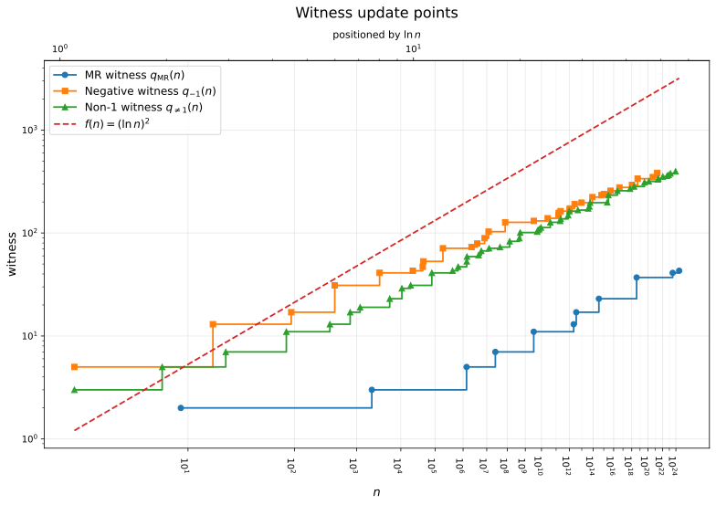

# 最小素数証人の更新点・素数別初出とSelfridgeの数表

Miller–Rabinの最小素数証人、二次指標の最小負値証人、最小非1証人について、累積最大値の更新点92点を掲載する。更新点の各行はそれ以前の最大値を上回る最小証人を初めて持つ入力を表す。さらに、奇素数ごとの最小入力とSelfridgeの最初の停止位置に関する6系列の定義・数表をまとめる。

本資料は数値探索の参考情報であり、表の数値計算にGRHは仮定しない。Leanで証明した上界とその前提は [PseudoSquare](PseudoSquare.md) と [Miller–Rabinの証人上界](MillerRabinBoundGrh.md) を参照する。数式の $\ln$ は自然対数を表す。

## 対象と証人の定義

| 種類 | 入力 $n$ | 証人候補の素数 $p$ | 証人の条件 |
|---|---|---|---|
| MR | 正の奇合成数。平方数も含む | $2$ を含むすべての素数 | 素数底 $p$ のMiller–Rabinテストに不合格 |
| 負値 | 非平方の正の奇数。素数も含む | 奇素数 | $\chi_p(n)=-1$ |
| 非1 | 非平方の正の奇数。素数も含む | 奇素数 | $\chi_p(n)\ne1$、すなわち $0$ または $-1$ |

MRでは $n-1=2^s d$、 $d$ を奇数、 $s\ge1$ として、合格条件を

$$
\mathrm{Pass}(n,p)\iff p^d\equiv1\pmod n
\quad\lor\quad
\exists r\in\mathbb Z,\quad 0\le r < s,\quad p^{2^r d}\equiv-1\pmod n
$$

とする。最小MR証人 $q_{\mathrm{MR}}(n)$ は、この条件を満たさない最小の素数 $p$ である。 $p$ と $n$ が互いに素であることは要求しない。

二次指標は、入力 $n$ を分子、奇素数 $p$ を分母とするLegendre記号

$$
\chi_p(n)=\left(\frac{n}{p}\right)\in\lbrace-1,0,1\rbrace
$$

である。分母が奇素数なので、Legendre記号はJacobi記号と一致する。 $p\mid n$ なら値は $0$ になる。最小負値証人 $q_{-1}(n)$ は $\chi_p(n)=-1$ となる最小の奇素数、最小非1証人 $q_{\ne1}(n)$ は $\chi_p(n)\ne1$ となる最小の奇素数である。候補に $p < n$ の制限はなく、たとえば $q_{-1}(3)=5$ である。

## 掲載範囲と更新点の読み方

| 種類 | 対象入力の範囲 | 更新点数（初期点を含む） | 最小証人の最大値 | 最大値の初達成入力 |
|---|---|---:|---:|---:|
| MR | 奇合成数 $9\le n\le3317044064679887385961981$ | 11 | 43 | 3317044064679887385961981 |
| 負値 | 非平方の正の奇数 $3\le n\le1736820352691539357719$ | 32 | 383 | 1736820352691539357719 |
| 非1 | 非平方の正の奇数 $3\le n < 2^{80}$ | 49 | 397 | 900328310767395396567151 |

上端は $2^{64}=18446744073709551616$、 $2^{80}=1208925819614629174706176$ である。非1証人の探索範囲は上端を含まない。MRと負値証人では最終更新点の入力を含む。

対象集合を $\mathcal D$、最小証人を $q(n)$ とすると、更新点は

$$
n\in\mathcal D,\quad
\forall m\in\mathcal D,\quad m < n\Longrightarrow q(m) < q(n)
$$

を満たす点 $(n,q(n))$ とする。先行入力のない最小元も初期点として含める。入力と証人値はともに狭義単調増加であり、凸包による点の間引きは行っていない。

二次指標の各表からは、掲載範囲内の $B$ に対する有限最大値 $Q_{-1}(B)$、 $Q_{\ne1}(B)$ を読める。 $n\le B$ となる最後の行の証人値がその最大値であり、対象入力がない $B < 3$ では $0$ になる。非1証人の探索が $2^{80}$ まで完了していても、負値証人について同範囲の最大値が確定したことにはならない。

比 $q(n)/(\ln n)^2$ は小数第7位を四捨五入して小数第6位まで表示した。この列は各更新入力での比であり、全入力に対する上界係数を示すものではない。

## MRの更新点

初期点は $(9,2)$ である。MR証人の候補には素数 $2$ を含める。

| $n$ | $q_{\mathrm{MR}}(n)$ | $q_{\mathrm{MR}}(n)/(\ln n)^2$ |
|---:|---:|---:|
| 9 | 2 | 0.414268 |
| 2047 | 3 | 0.051611 |
| 1373653 | 5 | 0.025032 |
| 25326001 | 7 | 0.024087 |
| 3215031751 | 11 | 0.022954 |
| 2152302898747 | 13 | 0.016121 |
| 3474749660383 | 17 | 0.020387 |
| 341550071728321 | 23 | 0.020538 |
| 3825123056546413051 | 37 | 0.020209 |
| 318665857834031151167461 | 41 | 0.013999 |
| 3317044064679887385961981 | 43 | 0.013489 |

### A006945の素数証人別一覧

[OEIS A006945](https://oeis.org/A006945) の第 $k$ 項は、素数底を小さい順に用いるMiller–Rabinテストで、第 $k$ 番目の素数底を必要とする最小の奇合成数を表す。表には重複する$n$も項ごとに残し、$p_k$ を項番号 $k$ に対応する素数として示す。

| $k$ | $n$ | $p_k$ | $p_k/(\ln n)^2$ |
|---:|---:|---:|---:|
| 1 | 9 | 2 | 0.414268 |
| 2 | 2047 | 3 | 0.051611 |
| 3 | 1373653 | 5 | 0.025032 |
| 4 | 25326001 | 7 | 0.024087 |
| 5 | 3215031751 | 11 | 0.022954 |
| 6 | 2152302898747 | 13 | 0.016121 |
| 7 | 3474749660383 | 17 | 0.020387 |
| 8 | 341550071728321 | 19 | 0.016966 |
| 9 | 341550071728321 | 23 | 0.020538 |
| 10 | 3825123056546413051 | 29 | 0.015840 |
| 11 | 3825123056546413051 | 31 | 0.016932 |
| 12 | 3825123056546413051 | 37 | 0.020209 |
| 13 | 318665857834031151167461 | 41 | 0.013999 |
| 14 | 3317044064679887385961981 | 43 | 0.013489 |

## 負値証人の更新点

各行の $p=q_{-1}(n)$ では $\chi_p(n)=-1$ となる。それより小さいすべての奇素数 $\ell$ については、 $\chi_\ell(n)$ は $0$ または $1$ である。

| $n$ | $q_{-1}(n)$ | $\chi_p(n)$ | $q_{-1}(n)/(\ln n)^2$ |
|---:|---:|---:|---:|
| 3 | 5 | -1 | 4.142677 |
| 15 | 13 | -1 | 1.772678 |
| 91 | 17 | -1 | 0.835469 |
| 399 | 31 | -1 | 0.864288 |
| 3045 | 41 | -1 | 0.637234 |
| 21099 | 43 | -1 | 0.433724 |
| 41155 | 47 | -1 | 0.416324 |
| 43059 | 53 | -1 | 0.465501 |
| 182919 | 71 | -1 | 0.483596 |
| 2190279 | 73 | -1 | 0.342487 |
| 3777855 | 79 | -1 | 0.344435 |
| 8042479 | 89 | -1 | 0.352032 |
| 12129315 | 103 | -1 | 0.387141 |
| 78278655 | 127 | -1 | 0.384430 |
| 3263415285 | 131 | -1 | 0.272988 |
| 25856763139 | 139 | -1 | 0.241806 |
| 147774098679 | 151 | -1 | 0.228281 |
| 156883882611 | 157 | -1 | 0.236252 |
| 212859328269 | 163 | -1 | 0.239576 |
| 1019539300341 | 167 | -1 | 0.218431 |
| 1066246263901 | 173 | -1 | 0.225548 |
| 2550661189365 | 191 | -1 | 0.234041 |
| 9551743094859 | 197 | -1 | 0.220536 |
| 86798190414901 | 223 | -1 | 0.216491 |
| 612057098059485 | 233 | -1 | 0.200991 |
| 1062483479555355 | 239 | -1 | 0.199646 |
| 4833899440864935 | 257 | -1 | 0.197048 |
| 40801368051299571 | 277 | -1 | 0.189354 |
| 1072438050265044969 | 293 | -1 | 0.169991 |
| 5073529011861079155 | 337 | -1 | 0.181664 |
| 451368766434936754915 | 349 | -1 | 0.154299 |
| 1736820352691539357719 | 383 | -1 | 0.160128 |

掲載範囲内の最後の更新点は $n=1736820352691539357719$、 $q_{-1}(n)=383$ である。この入力での最小証人はEulerの規準による剰余計算で確認した。353を最小負値証人とする初出入力は $n=5343181480814445463965$ である。この前に383の更新点があるため、353の初出は累積最大値の更新点にはならない。359、367、373、379の初出は未確定で、いずれも $2^{72}$ より大きい。

## 非1証人の更新点

各行の $p=q_{\ne1}(n)$ では $\chi_p(n)$ は $0$ または $-1$ となる。それより小さいすべての奇素数 $\ell$ については $\chi_\ell(n)=1$ である。指標値が $0$ の初期点も掲載した。

| $n$ | $q_{\ne1}(n)$ | $\chi_p(n)$ | $q_{\ne1}(n)/(\ln n)^2$ |
|---:|---:|---:|---:|
| 3 | 3 | 0 | 2.485606 |
| 7 | 5 | -1 | 1.320458 |
| 19 | 7 | -1 | 0.807408 |
| 79 | 11 | -1 | 0.576155 |
| 331 | 13 | -1 | 0.386163 |
| 751 | 17 | -1 | 0.387747 |
| 1171 | 19 | -1 | 0.380587 |
| 5251 | 23 | -1 | 0.313440 |
| 10651 | 29 | -1 | 0.337225 |
| 18379 | 31 | -1 | 0.321537 |
| 78439 | 41 | -1 | 0.322797 |
| 399499 | 43 | -1 | 0.258479 |
| 644869 | 47 | -1 | 0.262660 |
| 1394611 | 53 | -1 | 0.264776 |
| 1427911 | 59 | -1 | 0.293769 |
| 4355311 | 61 | -1 | 0.261030 |
| 5715319 | 67 | -1 | 0.276777 |
| 12807391 | 71 | -1 | 0.265093 |
| 43030381 | 73 | -1 | 0.236272 |
| 133826599 | 83 | -1 | 0.237047 |
| 452980999 | 89 | -1 | 0.224035 |
| 505313251 | 101 | -1 | 0.251476 |
| 5273095699 | 103 | -1 | 0.205536 |
| 5959962661 | 107 | -1 | 0.211202 |
| 7209891781 | 109 | -1 | 0.211555 |
| 9248561191 | 113 | -1 | 0.214585 |
| 38816991931 | 127 | -1 | 0.213629 |
| 196265095009 | 131 | -1 | 0.193746 |
| 212676312949 | 137 | -1 | 0.201374 |
| 782893951711 | 149 | -1 | 0.198665 |
| 963864514519 | 163 | -1 | 0.214068 |
| 4745628949021 | 167 | -1 | 0.196020 |
| 35984570527819 | 173 | -1 | 0.177560 |
| 46257585588439 | 181 | -1 | 0.182817 |
| 53009903964319 | 197 | -1 | 0.197265 |
| 2221982786875069 | 199 | -1 | 0.159364 |
| 2871159201832639 | 233 | -1 | 0.183914 |
| 24976302418603981 | 257 | -1 | 0.180279 |
| 632590969227841471 | 269 | -1 | 0.160113 |
| 1905834685957869991 | 283 | -1 | 0.159734 |
| 36227776794748949419 | 311 | -1 | 0.153332 |
| 133875781853684120779 | 317 | -1 | 0.147599 |
| 2142202860370269916129 | 331 | -1 | 0.137208 |
| 2570177826221071499731 | 337 | -1 | 0.138665 |
| 10940330978169094945381 | 353 | -1 | 0.137075 |
| 46151155402172599713229 | 359 | -1 | 0.131820 |
| 78553793556098659805581 | 367 | -1 | 0.132053 |
| 147295947882178671723211 | 379 | -1 | 0.133175 |
| 900328310767395396567151 | 397 | -1 | 0.130493 |

## 素数別の初出とSelfridgeの6系列

ここからは、各奇素数が最小証人となる最小入力と、Selfridge候補の最初の停止位置を扱う。更新点の表では、以前の最大値を更新しない素数の初出は掲載されない。例えば $q_{-1}(3)=5$ の後に $q_{-1}(5)=3$ が現れるが、後者は更新点にならない。

### 共通の入力とSelfridge候補

入力集合と奇素数の添字を

$$
\mathcal A=\lbrace n\in\mathbb N:n > 0,\ n\text{ は奇数かつ非平方}\rbrace,
\qquad p_1=3,\ p_2=5,\ p_3=7,\ldots
$$

とする。奇素数列は [OEIS A065091](https://oeis.org/A065091) に対応する。Selfridgeの候補は、奇数 $m\ge5$ に対し

$$
\delta(m)=(-1)^{(m-1)/2}m
$$

と置き、元の順序

$$
\delta(5),\delta(7),\delta(9),\ldots=5,-7,9,-11,13,-15,17,\ldots
$$

で調べる。負値での最初の停止値と、非1での最初の停止値を

$$
\begin{aligned}
g_{-1}(n)&=\delta\left(\min\lbrace m\ge5:m\text{ は奇数},\ (\delta(m)/n)=-1\rbrace\right),\\
g_{\ne1}(n)&=\delta\left(\min\lbrace m\ge5:m\text{ は奇数},\ (\delta(m)/n) < 1\rbrace\right)
\end{aligned}
$$

と定義する。ここで分母は入力 $n$ であり、記号はJacobi記号である。標準のSelfridge Method Aは $-1$ を探す。値 $0$ でも停止する非1版は、本稿で別に定義した条件である。いずれも $\lvert D\rvert=n$ の場合をJacobi値 $0$ として扱い、素数判定プログラムで行うgcd検査や特別分岐を数列の定義に含めない。

### 候補集合と6系列の定義

最初の停止値となり得る候補の絶対値は、次の集合に限られる。

$$
\begin{aligned}
S_{-1}&=\lbrace15,21,27\rbrace\cup\lbrace p\ge5:p\text{ は素数}\rbrace,\\
S_{\ne1}&=\lbrace9,15\rbrace\cup\lbrace p\ge5:p\text{ は素数}\rbrace.
\end{aligned}
$$

$S_{-1},S_{\ne1}$ の小さい方から第 $i$ 番目を $t_{-1}(i),t_{\ne1}(i)$ とし、次の6系列を定義する。添字はすべて1から始まる。

$$
\begin{aligned}
D_{-1}(i)&=\delta(t_{-1}(i)),&
D_{\ne1}(i)&=\delta(t_{\ne1}(i)),\\
a_{-1}(i)&=\min\lbrace n\in\mathcal A:q_{-1}(n)=p_i\rbrace,&
a_{\ne1}(i)&=\min\lbrace n\in\mathcal A:q_{\ne1}(n)=p_i\rbrace,\\
s_{-1}(i)&=\min\lbrace n\in\mathcal A:g_{-1}(n)=D_{-1}(i)\rbrace,&
s_{\ne1}(i)&=\min\lbrace n\in\mathcal A:g_{\ne1}(n)=D_{\ne1}(i)\rbrace.
\end{aligned}
$$

| 本稿の識別名 | 数列 | 掲載する連続項の範囲 |
|---|---|---|
| D-NEG | $D_{-1}(i)$：負値で最初の停止値になり得る候補 | 下表の第1～79項。候補集合の式は全項を定義する |
| D-NON1 | $D_{\ne1}(i)$：非1で最初の停止値になり得る候補 | 下表の第1～78項。候補集合の式は全項を定義する |
| P-NEG | $a_{-1}(i)$：奇素数 $p_i$ が最小負値証人となる最小入力 | 第1～70項。第71～74項は未確定、第75項も掲載 |
| P-NON1 | $a_{\ne1}(i)$：奇素数 $p_i$ が最小非1証人となる最小入力 | 第1～74項 |
| S-NEG | $s_{-1}(i)$：候補 $D_{-1}(i)$ が最初の負値停止となる最小入力 | 第1～72項 |
| S-NON1 | $s_{\ne1}(i)$：候補 $D_{\ne1}(i)$ が最初の非1停止となる最小入力 | 第1～75項 |

これらの識別名は元のOEIS登録草案内の仮称であり、既存のOEIS番号を表すものではない。最小値の存在にGRHは不要である。 $D$ は絶対値の順に並び、符号付き値そのものの昇順ではない。最小入力の4系列も一般には単調ではない。

### 奇素数ごとの最小入力表

次の表の負値列は研究記録 `quadratic_witness/u80-work-negative/negative_prime_minima.csv` の2026年10月28日取得内容、非1列は2026年10月19日時点の入力CSVに基づく。「未確定」はCSVの空欄、「未収録」はそのCSVの掲載範囲外を表す。いずれもその素数を最小証人とする入力の不存在を意味しない。

負値版では対象素数より前の奇素数で値 $0$ を許す。例えば $a_{-1}(4)=21$ では、奇素数 $3,5,7,11$ での値は順に $0,1,0,-1$ である。非1版では先行するすべての奇素数で値 $1$ を要求する。 $a_{\ne1}(8)=5251=59\cdot89$ のように、最小入力は合成数でもよい。

| $i$ | $p_i$ | $a_{-1}(i)$ | $a_{\ne1}(i)$ |
|---:|---:|---:|---:|
| 1 | 3 | 5 | 3 |
| 2 | 5 | 3 | 7 |
| 3 | 7 | 19 | 19 |
| 4 | 11 | 21 | 79 |
| 5 | 13 | 15 | 331 |
| 6 | 17 | 91 | 751 |
| 7 | 19 | 715 | 1171 |
| 8 | 23 | 429 | 5251 |
| 9 | 29 | 1005 | 10651 |
| 10 | 31 | 399 | 18379 |
| 11 | 37 | 3705 | 90931 |
| 12 | 41 | 3045 | 78439 |
| 13 | 43 | 21099 | 399499 |
| 14 | 47 | 41155 | 644869 |
| 15 | 53 | 43059 | 1394611 |
| 16 | 59 | 434919 | 1427911 |
| 17 | 61 | 278509 | 4355311 |
| 18 | 67 | 1744395 | 5715319 |
| 19 | 71 | 182919 | 12807391 |
| 20 | 73 | 2190279 | 43030381 |
| 21 | 79 | 3777855 | 163384621 |
| 22 | 83 | 9366855 | 133826599 |
| 23 | 89 | 8042479 | 452980999 |
| 24 | 97 | 33440551 | 1169755141 |
| 25 | 101 | 267511839 | 505313251 |
| 26 | 103 | 12129315 | 5273095699 |
| 27 | 107 | 1392257091 | 5959962661 |
| 28 | 109 | 182528031 | 7209891781 |
| 29 | 113 | 3967126095 | 9248561191 |
| 30 | 127 | 78278655 | 38816991931 |
| 31 | 131 | 3263415285 | 196265095009 |
| 32 | 137 | 28721025271 | 212676312949 |
| 33 | 139 | 25856763139 | 916716646759 |
| 34 | 149 | 161971447719 | 782893951711 |
| 35 | 151 | 147774098679 | 1876943222179 |
| 36 | 157 | 156883882611 | 4726529308939 |
| 37 | 163 | 212859328269 | 963864514519 |
| 38 | 167 | 1019539300341 | 4745628949021 |
| 39 | 173 | 1066246263901 | 35984570527819 |
| 40 | 179 | 5947699157079 | 123107433196141 |
| 41 | 181 | 16279597994529 | 46257585588439 |
| 42 | 191 | 2550661189365 | 71175839123029 |
| 43 | 193 | 33205050030685 | 104669513845381 |
| 44 | 197 | 9551743094859 | 53009903964319 |
| 45 | 199 | 143685718819185 | 2221982786875069 |
| 46 | 211 | 126316077604831 | 6450045516630769 |
| 47 | 223 | 86798190414901 | 4575966034632301 |
| 48 | 227 | 1142878285291219 | 5851505127988699 |
| 49 | 229 | 2473796370334279 | 20602619993714851 |
| 50 | 233 | 612057098059485 | 2871159201832639 |
| 51 | 239 | 1062483479555355 | 97915624862375191 |
| 52 | 241 | 11435289430251261 | 286657540188128671 |
| 53 | 251 | 17184264002396071 | 453954035543431861 |
| 54 | 257 | 4833899440864935 | 24976302418603981 |
| 55 | 263 | 41967948075416661 | 3912757033292244019 |
| 56 | 269 | 93239036008031995 | 632590969227841471 |
| 57 | 271 | 234970013552420745 | 10344345363611102341 |
| 58 | 277 | 40801368051299571 | 10198100582046287689 |
| 59 | 281 | 1331444818329072199 | 25257225026744397229 |
| 60 | 283 | 1080677206840353199 | 1905834685957869991 |
| 61 | 293 | 1072438050265044969 | 155109909180526689211 |
| 62 | 307 | 10975953610647592609 | 122723956872373235941 |
| 63 | 311 | 25214480450385638685 | 36227776794748949419 |
| 64 | 313 | 16502463898208867709 | 1215860103183273605149 |
| 65 | 317 | 133875781853684120779 | 133875781853684120779 |
| 66 | 331 | 43140119917579047015 | 2142202860370269916129 |
| 67 | 337 | 5073529011861079155 | 2570177826221071499731 |
| 68 | 347 | 670697744911896817879 | 13796148908330917619989 |
| 69 | 349 | 451368766434936754915 | 28881697766399357795899 |
| 70 | 353 | 5343181480814445463965 | 10940330978169094945381 |
| 71 | 359 | （初出未確定） $\gt 2^{72}$ | 46151155402172599713229 |
| 72 | 367 | （初出未確定） $\gt 2^{72}$ | 78553793556098659805581 |
| 73 | 373 | （初出未確定） $\gt 2^{72}$ | 174200648478752994412939 |
| 74 | 379 | （初出未確定） $\gt 2^{72}$ | 147295947882178671723211 |
| 75 | 383 | 1736820352691539357719 | （初出未確定） $\gt 2^{80}$ |
| 76 | 389 | （初出未確定） $\gt 2^{72}$ | （初出未確定） $\gt 2^{80}$ |
| 77 | 397 | （初出未確定） $\gt 2^{72}$ | 900328310767395396567151 |

### Selfridge候補と停止位置ごとの最小入力表

最初の停止位置は元の候補順で定義する。候補集合にない数をあらかじめ飛ばす実装を使う場合は、最初の停止位置が変わらないことを確認する。負値で最初に $-15,21,-27$ となる最小入力は、それぞれ $179,935,1925$。非1で最初に $9,-15$ となる最小入力は $39,179$ である。

#### 負値（$-1$）系

| $i$ | $D_{-1}(i)$ | $s_{-1}(i)$ |
|---:|---:|---:|
| 1 | 5 | 3 |
| 2 | -7 | 5 |
| 3 | -11 | 21 |
| 4 | 13 | 11 |
| 5 | -15 | 179 |
| 6 | 17 | 91 |
| 7 | -19 | 155 |
| 8 | 21 | 935 |
| 9 | -23 | 429 |
| 10 | -27 | 1925 |
| 11 | 29 | 1005 |
| 12 | -31 | 399 |
| 13 | 37 | 3705 |
| 14 | 41 | 3045 |
| 15 | -43 | 21099 |
| 16 | -47 | 41155 |
| 17 | 53 | 43059 |
| 18 | -59 | 434919 |
| 19 | 61 | 278509 |
| 20 | -67 | 1744395 |
| 21 | -71 | 182919 |
| 22 | 73 | 2190279 |
| 23 | -79 | 3777855 |
| 24 | -83 | 9366855 |
| 25 | 89 | 8042479 |
| 26 | 97 | 33440551 |
| 27 | 101 | 267511839 |
| 28 | -103 | 12129315 |
| 29 | -107 | 1392257091 |
| 30 | 109 | 182528031 |
| 31 | 113 | 3967126095 |
| 32 | -127 | 78278655 |
| 33 | -131 | 3263415285 |
| 34 | 137 | 28721025271 |
| 35 | -139 | 25856763139 |
| 36 | 149 | 161971447719 |
| 37 | -151 | 147774098679 |
| 38 | 157 | 156883882611 |
| 39 | -163 | 212859328269 |
| 40 | -167 | 1019539300341 |
| 41 | 173 | 1066246263901 |
| 42 | -179 | 5947699157079 |
| 43 | 181 | 16279597994529 |
| 44 | -191 | 2550661189365 |
| 45 | 193 | 33205050030685 |
| 46 | 197 | 9551743094859 |
| 47 | -199 | 143685718819185 |
| 48 | -211 | 126316077604831 |
| 49 | -223 | 86798190414901 |
| 50 | -227 | 1142878285291219 |
| 51 | 229 | 2473796370334279 |
| 52 | 233 | 612057098059485 |
| 53 | -239 | 1062483479555355 |
| 54 | 241 | 11435289430251261 |
| 55 | -251 | 17184264002396071 |
| 56 | 257 | 4833899440864935 |
| 57 | -263 | 41967948075416661 |
| 58 | 269 | 93239036008031995 |
| 59 | -271 | 234970013552420745 |
| 60 | 277 | 40801368051299571 |
| 61 | 281 | 1331444818329072199 |
| 62 | -283 | 1080677206840353199 |
| 63 | 293 | 1072438050265044969 |
| 64 | -307 | 10975953610647592609 |
| 65 | -311 | 25214480450385638685 |
| 66 | 313 | 16502463898208867709 |
| 67 | 317 | 133875781853684120779 |
| 68 | -331 | 43140119917579047015 |
| 69 | 337 | 5073529011861079155 |
| 70 | -347 | 670697744911896817879 |
| 71 | 349 | 451368766434936754915 |
| 72 | 353 | 5343181480814445463965 |
| 73 | -359 | （初出未確定） $\gt 2^{72}$ |
| 74 | -367 | （初出未確定） $\gt 2^{72}$ |
| 75 | 373 | （初出未確定） $\gt 2^{72}$ |
| 76 | -379 | （初出未確定） $\gt 2^{72}$ |
| 77 | -383 | 1736820352691539357719 |
| 78 | 389 | （初出未確定） $\gt 2^{72}$ |
| 79 | 397 | （初出未確定） $\gt 2^{72}$ |

#### 非1（$\ne1$）系

| $i$ | $D_{\ne1}(i)$ | $s_{\ne1}(i)$ |
|---:|---:|---:|
| 1 | 5 | 3 |
| 2 | -7 | 19 |
| 3 | 9 | 39 |
| 4 | -11 | 11 |
| 5 | 13 | 71 |
| 6 | -15 | 179 |
| 7 | 17 | 751 |
| 8 | -19 | 1171 |
| 9 | -23 | 5251 |
| 10 | 29 | 10651 |
| 11 | -31 | 18379 |
| 12 | 37 | 90931 |
| 13 | 41 | 78439 |
| 14 | -43 | 399499 |
| 15 | -47 | 644869 |
| 16 | 53 | 1394611 |
| 17 | -59 | 1427911 |
| 18 | 61 | 4355311 |
| 19 | -67 | 5715319 |
| 20 | -71 | 12807391 |
| 21 | 73 | 43030381 |
| 22 | -79 | 163384621 |
| 23 | -83 | 133826599 |
| 24 | 89 | 452980999 |
| 25 | 97 | 1169755141 |
| 26 | 101 | 505313251 |
| 27 | -103 | 5273095699 |
| 28 | -107 | 5959962661 |
| 29 | 109 | 7209891781 |
| 30 | 113 | 9248561191 |
| 31 | -127 | 38816991931 |
| 32 | -131 | 196265095009 |
| 33 | 137 | 212676312949 |
| 34 | -139 | 916716646759 |
| 35 | 149 | 782893951711 |
| 36 | -151 | 1876943222179 |
| 37 | 157 | 4726529308939 |
| 38 | -163 | 963864514519 |
| 39 | -167 | 4745628949021 |
| 40 | 173 | 35984570527819 |
| 41 | -179 | 123107433196141 |
| 42 | 181 | 46257585588439 |
| 43 | -191 | 71175839123029 |
| 44 | 193 | 104669513845381 |
| 45 | 197 | 53009903964319 |
| 46 | -199 | 2221982786875069 |
| 47 | -211 | 6450045516630769 |
| 48 | -223 | 4575966034632301 |
| 49 | -227 | 5851505127988699 |
| 50 | 229 | 20602619993714851 |
| 51 | 233 | 2871159201832639 |
| 52 | -239 | 97915624862375191 |
| 53 | 241 | 286657540188128671 |
| 54 | -251 | 453954035543431861 |
| 55 | 257 | 24976302418603981 |
| 56 | -263 | 3912757033292244019 |
| 57 | 269 | 632590969227841471 |
| 58 | -271 | 10344345363611102341 |
| 59 | 277 | 10198100582046287689 |
| 60 | 281 | 25257225026744397229 |
| 61 | -283 | 1905834685957869991 |
| 62 | 293 | 155109909180526689211 |
| 63 | -307 | 122723956872373235941 |
| 64 | -311 | 36227776794748949419 |
| 65 | 313 | 1215860103183273605149 |
| 66 | 317 | 133875781853684120779 |
| 67 | -331 | 2142202860370269916129 |
| 68 | 337 | 2570177826221071499731 |
| 69 | -347 | 13796148908330917619989 |
| 70 | 349 | 28881697766399357795899 |
| 71 | 353 | 10940330978169094945381 |
| 72 | -359 | 46151155402172599713229 |
| 73 | -367 | 78553793556098659805581 |
| 74 | 373 | 174200648478752994412939 |
| 75 | -379 | 147295947882178671723211 |
| 76 | -383 | （初出未確定） $\gt 2^{80}$ |
| 77 | 389 | （初出未確定） $\gt 2^{80}$ |
| 78 | 397 | 900328310767395396567151 |

### 候補集合と添字の対応の根拠

奇数 $m\ge5$ と正の奇数 $n$ について、二次相互法則から、共通因子を持つ場合も含めて

$$
\left(\frac{\delta(m)}n\right)=\left(\frac nm\right)
$$

となる。右辺を素因数ごとのJacobi記号の積に分けると、最初の停止候補となる合成数を絞れる。

負値版では5以上の素因数に由来する $-1$ は、その素数候補で先に検出される。残る原因は $(n/3)=-1$ であり、この場合は遅くとも $m=27$ で停止する。したがって合成数候補の絶対値は $15,21,27$ に限られる。非1版では $(n/3)=0$ なら遅くとも $m=9$、 $(n/3)=-1$ なら遅くとも $m=15$ で停止するため、残る合成数候補は $9,15$ である。

5以上の素数候補は対象素数法では非剰余、先行する奇素数法では1となる奇数を中国剰余定理で構成すれば、最初の停止値として実現する。上記の合成数候補にも表の実現例がある。

点ごとの関係は

$$
\begin{aligned}
q_{-1}(n)\ge5&\Longrightarrow g_{-1}(n)=\delta(q_{-1}(n)),\\
q_{\ne1}(n)\ge5&\Longrightarrow g_{\ne1}(n)=\delta(q_{\ne1}(n))
\end{aligned}
$$

である。逆向きには、素数 $p$ に対し

$$
\begin{aligned}
p\ge29&\Longrightarrow
\left(g_{-1}(n)=\delta(p)\iff q_{-1}(n)=p\right),\\
p\ge17&\Longrightarrow
\left(g_{\ne1}(n)=\delta(p)\iff q_{\ne1}(n)=p\right)
\end{aligned}
$$

が成立する。これより、最小入力の系列にも

$$
s_{-1}(j+2)=a_{-1}(j)\quad(j\ge9),\qquad
s_{\ne1}(j+1)=a_{\ne1}(j)\quad(j\ge6)
$$

が成り立つ。両系列の添字は一致しない。例えば $a_{-1}(2)=3$ は最小負値素数が5であることを表し、 $s_{-1}(2)=5$ は最初の負値Selfridge候補が $-7$ であることを表す。

### 素数別初出と累積最大値の関係

$\star\in\lbrace-1,\ne1\rbrace$ とし、 $B$ 以下の有限最大値を $Q_\star(B)$ とすると

$$
Q_\star(B)=\max\left(\lbrace0\rbrace\cup
\lbrace p_i:a_\star(i)\le B\rbrace\right).
$$

初出 $a_\star(i)$ が累積最大値の更新入力になる条件は

$$
\forall j > i,\quad a_\star(i) < a_\star(j)
$$

である。この条件は掲載範囲の外の項にも及ぶため、有限個の初出値だけから未探索範囲の更新点まで確定することはできない。

Selfridgeの最悪時の候補絶対値を

$$
G_\star(B)=\max\left(\lbrace0\rbrace\cup
\lbrace\lvert g_\star(n)\rvert:n\in\mathcal A,\ n\le B\rbrace\right)
$$

と置くと、各入力で

$$
\begin{aligned}
q_{-1}(n)&\le\lvert g_{-1}(n)\rvert\le\max(q_{-1}(n),27),\\
q_{\ne1}(n)&\le\lvert g_{\ne1}(n)\rvert\le\max(q_{\ne1}(n),15)
\end{aligned}
$$

となる。 $q_{-1}(399)=31$ と $q_{\ne1}(751)=17$ より

$$
G_{-1}(B)=Q_{-1}(B)\quad(B\ge399),\qquad
G_{\ne1}(B)=Q_{\ne1}(B)\quad(B\ge751)
$$

が従う。これは有限最大値の一致であり、すべての入力で $q_\star(n)=\lvert g_\star(n)\rvert$ になるという主張ではない。

### 先行する素数を通過する最小入力との関係

最初の $k$ 個の奇素数を通過する最小入力は

$$
\begin{aligned}
T_{-1}(k)&=\min\lbrace n\in\mathcal A:\forall j\le k,\ (n/p_j) > -1\rbrace=\min_{j > k}a_{-1}(j),\\
T_{\ne1}(k)&=\min\lbrace n\in\mathcal A:\forall j\le k,\ (n/p_j)=1\rbrace=\min_{j > k}a_{\ne1}(j).
\end{aligned}
$$

後方の最小値を取るため、ちょうど $p_i$ で初めて停止する入力を集めた $a_\star(i)$ とは区別する。 [OEIS A330423](https://oeis.org/A330423) は法と互いに素な平方剰余となる最小非平方数である。素数階乗を使うと、中国剰余定理により

$$
T_{\ne1}(k)=\mathrm{A330423}\left(2\prod_{j=1}^{k}p_j\right)
=\mathrm{A330423}\left(\mathrm{A002110}(k+1)\right)
\quad(k\ge0)
$$

となる。積の法に2を含めることで入力の奇数条件も表す。

関連する既存系列として、[OEIS A377212](https://oeis.org/A377212) は偶数入力も許した最初の負値素数位置の最小入力を与える。本稿の奇数限定版とは

$$
a_{-1}(i)\ge\mathrm{A377212}(i+1)
$$

の関係があり、右辺が奇数なら等号になる。 [OEIS A096636](https://oeis.org/A096636) は対象素数より大きい素数入力のうち、先行する奇素数で平方剰余となり、対象素数で非剰余となる最小値を扱う。この制約から

$$
a_{\ne1}(i)\le\mathrm{A096636}(i-1)
$$

である。例えば $a_{\ne1}(8)=5251 < 7459=\mathrm{A096636}(7)$。既存系列の条件を、合成数や指標値0も許す本稿の条件と混同しない。

## 出典と検証範囲

元資料は研究記録 `PseudoPrimeWork/witness_upper_hull_1e10/witness_definitions_and_all_records.md` である。更新点の3表は元資料の全行を引き継ぎ、対応するCSVの入力・証人値とも照合した。

公開用の再探索プログラムは [最小奇素数証人の更新点探索](../examples/quadratic_witness/README.md) を参照する。ビルド・実行・途中再開の手順は同梱のREADMEに記載している。

MRの更新点と素数別の表は、[OEIS A006945](https://oeis.org/A006945) の14項に基づく。第 $k$ 項は、素数底を小さい順に用いるMiller–Rabinテストで、第 $k$ 番目の素数底を必要とする最小の奇合成数を表し、同じ入力が複数回現れる。重複入力をまとめた更新点の表は11行である。更新入力の最小性と更新点間の網羅性は、この数列の最小性に依拠する。

負値証人の表は $n < 2^{64}$ の完了した探索と監査に、349と383の拡張点を加えた。拡張点の間に別の更新点がないことは素数別初出表の下界で確認した。非1証人の表は $n < 2^{80}$ の既存の探索と監査に基づく。元資料は分岐による対象範囲の被覆、候補削減の下界、完了ビットマップ、最小入力表の統合などを記録している。本ページの作成時に、範囲全体の探索や監査を再実行したわけではない。

元の更新点表の作成時には、90行すべてについて証人となることと、それより小さい候補素数では証人にならないことを再計算した。二次指標の値はEulerの規準による剰余計算で確認し、比の丸め値は80桁精度の十進計算で照合した。

各行での最小証人の再確認と、探索範囲全体で更新点を漏れなく列挙できたことの検証は別である。後者は上記の数列・探索記録・監査結果に依拠する。これらの数表はLeanによる形式検証を行っていない。

素数別初出とSelfridgeの6系列は、研究用のOEIS登録草案 `OEIS_six_Selfridge_sequences.md` の2026年10月19日版と、その入力CSVから転載・整理した。表の奇素数の添字、連続項、未確定項、添字対応による後続項を元資料と照合した。候補列の元データは各1000項であり、その生成式との一致を確認した。本ページでは最小入力の掲載範囲に合わせて、負値候補列の第79項、非1候補列の第78項までを表示している。

元資料の更新時にはCSVに記入された142入力について、奇数・非平方の条件と、対象素数が最初の負値または非1証人となる条件を再計算した。Selfridgeの対応式を使う入力と停止位置表の収録項について、元の候補順による最初の停止位置も直接確認した。120000未満では独立走査によりSelfridgeの最小入力を照合した。これより大きい入力の最小性は提供CSVの探索結果に依存する。今回の公開文書への追加時に、全探索範囲の列挙を再実行したわけではない。

素数別表には負値更新点表の掲載範囲を超える入力も含まれる。未確定項を飛ばして連続項として扱ったり、残る未探索入力での初出・更新点の不存在を主張したりしない。再探索と素数別CSVの出力方法は [quadratic_witnessのREADME](../examples/quadratic_witness/README.md) を参照する。

負値の素数別初出表と対応するSelfridge表は、研究記録 `PseudoPrimeWork/quadratic_witness/u80-work-negative/negative_prime_minima.csv` に基づき更新した。共有CSVは [negative_prime_minima.csv](../scripts/data/negative_prime_minima.csv) にある。記入済みの71行すべてについて、入力が正の奇数かつ非平方であること、対象素数が最小負値証人であることをEulerの規準で再計算した。Selfridge表の対応する停止位置も元の候補順で直接確認した。初出入力の最小性は提供CSVの探索結果に依拠し、探索範囲全体の列挙は再実行していない。
